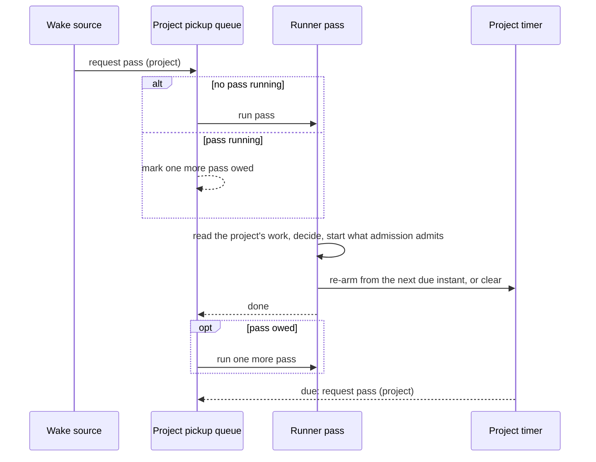
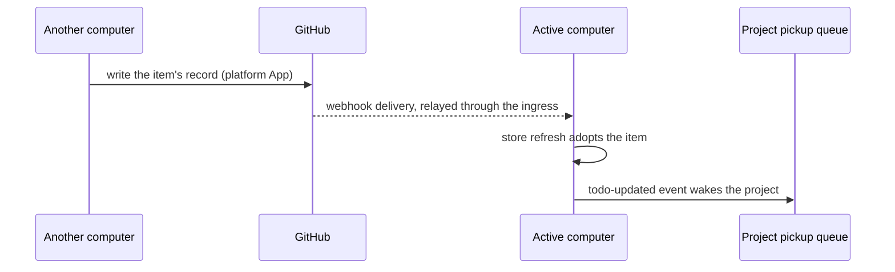
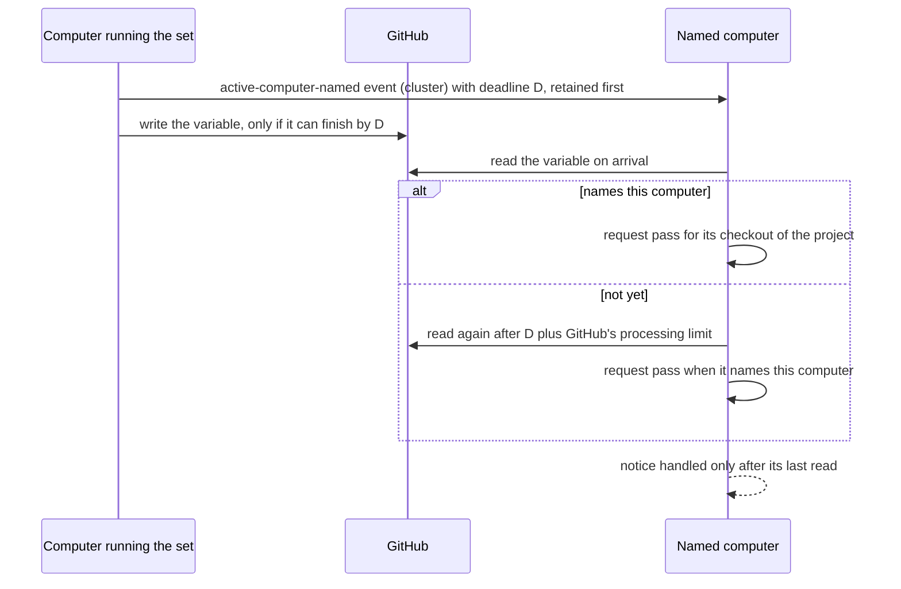

# Work Pickup — Design

## Purpose

The behavior this design delivers is
`local/projects/teleclaude/spec/feature/workflow/work-pickup`: when pickup
evaluates a project. This design states how the workflow context wakes the
lifecycle runner so that every change pickup decides on reaches it, and nothing
else does.

Pickup is level-triggered. A wake names a project and nothing more; the pass it
requests reads the project's whole current work and decides from that, as
`run_lifecycle_runner` does today. What woke it never changes what it decides.

## Inputs/Outputs

**Inputs — what requests a pass for a project:**

| Source                    | Where it comes from                                                                                                                                                  | Computer                       |
| ------------------------- | -------------------------------------------------------------------------------------------------------------------------------------------------------------------- | ------------------------------ |
| Local todo events         | todo created for pickup, updated, phase advanced, delivered; the router's existing triggers                                                                          | the computer that emitted them |
| Claim released or cleared | the active computer's clear of a claim, whether its own release or one another computer relays, emits the todo-updated event                                         | the active computer            |
| Removal and reactivation  | the workflow's removal and reactivation emit the todo-updated event                                                                                                  | the computer that made them    |
| Session ended             | the existing session-ended events for a session in the project's checkout                                                                                            | the session's computer         |
| Adopted changes           | a store refresh that adopts an item emits the todo-updated event for it (`local/projects/teleclaude/design/architecture/workflow-store`)                             | the computer that refreshed    |
| Active computer named     | the active-computer-named event, retained by the computer that names it before it writes the variable, and acted on by the named computer once the variable names it | the named computer             |
| Project timer             | the project's next due instant: a scheduled task's next occurrence, or a retry after a failed start, an unanswered claim judgment or a failed pass                   | the computer that armed it     |
| Daemon start              | one pass for every project the daemon serves, once its event platform runs                                                                                           | every computer                 |

**Outputs:** the existing pass outcomes — orchestrator starts through driver
admission (`local/projects/teleclaude/spec/feature/workflow/driver-admission`),
claim clearing, the pass log line — and the project's re-armed timer.

## Invariants

- **One pass per project at a time.** A wake for a project whose pass is
  running records that another pass is owed; when the running pass ends, one
  more pass runs. Any number of wakes during a pass yield one follow-up pass.
  Passes of different projects are independent.
- **A wake is accepted, not awaited.** The router and every other source
  request the pass and return; the event that woke pickup is handled once the
  request is recorded. A pass lost to a stop or crash before it ran is made up
  by the daemon-start pass.
- **Each project has at most one timer**, set to its next due instant. Every
  pass recomputes it from what the pass found: the earliest next occurrence of
  a scheduled task it held back as not yet due, and a retry within a minute
  when a start failed for a reason that can clear by itself, when a claim is
  held only because a computer did not answer its judgment, or when the pass
  itself failed. A pass that finds none of these clears the timer. The timer
  is derived state, kept in process memory and rebuilt by the daemon-start
  pass from the project's work record.
- **A refusal that names another computer is no failed start.** A start
  refused because another computer is the project's active computer, or
  because the project names no active computer, arms no retry: the change
  that would let it succeed — this computer being named active — wakes pickup
  itself.
- **The next occurrence of a recurring rule** is computed by the same rule
  owner that decides whether a schedule is due, so the timer fires inside the
  minute the rule matches.
- **No periodic wake.** Nothing requests passes on an interval, and the daemon
  enumerates the projects it serves only at its start.

## Primary flows

### A wake becomes a pass

### A change made on another computer

### Naming the active computer

The notice is the durable record of the naming's intent and is retained before
the variable changes. It carries an absolute deadline by which the naming's
write is over: the naming computer starts the write only when the write's own
bound ends by that deadline. When the notice is not retained in time for that,
it writes nothing and reports the naming as failed. GitHub terminates a request
it has processed past its documented processing limit, so after the deadline
plus that limit, and a margin for the difference between the two computers'
clocks, the variable can no longer change by this naming. The named computer's
reaction is a retained consumer of its own: it reads the variable on arrival,
and, if the variable does not yet name it, once more after that moment. It
counts the notice handled only after its last read, so a restart in between
redelivers the notice; its wait holds back only later naming notices. Once the notice is retained, nothing more is needed from
the naming computer.

## Failure modes

- **A wake arrives while the daemon drains.** It is not acted on; the next
  process's daemon-start pass evaluates the project.
- **A GitHub delivery is lost**, or arrives while the ingress is not
  receiving. The change waits for the project's next delivery or store refresh
  (`local/projects/teleclaude/design/architecture/workflow-store`); pickup does
  not look for it.
- **The named computer is not running** when it is named active. The event
  waits in the cluster stream for its consumer, and the computer's
  daemon-start pass evaluates the project anyway.
- **A claim whose computer does not answer.** The active computer's pickup
  judges it again within a minute, for as long as the computer stays silent;
  the claim stays held meanwhile
  (`local/projects/teleclaude/spec/feature/workflow/driver-admission`).
- **The naming notice cannot be retained:** the variable is not written and
  the naming is reported as failed.
- **The naming is interrupted after its notice:** the variable either changed
  by the deadline or did not; the named computer's last read after the
  deadline settles which, and it evaluates the project only when the variable
  names it.
- **The named computer restarts while it waits for its last read:** the
  notice is not yet handled, so it is delivered again and read again.
- **GitHub holds the project's requests back** after a rate limit. A
  delivery-triggered refresh waits for GitHub's stated time, because GitHub
  forbids requests before it; the delivered change is adopted when it passes
  (`local/projects/teleclaude/design/architecture/workflow-store`).
- **A pass fails.** Its failure is logged and the project's timer retries
  within a minute; the wake that requested it was already handled.
- **A start keeps failing** for a reason that can clear by itself, such as
  GitHub not answering: pickup retries it within a minute for as long as the
  todo stays startable, each retry a pass of its project.

## See Also

- docs/local/adr/0153-pickup-is-woken-by-changes-and-its-own-timers-with-no-periodic-resync.md
