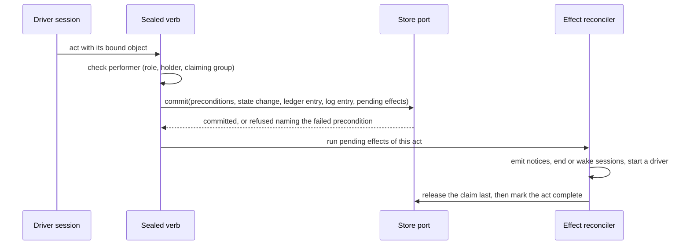
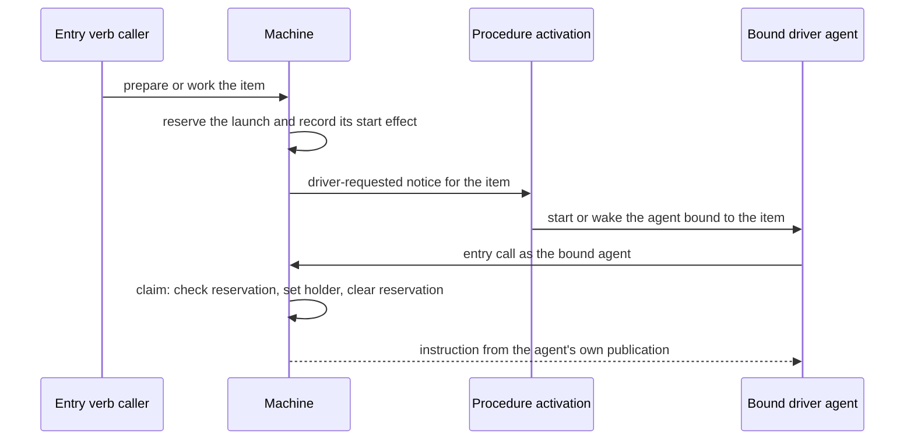

# Workflow Machine — Design

## Purpose

Drive preparation and work of an item with two sessions per phase - a driver that holds the claim and decides readiness, and a child that owns the artifact - without the machine knowing which backend holds the item. The behavior is `local/projects/teleclaude/spec/feature/workflow/item-lifecycle` and `local/projects/teleclaude/spec/feature/workflow/work-review-cycle`; the commands that perform its acts are `local/projects/teleclaude/spec/feature/workflow/item-acts`; the store it reads and writes through is `local/projects/teleclaude/design/architecture/workflow-store`. Procedure activation (`local/projects/teleclaude/design/architecture/procedure-activation`) is the only way an event reaches a driver.

## Inputs/Outputs

**Inputs:** item state read through the store port; the published procedure declarations; the calling session's record (role, binding, claiming group); events about items.

**Outputs:** the instruction the entry verbs return; acts committed with their ledger entry and pending effects; events for phase changes, claim changes, waiting, readiness, driver requests and head advances; log notes rendered as prose.

## Invariants

- **One port.** The machine reaches item state only through the store port. A production-source search for direct store access finds it only inside the local adapter.
- **One vocabulary.** Phases, acts and performers have one owner, the item-lifecycle spec. A reader of stored phases maps every legacy value to a phase a kept driver drives, so no item is left in a phase nothing drives.
- **Instructions are a function of state and publication.** The same item state and the same governing publication yield the same instruction. The governing publication of a holding driver is the one its session started under; for any other call it is the current one. An event's source and the backend's name never enter the decision.
- **A publication is bound where a driver starts.** The activation that starts a driver persists, with the session's invocation, the declarations it needs from the single index read that built the session's brief. A child is launched from that persisted set, so a republish between the driver's start and its dispatch cannot mix two publications. The child's procedure text governs its conduct, not the machine.
- **Acts are recorded, not inferred.** Each act is a ledger entry written by a sealed verb with the role, session and act the platform authenticated. The machine reads only the ledger. The log is its prose rendering, appended in the same transaction.
- **One atomic primitive commits every act.** The store applies, in one write transaction, preconditions on artifact revisions, the state mutation, the ledger entry, the log entry and the list of pending effects. A precondition that fails raises before any write and names both revisions.
- **Effects are durable intent.** A phase change that must also emit an event, end a session, wake a session, release the claim or start a driver records those effects in the same transaction. Each effect has an id derived from its act key and its name. They run after the commit and are completed by one reconciler at start, at every machine call and on the periodic tick. Release is the last effect, so the act's other writes are durable before the claim is released. An act is complete when its last effect finished; a repeated invocation of a complete act writes nothing, and of an incomplete act resumes its effects.
- **Act keys have an explicit scope.** A key is built from the project, the item's immutable store id, the act, the object the act binds (a revision, a commit, a question, a finding) and the claim epoch. A second wait, a later prepared revision and a re-stamp after a new work cycle are distinct acts; the same invocation repeated within one claim is one act.
- **A claim change is committed where it is stored.** Every write that changes an item's holder, by whatever path, commits a claim-change effect with the state it writes and advances the claim epoch, so a release by the holder and a release on session end each record exactly one change. The effect is published by the reconciler under an identity derived from the item and the effect, and finished effects are cleared by the item's durable row id.
- **Pending effects are recovered whatever the item's status.** The reconciler lists every item row that holds unfinished effects - active, iceboxed or delivered - and addresses each by its row id, so a slug reused later cannot redirect recovery to another row. One project that cannot be read does not stop the others.
- **The workflow record has one owner.** Generic state writes carry the stored workflow record forward unchanged; only the machine's own commit replaces it.
- **A driver is started once.** An entry call that finds the item drivable records a launch reservation and its start effect in one conditional write; a racing call attaches to the operation that is starting the driver. The start is a driver-requested notice answered by procedure activation, which resolves one agent bound to the item. That agent claims for itself on its first entry call, in one transaction that checks the reservation key, sets the holder and clears the reservation. The entry verb is a receipt-backed operation: it completes with the started driver's session or with a refusal cause, and a caller that stops waiting leaves it running; repeating the verb finds the same operation by its key and never starts a second driver. A reservation is cleared only on terminal evidence - the activation operation ended failed or stale, or the bound session ended without claiming - never on elapsed time. A terminal operation is not resumed, and a claim whose key is not the current reservation is refused and told to end its session, so an old launch cannot claim after a replacement.
- **A head notice names a published commit.** The sealed commit pushes the explicit commit it just created, never a symbolic head, as one compare-and-swap update of the integration ref from the tip it read; a successful swap is the observation of that exact update. It registers the intent with the platform before pushing and completes it with the push's own result, so the platform accepts a completion only for a registered intent whose swap succeeded, and a later push that moves the ref does not void it. An intent left without completion by a crash is unproved and raises nothing: a later read of the ref, even one that finds the commit among its ancestors, is evidence only for the head it observes. Reading the current head on each tick of the schedule clock covers pushes made another way and a head that an unrecorded publish left as the tip, and is a separate observation.
- **Findings are a ledger read, marked by delivery.** The stop and turn-start seams read unanswered findings from the ledger. The stop seam selects findings it has not yet offered this session, writes its response, and only after the response is written records them as offered; a response that failed leaves them unmarked, and a crash between write and mark offers them once more. The turn-start seam offers every unanswered finding regardless of the mark.
- **Gates run once per stamp invocation.** The stamp records an in-flight marker for its act key in one conditional write before the gates run, so a repeated invocation attaches to the running one; the marker is cleared when the invoking operation is terminal. The references are checked again after the gates and before the commit.
- **Admission delivers the admitted commit.** The integrator merges the commit it admitted, not the branch name.

## Primary flows

### An act

### Starting a driver

### The review loop

The builder commits through the sealed commit, which publishes and reports the pushed commit. The platform confirms the commit on the integration ref and raises the head notice, which activation delivers to the agent bound to the item. The driver records the commit as reviewed, places findings as ledger entries bound to commits, and the findings reach the builder at its stop and next turn start. At readiness the driver performs the stamp: the store commits the stamp, the phase and the ready effects together, and the integrator's candidate scan reads ready items through the port.

## Failure modes

- **A crash between an act's commit and its effects** leaves the act incomplete with its effects recorded; the reconciler completes them. No event is lost to a crash and none is repeated, because each effect's id is stable.
- **A crash after the driver agent starts and before it claims** leaves the reservation; the agent claims on its first call. A driver that never starts has its reservation cleared and relaunched.
- **A body edit racing a claim or a prepared act** is decided by the writer lock: the edit precedes the act, which is refused, or follows it, which stands at the revision it named.
- **A report lost between the sealed commit and the platform** leaves that commit without its own notice; the periodic reading raises the notice for the current head, and the driver's delta review covers the commits between.
- **A push between the stamp's checks and admission** either fails the stamp's reference checks or leaves a stamp that candidate selection does not admit.
- **A republish while a driver dispatches its child** launches the child from the driver's persisted set; the new set reaches drivers that start after it.
- **A driver that ends without the platform learning of it** keeps its claim until it is released by hand.
- **A producer, consumer or reconciler failure** is logged with the item and commit and does not stop the daemon.
