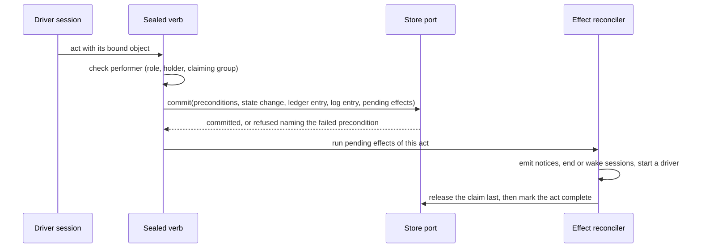
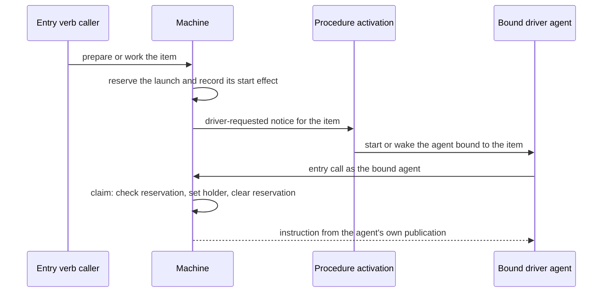

# Workflow Machine — Design

## Purpose

Drive preparation and work of an item with two sessions per phase - a driver that holds the claim and decides readiness, and a child that owns the artifact - without the machine knowing which backend holds the item. The behavior is `local/projects/teleclaude/spec/feature/workflow/item-lifecycle` and `local/projects/teleclaude/spec/feature/workflow/work-review-cycle`; the commands that perform its acts are `local/projects/teleclaude/spec/feature/workflow/item-acts`; the store it reads and writes through is `local/projects/teleclaude/design/architecture/workflow-store`. Procedure activation (`local/projects/teleclaude/design/architecture/procedure-activation`) is the only way an event reaches a driver.

## Inputs/Outputs

**Inputs:** item state read through the store port; the published procedure declarations; the calling session's record (role, binding, claiming group); events about items.

**Outputs:** the instruction the entry verbs return; acts committed with their ledger entry and pending effects; events for phase changes, claim changes, waiting, readiness, driver requests and head advances; log notes rendered as prose.

## Invariants

- **One port.** The machine reaches item state only through the store port. A production-source search for direct store access finds it only inside the local adapter.
- **One vocabulary.** Phases, acts and performers have one owner, the item-lifecycle spec. A reader of stored phases maps every legacy value to a phase a kept driver drives, so no item is left in a phase nothing drives.
- **Instructions are a function of state and publication.** The same item state and the same governing publication yield the same instruction. The governing publication of a driver that holds the item, or that was initialized for the item and is making its first claim, is the one its session started under; for any other call it is the current one. An event's source and the backend's name never enter the decision.
- **A publication is bound where a driver starts.** The activation that starts a driver persists, with the session's invocation, the declarations it needs from the single index read that built the session's brief. A child is launched from that persisted set, so a republish between the driver's start and its dispatch cannot mix two publications. The child's procedure text governs its conduct, not the machine.
- **Acts are recorded, not inferred.** Each act is a ledger entry written by a sealed verb with the role, session and act the platform authenticated. The machine reads only the ledger. The log is its prose rendering, appended in the same transaction.
- **One atomic primitive commits every act.** The store applies, in one write transaction, preconditions on artifact revisions, the state mutation, the ledger entry, the log entry and the list of pending effects. A precondition that fails raises before any write and names both revisions.
- **Effects are durable intent.** A phase change that must also emit an event, end a session, wake a session, release the claim or start a driver records those effects in the same transaction. Each effect has an id derived from its act key and its name. They run after the commit and are completed by one reconciler at start, at every machine call and on the periodic tick. Release is the last effect, so the act's other writes are durable before the claim is released. An act is complete when its last effect finished; a repeated invocation of a complete act writes nothing, and of an incomplete act resumes its effects.
- **Act keys have an explicit scope.** A key is built from the project, the item's immutable store id, the act, the session that performed it, the epoch of the claim that session itself made, and the content of the request - the revision, commit, question, finding or wait it binds, and its text. A decision binds the wait it answers, so a repeat can never rebind to a later wait. A second wait, a later prepared revision and a re-stamp at a new head are distinct acts; the same invocation repeated is one act for as long as it can be repeated, and another session's claim does not change it. A session that claims again performs new invocations.
- **A claim change is committed where it is stored.** Every write that changes an item's holder, by whatever path, commits a claim-change effect with the state it writes and advances the claim epoch, so a release by the holder and a release on session end each record exactly one change. The effect is published by the reconciler under an identity derived from the item and the effect, and finished effects are cleared by the item's durable row id.
- **Pending effects are recovered whatever the item's status.** The reconciler lists every item row that holds unfinished effects - active, iceboxed or delivered - and addresses each by its row id, so a slug reused later cannot redirect recovery to another row. One project that cannot be read does not stop the others.
- **The workflow record has one owner.** Generic state writes carry the stored workflow record forward unchanged; only the machine's own commit replaces it.
- **A driver is started once.** An entry call that finds the item drivable records a launch reservation and its start effect in one conditional write; a racing call attaches to the operation that is starting the driver. The start is a driver-requested notice answered by procedure activation, which resolves one agent bound to the item. That agent claims for itself on its first entry call, in one transaction that checks the reservation key, sets the holder and clears the reservation. The entry verb is a receipt-backed operation: it completes with the started driver's session or with a refusal cause, and a caller that stops waiting leaves it running; repeating the verb finds the same operation by its key and never starts a second driver. A reservation is cleared only on the platform's own durable evidence for exactly that request, never on elapsed time: the activation consumer has handled the request event, every activation it accepted for that event is terminal, and no open session is bound to the item for the procedure and home of any of them. The accepted activations are recorded on the reservation the first time they can be observed, while the platform still holds their receipts and within a window shorter than their retention; empty is recorded only by that observation. A request whose activations were not captured in the window stays unknown and held. A claim presents the reservation it was started for, taken from the request event that activated it; a claim with none, or another, is refused and told to end its session, so an old launch cannot claim after it was released or replaced.
- **A head notice names a published commit.** The sealed commit pushes the explicit commit it just created, never a symbolic head, as one compare-and-swap update of the integration ref from the tip it read; a successful swap is the observation of that exact update. It registers the intent with the platform before pushing and completes it with the push's own result, so the platform accepts a completion only for a registered intent whose swap succeeded, and a later push that moves the ref does not void it. An intent left without completion by a crash is unproved and raises nothing: a later read of the ref, even one that finds the commit among its ancestors, is evidence only for the head it observes. Reading the current head covers pushes made another way and a head that an unrecorded publish left as the tip, and is a separate observation. It happens at daemon start, on each tick of the schedule clock and at each machine call once the call is admitted, so a refused call writes nothing. The publication leases its update on the tip this clone last observed, and is made only when the commit contains that tip or the branch's history once carried it. The reading is bounded in time and in concurrency, contained per item and per project, and tells a remote it could not read from a branch that is absent.
- **Findings are a ledger read, marked by delivery.** The stop and turn-start seams read unanswered findings from the ledger. The stop seam selects findings it has not yet offered this session, composes them into the one response the stop already emits, writes it, and only after the response is written records the findings it included as offered; a response that failed leaves them unmarked, and a crash between write and mark offers them once more. The turn-start seam offers every unanswered finding regardless of the mark. Findings reach only the builder inside the holder's claiming group, as encoded item data after a separate platform instruction, so text in a finding cannot pass for platform text; the seams fail open.
- **At most one stamp runs per item, and it owns what it runs.** A stamp is a receipt-backed operation. It takes one item-wide slot, recorded durably with the invocation that holds it, after rechecking the phase and the holder where it is taken; a stamp that asks for something else while the slot is held is refused and displaces nothing, and a result is recorded only by the invocation that still holds the slot. The gates run in a detached runner owned through the spawn registry, which is the only holder of its process identity; the flight refers to it by the owning computer's name and the owner key, and a computer other than the owner treats such a flight as unknown. The runner does not start the workload until its identity is durable, settles its own group before it reports, and a daemon-side classifier of the registry row decides, from the row's runner and group and never from a clock or a numeric group id, whether the unit is live, dead or unknown. Unknown holds the slot and authorizes no signal; recovery is the governing agent's through its existing capabilities, with no clearing act. The references are checked again after the gates and before the commit.
- **Admission delivers the admitted commit.** The integrator merges the commit it admitted, not the branch name.

## Primary flows

### An act

### Starting a driver

### The review loop

The builder commits through the sealed commit, which publishes and reports the pushed commit. The platform confirms the commit on the integration ref and raises the head notice, which activation delivers to the agent bound to the item. The driver records the commit as reviewed, places findings as ledger entries bound to commits, and the findings reach the builder at its stop and next turn start. At readiness the driver performs the stamp: the store commits the stamp, the phase and the ready effects together, and the integrator's candidate scan reads ready items through the port.

## Failure modes

- **A crash between an act's commit and its effects** leaves the act incomplete with its effects recorded; the reconciler completes them. No event is lost to a crash and none is repeated, because each effect's id is stable.
- **A crash after the driver agent starts and before it claims** leaves the reservation; the agent claims on its first call. A driver that never starts has its reservation cleared and relaunched.
- **A body edit racing a claim or a prepared act** is decided by the writer lock: the edit precedes the act, which is refused, or follows it, which stands at the revision it named.
- **A report lost between the sealed commit and the platform** leaves that commit without its own notice; the periodic reading raises the notice for the current head, and the driver's delta review covers the commits between.
- **A push between the stamp's checks and admission** either fails the stamp's reference checks or leaves a stamp that candidate selection does not admit.
- **A republish while a driver dispatches its child** launches the child from the driver's persisted set; the new set reaches drivers that start after it.
- **A driver that ends without the platform learning of it** keeps its claim until it is released by hand.
- **Each claim is made by a fresh driver session that resumes from the store alone.** Nothing the machine decides rests on a session's memory of an earlier claim, and a session that claims again performs new invocations.
- **A request whose activations were not captured in the observation window** stays unknown and held; it is not released by elapsed time.
- **An integration head that cannot be read** yields no notice for the item until a later read succeeds, and leaves a stamp as it is; the failure is logged with the item and project.
- **A stamp that went stale** reads as work again; the next entry verb for work claims the item, clears the stale stamp and the driver stamps the new head.
- **A publish whose commit does not contain the tracked tip nor descend from the branch's history** publishes nothing and tells the builder to fetch and integrate.
- **A producer, consumer or reconciler failure** is logged with the item and commit and does not stop the daemon.
- **A stamp whose runner or daemon ended with workload processes left** holds the item's stamp as unknown until those processes end or the governing agent has ended the ones it can attribute; a descendant that starts its own session is outside the unit.
