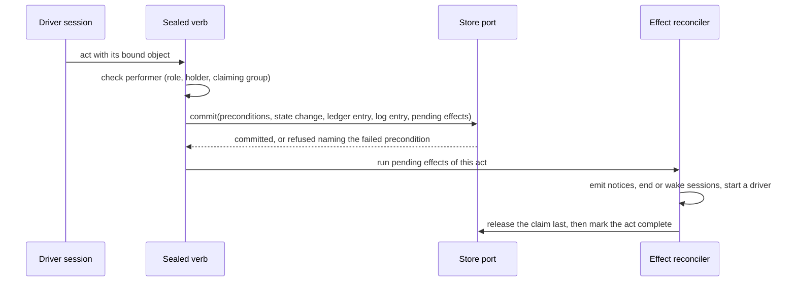
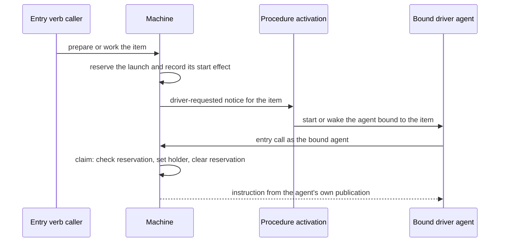

# Workflow Machine — Design

## Purpose

Drive preparation and work of an item with two sessions per phase - a driver that holds the claim and decides readiness, and a child that owns the artifact - without the machine knowing which backend holds the item. The behavior is `local/projects/teleclaude/spec/feature/workflow/item-lifecycle` and `local/projects/teleclaude/spec/feature/workflow/work-review-cycle`; the commands that perform its acts are `local/projects/teleclaude/spec/feature/workflow/item-acts`; the store it reads and writes through is `local/projects/teleclaude/design/architecture/workflow-store`. Procedure activation (`local/projects/teleclaude/design/architecture/procedure-activation`) is the only way an event reaches a driver.

## Inputs/Outputs

**Inputs:** item state read through the store port; the published procedure declarations; the calling session's record (role, binding, claiming group); events about items.

**Outputs:** the instruction the entry verbs return; acts committed with their ledger entry and pending effects; events for phase changes, claim changes, waiting, readiness, driver requests and head advances; log notes rendered as prose.

## Invariants

- **One port.** The machine reaches item state only through the store port. A production-source search for direct store access finds it only inside the local adapter.
- **One vocabulary.** Phases, acts and performers have one owner, the item-lifecycle spec. A reader of stored phases maps every legacy value to a phase a kept driver drives, so no item is left in a phase nothing drives. A todo of kind task has no phase in it: every reader reads the task lane by kind, never by the stored phase alone, because the stored value `prepared` is shared.
- **Instructions are a function of state and publication.** The same item state and the same governing publication yield the same instruction. The governing publication of a driver that holds the item, or that was initialized for the item and is making its first claim, is the one its session started under; for any other call it is the current one. An event's source and the backend's name never enter the decision.
- **A publication is bound where a driver starts.** The activation that starts a driver persists, with the session's invocation, the declarations it needs from the single index read that built the session's brief. A child is launched from that persisted set, so a republish between the driver's start and its dispatch cannot mix two publications. The child's procedure text governs its conduct, not the machine.
  - **A child launch also yields a pre-create result.** Once a child launch is admitted (the caller holds the item, the claim is not closing, the phase is driven and the child is the one the persisted set declares), the machine holds the item's identity as the selected store answers it, as for a driver start. It also holds the qualified holding parent: this computer and the admitted holder session. The rules of the driver start's pre-create result apply to it unchanged.
- **Acts are recorded, not inferred.** Each act is a ledger entry written by a sealed verb with the role, session and act the platform authenticated. The machine reads only the ledger. The log is its prose rendering, appended in the same transaction.
- **One atomic primitive commits every act.** The store applies, in one write transaction, preconditions on artifact revisions, the state mutation, the ledger entry, the log entry and the list of pending effects. A precondition that fails raises before any write and names both revisions.
- **Effects are durable intent.** A phase change that must also emit an event, end a session, wake a session, release the claim or start a driver records those effects in the same transaction. Each effect has an id derived from its act key and its name. They run after the commit and are completed by one reconciler at start, at every machine call and on the periodic tick. Release is the last effect, so the act's other writes are durable before the claim is released. An act is complete when its last effect finished; a repeated invocation of a complete act writes nothing, and of an incomplete act resumes its effects.
- **Act keys have an explicit scope.** A key is built from the project, the item's immutable store id, the act, the session that performed it, the epoch of the claim that session itself made, and the content of the request - the revision, commit, question, finding or wait it binds, and its text. A decision binds the wait it answers, so a repeat can never rebind to a later wait. A second wait, a later prepared revision and a re-stamp at a new head are distinct acts; the same invocation repeated is one act for as long as it can be repeated, and another session's claim does not change it. A session that claims again performs new invocations.
- **A claim change is committed where it is stored.** Every write that changes an item's holder, by whatever path, commits a claim-change effect with the state it writes and advances the claim epoch, so a release by the holder and a release on session end each record exactly one change. The effect is published by the reconciler under an identity derived from the item and the effect, and finished effects are cleared by the item's durable row id.
- **Pending effects are recovered whatever the item's status.** The reconciler lists every item row that holds unfinished effects - active, iceboxed or delivered - and addresses each by its row id, so a slug reused later cannot redirect recovery to another row. One project that cannot be read does not stop the others.
- **The workflow record has one owner.** Generic state writes carry the stored workflow record forward unchanged; only the machine's own commit replaces it.
- **A driver is started once.** An entry call that finds the item drivable records a launch reservation and its start effect in one conditional write; a racing call attaches to the operation that is starting the driver. The start is a driver-requested notice answered by procedure activation, which resolves one agent bound to the item. That agent claims for itself on its first entry call, in one transaction that checks the reservation key, sets the holder and clears the reservation. The entry verb is a receipt-backed operation: it completes with the started driver's session or with a refusal cause, and a caller that stops waiting leaves it running; repeating the verb finds the same operation by its key and never starts a second driver. A reservation is cleared only on the platform's own durable evidence for exactly that request, never on elapsed time: the activation consumer has handled the request event, every activation it accepted for that event is terminal, and no open session is bound to the item for the procedure and home of any of them. The accepted activations are recorded on the reservation the first time they can be observed, while the platform still holds their receipts and within a window shorter than their retention; empty is recorded only by that observation. A request whose activations were not captured in the window stays unknown and held. A claim presents the reservation it was started for, taken from the request event that activated it; a claim with none, or another, is refused and told to end its session, so an old launch cannot claim after it was released or replaced.

  - **Admission yields a pre-create result.** Once procedure activation admits a driver start, by its final judgment including the recheck of a start from `prepared`, it holds the item's identity as the selected store answers it. That identity is the canonical item identity together with its store address, read from the item the store addresses and never constructed from the requested key.
  - **It is consumed once.** The result is handed to the session creation that follows, which consumes it once. The machine keeps no record of it: it adds no registry, nothing is retried from it, and no response returns it. The session creation that consumes it persists what it derives under its own contract. The acknowledgment after creation is unchanged.
  - **Refusal and absence.** An item the store does not address takes the existing absent outcome. A failed identity read, or an item that leaves the addressable band between reads, refuses the start and yields nothing. Eligibility is not widened.
  - **No admission elsewhere.** A woken, revived, not-delivered or notice activation, and an ordinary start outside the workflow, carry no admission and are unchanged. On the local backend the result produces no external binding.
  - **Consumption is the creation contract's.** How session creation consumes the result is owned by the creation contract and is not restated here.

- **A start from `prepared` is judged again where its driver is created or woken.** The request of a reservation made from `prepared` stands only while the current intent body is at the prepared revision (#124 INV-S3). Procedure activation judges this immediately before it creates or wakes the driver (`local/projects/teleclaude/design/architecture/procedure-activation`). A request that does not stand is not delivered, and launch recovery alone releases its reservation. The check in the driver's claim stays as it is.
- **A head notice names a published commit.** The sealed commit pushes the explicit commit it just created, never a symbolic head, as one compare-and-swap update of the integration ref from the tip it read; a successful swap is the observation of that exact update. It registers the intent with the platform before pushing and completes it with the push's own result, so the platform accepts a completion only for a registered intent whose swap succeeded, and a later push that moves the ref does not void it. An intent left without completion by a crash is unproved and raises nothing: a later read of the ref, even one that finds the commit among its ancestors, is evidence only for the head it observes. Reading the current head covers pushes made another way and a head that an unrecorded publish left as the tip, and is a separate observation. It happens at daemon start, on each tick of the schedule clock and at each machine call once the call is admitted, so a refused call writes nothing. The publication leases its update on the tip this clone last observed, and is made only when the commit contains that tip or the branch's history once carried it. The reading is bounded in time and in concurrency, contained per item and per project, and tells a remote it could not read from a branch that is absent.
- **Findings are a ledger read, marked by delivery.** The stop and turn-start seams read unanswered findings from the ledger. The stop seam selects findings it has not yet offered this session, composes them into the one response the stop already emits, writes it, and only after the response is written records the findings it included as offered; a response that failed leaves them unmarked, and a crash between write and mark offers them once more. The turn-start seam offers every unanswered finding regardless of the mark. Findings reach only the builder inside the holder's claiming group, as encoded item data after a separate platform instruction, so text in a finding cannot pass for platform text; the seams fail open.
- **At most one stamp runs per item, and it owns what it runs.** A stamp is a receipt-backed operation. It takes one item-wide slot, recorded durably with the invocation that holds it, after rechecking the phase and the holder where it is taken; a stamp that asks for something else while the slot is held is refused and displaces nothing, and a result is recorded only by the invocation that still holds the slot. The gates run in a detached runner owned through the spawn registry, which is the only holder of its process identity; the flight refers to it by the owning computer's name and the owner key, and a computer other than the owner treats such a flight as unknown. The runner does not start the workload until its identity is durable, settles its own group before it reports, and a daemon-side classifier of the registry row decides, from the row's runner and group and never from a clock or a numeric group id, whether the unit is live, dead or unknown. Unknown holds the slot and authorizes no signal; recovery is the governing agent's through its existing capabilities, with no clearing act. The references are checked again after the gates and before the commit.
- **Admission delivers the admitted commit.** The integrator merges the commit it admitted, not the branch name. An active admission makes the item read as ready at that commit until the integrator retires it. Reservation and claim re-read this phase in their own row transaction and refuse it as not driven; the lifecycle runner requests no driver for it, so delivery and cleanup cannot run under a re-reserved driver. Task and delivered precedence is unchanged.
- **A phase is read once, with the lane's answer and the head resolved together.** Every consumer that needs an item's phase (entry, acts, the stamp slot, the runner, the candidate scan, admission, the refusals of retired acts, dependencies, the projection) gets it from one resolver that reads the creative lane's completeness and the integration head and hands the reading function a typed value only the resolver builds. A call site cannot supply a constant for either, so a reader added later cannot read an item as ordinary preparation while the creative lane drives it. A decision inside a transaction reads the same inputs the act resolved, and the creative section of the stored state is fenced against the snapshot the lane was resolved from; the workspace files the lane also reads are observed before the transaction and are the stated limit of that fence.
- **A ready item is held, never moved, by a start.** The work verb with a reason on a `ready` item the integrator has not admitted records a launch reservation and a reason note in one write and leaves the phase, the stamp and its ready time as they are. Reservation, claim and admission are each a conditional write on the item row under its writer lock, so exactly one of an admission and a start takes effect; admission refuses a holder or a start in progress, reservation and claim refuse an admission. Admission of a new attempt also refuses a record with a creative episode open; an attempt already admitted keeps its admission and continues, and its deferred episode completes only after the integrator retires that admission. Candidate selection excludes the same conditions, so a scan or a queue observation never decides the race.
- **Reasons are attributed, structural and offered by key.** A reason note is a ledger note carrying a closed kind, written by the verb for the calling session; the machine never reads note text to find one. A repeat by the same session of the same reason within the current stamp's cycle (for a carried handoff or verdict, since its recorded time) is a retry of one invocation: it returns or attaches to the earlier outcome and writes no note and starts no driver. A different session, reason or cycle is new input. Rendering the instruction of a held `ready` item records, in one write, an offer that names the highest reason note it read and issues an opaque key that the instruction prints. `release` presents the key and is refused when a reason was noted after the offer it names; with no key there is no release, so a failure between the render and the driver's receipt refuses the release rather than permitting it. The release at the end of the driver's session needs no key.
- **A return is one commit.** `kickback` from a held `ready` item writes the phase `preparation`, the cleared stamp (and with it the standing of a carried finalize handoff or review verdict, which are read only through the stored phase), the cleared prepared revision, the reason note and the recorded closing of the claim together; its sweep of helpers and the release of the claim are effects, the release last. `release` writes no phase.
- **Every writer of an item's state writes only what it owns, against the state read in its own transaction.** The hold update, the release on session end, the runner's active-runner writes, the provenance sync and every other writer that does not perform an act read the state and write their change in one conditional row write, replacing only the fields they own and carrying the holder, the launch reservation, the hold, the admission and the workflow record as the transaction read them. A write built from an earlier snapshot never replaces a field it did not change, so a hold change cannot erase a claim or reservation that landed after its read. An agent session's intent-body write checks the holder and phase at the same boundary; the input-removal surface and direct human-identity write permissions belong to `local/projects/teleclaude/spec/feature/workflow/artifact-versioning`.
- **An admission has an attempt identity, and its retirement is an intent.** Every admission has an attempt identity, unique to that admission, recorded in the row and published with the checkpoint's candidate. A park and the reset of an abandoned checkpoint each persist a retirement intent naming that attempt identity in the same durable checkpoint write that parks or resets, and the intent is completed by retiring the row admission that carries that identity, and only that one, and then cleared; the candidate key is preserved. An idle or absent checkpoint entry is not proof that an attempt ended, because the admission is recorded before the checkpoint publishes it. A retirement that fails stays pending as its intent and is retried idempotently, and one that completes late never clears a later attempt at the same commit. The scan and the admission write do not prioritize or accept early a row admission whose attempt a pending retirement intent names. No cleanup acts on absence. A pending retirement intent survives the checkpoint's reset to idle and the clearing of its parked list; only the completion of that exact intent clears it.
- **A stamp records its source.** The source is a closed type: performed by the stamp act, or carried from a finalize handoff or a review verdict. Only the normalization of a legacy record and a restore write a carried source, with an empty performing session; the stamp act always writes performed; clearing a stamp clears its source. The reading of a stale stamp follows the source and the holder: a carried stamp that is stale and unheld reads `preparation`, a stamp of either source that is stale under a Work driver's hold of the ready item (D14) reads `work`, and a performed stamp that is stale and unheld reads `work`. A preparation driver never holds a stale carried stamp: its claim stores `preparation` and clears the stamp and its source in the claim write. The missing prepared revision never decides the source.
- **A hold clears only where a start succeeds.** The reservation of a driver for preparation, prepared or work clears `hold` in the same write when the start is an explicit call, and is refused when it is the lifecycle runner's; the origin and the hold are read in that write, not from an earlier snapshot. For `ready` the hold is never cleared. A refused call writes no hold change.
- **A releasing act closes the claim, then sweeps its helpers.** `prepared`, `waiting`, `stamp`, `kickback` and `release` mark the claim closing in their own commit. A helper start is a conditional write that records the start before the session is created and is refused for a holder who is not the item's holder or for a closing claim. The claiming group is the holder and every session started from it, transitively and on any computer. The act's effects end every live session started from the holder, and no session outside that set and never the holder, which finishes its own act and ends normally afterwards; they wait for each recorded start to finish and end, and repeat the listing until none is live or in flight; the release of the claim is the last effect, reached only after a sweep that found nothing, and an effect that cannot finish stays pending. An entry call, and the start that an owner's decision would make, is refused while a live session of an earlier claiming group exists on the item, naming it and the overseer, whether the earlier claim is recorded by this machine or was recorded before it; a decision records the answer and clears the wait, and the next entry call starts the driver; the platform ends no session when a holder's session ends, so that case is the overseer's.
- **Worktree preparation is single-flight per item.** The claim, the effect reconciler and the periodic tick take one lock per project and item around ensure-and-prepare, so no two run at once; a second trigger waits for the first. All triggers run in the daemon.
- **Store activation is a daemon step on the tick.** The daemon's per-project minute pass activates a store whose mark is absent before it reconciles effects, in one transaction that converts the legacy creative records, opens a creative episode for each, installs the integrity fence on converted rows and records the mark. A store registered, created or restored later is covered by the next pass; one store's failure leaves it unmarked and refused with the cause and affects no other store. The same step normalizes forward every legacy record that is complete, that has no creative episode, at activation, at a restore and, for a `review_approved` verdict whose integration head could not be read then, at the first later pass that can read it (until then no driver is started for such a record held by nobody, and entry refuses it naming the unreadable integration head, and a preparation claim of such a record after the head is known stores `preparation` in the claim write), into a closed phase of the machine (a record that has had an episode persists `preparation` when its deferred conversion completes and is never normalized to `ready`) with the reading unchanged, so no read, refused call or worktree opener ever writes and a complete record needs no memory of a later regression. A legacy record the integrator's checkpoint names in an active state is given its row admission from that exact identity, re-read inside the activation's own transaction, and a deferred episode when its creative state was incomplete; the first pass that finds it without an admission converts it (a queued or parked record is converted at once, its checkpoint entry and key preserved), and a park or the reset of an abandoned checkpoint retires exactly the row admission carrying the abandoned attempt's identity, through a persisted retirement intent that is completed idempotently (the admission-attempt invariant), so the record never escapes the conversion by the checkpoint later clearing. The machine's reads, acts and scans refuse an unmarked store, naming `telec todo integrate` when the cause is an unreadable checkpoint, with the integrator's entry (its reading of delivered items and its reset of an idle checkpoint) outside that refusal, and worktree or CLI openers never activate.
- **A creative episode is opened with the creative write and closed by the first claim.** The design-spec write, the creative gate stamps and the creative dispatch open the item's episode in the same row transaction as their artifact, stamp or durable dispatch intent, or refuse and write neither; the holder's handoff is a releasing act, so its dispatch is an effect completed idempotently after the closing sweep, never beside the old helpers, with the release last; the claim of a driver clears the episode in the write that makes the claim, which already requires the creative state to be complete. The episode is a field of the workflow record, separate from the immutable record of converted rows. Preparation written by `prepared`, `decision` or `kickback` opens none, and a record stored in a closed phase of the machine is never read as `design`.
- **A notice reaches only the holder; a request starts a driver only for the current reservation.** The request events carry the reservation key; every other event about the item is a notice. A request whose key is not the item's current launch starts nothing. A notice goes to the open session bound to the item that holds its claim, otherwise it ends with a terminal not-delivered outcome that starts and revives nothing. A closing single-claim session terminalizes its undelivered notices and keeps their assignee.

## Primary flows

### An act

### Starting a driver

### The review loop

The builder commits through the sealed commit, which publishes and reports the pushed commit. The platform confirms the commit on the integration ref and raises the head notice, which activation delivers to the agent bound to the item. The driver records the commit as reviewed, places findings as ledger entries bound to commits, and the findings reach the builder at its stop and next turn start. At readiness the driver performs the stamp: the store commits the stamp, the phase and the ready effects together, and the integrator's candidate scan reads ready items through the port.

## Failure modes

- **A crash between an act's commit and its effects** leaves the act incomplete with its effects recorded; the reconciler completes them. No event is lost to a crash and none is repeated, because each effect's id is stable.
- **A crash after the driver agent starts and before it claims** leaves the reservation; the agent claims on its first call. A driver that never starts has its reservation cleared and relaunched.
- **A body edit after a start from `prepared` was reserved**, while its request is still queued for delivery or activation, makes the request not stand when activation judges it. No work driver is created or woken, launch recovery releases the reservation, and the next work start is refused naming both revisions. An edit made after the driver was created is caught by the same check in the driver's claim.
- **An item whose identity read fails, or that leaves the addressable band between admission's reads,** refuses the driver start or the child launch. No session is created and no result is carried.
- **A body edit racing a claim or a prepared act** is decided by the writer lock: the edit precedes the act, which is refused, or follows it, which stands at the revision it named.
- **A report lost between the sealed commit and the platform** leaves that commit without its own notice; the periodic reading raises the notice for the current head, and the driver's delta review covers the commits between.
- **A push between the stamp's checks and admission** either fails the stamp's reference checks or leaves a stamp that candidate selection does not admit.
- **A republish while a driver dispatches its child** launches the child from the driver's persisted set; the new set reaches drivers that start after it.
- **A driver that ends without the platform learning of it** keeps its claim until it is released by hand.
- **Each claim is made by a fresh driver session that resumes from the store alone.** Nothing the machine decides rests on a session's memory of an earlier claim, and a session that claims again performs new invocations.
- **A request whose activations were not captured in the observation window** stays unknown and held; it is not released by elapsed time.
- **An integration head that cannot be read** yields no notice for the item until a later read succeeds, and leaves a stamp as it is; the failure is logged with the item and project.
- **A stamp that went stale before admission** reads as work again; the next entry verb for work claims the item, clears the stale stamp and the driver stamps the new head.
- **A commit pushed after admission** does not reopen the item: it reads as ready at the admitted commit until the integrator retires the active admission. Delivery leaves it delivered; parking retires that drain's attempt and permits the ordinary phase reading again.
- **A publish whose commit does not contain the tracked tip nor descend from the branch's history** publishes nothing and tells the builder to fetch and integrate.
- **A driver that is started to test a reason and never claims** keeps the ready item out of candidacy until the platform's terminal evidence releases the reservation, the same rule that holds any other start; the delay is visible in the projection.
- **A crash between a kickback's commit and its sweep** leaves the item in preparation with the claim closing and the helpers' end pending; the reconciler completes the sweep and then releases. The item is never unheld while still ready on a cleared stamp.
- **A render committed but never received** leaves an offer no driver holds a key for; the release is refused and the driver's next entry call makes a new offer.
- **A helper start that was accepted when the claim began closing** is refused if it had not recorded its start, and is ended by the sweep if it had.
- **An unmarked store** refuses the machine's reads with the cause until the next pass activates it.
- **A producer, consumer or reconciler failure** is logged with the item and commit and does not stop the daemon.
- **A stamp whose runner or daemon ended with workload processes left** holds the item's stamp as unknown until those processes end or the governing agent has ended the ones it can attribute; a descendant that starts its own session is outside the unit.
