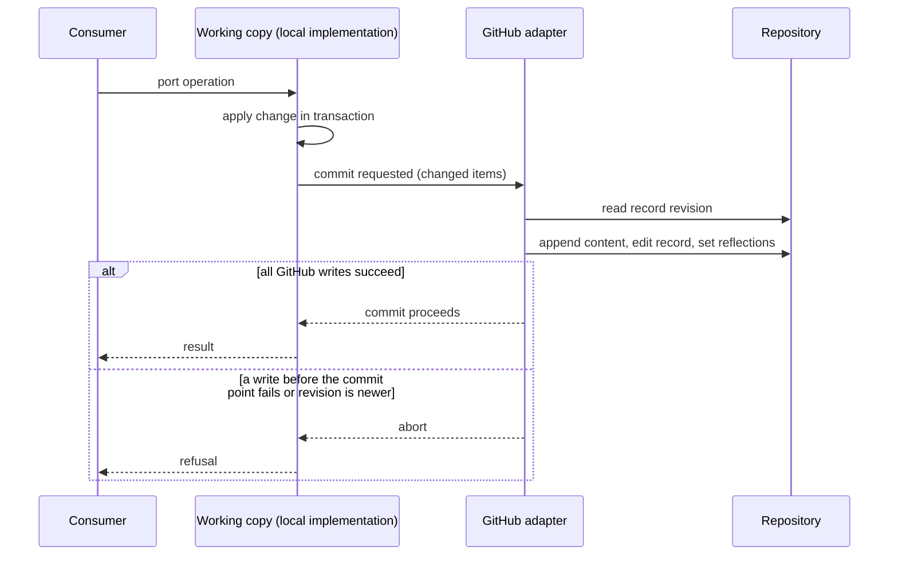

# Workflow Store — Design

## Required reads

- @docs/local/spec/domain/workflow.md
- @docs/local/spec/feature/workflow/todo-management.md
- @docs/local/spec/feature/workflow/todo-removal.md
- @docs/local/spec/feature/workflow/todo-state-transfer.md
- @docs/local/spec/integration-orchestrator.md
- @docs/local/spec/feature/workflow/github-work-record.md
- @~/.teleclaude/docs/sdlc/principle/design-fundamentals.md

## Purpose

Give workflow consumers one typed, backend-neutral operation surface. The
project resolver selects the adapter once for the canonical shared-state root.
Local is the default. `todos.store: github` selects the GitHub adapter, which
serves the whole port with the project's repository as its system of record;
what a reader of that repository sees is owned by
`local/projects/teleclaude/spec/feature/workflow/github-work-record`.
<!-- planned-change:github-pr-collaboration -->

The
GitHub adapter module also serves the identity reads and the native target
projection below, none of which is a port operation. Consumers do not select a
backend, open a connection, inspect tables, or carry storage paths.
<!-- change:github-pr-collaboration -->

The GitHub adapter module also serves the identity reads and the work item
lookup below, none of which is a port operation. Consumers do not select a
backend, open a connection, inspect tables, or carry storage paths.
<!-- /planned-change:github-pr-collaboration -->

## Inputs/Outputs

The canonical item identity is `WorkItemId`, the identity the selected adapter
assigns (#124 INV-D1). Consumers treat it as opaque: they never construct it
from a requested slug and never parse it. A separate opaque `StoreAddress` is
the selected adapter's address for the item, distinct from `WorkItemId`;
neither substitutes for the other. Existing protocol methods retain slug and
row-id string parameters where current consumers use them, and the adapter
resolves the address. The operation
records currently used by `WorkflowStore` are `WorkItem`,
`TodoDiagnosticRecord`, `WorkItemStateRead`, `IdentityResolution`,
`RemovalRequest`, `ExpiredRemovedItem`, `PurgedItem`, `ArtifactMetadata`,
`ArtifactWriterSet`, `ArtifactRemoval`, `ArtifactVersion`, `StoreCapabilities`,
and `TodoProjectionSnapshot` with `TodoProjectionItem`,
`TodoProjectionMetrics`, and `ArtifactFile`. Dependency operations use
`DependencyEntry`; workflow state remains `dict[str, StateValue]`. The
selected-store helpers additionally use `StorePresence`,
`StoreIntegrityStatus`, and the opaque `TransferSource` / `TransferResult`
pair. Existing task, schedule and creative state remain within workflow state
and preserve their current ownership and interpretation.

- **Creation result.** The slug a caller passes to `add_to_todo` or
  `create_item_with_initial_artifact` is the creation key. Each operation
  returns the `WorkItemId` of the item that holds that key after the call: the
  item it created or, for `add_to_todo`'s update of an existing key, that
  item. Every failure raises. Duplicate refusal stays with the live-conflict
  check keyed by the requested creation key, before the store is called.
  Consumers that act on the created item use the returned identity.
- **Selected backend.** The project resolver exposes the backend it selects
  from `todos.store` (#124 INV-B1). `WorkflowStore.capabilities` only gates
  operations; no consumer reads the backend from it.

<!-- planned-change:github-pr-collaboration -->

- **Native target projection.** The GitHub adapter module supplies a pure
  projection from the project's repository identity and an item's
  (`WorkItemId`, `StoreAddress`) pair to a session's native GitHub target.
  It makes no provider call and reads no workflow state outside the selected
  store. The projected target names no branch or base. The projection is not a
  port operation: the seven-part port gains no operation and carries no GitHub
  type.
  The target's repository and project are the repository identity's. Its work
  item is the `WorkItemId` itself, and its issue number is the one that key
  encodes; a key that is not a canonical positive decimal issue number is
  refused, never read leniently. The target has no address field: the
  projection carries no `StoreAddress` into it and neither decodes nor checks
  it, so the projection establishes repository, issue and work-item identity;
  that the address names the same item is the port's identity invariant.

- **Repository identity.** The GitHub adapter module resolves a project's
  repository identity from the project's committed repository declaration
  (`local/projects/teleclaude/spec/teleclaude-config`) and from nothing else:
  never from a git remote, clone path, checkout name, slug or origin metadata.
  Its repository facts are the declared stable repository ID and canonical
  owner/name. Its project path is the canonical shared-state root the project
  resolver resolves for the requested path, the root the selected store is
  resolved for, and resolution requires that root to be a project registered
  and present on this computer whose selected backend is `github`. Every linked
  worktree of a checkout resolves that checkout's identity; every clone resolves
  its own root with the same repository facts. The native target projection
  copies that project path into the target unchanged.

<!-- change:github-pr-collaboration -->

- **Repository identity.** The GitHub adapter module resolves a project's
  repository identity from the project's committed repository declaration
  (`local/projects/teleclaude/spec/teleclaude-config`) and from nothing else:
  never from a git remote, clone path, checkout name, slug or origin metadata.
  Its repository facts are the declared stable repository ID and canonical
  owner/name. Its project path is the canonical shared-state root the project
  resolver resolves for the requested path, the root the selected store is
  resolved for, and resolution requires that root to be a project registered
  and present on this computer whose selected backend is `github`. Every linked
  worktree of a checkout resolves that checkout's identity; every clone resolves
  its own root with the same repository facts.

<!-- /planned-change:github-pr-collaboration -->

- **Item identity read.** For a `WorkItemId`, the GitHub adapter module reads
  the issue that key encodes from the repository identity's repository and
  returns the `WorkItemId` with that issue's node ID as its `StoreAddress`, both
  taken from the one provider read. It authenticates through the identity
  owner's credential component with read-only issue access, as the actor
  assignment its caller supplies; the store selects no actor.
  The read retains nothing: no cached pair, no local record, no local fallback.
  It is a module call with no API, command-line or relayed surface.

<!-- planned:github-pr-collaboration -->

- **Work item lookup.** For a repository ID and an issue or pull request
  number, the GitHub adapter module answers which registered GitHub-backed
  project on this computer declares that repository, which of its items the
  number belongs to — the item's issue, or the pull request the adapter opened
  for it — and which session holds that item's claim. It reads only the
  working copies on this computer and makes no provider call; a number that
  belongs to no item answers none.

<!-- /planned:github-pr-collaboration -->

The seven operation parts are realized by the current state and artifact
operations:

- **Items:** `add_to_todo`, `list_todo`, `read_todo_diagnostic_record`,
  state/artifact reads and writes, soft removal/reactivation, and the typed
  projection cover create, read, list, intent-body edit, close and metadata.
  Slug identity and row addressing remain distinct.
- **Claims:** `active_runner` is read and written as workflow state; lifecycle
  code applies the existing session-liveness and caller-ownership checks around
  that state. Structural group membership and `status=holder` use separate
  operations and remain distinct facts.
- **Phases:** validated phase state is read and written through workflow state;
  `freeze`, `unfreeze`, `deliver`, and the registered transition hooks preserve
  existing phase and notification boundaries.
- **Stamps:** verdict state is bound to `artifact_digest` or commit SHA. The
  artifact-version reads and `update_state_with_artifact_evidence` provide the
  revision evidence while preserving the current mutation boundary.
- **Notes:** the local trail is the versioned `log` artifact, read and written
  through artifact operations. `artifact_versions` and writer metadata retain
  the existing trail and attribution behavior.
- **Delivery:** the typed projection and dependency reads feed existing ready
  candidate selection; `deliver` / `deliver_sync` record the confirmed root
  SHA, and downstream dependency cleanup remains a separate operation.
- **Capabilities:** `WorkflowStore.capabilities` reports the selected
  adapter's supported operations. Both adapters support every operation.

### GitHub adapter

The GitHub adapter serves the port through the local implementation opened on
a **working copy**: a store file in the project's shared-state directory,
distinct from the local backend's database, that the GitHub-backed project
never treats as its record. Every rule the local implementation decides is
decided there once; the GitHub adapter owns only the mapping between the
working copy and the repository.

<!-- planned-change:github-pr-collaboration -->

- **Platform identity.** Every GitHub read and write is made as the App the
  project's store declaration names, using that App profile from the
  machine's App inventory (`local/projects/teleclaude/spec/teleclaude-config`).
  The identity owner's credential component issues a repository-scoped
  installation credential with issue write access for the declared
  repository; the adapter keeps it in process memory until shortly before its
  expiry and never persists it. No session actor, person account or ambient
  token is used.

<!-- change:github-pr-collaboration -->

- **Platform identity.** Every GitHub read and write is made as the App the
  project's store declaration names, using that App profile from the
  machine's App inventory (`local/projects/teleclaude/spec/teleclaude-config`),
  except that an item's pull request is opened and closed as the App the
  inventory's role mapping names for the `builder` role, and its reviews are
  posted as the App it names for the `reviewer` role. A role the mapping
  does not name resolves through its composite role, so every review role
  posts as the `reviewer` App. The identity owner's
  credential component issues each App a repository-scoped installation
  credential with only the access its writes need for the declared
  repository; the adapter keeps each in process memory until shortly before
  its expiry and never persists it. No session actor, person account or
  ambient token is used.

- **Pull requests.** An item's pull request is a reflection like the issue's
  fields: written after the local commit from the record and the working
  copy, owed and rewritten on refresh when its write fails, and never read as
  state. It is owed apart from the issue's reflection, so a failure of either
  never holds back the other.
  - The reflection written for the build's start opens the item's pull
    request: its branch, named for the item, has one open draft pull request
    against the repository's default branch, linked to the item's issue, until
    the item is delivered or removed. When that write fails, or the branch is
    not yet on GitHub, the pull request is owed and opened by the next refresh
    that can, as every reflection is.
  - Each build review verdict is posted once as a review on the commit the
    verdict is bound to, with the verdict as approval or requested changes
    and, as its body under its envelope line, the review findings
    (`review-findings`) the verdict is bound to. The push that commits a new
    verdict captures it as a **review occurrence** — round, commit, verdict,
    findings digest and reviewer session — in the item's record, beside the
    workflow state and never in it, and every later revision of the record
    keeps it. A later stamp, a fix cycle that clears the verdict, or a rebuilt
    working copy therefore loses no review. An occurrence whose review is not
    yet on GitHub, including one whose commit is not yet there, stays owed.
  - Delivery closes the pull request with a comment naming the delivered
    commit; removal closes it without one. Nothing merges it on GitHub.
  - The pull request's body opens with an envelope line naming the item's
    issue. The pull request is found again from GitHub by its App author, its
    branch and that envelope, and a review by its App author and envelope
    round, so a rebuilt working copy neither opens a second pull request nor
    posts a review twice, and an item that reuses a delivered or removed
    item's slug never adopts that item's pull request.

<!-- /planned-change:github-pr-collaboration -->

- **Repository work.** Only repository work is published: an item whose
  kind is `task`, or whose workflow state carries a creative-track section,
  is not, and every other item, group holders included, is
  (`local/projects/teleclaude/spec/feature/workflow/github-work-record`).
  An item that is not repository work lives in the working copy as the
  local backend keeps it: the push writes nothing of it to GitHub, except
  that an item which stops being repository work gets one last record
  revision that says so, and an issue it has is reflected closed as not
  planned. An item that becomes repository work opens its issue in the next
  push and publishes every version the repository lacks
  (`local/projects/teleclaude/adr/0126-non-repository-work-stays-in-the-github-store-working-copy`).
- **Repository layout.** Each repository work item is one issue the platform
  App created. The item's `WorkItemId` and `StoreAddress` are those of its
  working-copy row, exactly as on the local backend, so every port result
  names items in one vocabulary; the issue is reached through the adapter's
  own bookkeeping and never through a port identity. The item's **record** is
  one platform-authored comment on that issue, edited in place: the item's
  row facts, dependencies, workflow state, a revision counter and, for each
  artifact, a pointer to its current content. Artifact versions are
  platform-authored content comments appended to the issue and never edited
  in content, so every version stays readable; content larger than one
  comment is split across consecutive parts, the version's history link sits
  hidden in its last part, and workflow state that does not fit in the record
  is stored the same way. A history link in a comment of its own, as earlier
  versions carry it, is read the same way. Content digests are computed from
  the stored content exactly as the local implementation computes them. One
  platform-created **ledger** issue per repository holds the project-level
  records, commit reviews and documentation transfers, as appended entries.
  Every platform comment opens with the envelope line the work record
  specifies; the machine data follows it hidden, and every reader accepts a
  comment with or without the envelope. The issue's title, body, open or
  closed state, labels, issue type, sub-issues, blocked-by relations and
  assignees are reflections the adapter writes from the record and its own
  bookkeeping and never reads.

- **Write path.** Every transaction on the working copy records which items
  and project-level records it changes. Before the local commit completes,
  the adapter writes those changes to GitHub, and exactly one GitHub write is
  the transaction's **commit point**: what GitHub holds after a refused
  operation is what it held before. New content comments are appended first;
  they are unreferenced until a record points at them.
  - A transaction that changes one item and no project-level record commits
    by editing that item's record to its next revision.
  - Any other transaction first writes each changed record with its next
    revision held as **pending** under the transaction's identity, beside the
    record's committed revision, then commits by appending one **commit
    entry** to the ledger that names the transaction, lists the items and
    revisions it commits, and carries its project-level records. A pending revision whose transaction has no commit
    entry is not part of the record, and the next write of that record
    replaces it.

A GitHub write before the commit point that fails aborts the local commit
and surfaces as the operation's failure. The reflections are written after
the local commit and never decide an operation's outcome. A reflection
writes only the parts whose projected value changed since the item's last
written reflection, and sets the repository's labels to the colours and
descriptions the work record specifies before using them. A reflection
that fails is logged and recorded as owed in the working copy; every
refresh rewrites the owed reflections from the item's record until they
are written, so a delivered item's issue closes without another change to
the item. Creating an item opens its issue in the push that commits it.

**Waiting for a person.** The person-addressed messaging path hands the
adapter a message an agent session sent while working on a repository work
item (`local/projects/teleclaude/spec/messaging`). The adapter appends it to
the item's issue as a question comment and records, in its own
bookkeeping, that the item waits for those recipients since that moment in
that phase; the record and the workflow state are unchanged. Each
reflection assigns the issue to the people the item waits for: the
recipients of an open question, and, while the item is in human PRD
approval, the people its lineage principal resolves to by the messaging
recipient rule. A question closes when the item's phase changes, or when
the asking session holds human input newer than the question, which
refresh observes through the session conversation seam. A failure to post
the question is logged and changes neither the message's delivery nor the
workflow.

- **Conflict check.** Before writing a record, the adapter reads its current
  revision from GitHub. A revision newer than the one the working copy was
  derived from means the item changed on another computer: the write is
  refused, the item is refreshed from GitHub, and the caller may retry.

- **Rebuild and refresh.** A working copy that is absent is rebuilt from the
  repository before first use: every issue the platform App created that
  carries a platform record of repository work, and the ledger. A record's
  pending revision is taken only when the ledger holds its transaction's
  commit entry. The daemon refreshes each GitHub-backed project it serves at
  start and periodically: it applies items whose effective GitHub revision
  is newer than the working copy's, including every item a new commit entry
  lists whether or not its issue changed since the last refresh, closes the
  questions their asking sessions have answered, and rewrites owed
  reflections. Neither adopts a record whose item is not repository work.
  Rebuild and refresh write the working copy without pushing records back.
- **Projection repair.** The working copy records which projection its
  repository was last brought to. A refresh that finds an older one owes a
  reflection for every item it holds, sets the repository's platform labels
  and removes the platform's retired labels, and brings every platform
  comment to the current presentation: record and ledger comments are
  rendered again from their own machine data, and every other comment gains
  its envelope line. It edits only the bot's own comments and never changes
  artifact content or machine data. The repair spaces its writes
  within GitHub's limits, continues on the next refresh after an
  interruption, and records the current projection only once complete.

- **Trust.** A comment is read as record, content or ledger only when the
  platform App's bot authored it, and only in the last version that bot
  wrote. When its last editor is someone else, that version is recovered from
  the comment's edit history, and refresh restores it on GitHub. The restored
  version is never older than the record's latest committed revision. A comment with no recoverable bot
  version is **unverifiable**: refresh leaves the working copy as it is, and
  every write to that item refuses with that cause. A label, title, body,
  comment or edit by anyone else is never read as state.
- **Selected-store helpers.** Presence, validation reads and integrity
  checks answer for the working copy. Transfer and database location refuse
  for a GitHub-backed project: each computer reaches the state from GitHub.

## Invariants

- One cache identity is keyed by the canonical shared-state root. A linked
  worktree and its owning checkout resolve to the same adapter. Sync and async
  facades share this identity and event-hook attachment; sync calls stay native
  sync and do not invoke a nested event loop.
- Adapter commands retain existing transaction boundaries and callback
  multiplicity. Artifact content and version append commit together and notify;
  provenance state is a later, separate commit and notification. A failure
  between those commits remains observable as it is today. Delivery and later
  dependency cleanup likewise retain their source-defined boundaries.
- A phase mutation persists before its existing transition notification. Failed
  persistence emits no successful transition. Hook registration occurs once
  per cached adapter.
- Local slug identity, row addressing, live claims, structural group
  holders, transitive claiming-group authorization and role checks remain
  separate facts. SHA/digest-bound stamps, audit, attribution and timestamps
  retain their existing meaning.
- Validation reads distinguish absent storage from invalid state and never
  bootstrap or migrate. SQL and compatibility with legacy local tables remain
  inside the local adapter.
- Existing computer-target transfer stays incremental and daemon-independent,
  including its running-target support, integrity checks and existing admin and
  role clearance. The adapter supplies an opaque transfer operation; callers
  do not receive a database path or SQL connection.
- Integrator candidate selection preserves current eligibility, FIFO ready
  ordering, dependency exclusion, durable checkpoint, lease and parking
  behavior, duplicate-integration guards and final-root confirmation. Delivery
  is recorded once at the confirmed final root SHA.

- An item's `WorkItemId` and `StoreAddress` name the same item. Wherever the
  selected adapter returns or resolves both, it reads them from that one
  stored item, and no operation pairs one item's identity with another item's
  address. A consumer that carries the pair relies on either value naming the
  item the other names, without decoding the address.

- On a GitHub-backed project, no change to repository work reaches the
  working copy's commit without first reaching GitHub, so the repository
  holds every committed change to it and a lost working copy loses none of
  it. Every write channel of the working copy, including raw connections,
  commits through the push.

- Processes on one computer stay serialized by the working copy's
  transactions, exactly as on the local backend. GitHub I/O runs on an
  adapter-owned I/O thread: a sync caller blocks on it without starting an
  event loop of its own, and an async caller awaits it without blocking the
  daemon's loop.
- The working copy's reads never reach GitHub; only writes, rebuild and
  refresh do.

## Primary flows

1. Resolve project context to the canonical state root, read its project config,
   select the store, and refuse before storage access when the selected
   capability is unavailable.
2. Consumer invokes one typed workflow operation. The adapter maps canonical
   slugs and optional row-address tokens to local storage and owns all SQL,
   migrations, sessions and result translation.
3. Local async daemon paths and native sync CLI/integrator paths use the same
   cached store identity. Successful mutations preserve existing callbacks and
   downstream cache/event behavior.
4. Validation and transfer use explicit adapter operations that preserve their
   no-bootstrap or daemon-independent boundaries.

### Store activation

A project activates the GitHub store by declaring `todos.store: github`
together with its repository and platform App
(`local/projects/teleclaude/spec/teleclaude-config`), with that App installed
on the repository. The first store resolution on a computer rebuilds the
working copy from the repository; an empty repository yields an empty store.
Moving an existing local store's items to GitHub is not part of activation.
The GitHub store switch
(`local/projects/teleclaude/spec/feature/workflow/github-store-switch`) moves
them by restoring each item, with every artifact version, into the working copy
as an ordinary change, so the write path below publishes it.

## Failure modes

- A missing store is a distinct read result from a malformed database or state
  record. Validation cannot create storage to make its read succeed.
- Adapter selection fails before any storage access when the selected adapter
  cannot be configured: a GitHub store without a declared repository or
  platform App, or an App the machine's inventory does not hold, refuses; it
  never falls back to local.
- A failed mutation retains the existing commit boundary and refusal. The
  adapter does not synthesize defaults, retry a failed write as success, or
  collapse distinct current commits.
- A transfer source is opaque. Exposing a local path would recreate the direct
  storage bypass this boundary owns.

- A GitHub identity read refuses with its cause and creates nothing. A path
  outside a registered, present project; a selected backend other than
  `github`; an undeclared repository; a key that is not a canonical issue
  number; a credential the identity owner refuses, including a declaration its
  installation scope does not confirm; an issue that is absent, moved or
  deleted; a pull request where an issue is required; and an unavailable or
  rate-limited provider each refuse distinctly. A refusal carries no provider
  response text and no credential.

- A GitHub write before the commit point that fails, is refused by a rate
  limit, or meets a newer record revision aborts the local commit and refuses
  the operation with that cause, and leaves no change on GitHub that any
  reader takes as part of the record.
- A commit-point write whose response is lost may have taken effect while the
  operation reports a refusal. The working copy then lags the repository
  until refresh, which adopts the committed revision; the repository stays
  the record. GitHub supports no conditional writes, so the revision check and the
  record write are separate requests: two computers writing the same item
  inside that interval can lose one write. Within one computer this cannot
  occur.
- A content comment or a newly opened issue whose transaction then aborts
  stays on GitHub unreferenced. Rebuild ignores it because no record points at
  it; an issue without a platform record is not an item.
- A crash after the GitHub write and before the local commit leaves the
  working copy behind the repository until refresh applies the newer
  revision; the repository is never behind.
- Retention purge removes an item from the working copy and marks its record
  purged. The platform App cannot delete issues, so the issue and its history
  stay on GitHub, closed; rebuild skips purged records.
- Rebuild or refresh that cannot read the repository refuses store resolution
  for a missing working copy and leaves an existing one as it is.
- A comment that someone else edited, and whose edit history no longer holds
  the bot's last version, makes its item unverifiable. Writes to the item
  refuse, and rebuild refuses store resolution naming the item. No working
  copy is ever published in its place.

<!-- planned-change:github-pr-collaboration -->

- The native target projection reads an issue number from a `WorkItemId`;
  the GitHub adapter's port identities are working-copy identities, so the
  projection receives no store-produced key it accepts.

<!-- change:github-pr-collaboration -->

- A role mapping that names no App for `builder` or `reviewer`, or an App not
  installed on the repository with pull request write access, leaves the
  pull request reflections owed with that cause; the issue and the workflow
  are unaffected.
- A pull request someone merges on GitHub, or a review someone else posts,
  changes nothing in the record: the item is still delivered only by the
  integrator, and only the reviewer's stamped verdict counts.
- A computer whose store predates review occurrences cannot read a record
  that carries one, so the item is unverifiable there. Every computer that
  serves a GitHub-backed project runs the current store before an item of
  that project starts its build.

<!-- /planned-change:github-pr-collaboration -->

- Work that is not repository work exists only in the working copy of the
  computer that holds it; a lost working copy loses it, as a lost local
  database loses the local backend's work.
- An item that stops being repository work on one computer keeps its last
  published revision on GitHub; another computer that already holds the
  item keeps its own copy, and a rebuild there no longer includes it.
- A person without a declared GitHub account is not assigned; the question
  comment is still posted.
- A computer whose store predates the comment envelope reads an enveloped
  content comment as no content, so the items holding one become
  unverifiable there. The current store reads both forms; every computer that
  serves a GitHub-backed project runs it before that project selects the
  store.

## See Also

- docs/local/adr/0125-github-store-keeps-the-local-implementation-as-its-working-copy.md

- docs/local/adr/0126-non-repository-work-stays-in-the-github-store-working-copy.md

- https://docs.github.com/en/rest/using-the-rest-api/best-practices-for-using-the-rest-api

- docs/local/spec/domain/workflow.md
- docs/local/spec/feature/workflow/todo-state-transfer.md
- docs/local/spec/integration-orchestrator.md
