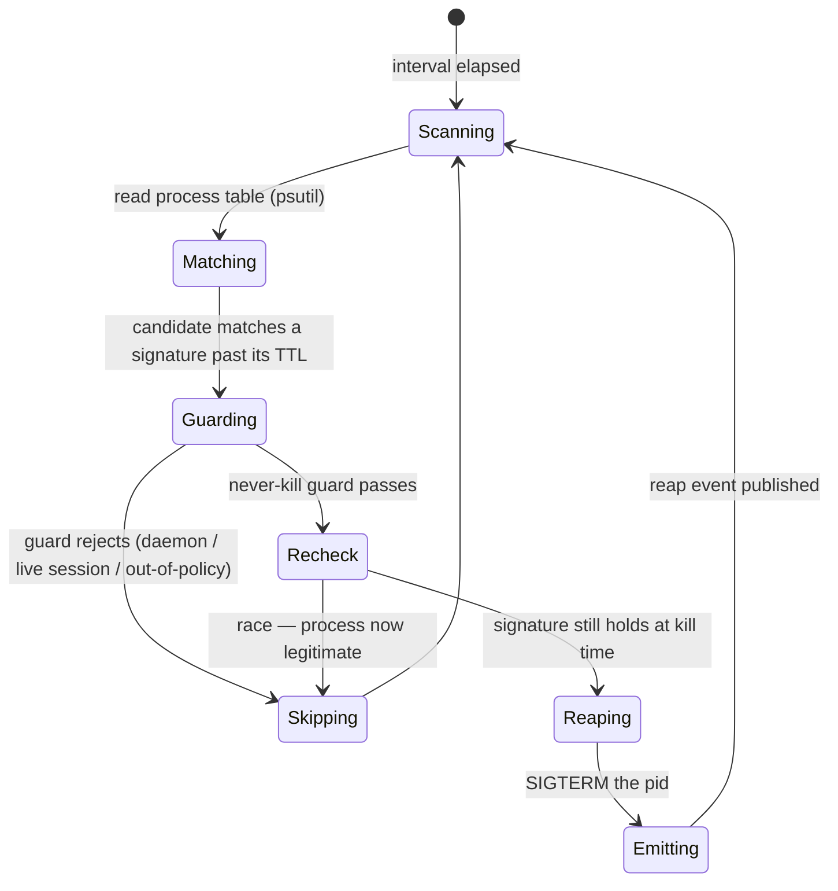
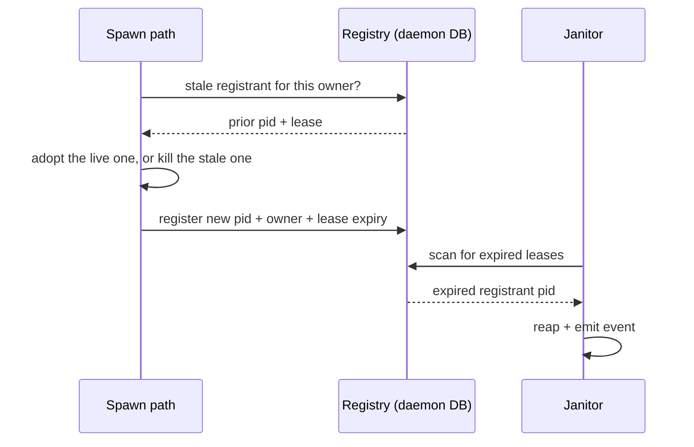

# Process Lifecycle — Design

## Required reads

## Purpose

The daemon owns the lifecycle of the processes it spawns or recognizes as its
own leaked dead weight, so orphaned and runaway processes are reaped
automatically and observably rather than accumulating until the host congests.

Two parts under one concept:

- **Janitor** — a periodic daemon task that scans the host process table against
  a signature + TTL policy and reaps matches, emitting one event per kill.
- **Spawn registry** — platform-spawned detached children record an identity and
  an expiring lease at spawn time; spawn paths adopt-or-kill a stale prior
  registrant before starting a replacement; the janitor reaps expired leases.

The signature policy is **data**, not branching code: a new leak class is a new
policy row, so a recurrence becomes configuration rather than a fresh incident.

## Inputs/Outputs

**Inputs:**

- The host process table (pid, ppid, start time, command), read through `psutil`
  — the dependency already used in `teleclaude/core/system_stats.py`.
- The signature + TTL policy: the set of leak-class matchers and their grace
  windows, seeded with the known classes and extensible by row.
- The spawn registry: identity (pid + owner + lease expiry) records written by
  platform spawn paths. Rows of the gate runner owner class also carry the
  process's start identity, the computer and the boot session; every other row,
  the chiptunes worker's included, is unchanged.
- Configurable scan interval and policy/lease TTLs from the typed config surface.

**Outputs:**

- Terminated leaked processes whose signature match has outlived its TTL.
- One observable reap event per killed pid — the process-reaped event, joining the
  existing `system.*` infrastructure-event family in
  `teleclaude/events/schemas/system.py`. Payload: the pid, the matched signature
  (id + name), the reap reason, and — when the reap is a lease expiry — the owner
  and lease. Emitted through `teleclaude/events/producer.py` `emit_event` at
  `EventLevel.OPERATIONAL` with host-local visibility, so the operator queries
  reaps through `telec events` like any other system event. Reaping is never
  silent.

- Each reap event carries a deterministic `idempotency_key` derived from the
  observed process and its matched signature, bucketed by a revalidation window
  from the typed config surface. A reap event reports no lifecycle state, so no
  consumer tells a person about it; it reaches the `telec events` stream on each
  scan.

- Registry rows mutated as detached children are registered, adopted, or reaped.

Seed signature classes (from the Jun 2026 leak evidence):

- execnet / pytest-xdist bootstrap processes reparented to `ppid == 1`;
- shell loops invoking `telec sessions tail` older than their TTL;
- parentless `node` / `pyright` servers under the project venv past TTL;
- detached workers with no live registration.

## Invariants

- **The signature policy is the sole authority for what is reapable.** A process
  is a candidate only if it satisfies an explicit signature; nothing outside the
  policy is ever killed.
- **The matcher can never reap the daemon, a live agent session, or an
  out-of-policy process.** This never-kill guard is not optional and defaults
  toward not killing on any ambiguity. Killing is irreversible; the guard is the
  load-bearing safety contract and is verified by refutation tests. Its exact
  formulation is the **Never-kill guard** flow below.
- **The janitor runs inside the daemon, not as an out-of-process job.** It is a
  periodic asyncio task registered in `teleclaude/daemon.py` beside
  `periodic_cleanup` and `resource_monitor_loop`, honoring `shutdown_event`. It
  shares the daemon's process and serialization domain with the spawn paths it
  coordinates with and reads live session identity directly — neither is available
  to a cron-spawned standalone job like `jobs/temp_reaper.py`.
- **Every reap is observable.** One event per killed pid reaches the event
  stream; a silent kill is a defect.
- **Reaping is idempotent and re-checked at kill time.** A signature is
  re-evaluated immediately before the kill so a process that legitimately started
  or reparented inside the TTL window is not caught by a stale match.
- **Detached children are owned, not untracked.** Anything the platform spawns
  with its own session registers a lease; an expired lease is reapable, and a
  stale registrant is resolved by adopt-or-kill before a replacement starts.
  A registrant that carries an identity - every row the gate runner owner class writes - is identified by the registry row alone: the owner, the pid, the process's start time, the computer and the boot session it ran in, and a pid never identifies such a process by itself. A row without an identity, which is every row that exists before this change and the chiptunes worker's, keeps its pid-only semantics exactly as they are; nothing here widens them.
- **Only the owner's computer and boot session classify or signal a registrant that carries an identity.** Such a row recorded on another computer, or in another boot session of this one, is never signalled on the strength of its pid. A different boot session proves every process of the earlier one gone; a different computer proves nothing, and the absence of a row on a computer that did not write it proves nothing either.
- **Daemon-owned state stays daemon-owned.** The policy table and the spawn
  registry live in the daemon DB (`teleclaude/core/schema.sql`); no other service
  reads or writes them.

## Primary flows

### Janitor scan

The scan follows the existing daemon periodic-task pattern
(`teleclaude/daemon.py`: `periodic_cleanup`, `resource_monitor_loop`) honoring
`shutdown_event`; it is not a new scheduler. The nearest prior art for the kill
mechanics: `jobs/temp_reaper.py` probes liveness with `os.kill(pid, 0)` and reaps
by a pid-embedded signature, and `teleclaude/chiptunes/manager.py` matches a
process signature over `psutil.process_iter` cmdline (the exact `-m <module>`
pair, uid-scoped via `proc.uids().real`), then SIGTERMs and polls a bounded
interval for exit. The janitor generalizes both: signature matching becomes a
data-driven policy, and the kill is guarded and observable.

### Never-kill guard

A candidate is reaped only when it **positively matches an active signature past
its TTL** AND survives the guard. The guard is a denylist of protected identities
applied after the signature allowlist, and it defaults to _not killing_ whenever
an input cannot be resolved.

Protected — never reaped regardless of signature match:

- **Not the daemon's own tree.** The daemon's own pid (`os.getpid()`) and every
  process in its process group / non-detached child tree.
- **Not a live agent session.** For every session in `db.get_active_sessions()`,
  its tmux host pid (`tmux_bridge.get_pane_pid(tmux_session_name)`) and that pid's
  descendants. A live session's hosting process is never a leak.
- **Not a leased registrant.** Any spawn-registry registrant whose lease is still
  valid — a live lease means the process is owned, not orphaned.
- **Not another user's process.** uid-scoped — only processes owned by the daemon
  user are ever candidates (mirroring `manager.py`'s `proc.uids().real` check).

Ambiguity defaults to skip: a `psutil` error, an unresolvable pid, a session whose
host pid cannot be read, or any missing identity datum removes the candidate from
the kill set rather than killing it. Signature and guard are both **re-evaluated
at kill time** (the `Recheck` state), so a process that became legitimate inside
the TTL window — started, reparented, or acquired a lease — is released before the
SIGTERM.

### Spawn registry lease

The chiptunes worker (`teleclaude/chiptunes/manager.py`, the existing
`subprocess.Popen(start_new_session=True)` detached spawn) is the first adopter,
proving the contract end to end and retiring its duplicate-worker leak.

**adopt-or-kill atomicity.** The registry lives in the daemon DB
(`teleclaude/core/db/`, schema in `teleclaude/core/schema.sql`); `owner` is unique
— at most one live registrant per owner. Registration is a single transaction that
reads the current registrant, resolves adopt-or-kill, and writes the new pid +
lease; SQLite's write serialization together with the unique-`owner` constraint is
the concurrency boundary, so two spawns of the same owner cannot both install a
registrant. Within the daemon the single asyncio event loop already serializes the
spawn paths; the transaction is the cross-process backstop. This replaces the
chiptunes manager's current file-based classify-then-spawn (pidfile + socket
probe), which is racy across processes.

A synchronous spawn path bridges the sync→async DB color boundary deliberately:
`teleclaude/chiptunes/manager.py` is a synchronous, thread-based class, while the
daemon-DB session helpers are async (`async with self._session()`). Registry reads
and writes from such a path use the synchronous SQLAlchemy/`sqlite3` session
helpers in `teleclaude/core/db/_sync.py`, or are dispatched onto a thread — never
called as if the async session were synchronous. The unique-`owner` transaction
holds identically on the sync path.

### Gate runner ownership

A stamp's build gates are run by a detached child, the **gate runner**
(`local/projects/teleclaude/spec/feature/workflow/work-review-cycle`), and it is
owned through this registry like any other detached child. The ownership contract
is the one above; this section states how the gate's owner class uses it.

**The row.** The owner is `stamp-gate:<the item's immutable identity>`: at most
one gate per item, by the registry's own unique-owner rule. The row gains four columns, each nullable: the process's start identity, the computer's name, the boot session identity and the generation, which is the key of the stamp invocation that registered the row. An invocation that finds a row with its own generation attaches to it; a row with another generation is classified and never taken over. An existing row (the chiptunes worker's) has all four empty and
keeps its semantics exactly: pid-only adopt-or-kill, its own liveness rule, no
change to its lease. A row with an empty identity is never signalled by the
gate classifier. The row is the only place that holds a gate's process identity.
The stamp's in-flight record on the item holds the invocation key and a host-qualified reference to the row: the name of the computer that owns it and the owner key. The invocation key equals the row's generation column, so a row left by an earlier invocation is recognised as such. The registry lives in the daemon database of the computer that wrote the row, so the reference is what routes a lookup to it; the process's pid, start time and boot session stay in the row alone, and the flight holds no process identity of its own. A computer that finds a flight naming another computer does not look for the row, does not read its absence as safe, and does not classify or signal any local pid on that evidence: the flight is unknown to it.

**Identity and its comparison.** A process's identity is the start identity the
operating system gives it, stored exactly as read and compared for equality with a
fresh read of the same pid. On Linux it is the raw start time in clock ticks since
boot (field 22 of the process's `stat`), together with the boot id, because a
computed wall-clock start time moves when the clock does; on macOS it is the
start time the system reports, together with the kernel's boot session identity.
The boot session is the host's immutable boot identity, stored as read and
compared for equality. There is no tolerance and no ordering: two identities are
the same or they are not, and neither a start identity nor a boot time is ever
compared with another to prove a reboot or that a process is unrelated.

**Start order, and what a crash between the writes leaves.** The writes are
distinct and ordered; the runner can start nothing before the last of them.

1. The invocation takes the item's stamp slot (the flight, with the owner key and
   the computer's name). One lock per item covers classifying the existing row,
   taking the slot, spawning the runner and registering it, so no other stamp of
   the item interleaves.
2. The daemon spawns the runner, which reports ready and waits for go. The daemon's
   wait for ready is bounded as well as the runner's wait for go. If the wait ends,
   or anything fails before the row is durable, the daemon ends the bootstrap by
   the identity it holds from the spawn, observes it exited and reaps it, closes its
   input, and only then lets the slot go. A bootstrap has started no workload.
3. The daemon registers the row: the runner's pid, its start identity, the
   computer, the boot session, the generation (the invocation key), and a lease. Registration refuses an existing row
   for the owner; it never takes the generic path that kills a stale registrant. A
   row is removed only by the classifier's proof below, so an existing row is
   always evidence of a unit that has to be classified first.
4. Only then does the daemon tell the runner to go, and the runner starts the
   workload.

A crash before step 3 leaves a flight with no row: no workload can exist, because go is sent only after the row is durable, and a row is deleted only after the classifier proved the unit dead, ended or from another boot session, so a missing row is never the remains of a unit that may still run, and the waiting runner exits when its
wait ends or its input closes. A crash between 3 and 4 leaves a row and a runner
that will not start the workload; the row classifies as live until the runner has
exited and as dead after. A crash after 4 is the ordinary case below. The runner
never starts the workload on its own, and closing its input after go does not stop
it: a daemon that ended must not stop a workload the runner supervises to its limit.

**The runner settles its own workload.** The runner leads the process group it
supervises. At the workload's end, or at its limit, it sends every other live
member of the group a terminate signal, gives them a short grace, sends a kill to
those still alive, and repeats observing until no non-zombie member is left or a
fixed bound passes, then reports; the bound it cannot meet is reported as
unsettled and the unit is left unknown. Members that are zombies are not running
work and are accounted separately; the leader's own exit is a separate step from
there being no other live member. Pipe cleanup is bounded. A failed report (the
daemon is gone) is ignored after settlement.

**Classifying a row.** Every time a stamp is requested for an item that has a row,
and whenever the daemon starts, the row is classified, on the computer and in the
boot session that wrote it:

| The row's runner      | Its group                         | Class          | What follows                                           |
| --------------------- | --------------------------------- | -------------- | ------------------------------------------------------ |
| alive, identity equal | any                               | owned and live | the same invocation attaches; another stamp is refused |
| gone                  | no non-zombie member              | dead           | the row is removed and the slot may be replaced        |
| gone                  | non-zombie members remain         | unknown        | nothing is signalled and nothing is replaced           |
| any                   | any, but a different boot session | dead           | the row is removed; every earlier process is gone      |
| any                   | any, but a different computer     | unknown        | only the owner's computer classifies or signals it     |

The daemon records the unit as ended only after it has seen the runner exit and no other non-zombie member of the group; that record, not the runner's own settlement, removes the row. A mismatch of identity never removes a row by itself: after any reap, the row is removed only when the unit is then observed dead, and a row is also removed when the boot session differs. No clock and no numeric group id ever decides a class
or authorizes a signal, and a group id with no positively identified leader is
never signalled: it cannot be told from an unrelated group that reused the number.

**Unknown is an investigation, owned by the governing agent.** The machine does
not recover an unknown unit by signalling it. The agent investigates and ends,
through the capabilities it already has, only processes it positively attributes to
the gate, then requests the stamp again, which classifies again. There is no act
that clears a unit, no exception for a person's presence, and no release while the
old workload may still run: the single-gate invariant holds until the class is dead
or the unit is recorded as ended. Nothing samples the group's members; if a later
change adds sampling, it needs an owner, storage and a cadence stated here first.

**Lease and expiry.** The lease is registered with the row and covers the whole
lifetime the runner can honestly hold: the bounded wait for go, the gates' limit,
the bounded drain, the settlement and the runner's exit, with a margin: 30 seconds for go, 600 for the gates, 10 for the drain and 10 for settlement make 650, and the lease is 900 seconds. The janitor
is a daemon-side backstop for a runner that outlives its lease; only the runner's
own bounds survive the daemon's absence. At expiry the janitor, on the owner's
computer and boot session, rechecks the runner's identity, ends the group's other
live members within a bound, then ends the runner and observes the result. Ending
only the runner would leave the workload without its supervisor. Each process
ended is one process-reaped event with the owner, the pid and the lease, as for
every reap. Ownership evidence is never deleted to make an expiry simpler: a row whose runner identity no longer matches is classified by the table above, and it is removed, and the flight replaced, only when that classification is dead, the unit is recorded as ended, or the boot session differs. A row whose group still has non-zombie members stays, as unknown, and nothing is signalled for it.

**Daemon stop and restart** never signal a gate runner: it is a lease holder, and
the guarantees of `local/projects/teleclaude/policy/daemon-availability` and
`local/projects/teleclaude/policy/agent-service-control` hold unchanged. On the
next start the row is classified as above.

**Limits.** A descendant that starts a session of its own leaves the group and is
not seen. A group that remains after its runner, with no positively identified
member, stays unknown and holds the item's stamp until its processes end or the
agent has ended the ones it can attribute. A row recorded on another computer is
unknown to this one.

## Failure modes

- **Guard false positive (kills something live).** The highest-stakes failure.
  Mitigation: signature policy is the sole authority, the never-kill guard
  defaults to not-killing on ambiguity, and an optional observe-only mode emits
  "would reap" without killing so a new signature row is validated before it
  kills.
- **Signature race.** A process matches "parentless past TTL" exactly as it
  legitimately starts or reparents. Mitigation: TTL windows plus a re-check at
  kill time; reaping is idempotent.
- **adopt-or-kill race.** Two spawn paths start the same child concurrently.
  Mitigation: the registry write is the serialization point — a single
  transaction under a unique-`owner` constraint (see _adopt-or-kill atomicity_),
  so only one registrant survives and the loser adopts it.
- **Scan cost on a busy host.** Reading the full process table every interval is
  not free. Mitigation: bound the scan and keep the interval sane.
- **Gate runner killed with its workload running, or the daemon gone.** The runner's own bounds end the workload when the runner lives; when it does not, the group stays unknown and holds the item's stamp. Nothing is signalled on a group number, and no second gate starts beside processes the first may still contain.
- **Silent reap.** An event fails to publish, hiding a kill. Mitigation: the
  per-kill event is part of the reap contract, not a side effect; a reap without
  its event is a defect, not a tolerated degradation.
