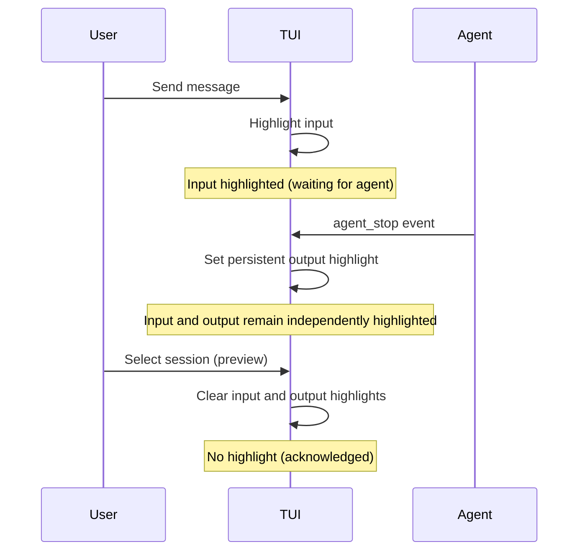
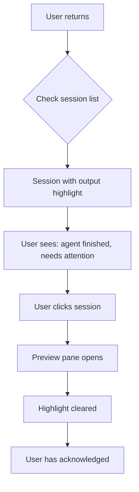

# Session Highlight — Design

## Purpose

The highlight system provides visual cues in the TUI to alert users about session activity requiring attention. It answers: "Which sessions need my attention?"

## Inputs/Outputs

**Inputs:**

- `user_prompt_submit` event — User sends a message to an agent
- `pre_tool_use` event — Agent starts a tool call (drives the "live activity" lit state)
- `agent_stop` event — Agent completes its turn
- User navigation — Selecting/previewing a session

**Outputs:**

- Independent visual highlight state for each session's input and output lines
- Highlight cleared when user acknowledges by viewing the session

## Invariants

1. **Independent line highlights**: Input and output highlights are independent. A session may show either highlight, both highlights, or neither.

2. **Input highlight on prompt submission**: A `user_prompt_submit` event highlights the input line without changing the output highlight. The existing preview timer and user acknowledgement clear it.

3. **Output highlight on agent completion**: An `agent_stop` event highlights the output line without changing the input highlight. The output highlight persists until the user views the session.

4. **Viewing clears line highlights**: Selecting a session (preview pane or sticky) acknowledges the session, clearing both line highlights.

5. **Live output highlight during active tool**: While `activity_event == "pre_tool_use"` the output line is lit. The highlight follows the live activity state — the next `pre_tool_use` or `agent_stop` advances it.

6. **Out-line text is retained**: The rendered out-line text value is retained in memory from the first non-empty out-bearing event (`pre_tool_use`, `thinking`, `agent_stop`) and persists across the `user_prompt_submit` clear and tree rebuilds until a newer non-empty out value replaces it. Only the `agent_stop` summary is persisted to disk; live values are retained in memory only. The row height stays stable — the out line never drops once a value has appeared. The highlight (invariant 5) follows live activity independently of the retained text.

## Primary flows

### 1. User sends message, agent responds



### 2. Live tool activity

```mermaid
sequenceDiagram
    participant User
    participant TUI
    participant Agent

    User->>TUI: Send message
    TUI->>TUI: Highlight input

    Agent->>TUI: pre_tool_use event
    Note over TUI: Existing input highlight remains unchanged
    TUI->>TUI: Output line lit while activity_event == pre_tool_use
    Note over TUI: Live activity highlight

    Agent->>TUI: pre_tool_use (next tool) / agent_stop
    Note over TUI: activity_event advances; highlight follows

    Agent->>TUI: agent_stop event with summary
    TUI->>TUI: Set persistent output highlight
    Note over TUI: Final highlight until viewed (or 3s on preview)
```

### 3. User returns to laptop



## Failure modes

| Scenario                          | Behavior                               | Recovery                                                                          |
| --------------------------------- | -------------------------------------- | --------------------------------------------------------------------------------- |
| Event lost                        | Session may show stale highlight state | Next event corrects state; user can click to clear                                |
| Rapid events                      | Multiple events in quick succession    | Each direction updates independently until acknowledgement clears both highlights |
| TUI restart                       | Highlight state lost                   | State persisted to `~/.teleclaude/tui_todo state (todos.db)`; restored on restart |
| Session deleted while highlighted | Orphaned highlight in state            | Highlight set garbage-collected when session no longer exists                     |
