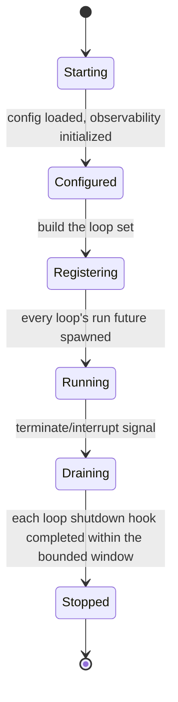
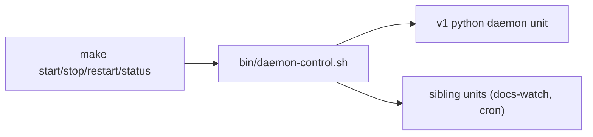

# Daemon Runtime — Design

## Required reads

- @docs/project/design/architecture-v2/overview.md
- @docs/project/design/architecture-v2/services.md
- @docs/project/design/architecture-v2/file-layout.md

## Purpose

Define the `telec-daemon` process as designed for v2: the long-running
supervisor binary and its supervision — the aspirational first always-on Rust
process and the host the v2 control loops mount onto. This is preserved v2
target design; v1 Python is the running supervisor.

The runtime is a **shell**. It owns process lifecycle — startup, signal
handling, graceful shutdown — and the operator control surface that drives the
local process set. It owns no domain logic: the loops that do real work
(reconciliation convergence, webhook ingress, and eventually agent_runtime
hosting) mount onto its registration seam and carry their own behavior. The
distinction is load-bearing: a change to the runtime shell is a process or
supervision change, never a change to what any loop computes.

## Inputs/Outputs

**Inputs:**

- OS lifecycle signals (terminate / interrupt) delivered by the service manager.
- Effective configuration, loaded once at startup through the `config` crate
  bootstrap (the same composition `telec-cli` uses).
- The set of service loops registered at startup, each supplying a run future
  and a shutdown hook.

**Outputs:**

- A supervised, always-on process that the service manager keeps alive across
  crashes.
- Structured startup and shutdown log lines through the `observability` crate.
- Graceful shutdown of every registered loop within a bounded window.
- The unified operator control surface (`make start/stop/restart/status` and
  `bin/daemon-control.sh`) operating the entire managed unit set.

## Invariants

- **`telec-daemon` is the v2 long-running supervisor binary.** It follows the
  fixed `telec-<role>` binary convention; the binary set is closed. Services are
  library crates embedded by binaries — a domain never gets its own
  process-per-service binary.
- **The runtime owns lifecycle, not loop logic.** Loops mount through the
  registration seam; the runtime drives each registered loop's run and shutdown.
  Ingress, reconciliation, and convergence logic live in their own service
  crates, never in the runtime shell's own modules.
- **The runtime shell registers no loops.** It ships with an empty loop set and
  tenant-typed extension points; each loop is registered by the context that
  owns it, never by the shell.
- **Graceful shutdown is bounded.** On a terminate/interrupt signal the runtime
  drives every registered loop's shutdown to completion within a window that
  stays under the service manager's SIGKILL escalation, then exits cleanly.
- **The service manager is the sole supervisor.** launchd (macOS) and systemd
  (Linux) are the only things that start and stop the process; `KeepAlive`
  restarts it on crash. Automation never calls `launchctl`/`systemctl` directly.

- **Coexistence during the v1→v2 window.** The v2 design runs the Rust
  `telec-daemon` as a distinct supervised unit — distinct service label and
  pidfile — alongside the v1 Python daemon, sharing no label, socket, or
  pidfile. The running system supervises only the v1 Python daemon; this
  coexistence is the target the v2 cutover realizes.

- **One operator control surface over the whole unit set.** The control surface
  operates the entire managed set of supervised units as a single abstraction,
  not a target per process, and reports per-unit state.
- **Startup and shutdown narrate only through `observability`.** Structured
  `key=value` records, no `print`/`eprintln`, no truncated identifiers.

## Primary flows

### Process lifecycle

The `main` entry point is thin: initialize observability, load effective
configuration, register the loop set, then run until signalled. Business logic
lives in the embedded service crates, per the file-layout rule that binaries are
thin entry points.

The v2 design supervises the runtime with a launchd plist (macOS) and a systemd
unit (Linux), provisioned through `bin/daemon-control.sh`'s platform
abstraction. The plist mirrors the v1 daemon plist conventions — `RunAtLoad`,
`KeepAlive`, `AbandonProcessGroup`, file-descriptor limits, null standard
streams — with program arguments pointing at the binary under `~/.local/bin/`.
On Linux the same contract holds through a `telec-daemon` systemd unit template:
restart-on-failure supervision, `WorkingDirectory` at the project root so the
binary loads `CLUSTER_REDIS_URL` from `.env` exactly as the plist does, and a
program path at `~/.local/bin/telec-daemon`.

This is preserved v2 target design. The running system ships no `telec-daemon`
build, service unit, or install path; `bin/daemon-control.sh` and the
`make start/stop/restart/status` surface supervise only the v1 Python daemon and
its sibling units (docs-watch, cron). Standing up the binary and its supervised
unit belongs to the v2 cutover.

### Unified operator control surface

`daemon-control.sh` manages a **set** of supervised units rather than a single
service label. The `start`, `stop`, `restart`, and `status` verbs operate the
whole set; `status` reports each unit on its own line. `make` targets stay thin
aliases that forward each verb to `daemon-control.sh`. A development path runs a
single process in the foreground without the service manager.

### Service-loop mount seam

The seam is a registration contract: a loop supplies a run future the runtime
spawns and a shutdown hook the runtime drives on signal. The runtime drives the
lifecycle of whatever loops are registered and owns none of their logic.

The runtime ships with an empty loop set — it registers no loops itself. The
seam is typed for the loops their owning contexts register, each through the
delivery that owns its logic:

- the **reconciliation control loop**, on every installation;
- the **integration ingress server**, on the single ingress installation,
  gated by role/configuration;
- **agent_runtime hosting**, once the Rust `telec-daemon` carries the supervisor
  role the v1 Python daemon holds today.

Loop registration belongs to the context that owns the loop, never to this
runtime shell. The runtime hosts each registered loop's lifecycle; the loop owns
its logic.

## Failure modes

- **Shutdown overruns the bounded window.** A loop's shutdown hook blocks too
  long and the service manager SIGKILLs the process, leaking in-flight work.
  Each loop keeps its shutdown bounded.
- **A per-service process binary is added** (e.g. a `reconciliation-server`)
  instead of mounting a loop on `telec-daemon`. Violates the fixed-binary-set
  invariant; reconciliation and ingress mount as loops, not processes.
- **The binary is named for a single tenant** (e.g. a reconciliation-specific
  name) instead of `telec-daemon`. Repeats the too-narrow naming trap; the host
  carries multiple loops and is named generically for the supervisor role.
- **Loop logic leaks into the shell.** Convergence, HMAC verification, or
  webhook routing code appears in the runtime's own modules. The shell hosts
  lifecycle; logic stays in the service crates.
- **A control verb operates one unit while claiming the surface.** Partial,
  confusing operation. Verbs operate the whole managed set.
- **The Rust daemon collides with the v1 Python daemon** through a shared label,
  pidfile, socket, or resource. During coexistence the two stay fully distinct.
- **Automation calls `launchctl`/`systemctl` directly.** Bypasses the allowed
  control surface; service control routes through `make` and
  `daemon-control.sh`.

## See Also

- docs/project/adr/0024-reconciliation-bounded-context.md

- docs/project/adr/0054-v1-is-the-system.md

- docs/project/adr/0028-single-lan-bound-ingress.md
- docs/project/design/architecture-v2/observability-model.md
- docs/project/design/architecture-v2/event-bus-transports.md
- docs/project/spec/domain/reconciliation.md
- docs/project/spec/feature/agent_runtime/daemon-lifecycle.md
- docs/project/policy/agent-service-control.md
- docs/project/policy/daemon-availability.md
- ~/.teleclaude/docs/software-development/policy/rust/core.md
