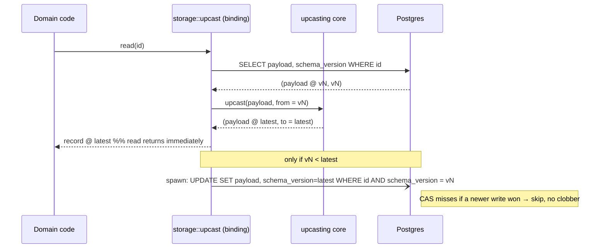

# Data Upcasting Engine — Design

## Required reads

- @docs/project/adr/0025-two-layer-migration-model.md
- docs/project/design/architecture-v2/file-layout.md

## Purpose

Realize Layer 1 of `@docs/project/adr/0025-two-layer-migration-model` — per-aggregate
data evolution by lazy upcasting. The engine guarantees domain code only ever sees the
latest shape of a persisted aggregate, so no read path carries a backward-compatibility
branch for an old persisted shape (the ADR's hard rule). It is a shared **kernel, not a
domain**: it ships the engine and conventions and owns **zero** domain transformations.
Each bounded context declares its own version chain and uses the engine.

The engine is two cooperating pieces, split along the storage boundary:

- **The transform core** (`crates/upcasting`) — storage-agnostic, synchronous, depends only
  on `serde_json`. It is the realization of "a `versions/`-per-aggregate convention, a
  declarative transformer for the common cases, and an escape hatch to custom handlers."
- **The Postgres convergence binding** (`crates/storage`) — the read-through / write-back /
  sweep machinery over `PgPool`. It depends on the core and on the consumer's own
  persistence, never on a specific domain's schema.

This split is the deliberate refinement of ADR-0025's "lives in shared infrastructure
(`shared`/`storage`)"; the reasoning is recorded in
`@docs/project/adr/0031-upcasting-engine-shape`.

## Inputs/Outputs

**Inputs:**

- A stored semi-structured record: a JSONB payload plus a per-record `schema_version`
  integer (the only source of truth for that record's shape — there is no installation-level
  applied flag).
- A domain-declared, contiguously-ordered **version chain** for one aggregate: a sequence of
  steps `vN → vN+1`, each either a declarative op set or a custom handler.
- A consumer-supplied persistence implementation (how to fetch a record's payload+version,
  how to conditionally persist the upgraded form, how to select cold records).

**Outputs:**

- The record handed to domain code already at the latest shape — domain code contains no
  version branch.
- Opportunistic store convergence: the upgraded form written back **off the read path**,
  **non-destructively**.
- A cold-data sweep primitive that force-converges never-read records so an upcaster spanning
  fully-converged versions can be retired.

## Invariants

- **Domain code only ever sees the latest shape.** A compat branch for an old persisted
  shape in domain logic is a defect, never a pragmatic exception (ADR-0025 hard rule).
- **The record's own `schema_version` is the only truth.** Whether and how far a record is
  upgraded on read is decided by its stamp, not by any global flag. After a successful
  write-back the stamp equals the latest version.
- **The transform core is storage-agnostic and synchronous.** It depends only on
  `serde_json` (plus `thiserror`) — no `sqlx`, no `tokio`. This keeps it reusable by any
  consumer (including a file-based one) and keeps `crates/shared` tiny. It lives in the
  infrastructure-crosscut crate `crates/upcasting`, alongside the existing generic-engine
  precedent `crates/state-machine`.
- **The DB convergence binding lives in `crates/storage`.** Storage already owns
  `sqlx::PgPool` helpers; the read-through/write-back/sweep machinery is a `PgPool` helper.
  It depends on `crates/upcasting`; it is the only piece that touches the database.
- **Write-back is best-effort, asynchronous, AND no-loss.** It runs off the read path
  (`tokio::spawn`, fire-and-forget, log-on-failure) so a read is never blocked on the
  persist, mirroring the established commit-then-emit at-most-once pattern in
  `workflow::service`. It is guarded by a compare-and-set: the persist only lands when the
  row is still at the version that was read (`… WHERE schema_version = $from_version`). If a
  concurrent domain write or a newer convergence already advanced the row, the CAS matches
  nothing and the write-back skips. Convergence therefore **never overwrites a concurrent
  write or a newer version**.
- **The engine never interpolates table or column names.** The consumer implements a
  persistence trait that issues its own typed `sqlx` queries (fetch, CAS-persist,
  select-cold); the engine owns chain execution and convergence orchestration. This keeps SQL
  ownership inside the owning bounded context and removes any dynamic-SQL injection surface.
- **The engine ships zero domain transformations.** Each consuming aggregate supplies its own
  version chain. Wiring any real aggregate (e.g. `workflow.todos`: adding its `schema_version`
  column and its `versions/`) is a downstream todo, not this kernel.
- **Config is not a database consumer.** `crates/config` is file-based YAML with a
  `#[serde(flatten)]` `extra` passthrough and no Postgres schema; it does not use the
  convergence binding. If a parsed config document ever needs structural evolution, it reuses
  only the synchronous transform core on its `serde_json::Value`-projected form. No Python
  counterpart is built unless a future consumer is grounded that cannot reach the Rust core.
- **The chain is contiguous and ordered.** Constructing a chain with a gap or a duplicated
  version is a construction-time error, not a silent skip.

## Primary flows

### Read-through with non-blocking, no-loss write-back



The read returns the upgraded record without waiting on the persist. The write-back is a
separate spawned task whose conditional `UPDATE` is a no-op when the row has since advanced.

### Chain composition — declarative plus custom escape hatch

A version chain is an ordered list of steps. The common cases are declarative and need no
imperative code:

- **Rename** — move a field's value to a new key.
- **AddWithDefault** — introduce a field with a default when absent.
- **Coerce** — convert a field's JSON type (e.g. string → number).

When a step is too complex for the declarative ops, it drops to a **custom handler**: an
implementation of a `CustomStep` trait occupying one position in the same ordered chain. The
core executes declarative and custom steps uniformly, composing `vN → vN+1 → … → latest`.

```rust
// crates/upcasting — illustrative shape, not the final signature
pub enum Op {
    Rename { from: String, to: String },
    AddWithDefault { field: String, default: serde_json::Value },
    Coerce { field: String, to: JsonKind },
}

pub trait CustomStep {
    fn apply(&self, value: serde_json::Value) -> Result<serde_json::Value, UpcastError>;
}

// A chain is built once per aggregate and validated for contiguity.
pub struct VersionChain { /* ordered steps, latest version */ }
impl VersionChain {
    pub fn upcast(&self, value: serde_json::Value, from: u32)
        -> Result<(serde_json::Value, u32 /* latest */), UpcastError>;
}
```

### Cold-data sweep (retirement hook, not a scheduler)


The sweep is a primitive the maintenance/`reconciliation` upkeep loop drives; it is **not** a
standalone scheduler or operator product. It force-runs cold records through the same
read-through + CAS-write-back path so that, once every channel has converged, the spanning
upcaster can be removed without data loss.

## Failure modes

- **Write-back fails (DB error, task dropped).** Logged at WARN; the record stays at its old
  version. The next read upcasts again (idempotent) and retries the write-back. No data loss —
  Postgres remains the source of truth, exactly as in the commit-then-emit pattern.
- **Concurrent write during write-back.** The CAS `WHERE schema_version = $from` matches
  nothing because the row advanced; the write-back is a no-op. The live write wins. No clobber.
- **Cold data never read.** It keeps its old version indefinitely; absent a sweep the chain
  cannot be safely shortened and grows unbounded. The sweep hook is the deliberate remedy —
  retiring an upcaster is gated on the sweep having converged the slowest channel.
- **Chain gap or duplicate version.** Rejected at chain construction; the engine refuses to
  run an incoherent chain rather than skipping a step silently.
- **Custom handler errors or panics on a record.** Surfaced as an `UpcastError` for that
  record; the read **fails closed** for that record rather than delivering a half-upgraded
  shape. One poisoned record does not corrupt the store or block others.
- **Engine asked to interpolate a table name.** Impossible by construction — the engine has
  no table knowledge; the consumer trait owns all SQL.

## See Also

- docs/project/adr/0025-two-layer-migration-model.md
  the two-layer decision this realizes.
- docs/project/adr/0031-upcasting-engine-shape.md
  why a dedicated core crate, CAS write-back, and trait-owned SQL.
- docs/project/spec/domain/reconciliation.md
  owns the distinct Layer-2 installation migration, and drives the sweep hook.
