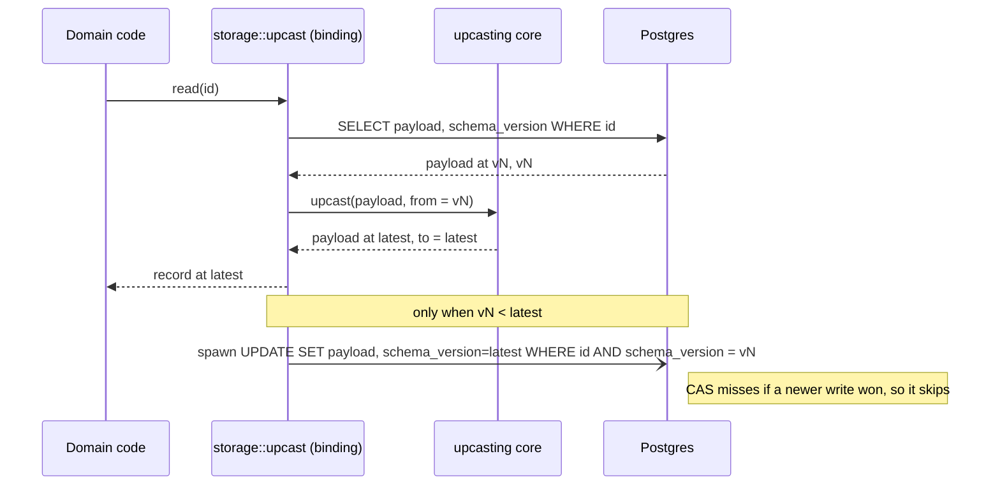
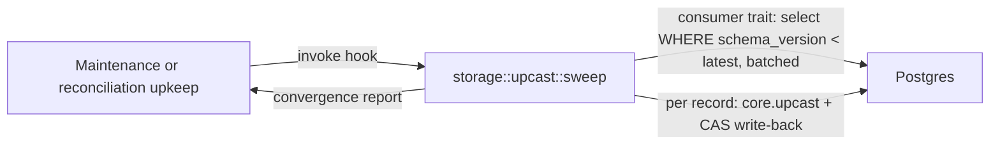

# Data Upcasting Engine — Design

## Purpose

The data-upcasting engine evolves persisted semi-structured records lazily and per record,
so domain code only ever receives the latest shape of an aggregate and no read path carries
a backward-compatibility branch for an old persisted shape.

The engine is a shared kernel, not a bounded context: it ships the engine and the conventions
and owns zero domain transformations. Each bounded context declares its own version chain and
uses the engine.

The engine is two cooperating pieces, split along the storage boundary:

- **The transform core** (`crates/upcasting`) — storage-agnostic and synchronous, depending
  only on `serde_json`. It provides the `versions/`-per-aggregate convention, the declarative
  transformer for the common cases, and the escape hatch to custom handlers.
- **The Postgres convergence binding** (`crates/storage`) — the read-through, write-back, and
  sweep machinery over `PgPool`. It depends on the core and on the consumer's own
  persistence; it never depends on a specific domain's schema.

## Inputs/Outputs

**Inputs:**

- A stored semi-structured record: a JSONB payload plus a per-record `schema_version`
  integer. The stamp is the only source of truth for the record's shape; there is no
  installation-level applied flag.
- A domain-declared, contiguously-ordered **version chain** for one aggregate: a sequence of
  steps `vN → vN+1`, each either a declarative op set or a custom handler.
- A consumer-supplied persistence implementation: how to fetch a record's payload and
  version, how to conditionally persist the upgraded form, how to select cold records.

**Outputs:**

- The record handed to domain code already at the latest shape, with no version branch in
  domain code.
- Opportunistic store convergence: the upgraded form written back off the read path,
  non-destructively.
- A cold-data sweep primitive that force-converges never-read records so a fully-spanned
  upcaster can be removed.

## Invariants

- **Domain code only ever sees the latest shape.** A backward-compatibility branch for an old
  persisted shape in domain logic is a defect.
- **The record's own `schema_version` is the only truth.** Whether and how far a record is
  upgraded on read is decided by its stamp. After a successful write-back the stamp equals the
  latest version.
- **The transform core is storage-agnostic and synchronous.** It depends only on `serde_json`
  and `thiserror` — no `sqlx`, no `tokio`. It lives in the infrastructure-crosscut crate
  `crates/upcasting` and is usable by a consumer that has no database.
- **The Postgres convergence binding lives in `crates/storage`** and depends on the core. It
  is the only piece that touches the database.
- **Write-back is best-effort, asynchronous, and no-loss.** It runs off the read path on a
  spawned task and logs on failure, so a read never blocks on the persist. It is guarded by a
  compare-and-set: the persist lands only when the row is still at the version that was read
  (`… WHERE schema_version = $from_version`). When a concurrent write or a newer convergence
  has advanced the row, the compare-and-set matches nothing and the write-back skips.
  Convergence never overwrites a concurrent write or a newer version.
- **The engine never interpolates table or column names.** The consumer implements a
  persistence trait that issues its own typed `sqlx` queries (fetch, compare-and-set persist,
  select-cold); the engine owns chain execution and convergence orchestration.
- **The engine ships zero domain transformations.** Each consuming aggregate supplies its own
  version chain.
- **Config is not a database consumer of the engine.** `crates/config` is file-based YAML
  with a `#[serde(flatten)]` passthrough and no Postgres schema; the synchronous core is
  reusable on a `serde_json::Value` without the convergence binding.
- **A version chain is contiguous and ordered.** A gap or a duplicated version is a
  construction-time error.

## Primary flows

### Read-through with non-blocking, no-loss write-back



The read returns the upgraded record without waiting on the persist. The write-back runs on a
separate spawned task; its conditional `UPDATE` is a no-op when the row has advanced.

### Chain composition — declarative plus custom escape hatch

A version chain is an ordered list of steps. The common cases are declarative and need no
imperative code:

- **Rename** — move a field's value to a new key.
- **AddWithDefault** — introduce a field with a default when absent.
- **Coerce** — convert a field's JSON type.

A step too complex for the declarative ops drops to a **custom handler**: an implementation of
a `CustomStep` trait occupying one position in the same ordered chain. The core executes
declarative and custom steps uniformly, composing `vN → vN+1 → … → latest`.

```rust
// crates/upcasting (illustrative shape)
pub enum Op {
    Rename { from: String, to: String },
    AddWithDefault { field: String, default: serde_json::Value },
    Coerce { field: String, to: JsonKind },
}

pub trait CustomStep {
    fn apply(&self, value: serde_json::Value) -> Result<serde_json::Value, UpcastError>;
}

pub struct VersionChain { /* ordered steps, latest version */ }
impl VersionChain {
    pub fn upcast(&self, value: serde_json::Value, from: u32)
        -> Result<(serde_json::Value, u32 /* latest */), UpcastError>;
}
```

### Cold-data sweep



The sweep is a primitive, not a scheduler; the maintenance or reconciliation upkeep loop
drives it. It force-runs cold records through the read-through and compare-and-set write-back
path so that, once every channel has converged, the spanning upcaster can be removed.

## Failure modes

- **Write-back fails (DB error, task dropped).** Logged; the record stays at its old version.
  The next read upcasts again and retries the write-back. No data is lost; Postgres remains the
  source of truth.
- **Concurrent write during write-back.** The compare-and-set matches nothing because the row
  advanced; the write-back is a no-op and the live write wins.
- **Cold data never read.** It keeps its old version until a sweep runs; absent a sweep the
  chain cannot be shortened. The sweep hook force-converges cold records so a spanning upcaster
  can be retired.
- **Chain gap or duplicate version.** Rejected at chain construction; the engine refuses to
  run an incoherent chain.
- **Custom handler errors on a record.** Surfaced as an `UpcastError` for that record; the
  read fails closed for that record rather than delivering a half-upgraded shape.
- **Engine asked to interpolate a table name.** Impossible by construction; the engine has no
  table knowledge and the consumer trait owns all SQL.

## See Also

- docs/project/adr/0025-two-layer-migration-model.md
  the two-layer migration decision this realizes.
- docs/project/spec/domain/reconciliation.md
  owns the distinct installation-structural migration and drives the sweep hook.
- docs/project/design/architecture-v2/file-layout.md
  the workspace crate layout this engine's crates sit in.
