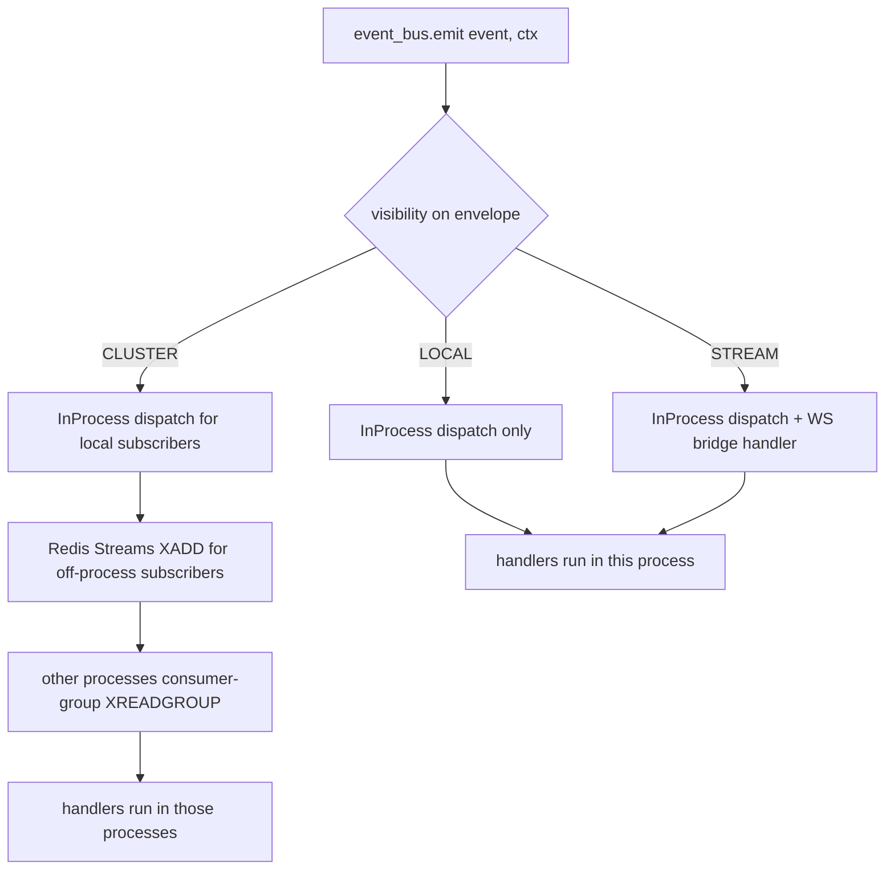

# Event Bus Transports — Design

## Required reads

- @docs/project/design/architecture-v2/overview.md
- @docs/project/design/architecture-v2/bounded-contexts.md
- @docs/project/design/architecture/layer-ownership.md

## Purpose

Define the event bus contract for the v2 platform: how events are scoped, which
transport carries them, and how same-process and cross-process subscribers are
served by one uniform API.

The contract is introduced now, while the platform is still a monolith, so that
the v1 daemon's broken Redis-pool-exhausted state can be repaired without a hack
and the eventual extraction of services into their own processes becomes a
deployment change rather than a code rewrite.

This snippet specifies the vocabulary and the rules. It commits to a three-scope
model. It fully designs the transitional implementation that lands in v1
(LOCAL + CLUSTER). It sketches but does not yet design the STREAM transport,
which carries high-volume in-process fanout and the co-located WebSocket
endpoint pattern; STREAM is a follow-up increment with its own design pass.

## Inputs/Outputs

**Inputs:**

- the v2 bounded-context decomposition (Identity, Session Runtime, Workflow,
  Session Ledger, Context & Knowledge, Integration & Events, Presentation,
  Configuration, Agent Artifacts).
- the v1 outage that surfaced the contract gap: every internal event currently
  goes through Redis Streams XADD regardless of scope, the daemon's Redis
  connection pool exhausts under sustained load, and same-process listeners pay
  full network cost.
- the existing `EventVisibility` enum (`LOCAL`, `CLUSTER`, `PUBLIC`) in
  `teleclaude/events/envelope.py`, already partially honored by event schemas
  but ignored by the internal `EventBus`.

**Outputs:**

- the three-scope vocabulary and what each scope means semantically.
- the transport-selection rules driven by visibility.
- the tagging rules a developer applies when emitting a new event.
- the increment plan that distinguishes what lands now (LOCAL + CLUSTER) from
  what is deferred (STREAM).
- the discipline that prevents in-process convenience from rebuilding the
  monolith inside the contract.

## Invariants

- **Visibility is logical scope, not deployment topology.** A `session_updated`
  event carries the same visibility regardless of whether Presentation is
  co-located with Session Runtime today or a separate process tomorrow.
- **Direct cross-context calls are forbidden, even within one process.** If
  emitter and subscriber belong to different bounded contexts, communication
  goes through the event bus. Same-process speed is a property of the transport,
  never of an out-of-band shortcut.
- **LOCAL never touches Redis.** A LOCAL event is dispatched in-process,
  synchronously, to the registered handler set. There is no cross-host visibility
  by design.
- **CLUSTER reaches every subscriber.** Same-process subscribers receive a
  CLUSTER event through the local dispatch path; off-process subscribers receive
  it through Redis Streams. Same envelope, single emit, two delivery legs. No
  self-redelivery loop: handlers that already fired locally are not re-fired
  when Redis redelivers the envelope to the originating process.
- **Idempotency is the dedup primitive.** Every envelope carries an
  `idempotency_key`. The bus records successful handler executions against this
  key so that local-then-Redis redelivery and consumer-group retries converge to
  at-most-once handler firing.
- **Cross-host failure does not break in-process delivery.** When Redis is
  unavailable, LOCAL events continue to dispatch and CLUSTER events still reach
  same-process subscribers. Off-process CLUSTER delivery degrades but does not
  poison the daemon's liveness.
- **The bus surface is stable across transports.** `event_bus.emit`,
  `event_bus.subscribe`, and `event_bus.unsubscribe` have the same shape and the
  same semantics regardless of the scope of the event. Callers do not branch on
  transport.

## Primary flows

### The three scopes

| Scope     | Transport(s)                                     | Durability | Cross-process? | Cross-host? | Example events                                                                                |
| --------- | ------------------------------------------------ | ---------- | -------------- | ----------- | --------------------------------------------------------------------------------------------- |
| `LOCAL`   | InProcess dispatch only                          | none       | no             | no          | `AGENT_READY`, internal readiness gates, same-coroutine completion signals                    |
| `STREAM`  | InProcess dispatch + co-located WebSocket bridge | none       | no\*           | no\*        | `agent_activity`, `tool_use`, `user_prompt_submit`, session lifecycle live-streaming (future) |
| `CLUSTER` | InProcess dispatch + Redis Streams               | durable    | yes            | yes         | `operation.todo_*.completed`, workflow handoff, integrator coordination, system events        |

\* STREAM is in-process for the data plane. Remote clients reach a STREAM event
by connecting via WebSocket to the process that owns the entity (e.g., the
Session Runtime hosting a given session). The control plane that tells the
client *which* process to connect to is a Presentation-context concern and uses
the API, not the event bus.

### Transport selection rule

### Tagging rule — how to decide a new event's scope

Apply the questions in order. The first one that fits decides the scope.

1. **Is the emitter waiting for a same-coroutine completion signal, with a
   single waiter and no fanout?** → `LOCAL`. Examples: readiness gates,
   in-process completion futures.
2. **Does the event cross a v2 bounded-context boundary?** That is: at least one
   subscriber lives in a different bounded context from the emitter, *in the v2
   target topology*. Today's process layout is irrelevant. → `CLUSTER`. Examples:
   `operation.*.completed` (Workflow → Integration & Events), integrator handoff
   (Workflow → Workflow on another host).
3. **Is the event a high-volume in-context broadcast whose subscribers include
   live-streaming endpoints?** → `STREAM`. Examples: agent activity feeds,
   session lifecycle live-streaming. STREAM is in-process; remote consumers
   reach it through a WebSocket bridge co-located with the emitter.

The default when uncertain is **not** LOCAL. Defaulting to LOCAL for convenience
is the failure mode that quietly rebuilds the monolith. Defaulting to CLUSTER
preserves correctness — a CLUSTER event still dispatches locally for
same-process subscribers, so the only cost of a false CLUSTER is a Redis XADD
that nobody consumes off-process. A false LOCAL silently drops cross-context
delivery and that lie is invisible until production breaks.

### Bounded-context audit for current daemon events

This table fixes the v2-correct visibility for the events the v1 daemon currently
emits. The Increment 1 implementation tags each event in code per this table.
Events not listed here keep their existing default until they are reviewed.

| Event                                                                  | v2 emitter context | v2 subscriber contexts                              | Scope                       |
| ---------------------------------------------------------------------- | ------------------ | --------------------------------------------------- | --------------------------- |
| `AGENT_READY`                                                          | Session Runtime    | Session Runtime (launcher coroutine)                | `LOCAL`                     |
| `agent_activity`, `tool_use`, `user_prompt_submit`                     | Session Runtime    | Session Runtime (WS bridge), Session Ledger         | `STREAM` (Increment 2)      |
| `session_started`, `session_updated`, `session_closed`, `session_status`| Session Runtime    | Session Runtime (WS bridge), Workflow, Session Ledger| `STREAM` (Increment 2)      |
| `agent_availability`                                                   | Session Runtime    | Session Runtime (WS bridge), Workflow               | `STREAM` (Increment 2)      |
| `operation.todo_create.completed`                                      | Workflow           | Workflow                                            | `CLUSTER`                   |
| `operation.todo_prepare.completed`                                     | Workflow           | Workflow                                            | `CLUSTER`                   |
| `operation.todo_work.completed`                                        | Workflow           | Workflow, Integration & Events                      | `CLUSTER`                   |
| `operation.todo_integrate.completed`                                   | Workflow           | Workflow, Integration & Events                      | `CLUSTER`                   |
| `operation.todo_remove.completed`                                      | Workflow           | Workflow                                            | `CLUSTER`                   |
| `system_command`                                                       | cross-cutting      | many                                                | `CLUSTER`                   |
| `error`                                                                | cross-cutting      | Presentation, Session Ledger                        | `CLUSTER`                   |
| `notification_*`, `session_escalated`                                  | Integration & Events| Presentation                                        | `CLUSTER`                   |

The audit identifies STREAM-eligible events but they remain `CLUSTER` in
Increment 1 because the STREAM transport ships in Increment 2. That keeps
correctness intact at the cost of continued Redis traffic for these events
during the transitional window. The `max_connections` bump in Increment 1
absorbs that load.

### Increment plan

**Increment 1 — visibility-aware dispatch over two transports.**

Lands the LOCAL and CLUSTER transports plus the contract above.

- `EventBus._publish` stops hardcoding `visibility=CLUSTER`. The visibility
  comes from an explicit `emit(event, ctx, visibility=…)` parameter; the
  envelope carries it.
- `EventBus.emit` performs synchronous in-process dispatch first by iterating
  `self._handlers[event]` and scheduling each handler in the current loop. The
  existing `_successful_handlers` cache records handler success keyed by
  `idempotency_key`.
- For `CLUSTER` envelopes, `emit` additionally schedules a background `xadd`
  publish task — current behavior, but now opt-in by visibility rather than
  default.
- For `LOCAL` envelopes, the `xadd` step is skipped entirely.
- The consumer-group side (`deliver` in `EventBus`) keeps its current dedup
  check; same-process redelivery of a locally-already-fired envelope is a
  no-op per handler.
- The per-event audit table above is encoded by passing the correct visibility
  at every existing `event_bus.emit` call site.
- `config.yml:redis.max_connections` is raised from 30 to 100 as transitional
  monolith-era sizing. The change is documented as transitional and is
  expected to shrink once services split.

Result: daemon restart loads the fix, AGENT_READY (and any other LOCAL events)
stop touching Redis, the pool no longer exhausts under sustained operation,
and the v2 contract is in place for every emit site.

**Increment 2 — STREAM transport and co-located WebSocket bridge.**

Requires a separate design pass. The decisions to settle:

- Does the daemon's current WebSocket endpoint move into Session Runtime's
  process explicitly, or does it stay where it is and subscribe via the
  STREAM bus?
- How does a remote TUI / web client discover which process hosts a given
  session? (Presentation API; the existing computers/sessions catalog likely
  suffices.)
- What is the back-pressure contract for the WS bridge when a subscriber is
  slow?
- Does STREAM carry an `idempotency_key` and per-handler dedup, given there
  is no durability guarantee?

Once that design lands, the STREAM-eligible events from the audit table move
from CLUSTER to STREAM in a follow-up implementation increment, and Redis
traffic drops to the CLUSTER-only steady state.

**Increment 3+ — service extraction per the v2 reconstruction order.**

By this point the event bus contract is correct. Extracting a bounded context
(for example, moving the API server out of the daemon) is a deployment
change: same emit, same subscribe, the CLUSTER leg of every cross-context
event now carries traffic that previously delivered in-process. No code in
the bus needs to change for an extraction.

### Operational properties

- **Pool sizing.** The monolith-era `max_connections: 100` covers the
  transitional window where CLUSTER plus to-be-STREAM events all run through
  Redis. Once Increment 2 lands and STREAM events bypass Redis, the steady-state
  pool requirement drops back toward the original 30. Services that emerge
  through extraction each carry their own pool budget.
- **Redis outage behavior.** LOCAL traffic is unaffected. CLUSTER traffic
  continues to dispatch to same-process subscribers. Off-process CLUSTER
  delivery fails fast at XADD time; per the contract documented on
  `EventBus`'s module docstring, workflow truth lives in SQLite-owned stores
  and clients fall back to polling canonical state. The bus does not buffer
  beyond Redis's own retry semantics in Increment 1; bounded local buffering on
  outage is a deferred enhancement and is not blocking for the v1 recovery.
- **Observability.** Increment 1 adds two counters: `event_bus.local_dispatch`
  and `event_bus.cluster_publish`. Their ratio is the operational read on how
  much steady-state Redis traffic remains attributable to in-context fanout —
  the signal that STREAM is needed and that the Increment 2 audit is paying
  off.

## Failure modes

**Tagging by deployment, not scope.** A developer sees that two services live
in the same daemon today and tags an event LOCAL "because it's faster." The
extraction breaks because LOCAL events do not cross processes. The discipline:
tag for v2 topology, not v1 topology.

**Defaulting to LOCAL for convenience.** LOCAL is fast; CLUSTER costs a Redis
hop. Under pressure to make something "lightweight," a developer reaches for
LOCAL when the event genuinely crosses contexts. The lie is invisible until a
remote subscriber goes silent. The discipline: when uncertain, choose CLUSTER.
A spurious XADD is recoverable; a missing one isn't.

**Direct cross-context calls within one process.** "We're both in the daemon
anyway; just `await presentation.notify_session_updated(...)`." This rebuilds
the monolith inside the bus contract. The next extraction discovers the call
the hard way. The discipline: cross-context coordination always goes through
the bus, even when both contexts are co-located.

**Treating the WS bridge as an exception.** The Presentation context owns the
WebSocket *API surface* (auth, framing, discovery), but the *data plane* of a
STREAM event flows from the entity-owning process via a co-located bridge.
Trying to route STREAM events through Redis to satisfy a notion of "all events
must be cluster-visible" reintroduces the pool pressure the contract is
designed to eliminate. The discipline: STREAM is in-process by design and
remote visibility is provided by where the WebSocket terminates, not by the
broker.

**Re-firing locally-delivered handlers when Redis redelivers.** The
`_successful_handlers` cache exists to prevent this. Removing or bypassing it
under the assumption "it's a fresh consumer-group read so it must be new"
silently double-fires handlers for CLUSTER events emitted in the same process
as a same-process subscriber. The discipline: the idempotency key is the
identity of an envelope across delivery legs; trust it.

## See Also

- docs/project/design/architecture-v2/bounded-contexts.md — the contexts that define what counts as crossing a boundary.
- docs/project/design/architecture-v2/reconstruction-order.md — the order in which contexts move from monolith to standalone services.
- docs/project/design/architecture/layer-ownership.md — why downstream layers receive fully resolved inputs and never reach sideways.
- docs/project/spec/event-vocabulary.md — the authoritative list of event types.
