# Prepare Discovery Flow — Design

## Purpose

Codify the prepare-phase discovery as a deterministic process the orchestrator follows every time. Not an agent-chosen sequence — a meticulous flow that guarantees exhaustive coverage of the discovery lanes, paired meta-questioning to surface what initial production missed, consolidation, tailor-fit, and reframe for user confirmation.

Discovery operates as enterprise-specialist intake: hear the customer's intent, build the complete picture of what serving that intent means, trim ruthlessly to what fits, present back for confirmation. The agents lead the technical work; the user is the source of intent.

## Inputs/Outputs

**Inputs:**

- `telec todo artifacts read {slug} input` — user-provided intent for the work item.
- Codebase state: greenfield or brownfield context inferred by the orchestrator from the area the input touches.
- Domain specs loaded via `telec docs index` / `telec docs get` for the domains the input references.
- Roadmap (`telec roadmap list`) for adjacent in-flight or delivered work that constrains or enables this.
- User proficiency level from PersonDTO injection (or asked once at session start).

**Outputs:**

| Artifact | Owner | Purpose |
| --- | --- | --- |
| `discovery-a.md` | orchestrator | turn-marked, append-only, working artifact for orchestrator's discovery |
| `discovery-b.md` | peer | turn-marked, append-only, working artifact for peer's discovery |
| `discovery-consolidated.md` | orchestrator | merged per-lane synthesis from both working artifacts |
| `discovery-tailor-fit.md` | orchestrator (or separate critic agent) | MoSCoW classification of every surfaced item |
| `discovery-reframe.md` | orchestrator | user-facing inspectable artifact for confirmation |

The confirmed reframe is the handoff input to the next phase: authoring the requirements artifact.

## Invariants

**Deterministic flow (no agent choice on sequence):**

- Context establishment is performed before peer dispatch.
- Peer is dispatched in parallel with the same input + context + lane set.
- Both agents answer the full lane set in Turn 1 (blind to each other).
- Both agents perform the meta-questioning pass in Turn 2 (each sees the other's Turn 1).
- Consolidation, drift check, tailor-fit run in order.
- Reframe is authored before the user is shown anything.
- No step is skipped, no order is reordered.

**Adaptive within steps (informed by context):**

- Lane weights — greenfield emphasizes impact and risk; brownfield emphasizes dependency and constraint.
- Whether a third inhalation round runs (default no; only if Turn 2 surfaced major material).
- Whether blocking intent questions exist that require interim user input.
- Cross-model peer selection (Codex vs. Gemini) based on what's available and what cognitive style suits the work.

**Guarantees the flow provides:**

- **Coverage.** Every lane is answered, twice (initial pass + meta-questioning).
- **Independence.** Peer's Turn 1 is blind; cross-model preferred for cognitive diversity.
- **Iteration.** The second turn catches what the first missed, without endless rounds.
- **Trim discipline.** MoSCoW forces explicit classification rather than implicit promotion of everything surfaced.
- **User stewardship.** The user sees a coherent reframe, not the messy process; they confirm or refine; they don't get pulled into the agents' working surface.
- **Replayability.** Every output is an artifact; the discovery can be inspected, audited, or re-run from any node.

## Primary flows

### The deterministic flow

```mermaid
flowchart TD
    Start([User input received]) --> Context[Establish context<br/>greenfield or brownfield<br/>load domain specs via telec docs<br/>read roadmap for adjacent work<br/>read user input in full]

    Context --> Dispatch[Dispatch peer in parallel<br/>cross-model preferred Codex or Gemini<br/>same input plus same context references<br/>same lane question set]

    Dispatch --> Inhale1{Inhalation 1<br/>parallel, blind}

    Inhale1 --> A1[Orchestrator answers full lane set<br/>in one pass<br/>writes discovery-a.md Turn 1]
    Inhale1 --> B1[Peer answers full lane set<br/>in one pass<br/>writes discovery-b.md Turn 1]

    A1 --> Sync1((Sync))
    B1 --> Sync1

    Sync1 --> Inhale2{Inhalation 2<br/>meta-questioning}

    Inhale2 --> A2[Orchestrator reads peer Turn 1<br/>and own Turn 1<br/>re-asks lane set focused on<br/>what was missed, what newly surfaces<br/>writes discovery-a.md Turn 2]
    Inhale2 --> B2[Peer reads orchestrator Turn 1<br/>and own Turn 1<br/>re-asks lane set focused on<br/>what was missed, what newly surfaces<br/>writes discovery-b.md Turn 2]

    A2 --> Sync2((Sync))
    B2 --> Sync2

    Sync2 --> Consolidate[Consolidation<br/>orchestrator merges both artifacts<br/>per-lane synthesis:<br/>actor map, impact map,<br/>approach options, dependency surface,<br/>constraint map, pre-mortem,<br/>success criteria, scope boundaries<br/>writes discovery-consolidated.md]

    Consolidate --> DriftCheck{Drift check<br/>each lane traces<br/>back to user input?}

    DriftCheck -->|drift items found| FlagDrift[Mark drift items<br/>for tailor-fit trim]
    DriftCheck -->|clean| TailorFit
    FlagDrift --> TailorFit

    TailorFit[Tailor-fit<br/>MoSCoW classification<br/>every surfaced item<br/>Must, Should, Could, Won't<br/>with one-sentence rationale per item<br/>writes discovery-tailor-fit.md]

    TailorFit --> IntentCheck{Open intent questions<br/>that block tailor-fit?}

    IntentCheck -->|yes| UserInterim[Surface batched intent questions<br/>to user at proficiency level<br/>collect answers]
    IntentCheck -->|no| Reframe
    UserInterim --> Consolidate

    Reframe[Author reframe artifact<br/>JTBD-shaped statement,<br/>Must items in user language,<br/>Should items with rationale,<br/>Won't items with reasoning,<br/>success criteria in Gherkin form,<br/>any remaining open questions<br/>writes discovery-reframe.md]

    Reframe --> UserConfirm{User confirms reframe?}

    UserConfirm -->|yes| Done([Discovery complete<br/>proceed to requirements artifact])
    UserConfirm -->|no, refine| Refine[Capture refinement<br/>incorporate user delta<br/>identify which lanes need re-work]

    Refine --> Consolidate
```

### Node responsibilities

**Establish context.** Orchestrator-only. Read user input in full. Determine greenfield vs brownfield by inspecting the codebase area the input references. Load relevant domain specs via `telec docs index` and `telec docs get`. Read roadmap for adjacent in-flight or delivered work. Output: context block used in both subsequent dispatches.

**Dispatch peer.** Cross-model preferred (Codex or Gemini). Fire-and-forget with `--detach`. Peer receives the same user input, the same context references, and the same lane question set. Peer does not see the orchestrator's working artifact.

**Inhalation 1 (parallel, blind).** Both agents answer every lane question in one pass against the input and context. The full lane set is presented at once. One pass each, no inter-agent reads yet. Output: two independent artifacts.

**Inhalation 2 (meta-questioning).** Each agent reads the other's Turn 1 and its own Turn 1, then re-passes the lane question set focused on "what did we miss between us; what newly surfaces from reading both." Output: Turn 2 appended in each artifact. Termination after Turn 2 is the default; a third round only if Turn 2 surfaced major new material.

**Consolidation.** Orchestrator-only step. Read both discovery artifacts. Merge per-lane content into a single consolidated view: actor map deduplicated, impact map tree-merged, approach options matrix, and so on per lane. Output: `discovery-consolidated.md`.

**Drift check.** For each consolidated lane, trace back to user input. Items that don't trace get flagged `[drift]`. Tailor-fit considers them for trimming.

**Tailor-fit (MoSCoW).** Every surfaced item across all lanes is classified Must / Should / Could / Won't with a one-sentence rationale. Drift-flagged items default to Could or Won't unless rationale upgrades them. Output: `discovery-tailor-fit.md`.

**Open-intent check.** Questions surfaced in discovery that require user judgment are classified: resolvable from source (resolve and update consolidation), blocking tailor-fit (surface to user now, batched, at proficiency level), or non-blocking (hold for reframe).

**Reframe.** Orchestrator authors the inspectable artifact the user reads. Includes JTBD-shaped statement, Must items articulated in the user's register, Should items with rationale, Won't items with reasoning, success criteria in Gherkin form, any non-blocking open questions. Output: `discovery-reframe.md`.

**User confirm.** User reads reframe. Confirms (discovery complete) or refines (delta incorporated; consolidation re-runs with the new input).

## Failure modes

- **Peer dispatch fails or returns unusable output.** Orchestrator continues solo; the reframe notes the missing second perspective.
- **Discovery exhausts after Turn 1.** When both agents agree the input is small and nothing more surfaces, the orchestrator may skip Turn 2 and proceed directly to consolidation. Short discoveries are valid for small intents.
- **User input is too sparse.** Orchestrator surfaces this immediately as a single clarifying question to the user, at their proficiency level. Does not invent material.
- **Refine loop reveals a missed lane or wrong frame.** Current v1 routes refinement back to consolidation. If the refinement reveals a structural gap that consolidation cannot fill, a focused re-inhalation may be needed; this branch is not yet codified — see open items below.
- **Endless inhalation churn.** If a third inhalation round is run and produces minimal new material, terminate inhalation and proceed to consolidation regardless.
- **Mid-process user interaction over-engineered.** The flow includes an optional interim user step when intent questions block tailor-fit. This may turn out to be over-engineered in practice — alternative is to push all intent questions to the reframe step and let the user resolve them there.
- **Tailor-fit ownership undecided.** Draft has the orchestrator doing tailor-fit. Alternative: a separate dispatched critic agent (cross-model) does it for additional independence. Worth deciding before this hardens.

## See Also

- docs/global/software-development/procedure/lifecycle/prepare/discovery-v2.md
- docs/global/software-development/concept/intake-frameworks.md
- docs/global/software-development/policy/preparation-artifact-quality.md
