# Prepare Discovery Flow — Design

## Purpose

Codify the prepare-phase discovery as a deterministic process the orchestrator follows every time. The agents discuss through their own sessions (orchestrator coordinates dispatch and tailing); blind Turn 1 pins independent perspectives; structured exhaustion terminates the discussion; synthesis + tailor-fit + reframe produce the inspectable handoff to the user.

Discovery operates as enterprise-specialist intake: hear the customer's intent, build the complete picture of what serving that intent means, trim ruthlessly to what fits, present back for confirmation. The agents lead the technical work; the user is the source of intent.

## Inputs/Outputs

**Inputs:**

- `telec todo artifacts read {slug} input` — user-provided intent for the work item.
- Codebase state: greenfield or brownfield, inferred by the orchestrator from the area the input touches.
- Domain specs loaded via `telec docs index` / `telec docs get`.
- Roadmap (`telec roadmap list`) for adjacent in-flight or delivered work.
- User proficiency from PersonDTO injection (or asked once at session start).

**Outputs:**

| Artifact | Owner | Purpose |
| --- | --- | --- |
| `discovery-tailor-fit.md` | orchestrator | synthesized per-lane content with MoSCoW classification and rationale per item |
| `discovery-reframe.md` | orchestrator | user-facing inspectable artifact for confirmation |
| `discovery-a.md` (optional) | orchestrator | working scratchpad, append-only, free-form |
| `discovery-b.md` (optional) | peer | working scratchpad, append-only, free-form |

The discussion itself lives in the orchestrator's and peer's session outputs. Scratchpad artifacts are optional and exist only to make consolidation cheaper to consume — they are not the channel of the discussion. The confirmed reframe is the handoff input to the next phase: authoring the requirements artifact.

## Invariants

**Deterministic structure (no agent choice on sequencing):**

- Context establishment happens before peer dispatch.
- Turn 1 is parallel and blind — both agents work without reading each other.
- From Turn 2 onward the orchestrator conducts the discussion: writes its turn first, then dispatches the peer with a brief that references its turn's content.
- Discussion terminates when both consecutive turns close `exhausted`.
- Tailor-fit synthesis and reframe are authored by the orchestrator.
- The reframe is the user's first sight of the discovery output.
- The flow is not skipped or reordered.

**Adaptive within steps (informed by context):**

- Lane emphasis — greenfield emphasizes impact, approach options, risk; brownfield emphasizes constraints, dependencies, scope.
- Cross-model peer selection (Codex / Gemini) based on availability and cognitive-style fit.
- Whether to use working scratchpad artifacts or operate purely from session output. Either works; the scratchpad simplifies consumption during synthesis.
- Number of meta-discussion turns: bounded by structural exhaustion, not by a fixed cap.

**Guarantees the flow provides:**

- **Coverage.** Every lane is touched in Turn 1; discussion extends and connects across lanes.
- **Independence.** Turn 1 is blind; cross-model preferred for cognitive diversity.
- **Discussion register.** Turn structure enforces engagement and reasoning rather than interview Q&A.
- **Convergence is earned.** Termination by structural exhaustion, not by either side capitulating to fatigue.
- **Trim discipline.** MoSCoW classification with rationale per item forces explicit need-fitness reasoning.
- **User stewardship.** The user sees the reframe, not the discussion. They confirm or refine; the agents handle the iteration loop.
- **Replayability.** Session transcripts persist; the tailor-fit and reframe artifacts are the durable record.

## Primary flows

### The deterministic flow

```mermaid
flowchart TD
    Start([User input received]) --> Context[Orchestrator establishes context<br/>greenfield or brownfield, load domain specs,<br/>read roadmap, read user input in full]

    Context --> Dispatch[Orchestrator dispatches peer for Turn 1<br/>cross-model preferred — Codex or Gemini<br/>brief: input + context + 8-lane question set<br/>--detach]

    Dispatch --> T1{Turn 1 — parallel, blind}
    T1 --> OT1[Orchestrator Turn 1 in own session<br/>full lane set, blind to peer<br/>each contribution carries<br/>from-input / from-source / speculative<br/>optional append to discovery-a.md]
    T1 --> PT1[Peer Turn 1 in own session<br/>full lane set, blind to orchestrator<br/>same citation discipline<br/>optional append to discovery-b.md]
    OT1 --> Sync((Both Turn 1 complete))
    PT1 --> Sync

    Sync --> OTN[Orchestrator Turn N — N starts at 2<br/>tails peer Turn N-1<br/>discussion register:<br/>• engagement with peer's contributions<br/>• reasoning building from their material<br/>• new material from cross-reading<br/>• residual uncertainty<br/>• genuine questions if they emerge<br/>• status — more or exhausted]

    OTN --> Gate{Dispatch peer for Turn N?<br/>defer if orchestrator Turn N exhausted<br/>AND peer prior turn was exhausted}
    Gate -->|defer — discussion done| TailorFit
    Gate -->|continue — material flowing| Disp

    Disp[Orchestrator dispatches peer for Turn N<br/>brief: 'engage with my Turn N,<br/>respond with reasoning,<br/>discussion register — NOT interview']

    Disp -.dispatch or response fails.-> Solo[Orchestrator continues solo<br/>conducts self-engagement meta-pass<br/>notes missing peer in reframe]
    Solo --> TailorFit

    Disp --> PTN[Peer Turn N in own session<br/>tails orchestrator Turn N<br/>same five-element turn structure<br/>closes with status]

    PTN --> Tail[Orchestrator tails peer Turn N]

    Tail --> Ex{Orchestrator Turn N exhausted<br/>AND peer Turn N exhausted?}
    Ex -->|no — material still flowing| OTN
    Ex -->|yes — discussion done| TailorFit

    TailorFit[Orchestrator tailor-fit synthesis<br/>merge per-lane content from both agents<br/>MoSCoW classify every item with rationale<br/>drift handled inline via rationale<br/>open intent questions surfaced for user<br/>write discovery-tailor-fit.md]

    TailorFit --> Reframe[Orchestrator authors reframe<br/>JTBD-shaped statement,<br/>Must / Should / Won't with reasoning,<br/>Success criteria in Gherkin form,<br/>open intent questions at user's level<br/>write discovery-reframe.md]

    Reframe --> Conf{User confirms reframe?}
    Conf -->|yes| Done([Discovery complete<br/>→ requirements phase])
    Conf -->|refine| Delta[Capture user delta]
    Delta --> TailorFit
```

### Round structure inside the meta-discussion

Each round of the meta-discussion (one orchestrator turn + one peer turn) is conducted by the orchestrator in this order:

1. **Orchestrator writes its Turn N** in its own session (after tailing the peer's prior turn). Five-element structure: engagement, reasoning, new material, residual, status.
2. **Self-check:** if orchestrator Turn N is exhausted AND peer's prior turn was exhausted, the discussion is over — skip dispatch.
3. **Dispatch peer for Turn N** with brief referencing the orchestrator's Turn N.
4. **Peer writes Turn N** in its own session — same five-element structure.
5. **Orchestrator tails** the peer's Turn N.
6. **Termination check:** if both Turn N closed exhausted, discussion ends. Otherwise increment N and continue.

The orchestrator's role across rounds: it is both a participant in the discussion (contributing engagement and reasoning) and the conductor (deciding when to dispatch, tailing the peer's output, deciding when termination has been reached).

### Discussion register vs interview register

Critical to the meta-discussion: agents engage with each other's material, not interview each other.

- Interview register: "You raised X. Question for you: what is Y?" Peer dutifully answers. Output is structurally complete and substantively thin.
- Discussion register: "You raised X. That makes me think Y matters because Z, and connects to what I surfaced about W. Where I'm uncertain is V." Peer reads, responds with its own reasoning that builds on this. Output is generative.

The brief enforces discussion register explicitly. Questions are welcome when they emerge from real engagement — they are not the backbone of a turn.

## Failure modes

- **Peer dispatch fails or returns unusable output.** Orchestrator continues solo, runs a single self-engagement meta-pass on its own Turn 1, and notes the missing peer perspective in the reframe.
- **Discussion exhausts at Turn 1.** When both agents report nothing more to surface after Turn 1, the orchestrator skips the meta-discussion and proceeds directly to tailor-fit. Short discoveries are valid for small intents.
- **User input is too sparse.** Orchestrator surfaces a single clarifying question at the user's proficiency level immediately; does not invent material.
- **Discussion runs unusually long without exhaustion.** Treat as a non-convergence signal. The input or context may be ambiguous in a way the agents can't resolve. Surface the state and the apparent disagreement to the user; do not force convergence by exhaustion.
- **Refine loop reveals a missed lane or wrong frame.** Routine refinements re-run tailor-fit only. If the delta opens genuinely new territory the discussion didn't surface, the orchestrator may decide to re-open the meta-discussion with the delta as additional input.
- **Speculative items dominating tailor-fit.** If most contributions are `[speculative]` rather than `[from-input]` or `[from-source]`, the discussion may have over-extended. Tailor-fit's MoSCoW rationale should classify speculative items as Could or Won't unless they're clearly grounded by implication.

### Design choices still being prototyped

- **Pure session output vs. light scratchpads.** The discussion lives in session output + tailing; scratchpad artifacts (`discovery-a.md`, `discovery-b.md`) are optional working documents. Whether they earn their place across many discovery sessions is still open. If session-only proves sufficient, scratchpads can be dropped entirely.
- **Round structure granularity.** The current draft has a single decision gate after orchestrator Turn N (dispatch or defer). Whether more decision points (e.g., explicit early-termination after Turn 1, or a per-lane check at each round) earn their place is open.
- **Drift handling as discipline vs. step.** v1 had a separate drift-check step. v2 folds drift handling into tailor-fit's MoSCoW rationale. Whether this loses important visibility is open.
- **Tailor-fit ownership.** Orchestrator-authored vs. a separate dispatched critic agent (cross-model) for additional independence. Current draft has orchestrator; if practice shows orchestrator's discussion participation biases its tailor-fit, separate the critic.
- **Cap on meta-discussion turns.** v2 has no fixed cap, trusting structural exhaustion. If pathological non-convergence is observed in practice, add a soft cap (e.g., 6 turns each) with a non-convergence flag rather than silent forcing.

## See Also

- ~/.teleclaude/docs/software-development/procedure/lifecycle/prepare/discovery-v2.md
- ~/.teleclaude/docs/software-development/concept/intake-frameworks.md
- ~/.teleclaude/docs/software-development/policy/preparation-artifact-quality.md
