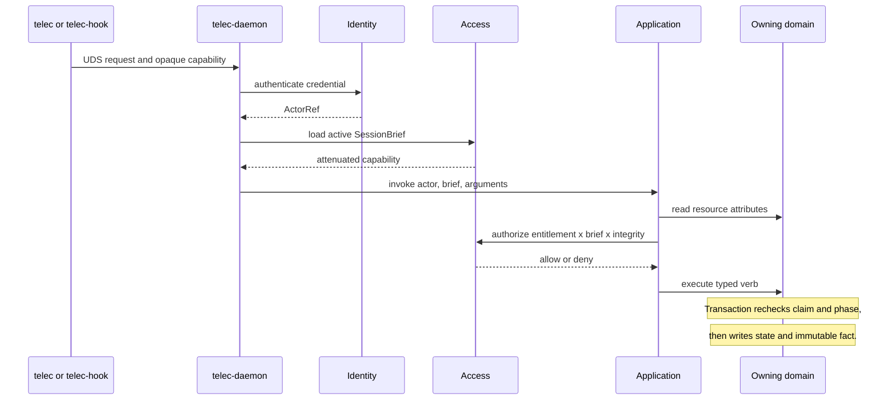

# vNext Authorization — Design

## Required reads

@docs/project/design/architecture-vnext/overview.md

## Purpose

Define one authorization model for CLI, TUI, hooks, APIs, agents, companies,
projects, settings, tools, and personal services. The model prevents authority
from being inferred from a transport, a caller-supplied role, or account
lineage.

## Inputs/Outputs

**Inputs:** an authenticated credential, requested action, target resource
attributes, active session capability, object lifecycle state, and durable
access relationships.

**Outputs:** a typed allow or deny decision, an auditable decision fact, and a
domain transaction that independently re-enforces object invariants.

## Invariants

- A person has one immutable `PersonId`. Email is a mutable unique attribute,
  not an identity key.
- `ActorRef` identifies the authenticated actor. It contains no role or
  authorization snapshot.
- Identity authenticates credentials. Access owns grants, company memberships,
  project bindings, capability briefs, revocations, policy evaluation, and
  security audit facts. Organization owns companies only.
- Infrastructure assigns session identity and role markers. Agent input can
  never choose or widen them.
- The daemon and each per-user executor have distinct machine principals. The
  executor principal can report only spawn result, liveness, and process exit;
  it cannot mint briefs, mutate workflow, complete work, or discharge an
  obligation.
- Every application entrypoint authorizes at the point of action. CLI and TUI
  dispatch do not bypass the gate used by APIs.
- Authorization is default-deny and fail-closed. An unavailable evaluator or
  malformed policy input denies the operation.
- Every allow and deny writes a structured audit fact. Parameters use typed
  fields or digests; secrets and sensitive payloads are never recorded.
- A global platform administrator bypasses entitlement checks only. Claims,
  lifecycle phase, capability attenuation, and transactional integrity remain
  mandatory. Takeover is an explicit audited transition.
- Lineage records whose authority the work ran under; it never proves who
  authored or personally initiated the work.
- Bulk reads apply authorization in the query or projection. Fetch-all and
  hide-in-the-UI is forbidden.

## Primary flows

### Decision model

```text
allow = entitlement(global/scoped role + relationship)
    AND session capability(immutable attenuated brief)
    AND object integrity(claim + lifecycle phase)
```

Each domain owns its action names and resource attributes. `Access` provides
the evaluator and typed conjunction, not a central list of every domain rule.
The first evaluator is exhaustive Rust. Cedar is the designated replacement
candidate when policies become operator-authored, tenant-composed, or exceed
the practical exhaustiveness of typed matching. The public contract remains
`authorize(request) -> Decision`.

### Request flow



The application check protects the use-case boundary. The owning transaction
is authoritative under concurrency and rejects stale claim or phase snapshots.

### Roles and memberships

Access distinguishes global roles from scoped relationships:

- `platform_admin` is the global operational role.
- Company roles are membership-scoped and begin with owner, admin, member, and
  contributor semantics.
- Project and resource grants narrow authority below company scope.
- Contributors see no configuration fields unless a descriptor grants a read
  action. Members see only explicitly permitted fields.
- Agent sessions receive a brief derived from the authenticated person's
  current entitlement and the assigned task. A brief can only reduce authority.

Role names are templates for capabilities, not checks scattered through
transports. Service code evaluates actions and relationships through Access.

### Capability lifecycle

Session capabilities are opaque, short-lived, server-revocable, replay
protected, and bound to an active session. The daemon rotates or renews them
over authenticated UDS while liveness remains valid. Human and API credentials
expire independently. Session completion or revocation invalidates the brief
immediately.

### Execution identities

`telec-daemon` runs under a dedicated service identity and owns runtime
database credentials. A per-user `telec-executor` runs under the human OS
account so it can use that person's worktrees, tmux, and agent-provider login.
It holds no database, bootstrap, or encryption-root authority.

Trust is directional. The executor accepts spawn, signal, and reap orders only
from the daemon service identity, authenticated by peer UID and protocol
credential. Same-user processes cannot command it. The daemon mints the
session brief and hands it down; the executor never requests or widens one.

The executor's own credential is maximally attenuated. Theft can at most forge
launch, liveness, or exit reporting. Process loss never proves work completion
and never discharges an obligation.

### Personal secrets

Secrets are never configuration values returned to agents or clients. The
first context that needs credentials stores ciphertext and metadata in its
owned Postgres schema. A root key comes from an OS keychain or a file owned by
a dedicated daemon service identity; a file readable by agent processes is
not an acceptable provider.

Access authorizes secret metadata reads, mutation, and use separately. Secret
plaintext exists only inside the daemon long enough to materialize an
allowlisted variable into the authorized child process. There is no global
fallback for a missing personal credential. Identity resolution failure,
ownership mismatch, or missing required key fails the request.

Tool Gateway binds a personal MCP service call to the resolved person and the
server's declared environment allowlist. An agent under another person's
lineage cannot list, use, or infer that credential.

## Failure modes

- A role is copied into tokens, event envelopes, or shared principal structs
  and becomes stale authority.
- A transport authenticates successfully and treats authentication as
  authorization.
- Global admin silently mutates claimed work without an audited takeover.
- A same-user plaintext or decryptable secret file is called isolated.
- An agent receives database credentials, encryption-root material, or another
  session's capability.
- A same-user process commands the executor or causes it to launch without the
  daemon-supplied sandbox profile and brief.
- Executor credential theft can complete work, approve review, or discharge an
  obligation.
- Settings visibility is enforced only in the TUI while direct CLI or API
  dispatch remains unrestricted.
- A policy engine skips malformed policies and the wrapper treats the partial
  result as valid.

## See Also

- docs/project/adr/0068-vnext-replaces-v1-through-authoritative-cuts.md
- docs/project/design/architecture-vnext/runtime-and-facts.md
