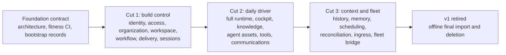
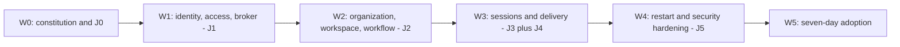

# vNext Cutover Program — Design

## Required reads

@docs/project/design/architecture-vnext/overview.md
@docs/project/design/architecture-vnext/runtime-and-facts.md
@docs/project/design/architecture-vnext/code-organization.md

## Purpose

Turn the architecture into an adoption program that cannot repeat the prior
horizontal rewrite. Progress is measured only when vNext becomes authoritative
for a complete journey and the corresponding v1 path closes.

## Inputs/Outputs

**Inputs:** the frozen architecture contract, v1 as a temporary operational
appliance, the assessed Rust workspace as untrusted salvage, legacy data
exports, and a small v1 maintenance whitelist.

**Outputs:** authoritative vertical cuts, adoption evidence, closed v1 paths,
an offline migration record, and explicit stop decisions when the program
fails its proof points.

## Invariants

- v1 is a frozen appliance during the program, not vNext's control plane.
- vNext work is never tracked, dispatched, reviewed, or completed through v1
  workflow state, including bootstrap work.
- No v1/vNext bridge, dual write, shared schema, or bidirectional synchronization
  exists. Legacy data moves through immutable one-shot import tools.
- A cut is complete only after its adoption event succeeds and the equivalent
  v1 entry path is disabled in the same adoption step.
- The deleted Rust workspace is research-grade salvage. Types, tests, and
  techniques re-enter only through normal review; lineage grants no trust.
- Scope is contracted deliberately. Parity with every v1 feature is not a goal.
- Independent adversarial review remains mandatory even though marker,
  checkpoint, and fold inference machinery does not.
- The separately governed vNext repository becomes authoritative at its seed
  commit. Architecture and program state are never mirrored back into v1.

## Primary flows

### Authoritative sequence



### Foundation contract

Before parallel builders enter, the workspace fixes the crate map, dependency
law, typed-fact constitution, authorization model, source budgets, test law,
and cut-1 journeys. Bootstrap migrations create one person, one platform-admin
binding, one organization, and one workspace.

The seed repository records the reviewed v1 source commit and owns the
architecture from its first commit. Cut 1 invokes its repository-owned `telec`
binary by absolute path and does not install it globally. The global `telec`
entry point flips atomically to vNext at cut-2 daily-driver adoption; the
frozen v1 binary remains available only by an explicit rollback path until
retirement.

The v1 intake freeze admits only failures that keep the frozen appliance
operable: synchronization deadlock, operator cockpit failure, session startup
loss, and event-pipeline integrity. Other active features and structural
improvements stop rather than racing the replacement.

Freeze is immediate. New dispatch stops first. An already-entered
noninterruptible merge or database transaction may reach its first quiescent
boundary; no phase, review lane, todo, or integration run drains to completion.
Records, artifacts, branches, and worktrees remain as read-only evidence.
Superseded todos are iceboxed, not removed.

### Cut-1 proof journeys

Cut 1 is accepted through six composed journeys:

- **J0, hostile execution:** the actual Codex child cannot read daemon or
  database authority, host credentials, or sibling-session state; cannot write
  outside its worktree and session directory; cannot use unauthorized sockets;
  and cannot make direct model-generated network requests. It cannot command
  the executor, alter the effective sandbox profile for the next spawn, or use
  a stolen executor credential to complete work or discharge obligations.
- **J1, bootstrap and authentication:** a clean install provisions the daemon
  service identity and per-user executor, migrates Postgres, seeds the initial
  actor and scopes, serves authenticated UDS, and denies malformed, replayed,
  anonymous, and revoked requests.
- **J2, intake and artifact review:** a work item is dependency-ordered,
  versioned, independently artifact-reviewed, claimed, and started. The WIP cap
  is transactional. Global admin bypasses entitlement only and uses an audited
  takeover for another claim.
- **J3, dispatch and completion:** the daemon issues an attenuated brief, the
  executor starts Codex inside J0, and explicit start, liveness, exit, and
  completion facts arrive through UDS. Failed dispatch revokes orphan
  authority; process death becomes `lost`.
- **J4, code review and integration:** typed Git operations create the change,
  an independent digest-bound review approves it, and integration writes merge
  facts before Workflow consumes them and marks delivery.
- **J5, restart and idempotency:** daemon and executor restarts at every prior
  boundary preserve committed state, reject duplicate natural keys, resume
  cursors, and require no inferred cache state.

### Journey-gated waves



Each package has one owner and an independent reviewer. Reviewed package
branches accumulate on the current wave branch. Only a green journey merges
the wave atomically to `main`, so main always represents the last complete
vertical capability. At most three builders and one integrator operate at
once. W0 is limited to one week and is the only horizontal wave.

### Work-package graph

```text
P00 repo-authority
 -> P01 workspace-scaffolder
 -> [P02 fitness-ci | P03 foundation | P04 sandbox-uds-proof]
 -> P05 W0-integrate

P05
 -> [P10 identity-core -> P11 identity-postgres
     | P12 access-core -> P13 access-postgres
     | P14 uds-adapter]
 -> P15 broker-composition -> P16 J1 -> P17 W1-integrate

P17
 -> [P20 organization-workspace
     | P21 workflow-core -> P22 workflow-postgres
     | P23 workflow-artifacts-reviews-obligations]
 -> P24 work-control -> P25 J2 -> P26 W2-integrate

P26
 -> [P30 sessions-core-postgres -> P31 codex-tmux-sandbox-adapter
     | P32 delivery-core-postgres -> P33 git-adapter
     | P34 agent-dispatch | P35 delivery-control
     | P36 telec-hook-executor-clients]
 -> P37 J3-J4 -> P38 W3-integrate

P38
 -> [P40 restart-idempotency | P41 security-adversary-suite
     | P42 backup-restore | P43 adoption-runbook]
 -> P44 W4-integrate -> P45 seven-day-adoption
```

A package names its files, owner, independent reviewer, source budget,
contract references, and executable behavior before dispatch. The integrator
alone merges package branches into the wave branch and the wave branch into
`main`.

### Cut 1: build control

Cut 1 implements real minimal slices of Identity, Access, Organization,
Workspace, Workflow, Delivery, and Sessions, plus the UDS broker and four
binaries, including the per-user `telec-executor`. The workflow lifecycle
includes only states exercised by construction; the old seventeen-phase
machine is evidence, not a parity target.

Workflow uses `draft -> ready -> active -> completed -> delivered`. Claims are
separate records. Blocking opens a typed obligation instead of replacing phase
with a lossy generic blocked state.

The adoption event is one continuous week in which at least one vNext work item
is created, sequenced, claimed, dispatched, completed, artifact-reviewed,
code-reviewed, integrated, and merged entirely through vNext facts and verbs.
No v1 todo, checkpoint, review, or dispatch state participates.

### Cut 2: daily driver

Cut 2 expands Sessions into the daily runtime, makes the cockpit in `telec`
authoritative, and introduces Knowledge and Agent Assets through immutable
bundle publication. Tool Gateway and minimal Communications enter when the
first credential-backed and channel-backed journeys adopt. Encrypted secret
storage enters once, at the first credential need.

The adoption event moves the operator's daily workflow to vNext and disables
the corresponding v1 CLI, TUI, context publication, tool, and communication
paths behind each accepted journey.

### Cut 3 and retirement

Session History, Memory, Scheduling, and Reconciliation enter only with named
consumers. Transcript blocks remain a projection option until a replay consumer
requires them. Fleet Redis carries committed cluster facts, never truth.

Final legacy state moves through offline, checksum-verified import binaries.
After adoption verification and a restorable backup, remaining v1 entry points
and Python runtime code are deleted.

### Surface disposition

TTS, chiptunes, help-desk workflows, WhatsApp, publications, the current web
frontend, and extra adapters are not ported by default. Each must earn a later
cut through a current user journey and an owning context. Raw source data is
retained where its future value exceeds its operational cost.

### Stop conditions

- Cut 1 has not completed its adoption event by week 7.
- A bridge, dual write, shared mutable state, or v1 workflow dependency appears.
- A fact is inferred from transcript, shell, pane, timestamp, or regex evidence.
- A future context is horizontally scaffolded without an adoption journey.
- The daemon gains unsanctioned state, cache, bookkeeping, or business logic.
- v1 maintenance consumes more than one operator-attention fix per week.
- Post-merge defects exceed pre-merge review findings over two weeks.
- An execution change adds pane parsing, readiness heuristics, mid-session
  injection, output polling, or a second agent type to cut 1.
- J0 cannot prove the effective launch profile, executor command direction,
  profile digest, runtime database grants, or same-user isolation.
- A package reaches `main` without its wave's complete journey.

A stop condition pauses the program for a scope or architecture reassessment.
It is not waived by sunk work or an almost-complete status.

## Failure modes

- Crates and services are counted as progress before any journey adopts them.
- A comfortable bridge survives its expiry date and makes two systems normal.
- v1 keeps receiving features, moving the parity target during construction.
- The rebuild reproduces every current lifecycle phase and product surface.
- Migration tools become recurring synchronization services.
- The operator must inspect Rust internals instead of verifying contracts,
  diagrams, CLI journeys, and independent review evidence.

## See Also

- docs/project/adr/0068-vnext-replaces-v1-through-authoritative-cuts.md
- docs/project/design/architecture-vnext/authorization.md
