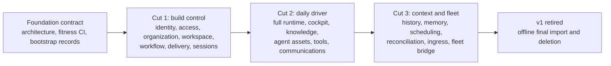

# vNext Cutover Program — Design

## Required reads

@docs/project/design/architecture-vnext/overview.md
@docs/project/design/architecture-vnext/runtime-and-facts.md
@docs/project/design/architecture-vnext/code-organization.md

## Purpose

Turn the architecture into an adoption program that cannot repeat the prior
horizontal rewrite. Progress is measured only when vNext becomes authoritative
for a complete journey and the corresponding v1 path closes.

## Inputs/Outputs

**Inputs:** the frozen architecture contract, v1 as the temporary build host,
the assessed Rust workspace as untrusted salvage, legacy data exports, and a
small v1 maintenance whitelist.

**Outputs:** authoritative vertical cuts, adoption evidence, closed v1 paths,
an offline migration record, and explicit stop decisions when the program
fails its proof points.

## Invariants

- v1 is a frozen appliance during the program, not vNext's control plane.
- vNext work is never tracked, dispatched, reviewed, or completed through v1
  workflow state, including bootstrap work.
- No v1/vNext bridge, dual write, shared schema, or bidirectional synchronization
  exists. Legacy data moves through immutable one-shot import tools.
- A cut is complete only after its adoption event succeeds and the equivalent
  v1 entry path is disabled in the same adoption step.
- The deleted Rust workspace is research-grade salvage. Types, tests, and
  techniques re-enter only through normal review; lineage grants no trust.
- Scope is contracted deliberately. Parity with every v1 feature is not a goal.
- Independent adversarial review remains mandatory even though marker,
  checkpoint, and fold inference machinery does not.

## Primary flows

### Authoritative sequence

### Foundation contract

Before parallel builders enter, the workspace fixes the crate map, dependency
law, typed-fact constitution, authorization model, source budgets, test law,
and cut-1 journeys. Bootstrap migrations create one person, one platform-admin
binding, one organization, and one workspace.

The v1 intake freeze admits only failures that prevent v1 from acting as the
temporary crane: synchronization deadlock, operator cockpit failure, session
startup loss, and event-pipeline integrity. Other active features and structural
improvements stop rather than racing the replacement.

### Cut 1: build control

Cut 1 implements real minimal slices of Identity, Access, Organization,
Workspace, Workflow, Delivery, and Sessions, plus the three binaries and UDS
broker. The workflow lifecycle includes only states exercised by construction;
the old seventeen-phase machine is evidence, not a parity target.

The adoption event is one continuous week in which at least one vNext work item
is created, sequenced, claimed, dispatched, completed, artifact-reviewed,
code-reviewed, integrated, and merged entirely through vNext facts and verbs.
No v1 todo, checkpoint, review, or dispatch state participates.

### Cut 2: daily driver

Cut 2 expands Sessions into the daily runtime, makes the cockpit in `telec`
authoritative, and introduces Knowledge and Agent Assets through immutable
bundle publication. Tool Gateway and minimal Communications enter when the
first credential-backed and channel-backed journeys adopt. Encrypted secret
storage enters once, at the first credential need.

The adoption event moves the operator's daily workflow to vNext and disables
the corresponding v1 CLI, TUI, context publication, tool, and communication
paths behind each accepted journey.

### Cut 3 and retirement

Session History, Memory, Scheduling, and Reconciliation enter only with named
consumers. Transcript blocks remain a projection option until a replay consumer
requires them. Fleet Redis carries committed cluster facts, never truth.

Final legacy state moves through offline, checksum-verified import binaries.
After adoption verification and a restorable backup, remaining v1 entry points
and Python runtime code are deleted.

### Surface disposition

TTS, chiptunes, help-desk workflows, WhatsApp, publications, the current web
frontend, and extra adapters are not ported by default. Each must earn a later
cut through a current user journey and an owning context. Raw source data is
retained where its future value exceeds its operational cost.

### Stop conditions

- Cut 1 has not completed its adoption event by week 7.
- A bridge, dual write, shared mutable state, or v1 workflow dependency appears.
- A fact is inferred from transcript, shell, pane, timestamp, or regex evidence.
- A future context is horizontally scaffolded without an adoption journey.
- The daemon gains unsanctioned state, cache, bookkeeping, or business logic.
- v1 maintenance consumes more than one operator-attention fix per week.
- Post-merge defects exceed pre-merge review findings over two weeks.
- An execution change adds pane parsing, readiness heuristics, mid-session
  injection, output polling, or a second agent type to cut 1.

A stop condition pauses the program for a scope or architecture reassessment.
It is not waived by sunk work or an almost-complete status.

## Failure modes

- Crates and services are counted as progress before any journey adopts them.
- A comfortable bridge survives its expiry date and makes two systems normal.
- v1 keeps receiving features, moving the parity target during construction.
- The rebuild reproduces every current lifecycle phase and product surface.
- Migration tools become recurring synchronization services.
- The operator must inspect Rust internals instead of verifying contracts,
  diagrams, CLI journeys, and independent review evidence.

## See Also

- docs/project/adr/0068-vnext-replaces-v1-through-authoritative-cuts.md
- docs/project/design/architecture-vnext/authorization.md
