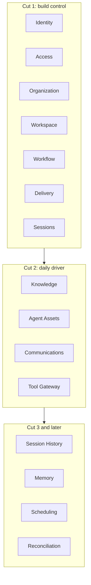
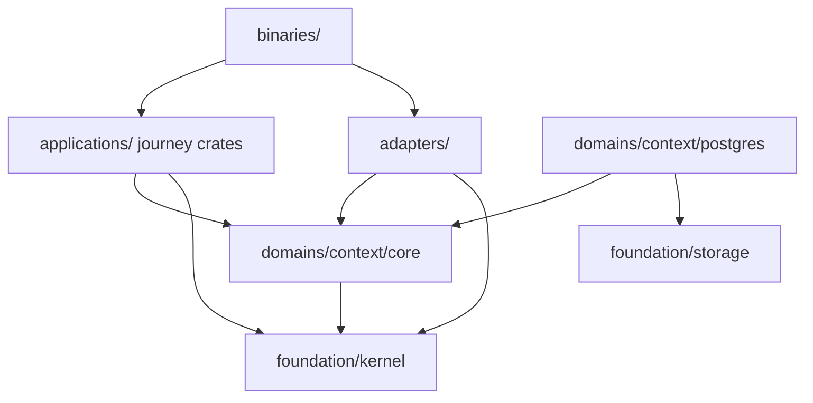

# vNext Architecture Overview — Design

## Purpose

Define the architecture agents use to build and evaluate vNext. The design
optimizes for agent-local comprehension, compile-enforced boundaries, explicit
authority, and successive authoritative adoption.

## Inputs/Outputs

**Inputs:**

- TeleClaude's operator, agent-runtime, workflow, context, and integration needs.
- The v2 design corpus and deleted Rust workspace as assessed evidence.
- The v1 defect record, especially inference-heavy checkpoint machinery,
  fragmented storage authority, configuration drift, and daemon coupling.
- The privacy requirement that one person's agent cannot use another person's
  credentials or personal services.

**Outputs:**

- Fifteen bounded contexts with explicit ownership.
- A folder-visible, CI-enforced dependency graph.
- A Postgres ownership and cross-context consistency model.
- The stable architectural contract used by the cut sequence.

## Invariants

- vNext is Rust and uses one local Postgres installation. Each bounded context
  owns exactly one schema and never reads another context's tables.
- A bounded context owns a model, lifecycle, schema, and facts. Technical
  utilities are foundation crates, not contexts.
- Domain cores are pure Rust. They import no SQLx, Redis, Axum, tmux,
  filesystem, provider SDK, adapter, or foreign domain crate.
- Cross-context work occurs only in an application journey or through durable
  facts. A domain core importing another domain core is a build failure.
- Every operational mutation uses a typed verb. Completion, review, restart,
  synchronization, and commit facts are never inferred from transcripts,
  shell text, timestamps, pane contents, or regular expressions.
- Operational state is database-backed. Authored code, documentation, and
  agent-asset sources remain in Git; runtime configuration does not.
- Legacy YAML, JSON, SQLite, and `.env` inputs are migration sources, never
  ongoing authorities.
- v1 and vNext never share writable state and never use a compatibility bridge.

## Primary flows

### Context map

| Context         | Authority                                                                                                    |
| --------------- | ------------------------------------------------------------------------------------------------------------ |
| Identity        | People, machine and session principals, authentication credentials                                           |
| Access          | Global and scoped grants, membership bindings, session briefs, authorization decisions, security audit facts |
| Organization    | Companies and their structural lifecycle                                                                     |
| Workspace       | Projects, repositories, installations, nodes, and placement                                                  |
| Workflow        | Todos, roadmaps, artifacts, claims, obligations, lifecycle, and artifact reviews                             |
| Delivery        | Worktrees, code-review requests, verdicts, integration attempts, and merge facts                             |
| Sessions        | Dispatch, session lifecycle, liveness, completion, and provider-neutral execution facts                      |
| Knowledge       | Authored documentation selection and immutable bundle publication                                            |
| Agent Assets    | Trusted skills, commands, addenda, compilation, and immutable bundle publication                             |
| Communications  | Recipients, routing, channel policy, and message delivery intent                                             |
| Tool Gateway    | MCP registry, singleton server leases, calls, and personal credential binding                                |
| Session History | Durable transcript archive and consumer-driven projections                                                   |
| Memory          | Personal and project observations with provenance                                                            |
| Scheduling      | Durable schedules, firings, and execution outcomes                                                           |
| Reconciliation  | Desired fleet state and convergence lifecycle                                                                |

Reconciliation begins as an application process manager over Workspace facts.
It becomes a context only when it owns durable desired-state policy and facts.

### Layer and dependency law

`foundation/` contains only `kernel`, `storage`, and `observability`.
`kernel` owns immutable ID newtypes, `ActorRef`, correlation and causation IDs,
and clock contracts. It carries no roles or rich principal snapshots.

Each context is a folder containing a pure `core` crate and, when persistence
exists, a `postgres` crate. Core ports are verb-shaped, not generic repository
interfaces. The Postgres implementation performs one domain transaction that
writes state and facts together.

Applications are journey-oriented use-case crates. They may compose domain
verbs but own no domain state. Adapters implement external mechanics such as
Git, tmux, UDS, Redis, messaging providers, and filesystem publication.
Binaries are composition roots and contain wiring only.

### Settings ownership

There is no Config context. Each context owns its typed settings. A settings
query application aggregates domain-provided descriptors with explicit
`read_action` and `write_action` metadata. Missing metadata defaults to
platform-admin-only.

Bootstrap contains only database coordinates, node identity, encryption-root
reference, and log destination. It is loaded before domain services exist and
is not a general configuration surface.

## Failure modes

- A technical catch-all such as Config, Integration, Common, Models, or Utils
  becomes a hidden dependency spine.
- Organization absorbs project, repository, node, or access lifecycles and
  becomes a tenancy-shaped god context.
- An application crate accumulates unrelated actor/action families instead of
  splitting by journey.
- A context reads a foreign schema or imports a foreign Postgres crate.
- Empty future crates are scaffolded and reported as architectural progress.
- A migration bridge allows v1 and vNext to normalize coexistence.
- Runtime files regain authority because a database-backed verb is inconvenient.

## See Also

- docs/project/adr/0068-vnext-replaces-v1-through-authoritative-cuts.md
- docs/project/design/architecture-vnext/authorization.md
- docs/project/design/architecture-vnext/runtime-and-facts.md
- docs/project/design/architecture-vnext/code-organization.md
- docs/project/design/architecture-vnext/cutover-program.md
