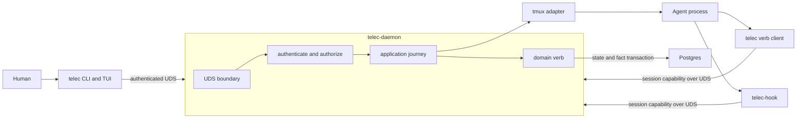
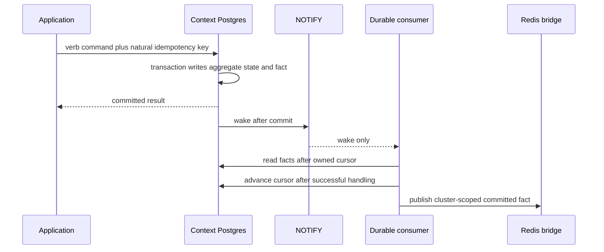

# vNext Runtime and Facts — Design

## Required reads

@docs/project/design/architecture-vnext/overview.md
@docs/project/design/architecture-vnext/authorization.md

## Purpose

Define how commands execute without giving agents database or secret access,
how durable facts replace behavioral inference, and how long-running loops
mount without turning the daemon into a business-logic owner.

## Inputs/Outputs

**Inputs:** authenticated UDS commands, typed domain verbs, domain state,
session capabilities, external adapter results, and durable consumer cursors.

**Outputs:** committed domain state, immutable facts, queryable obligations,
adapter side effects, liveness, and reconstructable delivery progress.

## Invariants

- Only `telec-daemon` holds database credentials and encryption-root access.
  `telec` and `telec-hook` are unprivileged UDS protocol clients.
- The UDS boundary authenticates every request. Localhost or filesystem
  proximity alone never establishes trust.
- The daemon is a privilege broker and composition root. It owns no business
  state, cache, inferred bookkeeping, or hidden source of truth.
- A domain mutation writes state and its immutable fact row in one Postgres
  transaction with a stable natural idempotency key.
- Facts are authority. Events are post-commit notifications or projections.
  Signals are ephemeral in-process or database wakes.
- Postgres `LISTEN/NOTIFY` carries wakeups only. Consumers requery facts using
  durable per-consumer cursors.
- Redis never holds local truth. It is an optional fleet bridge for committed
  facts and uses stable keys with durable inbound ingestion.
- No event or required operation is silently dropped because a transport is
  absent.
- Cross-domain writes never share a transaction. Applications order verbs and
  repair partial progress using durable facts.
- Pane rendering and transcript observation support display and liveness only.
  They never prove completion, review, or domain state.

## Primary flows

### Cut-1 topology

The daemon starts in cut 1 because it is the security boundary separating
agent processes from privileged storage and credentials. Local-first means no
network dependency; it does not mean no local process dependency. The daemon
must restart quickly because all durable state remains in Postgres.

### Fact lifecycle

Each context defines its fact payloads in core and stores them in its schema.
Foundation provides envelope, correlation, causation, lineage, and cursor
contracts. Payload versions use explicit supported-version decoders. Relational
state changes through forward migrations; generic lazy upcasting is not a
platform mechanism.

### Typed obligations

The verb performing an operation records its resulting facts and obligations.
`obligation list` is a query over durable state. Discharge is a typed verb tied
to evidence. Checkpoint behavior is therefore a thin reminder surface, not an
engine that infers whether shell commands or transcript phrases satisfied a
requirement.

### Cross-domain ordering

An application journey composes domain transactions in a declared order. A
dispatch that needs new authority first issues the Access brief, then records
the Sessions dispatch. If the second step fails, reconciliation revokes the
orphan brief. The general rule is grant before use and revoke on orphan.

No application passes transaction handles across contexts. Facts make partial
progress visible and retryable without dual writes.

### Runtime growth

Later cuts mount sanctioned loops on an explicit supervisor seam:

- fact dispatcher and cockpit refresh;
- webhook ingress and communications delivery;
- Redis fleet bridge and remote fact ingestion;
- scheduling and reconciliation.

Each loop invokes application journeys, owns a durable cursor where relevant,
and can restart independently. A loop does not move its state into the daemon.

## Failure modes

- Hooks or CLI clients connect directly to Postgres and bypass authorization.
- The daemon accumulates cache, lifecycle state, business rules, or inference
  bookkeeping and becomes the system's authority.
- A consumer acknowledges before side effects complete or advances another
  consumer's cursor.
- Random idempotency keys make retries indistinguishable from new operations.
- Redis publication is mistaken for durable consumption.
- `NOTIFY` payloads become a second event contract.
- A missing hook fact is repaired by pane parsing instead of fixing capability,
  hook delivery, or timeout semantics.
- Two contexts are updated in one database transaction or through direct schema
  access.

## See Also

- docs/project/adr/0068-vnext-replaces-v1-through-authoritative-cuts.md
- docs/project/design/architecture-vnext/code-organization.md
- docs/project/design/architecture-vnext/cutover-program.md
