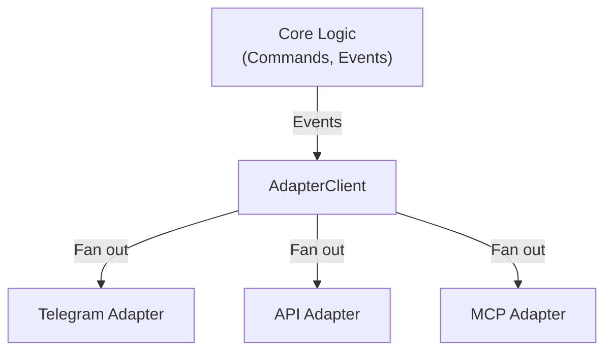
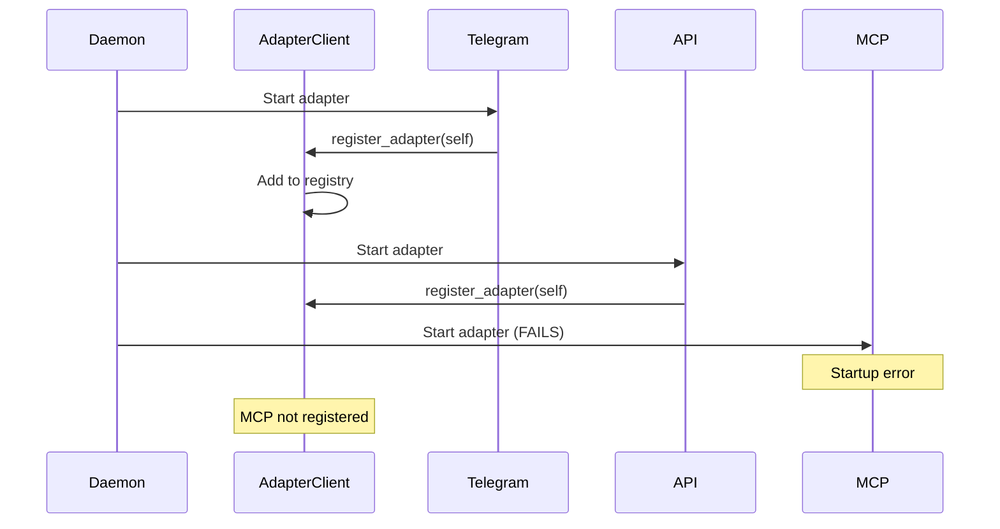
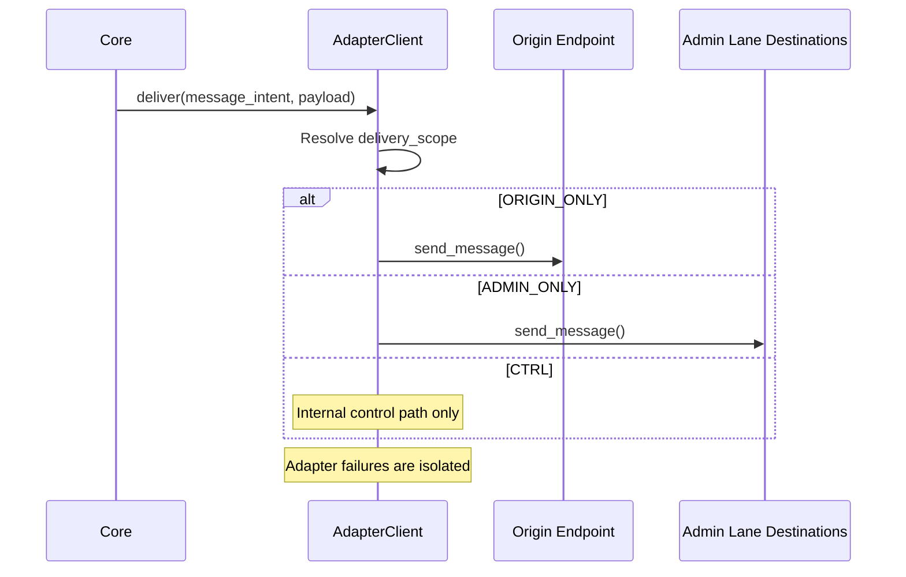
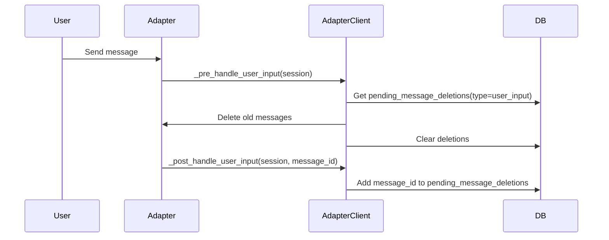
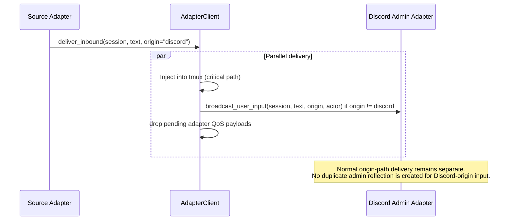

# Adapter Client — Design

## Required reads

- @docs/project/spec/session-output-routing.md
- @docs/project/spec/session-projection.md

## Purpose

- Own adapter lifecycle and message delivery across adapters.

- Resolve message intent into delivery scope (`ORIGIN_ONLY`, `ADMIN_ONLY`, `DUAL`, `CTRL`) through the core Router, which returns a `DeliveryPlan` of destinations.

- Preserve direct reply continuity to the origin endpoint.
- Apply UI cleanup hooks and observer notifications around user input and AI output.
- Leave rendering and placement strategy to adapters.

AdapterClient is concerned with adapters only. Cross-computer command routing is not an
adapter concern: it lives on the Redis transport and is driven by the command dispatcher off
each command's target computer (see redis-transport and command-classification).

## Inputs/Outputs

**Inputs:**

- Domain events from core (SESSION_STARTED, OUTPUT_UPDATE, SESSION_CLOSED, etc.)
- Commands and events from core logic that need delivery to adapters
- Adapter registration calls during startup
- Deletion requests (pending user input, feedback messages)

**Outputs:**

- Scope-based delivery to UI adapters
- Origin-only delivery for notices and user-facing feedback
- Origin-only delivery for operational output stream traffic
- UI channel creation requests (fire-and-forget)
- Deletion operations for message cleanup

## Invariants

- **Adapter Independence**: One adapter failure never blocks others; each runs in isolated async task.

<!-- planned-change:daemon-selfcheck-and-adapter-liveness -->

- **Registration Before Use**: Only adapters that successfully start are registered; failed adapters invisible to core.

<!-- change:daemon-selfcheck-and-adapter-liveness -->

- **Registration Before Use**: Only adapters that successfully start are registered, so a failed adapter is invisible to _routing_ — core never selects it as a recipient. It is **not** invisible to the operator: the start path classifies every configured adapter, and that classification is read by the boot self-check verdict and by the liveness worker. Invisibility is a routing property, never a reporting one.

<!-- /planned-change:daemon-selfcheck-and-adapter-liveness -->

- **Scope-First Routing**: Recipient selection follows message intent and delivery scope.
- **Origin Endpoint Continuity**: Origin identifies direct reply endpoint; it does not define fan-out policy.
- **Discord-Only Admin Reflection**: Core creates the extra admin reflection only for Discord, and only when the origin is not Discord.
- **Lifecycle vs Recipients**: Cleanup/lifetime settings never decide recipients.
- **UI Metadata Requirement**: Before sending to a non-origin adapter, ensure UI channel metadata exists.
- **Pre/Post Hooks**: User input cleanup (pre-hook) and message tracking (post-hook) run atomically.
- **Fresh title sync**: Channel-title delivery must resolve current session truth at execution time so stale queued work cannot replay an older title.
- **Projection Before Delivery**: AdapterClient delivers already-selected projected content. It does not infer source order or turn truth from adapter state.
- **QoS Break Is Not Projection**: `break_threaded_turn` may drop pending adapter QoS payloads, but it must not decide what source entries have been delivered.
- **Adapters Only**: AdapterClient owns no transport handle and performs no cross-computer routing; command forwarding to a peer is the dispatcher's job over the Redis transport.

- **Destination-Addressed Seam**: The four delivery methods (`send_message`, `edit_message`, `delete_message`, `send_file`) address a resolved `Destination` — the target platform coords plus any adapter-local delivery metadata needed to perform the send (e.g. WhatsApp's `last_customer_message_at`, which decides text-vs-template delivery inside the 24-hour customer window) — never a `Session`. AdapterClient keeps its session/intent-addressed public surface; AdapterClient routing and UiAdapter's internal helper paths both resolve `Session → Destination` through the shared core resolver, so the concrete platform delivery methods never re-derive their own coordinates.
- **Router Owns Recipient Selection**: A single core `Router` maps `(session, message_intent)` to a `DeliveryPlan` — `scope`, an `origin_endpoint` Destination, and `admin_lane_destinations`. It honors an explicit `metadata.channel_id` override ahead of the session-derived default. Adapters never re-derive their own destination coords.
- **Projector Owns Content Selection**: The core `Projector` decides which source spans are eligible, in source order, filtered by per-recipient output visibility, before AdapterClient hands a Destination to an adapter. Routing chooses recipients; projection chooses content; the two are separate.

- **Channel Lifecycle Is Admin/Discord-Only**: `create_channel`, `update_channel_title`, and `delete_channel` are session-shaped channel-lifecycle operations hosted on the Discord-only admin-reflection mixin, not on the universal adapter contract, and are not part of the destination-addressed delivery seam. `create_channel` is reached only through Discord's own provisioning path (`ensure_channel`); AdapterClient carries no cross-adapter `create_channel` broadcast. `update_channel_title` and `delete_channel` are AdapterClient methods that resolve to the Discord adapter — as the origin adapter when the session originates on Discord (`Router.resolve_origin_ui_adapter`), otherwise as the admin/reflection target (`Router.resolve_admin_output_target`) — rather than fanning out to every adapter. `close_channel` and `reopen_channel` are not part of the contract — no caller invokes them.

<!-- planned:daemon-selfcheck-and-adapter-liveness -->

- **The Delivery Lane Is The Liveness Observable**: Adapter liveness is derived from the outcome of deliveries the routing path already performs — the per-adapter delivery lane is the single point where an attempt is made and either succeeds or raises, so it is where the outcome is recorded. AdapterClient keeps a per-adapter routing-outcome record alongside its start-time classification. The adapter contract gains **no** health, heartbeat, connection-state, or probe method, and nothing synthetic is sent to test an adapter: liveness is a by-product of real traffic, never a generator of it.
- **Silence Is Not Death**: An adapter with no delivery attempts is not failing — it has nothing to route. "Stopped routing" means attempts are being made and are failing, never that the record is merely stale. An adapter that is never selected as a recipient can therefore never raise a liveness alarm, which is what keeps a quiet deployment quiet.

<!-- /planned:daemon-selfcheck-and-adapter-liveness -->

## Primary flows

### 1. Adapter Registration (Startup)

### 2. Scope-Based Delivery

### 3. UI Cleanup Hooks (Pre/Post User Input)

### 4. Reflection Routing (User Input)

Core creates only the extra admin reflection. It routes that reflection to Discord only, and only when the input origin is not already Discord.

## Failure modes

<!-- planned-change:daemon-selfcheck-and-adapter-liveness -->

- **Adapter Crash During Delivery**: Adapter raises exception. AC logs error and continues other recipients in the same scope.

<!-- change:daemon-selfcheck-and-adapter-liveness -->

- **Adapter Crash During Delivery**: Adapter raises exception. AC logs error, records the failed outcome against that adapter, and continues other recipients in the same scope. A single failure changes nothing beyond the record; only sustained failure at the lane makes the adapter a liveness concern.
- **Adapter Stopped Routing**: An adapter's deliveries fail at the lane without interruption past the liveness threshold. The liveness worker reports the adapter through the notification pipeline. Routing is unchanged — the adapter stays registered and keeps being selected, because the failure may be transient and AdapterClient performs no remediation.

<!-- /planned-change:daemon-selfcheck-and-adapter-liveness -->

- **Stale title update task**: Old queued title sync work must fetch fresh session state before renaming. Otherwise an older task can revert a newer thread title.
- **Channel Metadata Missing**: Attempting to send to non-origin adapter without channel fails. AC creates channel (fire-and-forget) and queues message for retry.
- **Cleanup Hook Failure**: Pre/post hooks fail to delete messages or track IDs. Stale messages accumulate in UI. Does not block message delivery.
- **Stale Broad Fanout Assumption**: Invalid. AdapterClient must choose explicit targets up front. `_route_to_ui()` is an execution helper, not a policy engine.
- **Adapter-owned turn assumption**: Invalid. Adapter delivery receipts can be cleared for rendering, but source ordering and duplicate suppression belong to session projection.
- **Parallel Delivery Timeout**: One adapter blocks indefinitely. Other adapters complete normally. Stuck adapter logged and skipped.
