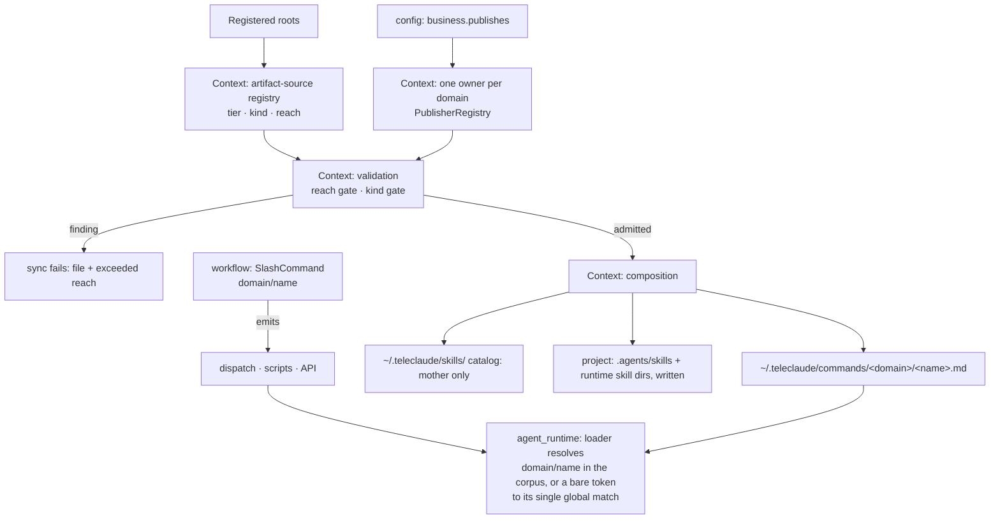

# Agent Artifact Distribution — Design

## Required reads

- @docs/project/spec/domain/context.md
- @docs/project/spec/feature/context/agent-runtime-deployment.md

## Purpose

Realize `@prd#authorized-horizon` across several bounded contexts without
letting any of them absorb another's rule. `context` owns the artifact-source
registry this delivery introduces, reach validation, composition, and
deployment of commands and skills.
`config` owns the publishing declaration that bounds a repository's global
reach. Each command's name, and every emission of it, belongs to the context
that owns that command's meaning — `workflow` for the todo-lifecycle commands,
and other contexts for the commands whose reason to change is theirs.
`agent_runtime` owns resolving a name to a corpus document at dispatch. This
document owns only the relationships among those contracts and the order in
which the mother's sources migrate; every behavior resolves to one context's
own spec.

The approved target it preserves: one tiered source shape at every repository
root (`@prd#included`), global commands partitioned by declared domain and
refused outside declared reach (`@prd#sc-2-global-commands-publish-by-declared-domain-and-out-of-reach-sources-fail-loudly`),
general commands and global skills from the mother alone (`@prd#sc-6-the-global-skill-catalog-is-composed-from-the-mother-alone`),
`.agents/` as delivery output only (`@prd#sc-4-authored-input-and-generated-output-never-share-a-location`),
domain-qualified command names everywhere the platform names one (`@prd#sc-3-a-global-command-is-named-by-its-domain-everywhere-the-platform-names-it`),
and no loss of offered artifacts at any point in the migration (`@prd#sc-5-the-mothers-migrated-artifacts-lose-nothing-sessions-were-offered-at-every-point-in-the-cutover`).

## Inputs/Outputs

**Inputs**

- Authored sources under a repository's `agents/global/commands/<domain>/`,
  `agents/global/commands/general/`, `agents/global/skills/<name>/`,
  `agents/project/commands/`, and `agents/project/skills/<name>/`, plus the
  untiered master and addenda at the artifact root.
- The repository's publishing declaration (`business.publishes`), read through
  `config`'s existing `publishes_for_root` contract, and the registered-root set.
- The command-name table in `teleclaude/constants.py` (`SlashCommand`): a
  mechanical registry holding every command's canonical value. Each value is
  owned by the context that owns its command; the table owns none of them.

**Outputs**

- The global command corpus at `~/.teleclaude/commands/<domain>/<name>.md`,
  one directory per published domain plus `general/`, composed from every
  publisher root's in-reach global command sources.
- The global skill catalog at `~/.teleclaude/skills/`, composed from the
  mother's `agents/global/skills/<name>/` folders alone.
- Project delivery: each project's `agents/project/skills/*` rendered into
  that project's runtime skill directories and into `.agents/skills/`. A source
  under `agents/project/commands/` is validated and reach-checked and is written
  to no corpus by this delivery; the per-tier corpus and its resolution are the
  command output side's contract. `.agents/` is a delivery location and is never
  read as an authored source.
- Validation findings that name the file and the reach it exceeds, or both
  files and the colliding name, and fail sync.
- The deployed-commands ownership manifest, keyed by relative corpus path.
- The artifact-source registry: one typed owner declaring every directory that
  is an agent-artifact source, the kind it carries, its tier and reach, and
  whether its content is authored by TeleClaude or incorporated from a third
  party. It holds no filesystem access, validation, deployment, or checkpoint
  behavior; its consumers read it and restate nothing.

## Invariants

### Ownership

- **`context` owns the registry, reach, composition, and retraction.** The
  registry is the single statement of which directories are sources, of which
  kind, at which tier, with which reach, and under which authorship. Every
  consumer — validation (`teleclaude/resource_validation/_artifacts.py`), global
  skill discovery (`teleclaude/global_skills.py`), distribution
<!-- planned-change:retire-docs-watcher -->
  (`scripts/distribute.py`), the sync watcher's top-level scope
  (`teleclaude/cli/watch.py`), the checkpoint sync scope
  (`teleclaude/constants.py`), and onboarding inference
<!-- change:retire-docs-watcher -->
  (`scripts/distribute.py`), the checkpoint sync scope
  (`teleclaude/constants.py`), and onboarding inference
<!-- /planned-change:retire-docs-watcher -->
  (`teleclaude/project_setup/init_flow.py`), and the commit gate's review
  routing (`teleclaude/cli/telec/handlers/code.py`) — derives its directory set
  from the registry and restates nothing. Three of those consumers previously
  carried their own directory and kind vocabulary; one registry replaces all
  three.
- **Reach is a registry attribute, resolved against `config`'s declaration.** A
  global command record's reach is the set of domains the repository publishes;
  the mother's reach additionally includes `general`. A global skill record's
  reach is the mother alone. A project record's reach is the repository itself.
  The one-owner-per-domain resolution reuses the docs publisher registry
  (`teleclaude/docs_publishers.py`, `PublisherRegistry`): a domain has exactly
  one owning publisher for documentation and for commands, resolved once.
- **A command's name is owned by the context that owns the command.** The
  domain a command publishes under states whose rule it is, so the name and
  every emission of it resolve to that context: the todo-lifecycle commands to
  `workflow`, stated in its domain spec and bound by the prepare and work
  state-machine specs; a scheduled-job, creative, or personal command to the
  context that owns its meaning, stated there. The shared name table in the
  codebase is a mechanical cross-context registry — it holds every value in one
  place, and hosting confers no authority
  (`software-development/policy/domain-ownership`). `context` lays the corpus
  out against those names and owns none of them.
- **`agent_runtime` owns resolution within the global corpus, and the
  session metadata that carries the name.** The rule is stated in the agent
  runtime domain spec and bound by the run-session-with-command spec; this
  document only records that resolution reads the corpus `context` publishes
  and decides nothing about reach or layout. Resolution that reads a session's
  tier context is outside this design. The session record, its title, and the
  live-session attribution query carry and match the qualified value `workflow`
  dispatched; `workflow` consumes that query and owns none of it.
- **`config` owns the declaration, never the gate.** `business.publishes` says
  what a repository may reach; `context` decides admission from it.

### Authorship decides review routing

- Every source record declares its content authored or incorporated. Authored
  content is TeleClaude's own — commands, the masters, the addenda — and a
  commit touching it routes to required doc-hygiene review. Incorporated
  content is a third-party skill package the platform republishes unchanged,
  and a commit touching it routes to no review.
- The exemption is not a weakening of the review contract: the package body is
  explicitly outside TeleClaude's artifact taxonomy, so a doc-hygiene reviewer
  grades it against a schema it does not claim to satisfy and can find nothing.
  The risk that is real — executable content, egress, credential reach,
  injected directives — is inspected by the adopting agent before the commit,
  under `general/procedure/skill-management`.
- Authorship is a property of the source directory, not of the file: the
  mother-authored catalog master living beside incorporated packages is an
  authored record in its own right and keeps its review.

### Reach gate

- A source under `agents/global/commands/<domain>/` from a root that does not
  publish `<domain>` is a validation finding naming the file and the reach it
  exceeds. `general/` from a non-mother root is refused the same way.
- A folder under `agents/global/skills/` from a non-mother root is refused.
- A kind directory under `agents/global/` or `agents/project/` other than
  `commands/` or `skills/` is refused as outside the artifact model.
- Nothing under `.agents/` is ever enumerated as a source by any consumer.
- A global source outside a repository's reach is a finding, never a silent
  skip: the global phase in `scripts/distribute.py` composes from every
  publisher root's admitted sources and refuses the rest by name.

### Corpus layout and names

- The shared corpus holds global commands only, partitioned by domain; two
  domains may carry the same bare file name. A project command never enters the
  shared corpus. Project scope keys leave the shared manifest on their project's
  first sync after migration, because that sync stages nothing at the shared
  root for them.
- The deployed-commands manifest keys by relative corpus path — `<name>.md` at
  the root or `<domain>/<name>.md`, never deeper — so partitioning and
  migration are ordinary add-and-retract deltas within one sync run.
- **Ownership is per publishing repository, never per phase.** The corpus is a
  destination several repositories write into, and retraction removes what a
  source owned and no longer stages. The owner recorded for a deploy is
  therefore the repository that ran it, at every phase. A phase-wide owner is
  correct only while one repository can run that phase: two repositories
  publishing under one owner subtract each other's commands, because retraction
  is a set difference inside one owner's inventory and the guard that spares a
  file another owner claims cannot fire when no other owner exists. Domain
  partitioning does not substitute: different paths still subtract to the same
  difference. Reach admits the second publisher, so reach is also what makes the
  per-repository owner necessary.
- **Manifest forward migration.** The manifest carries a schema version. The
  first load of an unversioned manifest rewrites it in place before any
  reconciliation reads it: every existing entry is a basename, and a basename is
  the root-relative path of a file that is at the corpus root, so each entry is
  carried forward unchanged in meaning and the file gains its version. Domain
  code reads only the versioned shape; the unversioned reader exists only inside
  that migration step (`software-development/policy/backward-compatibility-hygiene`,
  owned internal data). The same step rekeys the one phase-wide owner an
  unversioned manifest carries to the repository that produced it — the mother,
  which was the only repository able to publish globally while that shape was
  written — so no inventory is orphaned and no file is left unretractable. While both roots carry a command, the manifest holds
  both its root key and its partitioned key, and the deletion of the flat root
  is what later retracts the root key.
- Domain assignment of the mother's existing commands is read from each
  command's own governing contract, never assumed from its name
  (`@prd#premises-and-assumptions`): a command publishes under the domain that
  owns the contract it executes, and a command whose contract is domain-agnostic
  publishes under `general`, which is the mother's alone. Two cases are named
  here because the name misleads: `next-assist` executes a software-development
  lifecycle procedure and publishes under `software-development`, not `general`;
  `next-run-job` executes a configured job, and the job model is `config`'s —
  the declaration, the schedule contract, and the operator surface all resolve
  there, while `agent_runtime` dispatches a scheduled job into a session as it
  dispatches any command. `config` owns this command's name, and its domain is `general`.

### Migration by expansion before contraction

- The mother's commands exist under both the flat root and the tiered root, and
  both are declared artifact sources while both carry commands. Contraction —
  deleting the flat root — is the migration's last step.
- Retraction removes what an owner staged before and does not stage now, so the
  hazard it poses is a staged set that shrinks. While both roots carry a
  command, every command the flat root carries is staged, so no publication run
  observes a source as absent and no retraction of a live command is reachable.
  `@prd#sc-5-the-mothers-migrated-artifacts-lose-nothing-sessions-were-offered-at-every-point-in-the-cutover`
  holds by the shape of the migration, so no compatibility mechanism exists in
  this design.
- The order in which the tiered root and its reader appear is unconstrained,
  because the flat root carries every command throughout.
- Contraction is a plain deletion: the existing reconciler retracts the flat
  root's keys on the next publication, and this design adds no mechanism for
  it.

## Primary flows



Migration sequence:

```mermaid
sequenceDiagram
    participant Human as human-present session on main
    participant Code as this delivery
    participant Sync as publication
    Human->>Sync: expansion: commands copied to the tiered root, flat root kept
    Sync->>Sync: both roots staged; the staged set never shrinks
    Code->>Sync: registry declares both roots; manifest keyed by relative path
    Sync->>Sync: corpus carries each command at its root key and its domain key
    Human->>Sync: contraction: flat root deleted
    Sync->>Sync: existing reconciler retracts the root keys
```

## Failure modes

- **A root publishes a global command for a domain it does not declare.** Sync
  fails with the file and the reach it exceeds; nothing is composed for that
  run.
- **A bare token names a command in two domains.** The loader refuses, naming
  both. Domain-qualified dispatch is unaffected.
- **An edit lands on one root and not the other.** While both roots exist the
  same command is two files, and they can diverge. The window is bounded by the
  contraction, and the corpus composes from both, so a divergence surfaces as
  two sources for one name rather than as a silent loss.
- **A commit touches an incorporated package and no review runs.** Intended:
  the adopting agent's pre-commit inspection is the gate, and the registry's
  authorship class is what routes it.
- **A legacy `.agents/` file a project authored by hand.** Never read, never
  adopted, never deleted by this delivery; it stays until the native-output
  sibling lands ownership records.
- **A consumer restates its own directory list instead of reading the
  registry.** A second source of truth; reviewers treat it as an ownership
  defect (`software-development/policy/domain-ownership`).
- **Two repositories publish global commands and one deploy erases the
  other's.** Prevented by the per-repository owner: each deploy retracts only
  the paths its own repository last staged.

## See Also

- docs/project/spec/domain/context.md
- docs/project/spec/domain/context-map.md
- docs/project/spec/feature/context/agent-runtime-deployment.md
- docs/project/spec/feature/context/agent-artifact-validation.md
- docs/project/spec/feature/agent_runtime/run-session-with-command.md
- docs/project/spec/feature/config/project-capability-manifest.md
