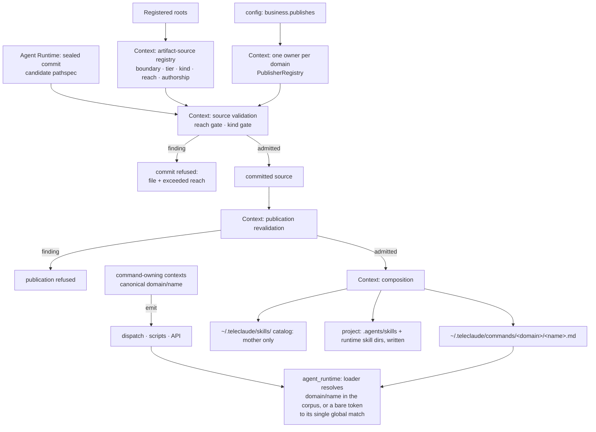
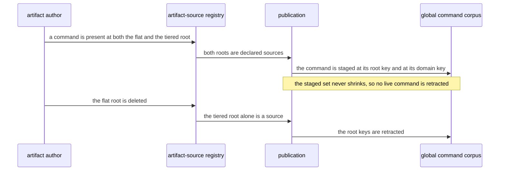

# Agent Artifact Distribution — Design

## Required reads

- @docs/project/spec/domain/context.md
- @docs/project/spec/feature/context/agent-runtime-deployment.md

## Purpose

Realize `@prd#authorized-horizon` across several bounded contexts without
letting any of them absorb another's rule. `context` owns the artifact-source
registry this delivery introduces, reach validation, composition, and
deployment of commands and skills.
`config` owns the publishing declaration that bounds a repository's global
reach. Each command's name, and every emission of it, belongs to the context
that owns that command's meaning — `workflow` for the todo-lifecycle commands,
and other contexts for the commands whose reason to change is theirs.
`agent_runtime` owns resolving a name to a corpus document at dispatch. This
document owns only the relationships among those contracts and the order in
which the mother's sources migrate; every behavior resolves to one context's
own spec.

The approved target it preserves: one tiered source shape at every repository
root (`@prd#included`), global commands partitioned by declared domain and
refused outside declared reach before commit (`@prd#sc-2-global-commands-publish-by-declared-domain-and-out-of-reach-sources-fail-before-commit`),
general commands and global skills from the mother alone (`@prd#sc-6-the-global-skill-catalog-is-composed-from-the-mother-alone`),
`.agents/` as delivery output only (`@prd#sc-4-authored-input-and-generated-output-never-share-a-location`),
domain-qualified command names everywhere the platform names one (`@prd#sc-3-a-global-command-is-named-by-its-domain-everywhere-the-platform-names-it`),
and no loss of offered artifacts at any point in the migration (`@prd#sc-5-the-mothers-migrated-artifacts-lose-nothing-sessions-were-offered-at-every-point-in-the-cutover`).

## Inputs/Outputs

**Inputs**

- Authored sources under a repository's `agents/global/commands/<domain>/`,
  `agents/global/commands/general/`, `agents/global/skills/<name>/`,
  `agents/project/commands/`, and `agents/project/skills/<name>/`, plus the
  authored global-skill catalog master and the untiered global master and
  addenda at the artifact root.
- The repository's publishing declaration (`business.publishes`), read through
  `config`'s existing `publishes_for_root` contract, and the registered-root set.
- The command-name table in `teleclaude/constants.py` (`SlashCommand`): a
  mechanical registry holding every command's canonical value. Each value is
  owned by the context that owns its command; the table owns none of them.

**Outputs**

- The global command corpus at `~/.teleclaude/commands/<domain>/<name>.md`,
  one directory per published domain plus `general/`, composed from every
  publisher root's in-reach global command sources.
- The global skill catalog at `~/.teleclaude/skills/`, composed from the
  mother's `agents/global/skills/<name>/` folders alone.
- Project delivery: each project's `agents/project/skills/*` rendered into
  that project's runtime skill directories and into `.agents/skills/`. A source
  under `agents/project/commands/` is validated and reach-checked and is written
  to no corpus by this delivery; the per-tier corpus and its resolution are the
  command output side's contract. `.agents/` is a delivery location and is never
  read as an authored source.
- Validation findings that name the file and the reach it exceeds, or both
  files and the colliding name. Pathspec-scoped findings refuse the sealed
  commit; publication repeats source validation as defense in depth and
  refuses that publication run on a finding.
- The deployed-commands ownership manifest, keyed by relative corpus path.
- The artifact-source registry: one typed owner declaring every source
  boundary, the kind it carries, its tier and reach, and whether its content is
  authored by TeleClaude or incorporated from a third party. A boundary selects
  either one exact file, one uniformly classified directory tree, or the
  immediate package directories below a root. It holds no filesystem access,
  validation, deployment, or checkpoint behavior; its consumers read it and
  restate nothing.

## Invariants

### Ownership

- **`context` owns the registry, reach, composition, and retraction.** The
  registry is the single statement of which path boundaries are sources, of
  which kind, at which tier, with which reach, and under which authorship. Every
  consumer — validation (`teleclaude/resource_validation/_artifacts.py`), global
  skill discovery (`teleclaude/global_skills.py`), distribution
  (`scripts/distribute.py`), recorded-commit publication
  (`teleclaude/sync.py`), the checkpoint publication scope
  (`teleclaude/constants.py`), and onboarding inference
  (`teleclaude/project_setup/init_flow.py`), and the commit gate's review
  routing (`teleclaude/cli/telec/handlers/code.py`) — derives its directory set
  from the registry and restates nothing. Three of those consumers previously
  carried their own directory and kind vocabulary; one registry replaces all
  three.
- **Publication is bound to one recorded repository contribution.** Context
  materializes the triggering repository at the immutable recorded commit and
  repeats the registry-backed reach and kind validation on that snapshot before
  composition. A finding refuses the publication action. Distribution
  reconciles commands under that repository's canonical-root ownership key and
  preserves every other repository's manifest entries and deployed commands;
  it never reads another checkout to advance another owner's contribution.
- **Reach is a registry attribute, resolved against `config`'s declaration.** A
  global command record's reach is the set of domains the repository publishes;
  the mother's reach additionally includes `general`. A global skill record's
  reach is the mother alone. A project record's reach is the repository itself.
  The one-owner-per-domain resolution reuses the docs publisher registry
  (`teleclaude/docs_publishers.py`, `PublisherRegistry`): a domain has exactly
  one owning publisher for documentation and for commands, resolved once.
- **A command's name is owned by the context that owns the command.** Semantic
  ownership and corpus partition are separate coordinates. The command's
  governing contract owns its canonical name and every emission of that name;
  its first governing global-domain contract selects the corpus domain, with
  `general` as the mother-only partition when the owner has no narrower
  published global domain. The todo-lifecycle commands therefore belong to
  `workflow`, while the configured-job command and the scheduler emission of it
  belong to `config` even though that command publishes under `general`.
  Creative, personal, and context-authoring commands likewise remain owned by
  the contract that defines their meaning rather than by `workflow` or by their
  runtime host. The shared name table in the codebase is a mechanical
  cross-context registry — it holds every value in one place and owns none of
  them (`sdlc/policy/domain-ownership`). `context` lays the
  corpus out against those names and owns none of them.
- **`agent_runtime` owns resolution within the global corpus, and the
  session metadata that carries the name.** The rule is stated in the agent
  runtime domain spec and bound by the run-session-with-command spec; this
  document only records that resolution reads the corpus `context` publishes
  and decides nothing about reach, layout, or command vocabulary. Resolution
  that reads a session's tier context is outside this design. The session
  record, its title, and the live-session attribution query carry and match the
  qualified value the owning context emitted; a caller such as `workflow`
  consumes that query and owns none of it.
- **`config` owns the declaration, never the gate.** `business.publishes` says
  what a repository may reach; `context` decides admission from it.

### Authorship decides review routing

- Every source path matches exactly one non-overlapping registry boundary;
  absence or overlap is a registry contract violation. That matched record
  declares the path authored or incorporated. Authored content is TeleClaude's
  own — commands, masters, and addenda — and a commit touching it routes to
  required doc-hygiene review. Incorporated content is a third-party skill
  package the platform republishes unchanged, so a commit touching it routes
  to no separate post-commit doc-hygiene review. The adoption security gate is
  owned by `general/procedure/skill-management` under
  `sdlc/policy/ai-agent-security`; this design classifies
  doc-hygiene routing and neither restates nor weakens that gate.
- The mixed global-skills tree is represented by two disjoint registry
  boundaries: the exact `agents/global/skills/AGENTS.master.md` file is an
  authored catalog-master record, while each immediate
  `agents/global/skills/<name>/` directory is an incorporated-package record.
  The package selector admits directories only, so it cannot absorb the master;
  every consumer asks the registry for the matched record and carries no local
  path exception.
<!-- planned:fold-retires-whole-files -->
- A command tree holds commands and their retirement companions. A file whose
  name carries no dot before `.md` is a command record. A zero-byte
  `<name>.<slug>.md` beside a command is that command's retirement companion
  (`general/spec/agent-artifacts`): it matches the command's own record, so a
  commit touching it routes as authored content, and it is never a command
  itself, so validation, composition, and deployment see only the command.
  Any other file in a command tree whose name carries a dot before `.md` —
  non-empty, or with no command beside it — matches no boundary and is a
  validation finding naming it as a malformed command source.
<!-- /planned:fold-retires-whole-files -->

### Reach gate

- A source under `agents/global/commands/<domain>/` from a root that does not
  publish `<domain>` is a validation finding naming the file and the reach it
  exceeds. `general/` from a non-mother root is refused the same way.
- A folder under `agents/global/skills/` from a non-mother root is refused.
- A kind directory under `agents/global/` or `agents/project/` other than
  `commands/` or `skills/` is refused as outside the artifact model.
- Nothing under `.agents/` is ever enumerated as a source by any consumer.
- A global source outside a repository's reach is a finding, never a silent
  skip. The sealed commit runs Context's artifact validation over its pathspec
  and refuses the commit on that finding. Publication repeats the same reach
  validation before composition as defense in depth and refuses the run rather
  than publishing an inadmissible source.

### Corpus layout and names

- The shared corpus holds global commands only, partitioned by domain; two
  domains may carry the same bare file name. A project command never enters the
  shared corpus. A project's next recorded publication stages no project
  command at the shared root, so reconciliation clears only that project's
  obsolete shared-corpus keys.
- The deployed-commands manifest keys by relative corpus path — `<name>.md` at
  the root or `<domain>/<name>.md`, never deeper — so partitioning and
  migration are ordinary add-and-retract deltas within one recorded publication.
- **Ownership is per publishing repository, never per phase.** The corpus is a
  destination several repositories write into, and retraction removes what a
  source owned and no longer stages. The owner recorded for a deploy is
  therefore the repository that ran it, at every phase. A phase-wide owner is
  correct only while one repository can run that phase: two repositories
  publishing under one owner subtract each other's commands, because retraction
  is a set difference inside one owner's inventory and the guard that spares a
  file another owner claims cannot fire when no other owner exists. Domain
  partitioning does not substitute: different paths still subtract to the same
  difference. Reach admits the second publisher, so reach is also what makes the
  per-repository owner necessary.
- **Manifest forward migration.** The manifest carries a schema version. The
  first load of an unversioned manifest rewrites it in place before any
  reconciliation reads it: every existing entry is a basename, and a basename is
  the root-relative path of a file that is at the corpus root, so each entry is
  carried forward unchanged in meaning and the file gains its version. Domain
  code reads only the versioned shape; the unversioned reader exists only inside
  that migration step (`sdlc/policy/backward-compatibility-hygiene`,
  owned internal data). The same step rekeys the one phase-wide owner an
  unversioned manifest carries to the repository that produced it — the mother,
  which was the only repository able to publish globally while that shape was
  written — so no inventory is orphaned and no file is left unretractable. While both roots carry a command, the manifest holds
  both its root key and its partitioned key, and the deletion of the flat root
  is what later retracts the root key.
- Corpus-domain assignment of the mother's existing commands is read from each
  command's own governing global-domain contract, never assumed from its name
  (`@prd#premises-and-assumptions`): a command publishes under the domain that
  owns the contract it executes, and a command whose contract is domain-agnostic
  publishes under `general`, which is the mother's alone. Two cases are named
  here because the name misleads: `assist` executes a sdlc
  lifecycle procedure and publishes under `sdlc`, not `general`;
  `run-job` executes a configured job, and the job model is `config`'s —
  the declaration, the schedule contract, its canonical
  `general/run-job` name, and the scheduler emission all resolve there,
  while `agent_runtime` dispatches the scheduled job into a session as it
  dispatches any command. The `general` path is its corpus partition, not a
  second semantic owner.

### Migration by expansion before contraction

- The mother's commands exist under both the flat root and the tiered root, and
  both are declared artifact sources while both carry commands. Contraction —
  deleting the flat root — is the migration's last step.
- Retraction removes what an owner staged before and does not stage now, so the
  hazard it poses is a staged set that shrinks. Two independent things can
  shrink it, and the migration's shape answers only one. Both roots carrying a
  command means no _source_ goes absent. Partitioning the staged corpus into
  `<domain>/` directories is the other: an enumerator that lists one level and
  counts only files sees an empty staged set the moment the corpus stops being
  flat, and retracts everything the owner held. Ownership enumeration is
  therefore recursive over the staged corpus and keyed by relative path, and
  that is the mechanism
  `@prd#sc-5-the-mothers-migrated-artifacts-lose-nothing-sessions-were-offered-at-every-point-in-the-cutover`
  rests on. The migration's shape covers the source side; this covers the
  staged side.
- The order in which the tiered root and its reader appear is unconstrained on
  the source side, because the flat root carries every command throughout. The
  recursive, relative-path ownership enumeration is not order-free: it is the
  precondition for partitioning the corpus at all, and lands with or before the
  first partitioned deploy.
- Contraction is a plain deletion: the existing reconciler retracts the flat
  root's keys on the next publication, and this design adds no mechanism for
  it.
- **Persisted session-command identity migrates forward before exact matching.**
  Agent Runtime owns a one-way migration from each recognized TeleClaude bare
  command value already stored on a session to that command's domain-qualified
  canonical value. Already-qualified values, unknown external command values,
  and null remain unchanged. The migration runs before live-session attribution
  performs exact equality, and runtime consumers carry no permanent old-shape
  compatibility branch (`sdlc/policy/backward-compatibility-hygiene`).

## Primary flows

Migration sequence:

## Failure modes

- **A root authors a global command for a domain it does not declare.** The
  sealed commit is refused with the file and the reach it exceeds. If an
  inadmissible source reaches publication outside that path, defense-in-depth
  validation refuses the publication run and composes nothing.
- **A bare token names a command in two domains.** The loader refuses, naming
  both. Domain-qualified dispatch is unaffected.
- **An edit lands on one root and not the other.** While both roots exist the
  same command is two files, and they can diverge. The window is bounded by the
  contraction, and the corpus composes from both, so a divergence surfaces as
  two sources for one name rather than as a silent loss.
- **A commit touches an incorporated package and no post-commit doc-hygiene
  review runs.** The registry suppresses only taxonomy grading; adoption remains
  gated by `general/procedure/skill-management` and the AI-agent security policy.
- **A legacy `.agents/` file a project authored by hand.** Never read, never
  adopted, never deleted by this delivery; it stays until the native-output
  sibling lands ownership records.
- **A consumer restates its own directory list instead of reading the
  registry.** A second source of truth; reviewers treat it as an ownership
  defect (`sdlc/policy/domain-ownership`).
- **A source path matches no registry boundary or more than one.** Registry
  classification fails before validation or review routing; no consumer picks
  a fallback class.
- **Two repositories publish global commands and one deploy erases the
  other's.** Prevented by the per-repository owner: each deploy retracts only
  the paths its own repository last staged.

## See Also

- docs/project/spec/domain/context.md
- docs/project/spec/domain/context-map.md
- docs/project/spec/domain/config.md
- docs/project/spec/feature/context/agent-runtime-deployment.md
- docs/project/spec/feature/context/agent-artifact-validation.md
- docs/project/spec/feature/agent_runtime/run-session-with-command.md
- docs/project/spec/feature/config/project-capability-manifest.md
