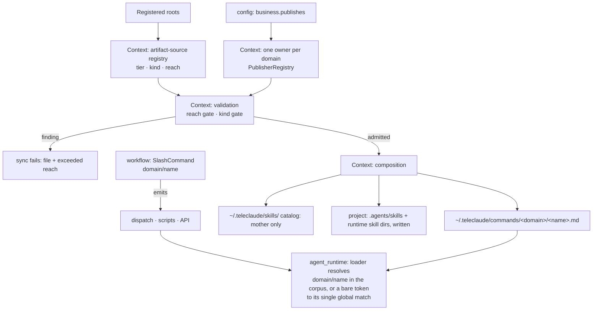
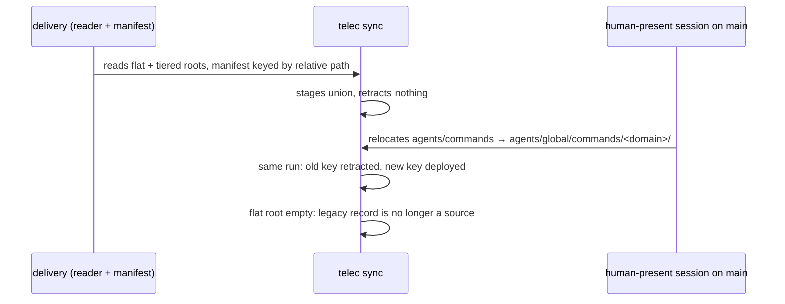

# Agent Artifact Distribution — Design

## Required reads

- @docs/project/spec/domain/context.md
- @docs/project/spec/feature/context/agent-runtime-deployment.md

## Purpose

Realize `@prd#authorized-horizon` across four bounded contexts without letting
any of them absorb another's rule. `context` owns the authored-source registry,
reach validation, composition, and deployment of commands and skills. `config`
owns the publishing declaration that bounds a repository's global reach.
`workflow` owns the canonical command-name vocabulary the lifecycle machinery
emits. `agent_runtime` owns resolving a name to a corpus document at dispatch.
This document owns only the relationships among those contracts and the order
in which the mother's sources migrate; every behavior resolves to one of the
four contexts' own specs.

The approved target it preserves: one tiered source shape at every repository
root (`@prd#included`), global commands partitioned by declared domain and
refused outside declared reach (`@prd#sc-2-global-commands-publish-by-declared-domain-and-out-of-reach-sources-fail-loudly`),
general commands and global skills from the mother alone (`@prd#sc-6-the-global-skill-catalog-is-composed-from-the-mother-alone`),
`.agents/` as delivery output only (`@prd#sc-4-authored-input-and-generated-output-never-share-a-location`),
domain-qualified command names everywhere the platform names one (`@prd#sc-3-a-global-command-is-named-by-its-domain-everywhere-the-platform-names-it`),
and no loss of offered artifacts at any point in the migration (`@prd#sc-5-the-mothers-migrated-artifacts-lose-nothing-sessions-were-offered-at-every-point-in-the-cutover`).

## Inputs/Outputs

**Inputs**

- Authored sources under a repository's `agents/global/commands/<domain>/`,
  `agents/global/commands/general/`, `agents/global/skills/<name>/`,
  `agents/project/commands/`, and `agents/project/skills/<name>/`, plus the
  untiered master and addenda at the artifact root.
- The repository's publishing declaration (`business.publishes`), read through
  `config`'s existing `publishes_for_root` contract, and the registered-root set.
- The Context-owned artifact-source registry in `teleclaude/agent_artifacts.py`:
  one frozen record per source directory carrying relative directory, artifact
  kind, authorship, tier, and reach. The records name the tiered directories;
  the domain spec that owns the registry is listed under Required reads.
- The canonical command-name vocabulary in `teleclaude/constants.py`
  (`SlashCommand`), owned by `workflow`.

**Outputs**

- The global command corpus at `~/.teleclaude/commands/<domain>/<name>.md`,
  one directory per published domain plus `general/`, composed from every
  publisher root's in-reach global command sources.
- The global skill catalog at `~/.teleclaude/skills/`, composed from the
  mother's `agents/global/skills/<name>/` folders alone.
- Project delivery: each project's `agents/project/skills/*` rendered into
  that project's runtime skill directories and into `.agents/skills/`. A source
  under `agents/project/commands/` is validated and reach-checked and is written
  to no corpus by this delivery; the per-tier corpus and its resolution are the
  command output side's contract. `.agents/` is a delivery location and is never
  read as an authored source.
- Validation findings that name the file and the reach it exceeds, or both
  files and the colliding name, and fail sync.
- The deployed-commands ownership manifest, keyed by relative corpus path.

## Invariants

### Ownership

- **`context` owns the registry, reach, composition, and retraction.** The
  registry in `teleclaude/agent_artifacts.py` is the single statement of which
  directories are sources, of which kind, at which tier, with which reach. Every
  consumer — validation (`teleclaude/resource_validation/_artifacts.py`), global
  skill discovery (`teleclaude/global_skills.py`), distribution
<!-- planned-change:retire-docs-watcher -->
  (`scripts/distribute.py`), the sync watcher's top-level scope
  (`teleclaude/cli/watch.py`), the checkpoint sync scope
  (`teleclaude/constants.py`), and onboarding inference
<!-- change:retire-docs-watcher -->
  (`scripts/distribute.py`), the checkpoint sync scope
  (`teleclaude/constants.py`), and onboarding inference
<!-- /planned-change:retire-docs-watcher -->
  (`teleclaude/project_setup/init_flow.py`) — derives its directory set from the
  registry and restates nothing.
- **Reach is a registry attribute, resolved against `config`'s declaration.** A
  global command record's reach is the set of domains the repository publishes;
  the mother's reach additionally includes `general`. A global skill record's
  reach is the mother alone. A project record's reach is the repository itself.
  The one-owner-per-domain resolution reuses the docs publisher registry
  (`teleclaude/docs_publishers.py`, `PublisherRegistry`): a domain has exactly
  one owning publisher for documentation and for commands, resolved once.
- **`workflow` owns the name vocabulary and every emission of it.** The rule
  is stated in the workflow domain spec and bound by the prepare and work
  state-machine specs; this document only records that the vocabulary is the
  contract `context` lays the corpus out against.
- **`agent_runtime` owns resolution within the global corpus, and the
  session metadata that carries the name.** The rule is stated in the agent
  runtime domain spec and bound by the run-session-with-command spec; this
  document only records that resolution reads the corpus `context` publishes
  and decides nothing about reach or layout. Resolution that reads a session's
  tier context is outside this design. The session record, its title, and the
  live-session attribution query carry and match the qualified value `workflow`
  dispatched; `workflow` consumes that query and owns none of it.
- **`config` owns the declaration, never the gate.** `business.publishes` says
  what a repository may reach; `context` decides admission from it.

### Reach gate

- A source under `agents/global/commands/<domain>/` from a root that does not
  publish `<domain>` is a validation finding naming the file and the reach it
  exceeds. `general/` from a non-mother root is refused the same way.
- A folder under `agents/global/skills/` from a non-mother root is refused.
- A kind directory under `agents/global/` or `agents/project/` other than
  `commands/` or `skills/` is refused as outside the artifact model.
- Nothing under `.agents/` is ever enumerated as a source by any consumer.
- A global source outside a repository's reach is a finding, never a silent
  skip: the global phase in `scripts/distribute.py` composes from every
  publisher root's admitted sources and refuses the rest by name.

### Corpus layout and names

- The shared corpus holds global commands only, partitioned by domain; two
  domains may carry the same bare file name. A project command never enters the
  shared corpus. Project scope keys leave the shared manifest on their project's
  first sync after migration, because that sync stages nothing at the shared
  root for them.
- The deployed-commands manifest keys by relative corpus path — `<name>.md` at
  the root or `<domain>/<name>.md`, never deeper — so partitioning and
  migration are ordinary add-and-retract deltas within one sync run.
- **Ownership is per publishing repository, never per phase.** The corpus is a
  destination several repositories write into, and retraction removes what a
  source owned and no longer stages. The owner recorded for a deploy is
  therefore the repository that ran it, at every phase. A phase-wide owner is
  correct only while one repository can run that phase: two repositories
  publishing under one owner subtract each other's commands, because retraction
  is a set difference inside one owner's inventory and the guard that spares a
  file another owner claims cannot fire when no other owner exists. Domain
  partitioning does not substitute: different paths still subtract to the same
  difference. Reach admits the second publisher, so reach is also what makes the
  per-repository owner necessary.
- **Manifest forward migration.** The manifest carries a schema version. The
  first load of an unversioned manifest rewrites it in place before any
  reconciliation reads it: every existing entry is a basename, and a basename is
  the root-relative path of a file that is at the corpus root, so each entry is
  carried forward unchanged in meaning and the file gains its version. Domain
  code reads only the versioned shape; the unversioned reader exists only inside
  that migration step (`software-development/policy/backward-compatibility-hygiene`,
  owned internal data). The same step rekeys the one phase-wide owner an
  unversioned manifest carries to the repository that produced it — the mother,
  which was the only repository able to publish globally while that shape was
  written — so no inventory is orphaned and no file is left unretractable. A later sync that stages `<domain>/<name>.md` for a
  relocated command retracts the root entry and records the partitioned one in
  the same run.
- Domain assignment of the mother's existing commands follows the governing
  procedure's domain (`@prd#premises-and-assumptions`): every lifecycle,
  review, run, drift, defer, emulate, coordinate, integrate, work, prepare, and
  todo-analysis command → `software-development`; `next-create`,
  `next-create-art`, `next-create-html` → `creative`; `sweep-email` →
  `personal`; `next-research`, `author-knowledge`, `projects-analyze`,
  `projects-assess-config`, `projects-onboard`, `companies-analyze`,
  `next-assist` → `general`.

### Migration without a retraction gap

- The reader accepts the mother's sources at both the flat root
  (`agents/commands`, `agents/skills`) and the tiered root until the flat root
  carries no artifacts; the flat root is a registry record marked legacy and
  retired when empty. A sync run at any point during the relocation therefore
  stages the union and retracts nothing that moved.
- Landing order: the code that reads both roots and keys the manifest by
  relative path lands first; the human-present relocation on `main` follows.
  The legacy record exists exactly as long as the flat root carries an
  artifact; a flat root that carries none is not a source. `@prd#sc-5-the-mothers-migrated-artifacts-lose-nothing-sessions-were-offered-at-every-point-in-the-cutover`
  binds the outcome; this section is the mechanism.

## Primary flows

Migration sequence:

## Failure modes

- **A root publishes a global command for a domain it does not declare.** Sync
  fails with the file and the reach it exceeds; nothing is composed for that
  run.
- **A bare token names a command in two domains.** The loader refuses, naming
  both. Domain-qualified dispatch is unaffected.
- **A sync lands mid-relocation.** The union of both roots is staged; no
  deployed artifact is retracted because its source moved.
- **A legacy `.agents/` file a project authored by hand.** Never read, never
  adopted, never deleted by this delivery; it stays until the native-output
  sibling lands ownership records.
- **A consumer restates its own directory list instead of reading the
  registry.** A second source of truth; reviewers treat it as an ownership
  defect (`software-development/policy/domain-ownership`).
- **Two repositories publish global commands and one deploy erases the
  other's.** Prevented by the per-repository owner: each deploy retracts only
  the paths its own repository last staged.

## See Also

- docs/project/spec/domain/context.md
- docs/project/spec/domain/context-map.md
- docs/project/spec/feature/context/agent-runtime-deployment.md
- docs/project/spec/feature/context/agent-artifact-validation.md
- docs/project/spec/feature/agent_runtime/run-session-with-command.md
- docs/project/spec/feature/config/project-capability-manifest.md
