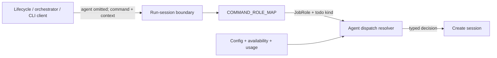
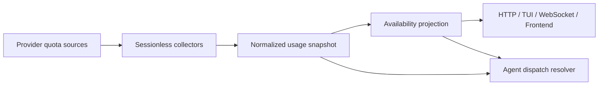

# Agent Dispatch — Design

## Purpose

Give every fresh-session entry point one agent-selection policy while preserving
the distinct semantics of automatic work, explicit human preference, and
runtime-bound continuation. Callers describe the job and intent; the
agent-runtime core chooses the agent from configured inventory, operator health
state, and normalized quota state.

The ordered role policy and observable outcomes live in
`project/spec/feature/agent_runtime/usage-aware-agent-dispatch`. This design owns
where that policy executes and which context crosses each boundary.

## Inputs/Outputs

**Inputs:**

- Dispatch mode: automatic preference, manual preference, or fixed agent.
- Canonical `JobRole` from `COMMAND_ROLE_MAP`, plus todo kind for a prepare
  orchestrator.
- Producer agent for reviewer and architecture-reviewer dispatch when known.
- Explicit human-selected agent for manual preference, or bound runtime agent
  for fixed continuation.
- Configured agent inventory and enabled state.
- Operator availability and degradation state.
- Normalized quota status and headroom from the agent-usage snapshot.

**Output:**

- A typed dispatch decision containing selected agent, applicable preferred
  agent, dispatch mode, job role, todo kind when relevant, and an exact fallback
  reason when selection leaves the first applicable preference.
- A hard no-candidate error instead of a session when no eligible agent exists.

## Invariants

### One policy owner

- The agent-runtime core owns one typed resolver. API routes, CLI clients,
  workflow, generated scripts, cron, adapters, and integration never carry
  their own role orders or availability logic.
- `COMMAND_ROLE_MAP` remains the only command-to-`JobRole` registry. The
  resolver consumes its result; it never duplicates command classification.
  Delivery adds the deployed `/next-create` command to `SlashCommand` and maps
  it to `JobRole.CREATE_ORCHESTRATOR`, closing the one current registry gap so
  the create-orchestrator matrix row is reachable through the same boundary.
- The role matrix is exhaustive over the canonical `JobRole` enum. A missing
  row is an observable contract defect and uses the global fallback
  `Claude, Codex, Gemini` only to keep fresh work operable.

### Automatic preference

- Automatic selection begins from the role row, or the global fallback when
  role context is absent or unmapped.
- Unconfigured, disabled, and hard-unavailable agents are removed.
- Healthy candidates form the preferred health band; degraded candidates are
  considered only when no healthy candidate remains.
- Reviewer independence is applied inside the best available health band. A
  healthy producer remains ahead of a degraded independent candidate.
- Quota pressure and normalized headroom rank candidates inside that band.
  Pressure never turns every candidate into a refusal.
- Matrix order is the stable tie-breaker. Configuration iteration order never
  becomes policy.

### Manual preference and fixed continuation

- An explicitly supplied human agent is manual preference. Pressure and
  degradation do not reroute it; hard unavailability selects an eligible
  fallback or fails when none exists.
- Resume, revive, restart, attach, transcript-bound continuation, and declared
  fixed-agent jobs are fixed. They never cross-agent substitute.
- Agent-specific startup-message handling runs only after selection. It cannot
  participate in or precede the dispatch decision.

### Omission and warnings

- An omitted agent remains absent through the CLI and API client boundary until
  the resolver runs. A schema default, serializer, or convenience client never
  materializes an agent for an automatic request.
- Generated orchestration scripts omit `--agent`; they provide command, role
  context, mode, and producer context where applicable.
- Every departure from the first applicable preference emits one structured
  warning with dispatch mode, role, todo kind when relevant, preferred agent,
  selected agent, and exact reason. Ordinary fallback is never described as
  configuration failure.

### Usage-state ownership and projection

- Agent runtime owns the normalized usage snapshot under durable structured
  state. Provider-native quota data remains provider-owned and raw output,
  credentials, account identity, access tokens, and transcripts are never
  persisted.
- The collector publishes normalized changes through the existing agent
  availability path. HTTP, TUI bootstrap, WebSocket, and frontend clients
  receive the same compact pressure fragments without provider parsing.
- Confirmed exhaustion may update only quota-owned hard-unavailability state.
  It never overwrites an operator-owned unavailable or degraded reason.

## Primary flows

### Automatic command dispatch

The run-session boundary resolves the command role before any agent-specific
message rewrite. A prepare dispatch also carries todo kind. Reviewer dispatch
adds producer agent when known. Unknown commands use the global fallback and
emit `job_unmapped`.

### Generic fresh-session dispatch

The generic create door infers role context from its initial command or accepts
typed job metadata from a trusted caller. An explicit human agent enters manual
preference; absence enters automatic preference. Direct core spawners such as
integration, scheduled jobs, and adapters pass the same typed dispatch context
before constructing the launch intent. A job whose declaration fixes an agent
uses fixed mode instead.

### Availability and quota propagation

Collectors use only the provider-specific no-session mechanisms bound by the
feature spec. Snapshot updates rebuild the availability projection and reuse
the existing availability event rather than introducing a second live-status
channel.

### Affected boundaries

- **Request contract:** run-session and generic-create requests preserve
  omission; responses expose the selected agent.
- **Core:** one dispatch resolver owns matrix, health, producer separation,
  quota, warning, and no-candidate semantics.
- **Workflow:** lifecycle runners provide lane command and todo kind but do not
  choose an agent.
- **Generated orchestration:** worker scripts omit `--agent` and stop asking the
  orchestrator to reproduce selection policy.
- **Direct spawners:** cron, adapters, log-hunting workers, and integration use
  automatic or fixed context explicitly instead of configured defaults.
- **Presentation:** availability DTOs and existing event propagation carry
  compact pressure fragments; UI layers only render them.

## Failure modes

- **Omission collapsed before resolution.** A client or schema default turns an
  automatic request into manual Claude. Reject this at review by tracing the
  serialized request, not only the endpoint model.
- **Caller-owned policy.** A generated script, adapter, or bridge embeds a role
  order or selects a default agent. Move the decision back to the resolver.
- **Health-order inversion.** Producer separation or quota pressure promotes a
  degraded candidate over a healthy one. Establish the health band first.
- **Unknown quota treated as healthy.** Missing, stale, or failed quota data
  wins a comparison. Preserve stable role order within uncertainty instead.
- **Fixed work substituted.** A resume or fixed job crosses agents. Refuse with
  the bound-agent reason instead.
- **Duplicate fallback signal.** Multiple layers warn for one decision. Emit
  once at the resolver boundary and propagate the decision.
- **Provider probe creates a session artifact.** Refuse that probe path; never
  fall back to a model-turn invocation.

## See Also

- docs/project/spec/feature/agent_runtime/usage-aware-agent-dispatch.md
- docs/project/spec/feature/agent_runtime/run-session-with-command.md
- docs/project/design/architecture/ai-to-ai-dispatch.md
- docs/project/design/architecture/layer-ownership.md
- docs/project/spec/teleclaude-home-layout.md
