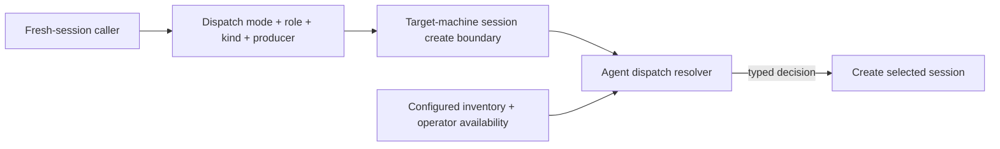
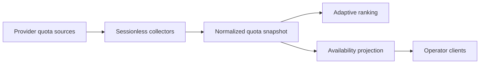

# Agent Dispatch — Design

## Required reads

@docs/project/spec/feature/agent_runtime/role-aware-agent-dispatch.md
@docs/project/spec/feature/agent_runtime/run-session-with-command.md
@docs/project/spec/feature/config/agents-inventory-requirement.md

## Purpose

Give every fresh-session entry point one agent-selection boundary while preserving
the distinct semantics of automatic work, explicit human preference, and
runtime-bound continuation. Callers describe the job and dispatch intent; the
agent-runtime core chooses from configured, enabled, operator-available agents.

The ordered role policy and observable deterministic outcomes live in
`project/spec/feature/agent_runtime/role-aware-agent-dispatch`. This design owns where
selection executes and which context crosses each boundary.

<!-- planned:adaptive-usage-routing -->
Provider-neutral quota state extends automatic preference only after deterministic
eligibility. Its observable outcomes live in
`project/spec/feature/agent_runtime/usage-aware-agent-dispatch`.
<!-- /planned:adaptive-usage-routing -->

## Inputs/Outputs

**Inputs:**

- Dispatch mode: automatic preference, manual preference, or fixed agent.
- Canonical job role, plus todo kind for a prepare orchestrator.
- Producer agent for reviewer dispatch when known.
- Explicit human-selected agent for manual preference, or bound runtime agent for
  fixed continuation.
- Configured agent inventory, enabled state, and operator availability.
<!-- planned:adaptive-usage-routing -->
- Normalized quota condition and headroom for deterministically eligible candidates.
<!-- /planned:adaptive-usage-routing -->

**Output:**

- A typed dispatch decision carrying the selected agent, dispatch mode, job role,
  todo kind when relevant, and a fallback reason when selection leaves the first
  applicable preference.
- A hard no-candidate error instead of a session when no eligible agent exists.

The decision is made on the computer that will host the new session. Machine-local
configuration and availability never travel to a caller for speculative selection.

## Invariants

### One policy owner

- `teleclaude/core/agent_dispatch.py` owns the typed resolver, role matrix, eligibility
  filtering, reviewer separation, and decision reasons.
- `teleclaude/core/command_handlers/_session.py` invokes that resolver once, before it
  writes the session row or starts a runtime. This is the universal target-machine
  boundary shared by API, adapter, workflow, scheduled, integration, and remote starts.
- API routes, CLI clients, workflow, generated instructions, scheduled jobs, adapters,
  and integration carry typed dispatch intent; they never carry role orders,
  availability logic, or a pre-resolved automatic default.
- The canonical command-to-role registry remains the only command classification
  boundary. Selection consumes its result and never duplicates it.
- Every canonical role has an ordered matrix row. An absent or unmapped role uses the
  Claude, Codex, Gemini global order while surfacing the distinction.

### Deterministic automatic preference

- Automatic selection begins from the role row, or the global order when role context
  is absent or unmapped.
- Unconfigured, disabled, degraded, and unavailable agents are removed. Only operator
  status `available` is eligible.
- A missing operator-availability row normalizes to available. Unexpired degraded and
  unavailable rows are ineligible; expired rows normalize to available through the
  existing database expiry semantics. A storage read failure remains a typed dispatch
  failure and is never treated as a missing row.
- Reviewer independence is applied inside the eligible set while preserving row order.
  The producer remains usable when no independent candidate survives.
- Matrix order is stable. Configuration iteration order never becomes policy.
- An empty eligible set refuses creation instead of choosing outside the contract.

### Manual preference and fixed continuation

- An explicitly supplied human agent is manual preference. It must be known and enabled.
  Operator status `available` or `degraded` selects that exact agent; `unavailable`,
  unknown, or disabled preference is rejected before session creation and never enters
  automatic fallback ordering.
- Resume, revive, restart, attach, transcript-bound continuation, and declared
  fixed-agent jobs are fixed. They never cross-agent substitute.
- Agent-specific startup handling runs only after selection and cannot participate in
  the decision.

### State and boundary ownership

- The config context owns the known-agent inventory and enabled flags. Its required
  configured default remains a configuration invariant but is not an automatic
  fresh-session routing rule.
- The agent-runtime database owns operator availability. The resolver reads the
  existing availability records and their expiry semantics; it introduces no second
  status store and emits no new event family.
- `SessionLaunchIntent` preserves automatic, manual-preference, or fixed intent plus
  the supplied preferred or fixed agent. `CreateSessionCommand` carries job role,
  prepare todo kind when applicable, and producer identity when reviewer separation
  cannot be derived from the initiating session.
- The selected agent is materialized only after resolution, then remains the existing
  `Session.active_agent` value and launch-intent agent used by startup. No routing
  explanation is persisted as session input.
- Core dispatch errors are typed. Session API edges translate invalid manual choices,
  no-candidate refusal, and fixed-agent refusal without creating a session row.

### Omission and explanation

- An omitted agent remains absent through client, request, adapter, and lifecycle
  boundaries until the resolver runs.
- Generated orchestration supplies role context and omits an agent choice.
- Relevant human-facing CLI callers receive the selected agent and exact fallback
  reason. Spawned-agent context and automated responses do not carry human-facing
  routing explanation.

### Structured decision evidence

- The core decision boundary emits the stable structured token
  `agent_runtime.agent_dispatch.decision` for every selected, fallback, refused, and
  policy-defect outcome.
- Fields are `outcome`, dispatch mode, job role, todo kind when applicable, preferred or
  fixed agent when supplied, selected agent when one exists, and a stable reason token
  covering eligibility, fallback, no-candidate, availability-state failure, or a
  missing role-matrix row.
- Evidence contains no startup message, command arguments, credentials, quota data,
  personal data, or free-form routing explanation. It remains runtime diagnostic
  evidence and never enters spawned-agent context.

<!-- planned:adaptive-usage-routing -->
### Adaptive quota extension

- Quota ranking receives only the candidates that survive deterministic eligibility.
- Below-pressure candidates precede pressured candidates; greater normalized headroom
  ranks comparable candidates; deterministic matrix order breaks remaining ties.
- Pressure never empties the candidate set. Unknown quota state preserves deterministic
  order when comparison is unsupported.
- Confirmed exhaustion may establish quota-owned hard unavailability but never
  overwrites operator-owned status.
<!-- /planned:adaptive-usage-routing -->

## Primary flows

### Session-creation flow

Automatic fresh-session callers preserve an absent agent through request, client,
adapter, lifecycle, and integration boundaries. Command-bearing doors derive the
canonical job from `COMMAND_ROLE_MAP`; lifecycle dispatch supplies prepare todo kind,
and reviewer dispatch supplies or makes derivable the producer. Generated orchestration
supplies role context without selecting an agent.

The target-machine session handler resolves typed dispatch intent against its local
configuration and availability immediately before session creation. Agent-specific
startup rewriting and launch occur only after the selected agent is materialized.

### Fresh-session selection

The selection boundary resolves role context before agent-specific launch behavior. A
prepare dispatch carries todo kind. Reviewer dispatch carries the producer when known.
Unknown role context uses the global order and remains observably distinct from a
missing row for a known role.

### Generic and direct spawners

Generic creation infers role context from its initial command or accepts trusted typed
job context. An explicit human agent enters manual-preference mode; absence enters
automatic-preference mode. Direct spawners such as integration, scheduled jobs, and
adapters pass the same dispatch intent instead of materializing configured defaults. A
job whose contract fixes an agent uses fixed mode.

Remote creation carries unresolved intent to the target computer. Resolving on the
origin computer would apply the wrong configured inventory or stale availability and is
therefore forbidden.

<!-- planned:adaptive-usage-routing -->
### Quota collection and projection

Provider adapters produce normalized facts without creating agent activity. The
snapshot extends routing and existing availability presentation without placing
provider parsing in callers.
<!-- /planned:adaptive-usage-routing -->

### Affected boundaries

- **Request contract:** fresh-session requests preserve omission and responses expose
  the selected agent. A fallback explanation is populated only for an authenticated
  human-facing response; automated callers receive the selected agent or typed failure.
- **API models and clients:** `RunSessionRequest.agent` becomes optional, generic create
  retains its existing optional agent, and clients omit absent values rather than
  serializing Claude or the configured default.
- **Core command model:** launch intent distinguishes automatic, manual preference, and
  fixed continuation until the target-machine handler resolves it.
- **Core:** one resolver owns role order, eligibility, reviewer separation, manual
  preference, fixed continuation, explanation, and no-candidate semantics. The session
  handler is the sole caller that materializes an agent for fresh work.
- **Workflow and generated orchestration:** callers provide job context and do not
  reproduce selection policy.
- **Direct spawners:** scheduled jobs, adapters, and integration declare automatic or
  fixed intent instead of choosing configured defaults.
<!-- planned:adaptive-usage-routing -->
- **Quota state and presentation:** provider adapters feed one normalized snapshot;
  availability clients render the same compact pressure projection.
<!-- /planned:adaptive-usage-routing -->

## Failure modes

- **Omission collapsed before resolution.** A client or schema turns automatic intent
  into manual preference. Trace serialized requests through the selection boundary.
- **Origin-machine resolution.** Remote dispatch uses the caller's config or availability
  instead of the target computer's state. Keep intent unresolved until target handling.
- **Caller-owned policy.** A generated instruction, adapter, or bridge embeds role order
  or selects a default. Return the decision to the resolver.
- **Eligibility bypass.** A disabled, degraded, unavailable, or unconfigured agent is
  selected to keep work moving. Refuse creation when the eligible set is empty.
- **Availability read failure treated as absence.** A storage error makes an agent look
  available because no row was returned. Preserve the typed read failure and refuse
  creation before policy evaluation completes.
- **Fixed work substituted.** Continuation crosses agents. Return a bound-agent failure
  instead.
- **Explanation leakage.** A human-facing fallback reason enters spawned-agent context or
  automated responses. Keep explanation at the relevant human boundary.
- **Partial creation on refusal.** A session row exists after no-candidate or invalid
  manual selection. Resolution must precede the first durable session write.
<!-- planned:adaptive-usage-routing -->
- **Quota establishes eligibility.** Ranking reintroduces a candidate deterministic
  eligibility removed. Adaptive ranking must only reorder the surviving set.
- **Unknown quota treated as healthy.** Missing, stale, or failed data wins a comparison.
  Preserve deterministic order where normalized comparison is unsupported.
- **Provider probe creates agent activity.** Refuse the probe path rather than invoking a
  model or creating a session artifact.
<!-- /planned:adaptive-usage-routing -->

## See Also

- docs/project/spec/feature/agent_runtime/role-aware-agent-dispatch.md
- docs/project/spec/feature/agent_runtime/usage-aware-agent-dispatch.md
- docs/project/spec/feature/agent_runtime/run-session-with-command.md
- docs/project/design/architecture/ai-to-ai-dispatch.md
- docs/project/design/architecture/layer-ownership.md
