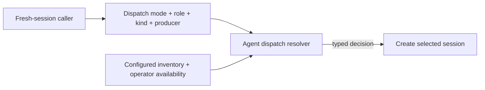
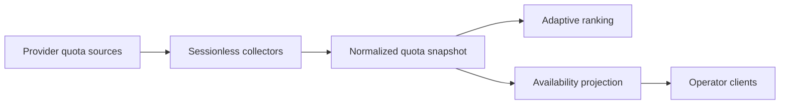

# Agent Dispatch — Design

## Purpose

Give every fresh-session entry point one agent-selection boundary while preserving
the distinct semantics of automatic work, explicit human preference, and
runtime-bound continuation. Callers describe the job and dispatch intent; the
agent-runtime core chooses from configured, enabled, operator-available agents.

The ordered role policy and observable deterministic outcomes live in
`project/spec/feature/agent_runtime/role-aware-agent-dispatch`. This design owns where
selection executes and which context crosses each boundary.

<!-- planned:adaptive-usage-routing -->
Provider-neutral quota state extends automatic preference only after deterministic
eligibility. Its observable outcomes live in
`project/spec/feature/agent_runtime/usage-aware-agent-dispatch`.
<!-- /planned:adaptive-usage-routing -->

## Inputs/Outputs

**Inputs:**

- Dispatch mode: automatic preference, manual preference, or fixed agent.
- Canonical job role, plus todo kind for a prepare orchestrator.
- Producer agent for reviewer dispatch when known.
- Explicit human-selected agent for manual preference, or bound runtime agent for
  fixed continuation.
- Configured agent inventory, enabled state, and operator availability.
<!-- planned:adaptive-usage-routing -->
- Normalized quota condition and headroom for deterministically eligible candidates.
<!-- /planned:adaptive-usage-routing -->

**Output:**

- A typed dispatch decision carrying the selected agent, dispatch mode, job role,
  todo kind when relevant, and a fallback reason when selection leaves the first
  applicable preference.
- A hard no-candidate error instead of a session when no eligible agent exists.

## Invariants

### One policy owner

- The agent-runtime core owns one typed resolver. API routes, CLI clients, workflow,
  generated instructions, scheduled jobs, adapters, and integration never carry
  their own role orders or availability logic.
- The canonical command-to-role registry remains the only command classification
  boundary. Selection consumes its result and never duplicates it.
- Every canonical role has an ordered matrix row. An absent or unmapped role uses the
  Claude, Codex, Gemini global order while surfacing the distinction.

### Deterministic automatic preference

- Automatic selection begins from the role row, or the global order when role context
  is absent or unmapped.
- Unconfigured, disabled, degraded, and unavailable agents are removed. Only operator
  status `available` is eligible.
- Reviewer independence is applied inside the eligible set while preserving row order.
  The producer remains usable when no independent candidate survives.
- Matrix order is stable. Configuration iteration order never becomes policy.
- An empty eligible set refuses creation instead of choosing outside the contract.

### Manual preference and fixed continuation

- An explicitly supplied human agent is manual preference. It must be known, enabled,
  and available; unavailable preference falls back through deterministic order, while
  unknown or disabled preference is rejected.
- Resume, revive, restart, attach, transcript-bound continuation, and declared
  fixed-agent jobs are fixed. They never cross-agent substitute.
- Agent-specific startup handling runs only after selection and cannot participate in
  the decision.

### Omission and explanation

- An omitted agent remains absent through client, request, adapter, and lifecycle
  boundaries until the resolver runs.
- Generated orchestration supplies role context and omits an agent choice.
- Relevant human-facing CLI callers receive the selected agent and exact fallback
  reason. Spawned-agent context and automated responses do not carry human-facing
  routing explanation.

<!-- planned:adaptive-usage-routing -->
### Adaptive quota extension

- Quota ranking receives only the candidates that survive deterministic eligibility.
- Below-pressure candidates precede pressured candidates; greater normalized headroom
  ranks comparable candidates; deterministic matrix order breaks remaining ties.
- Pressure never empties the candidate set. Unknown quota state preserves deterministic
  order when comparison is unsupported.
- Confirmed exhaustion may establish quota-owned hard unavailability but never
  overwrites operator-owned status.
<!-- /planned:adaptive-usage-routing -->

## Primary flows

### Fresh-session selection

The selection boundary resolves role context before agent-specific launch behavior. A
prepare dispatch carries todo kind. Reviewer dispatch carries the producer when known.
Unknown role context uses the global order and remains observably distinct from a
missing row for a known role.

### Generic and direct spawners

Generic creation infers role context from its initial command or accepts trusted typed
job context. An explicit human agent enters manual-preference mode; absence enters
automatic-preference mode. Direct spawners such as integration, scheduled jobs, and
adapters pass the same dispatch intent instead of materializing configured defaults. A
job whose contract fixes an agent uses fixed mode.

<!-- planned:adaptive-usage-routing -->
### Quota collection and projection

Provider adapters produce normalized facts without creating agent activity. The
snapshot extends routing and existing availability presentation without placing
provider parsing in callers.
<!-- /planned:adaptive-usage-routing -->

### Affected boundaries

- **Request contract:** fresh-session requests preserve omission and responses expose
  the selected agent.
- **Core:** one resolver owns role order, eligibility, reviewer separation, manual
  preference, fixed continuation, explanation, and no-candidate semantics.
- **Workflow and generated orchestration:** callers provide job context and do not
  reproduce selection policy.
- **Direct spawners:** scheduled jobs, adapters, and integration declare automatic or
  fixed intent instead of choosing configured defaults.
<!-- planned:adaptive-usage-routing -->
- **Quota state and presentation:** provider adapters feed one normalized snapshot;
  availability clients render the same compact pressure projection.
<!-- /planned:adaptive-usage-routing -->

## Failure modes

- **Omission collapsed before resolution.** A client or schema turns automatic intent
  into manual preference. Trace serialized requests through the selection boundary.
- **Caller-owned policy.** A generated instruction, adapter, or bridge embeds role order
  or selects a default. Return the decision to the resolver.
- **Eligibility bypass.** A disabled, degraded, unavailable, or unconfigured agent is
  selected to keep work moving. Refuse creation when the eligible set is empty.
- **Fixed work substituted.** Continuation crosses agents. Return a bound-agent failure
  instead.
- **Explanation leakage.** A human-facing fallback reason enters spawned-agent context or
  automated responses. Keep explanation at the relevant human boundary.
<!-- planned:adaptive-usage-routing -->
- **Quota establishes eligibility.** Ranking reintroduces a candidate deterministic
  eligibility removed. Adaptive ranking must only reorder the surviving set.
- **Unknown quota treated as healthy.** Missing, stale, or failed data wins a comparison.
  Preserve deterministic order where normalized comparison is unsupported.
- **Provider probe creates agent activity.** Refuse the probe path rather than invoking a
  model or creating a session artifact.
<!-- /planned:adaptive-usage-routing -->

## See Also

- docs/project/spec/feature/agent_runtime/role-aware-agent-dispatch.md
- docs/project/spec/feature/agent_runtime/usage-aware-agent-dispatch.md
- docs/project/spec/feature/agent_runtime/run-session-with-command.md
- docs/project/design/architecture/ai-to-ai-dispatch.md
- docs/project/design/architecture/layer-ownership.md
