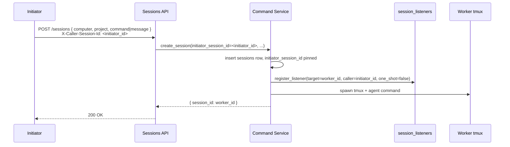
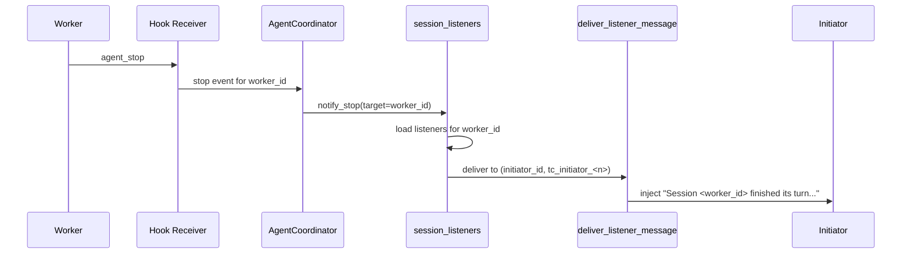
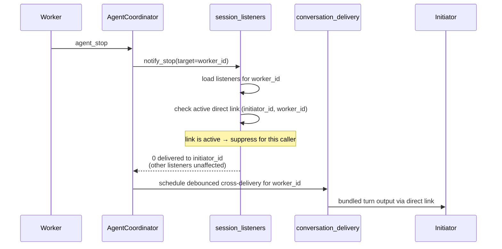

# AI-to-AI Dispatch — Design

## Required reads

- @docs/project/spec/session-subscriptions.md
- @docs/project/design/architecture/session-listeners.md

## Purpose

Enable one AI session (the **Initiator**) to spawn and supervise another (the **Worker**) asynchronously, with stop notifications delivered into the Initiator's tmux when the Worker's turn finishes. Supports fire-and-forget delegation, parallel autonomous execution, and asymmetric attention — the Initiator stays focused on its own work while the Worker progresses on the side.

This design covers the dispatch journey. Storage internals for the listener registry live in `session-listeners`. The state contract that this flow obeys lives in `session-subscriptions`.

<!-- planned:personal-assistant-launch -->

### Producers that reach a person workspace

Five paths create a session in a person's workspace. Two general verbs carry a
destination the caller supplied. Three derive it from a person the platform
already resolved: the Telegram private-chat handlers and the Discord
direct-message handlers, from the person behind the conversation, and the
personal-assistant launch, from the person behind the authenticated caller. All
five converge on one session-creation command.

### Prior art for the derived subject

The launch is a security boundary and takes an established shape rather than a
new one. The failure it is designed against is the confused deputy, in which a
trusted deputy applies its own authority to a target its caller named; a launch
that accepted and validated a person argument would be that deputy. The remedy is
to designate the subject by what the invoker already holds rather than by a name
it supplies, which removes the step the attack needs.

The Kubernetes authorization API carries the same split in production:
`SubjectAccessReview` accepts a subject and is privileged, while
`SelfSubjectAccessReview` is a separate resource whose user and group fields must
be empty because the subject is taken from the authenticated caller. `run-pa`
stands in that relation to `run` and `start`, including the choice to be a
distinct surface rather than a mode of the general one. The platform's own `self`
surfaces are the internal precedent.

The decision is to adopt: no new authorization mechanism is introduced, the
refusal reuses the existing creation path and its typed refusal reason, and the
launch reuses the existing session-creation command.

<!-- /planned:personal-assistant-launch -->

## Inputs/Outputs

**Inputs:**

- `telec sessions run` or `telec sessions start` invocation from the Initiator (CLI or API). Carries target computer, project path, command or message, and (when relevant) `--direct`.
<!-- planned:personal-assistant-launch -->
- `telec sessions run-pa` invocation from any session. Carries a brief and
  nothing else: no path, no subfolder, no computer, and no person. Each of those
  is derived from the authenticated caller.
<!-- /planned:personal-assistant-launch -->
- Initiator's session identity (`X-Caller-Session-Id` header / equivalent) — pins the dispatcher identity on the new session.
- Worker `agent_stop` events from the agent CLI hook receiver.

**Outputs:**

<!-- planned-change:personal-assistant-launch -->
- New Worker session record in the database, with `initiator_session_id` set.
- Persistent listener row registered for the (Initiator → Worker) pair (`one_shot=false`).
- Stop notification injected into the Initiator's tmux when the Worker's turn ends — subject to the suppression rule in `session-subscriptions`.
<!-- change:personal-assistant-launch -->
- New Worker session record in the database. A dispatch made by an initiator
  records that initiator; a launch that pins no parent records none.
- Persistent listener row registered for the (Initiator → Worker) pair
  (`one_shot=false`), for a dispatch that has an initiator to notify.
- Stop notification injected into the Initiator's tmux when the Worker's turn ends — subject to the suppression rule in `session-subscriptions`. A session with no initiator produces none.
<!-- /planned-change:personal-assistant-launch -->

## Invariants

<!-- planned:personal-assistant-launch -->
- **A person is derived, never addressed.** `run-pa` resolves its target from the
  authenticated caller's identity. The surface exposes no parameter naming a
  person, in any form.
- **A platform admin gets their own assistant.** The call has one form and
  elevation does not widen it.
- **Person workspaces are unreachable through the general verbs.** `run` and
  `start` refuse a path resolving inside one.
- **No caller identity, no launch.** A caller resolving to no person is refused,
  never defaulted.
- **The launch pins no parent.** No initiator is recorded for the session it
  starts, so nothing holds authority over its ending and it ends itself. The
  caller's identity resolves the person; it does not become a parent link.
  Parentage is distinct from the listener suppression that `detach` expresses
  elsewhere in this design: suppression decides who is notified, parentage
  decides who may end the session, and neither implies the other.
- **The brief is carried as a request made in the moment.** What `run-pa` starts
  serves that request.
- **Derivation and refusal sit at different layers.** The person is resolved where
  the caller is authenticated. The destination is refused where every creation
  path converges. The authenticated edge sees one route at a time; the convergence
  point carries no caller identity.
- **The refusal reads only the destination.** No caller is exempt from it, and no
  caller identity is consulted to apply it.
- **The destination checked is the composed one.** A project path and any
  subdirectory beneath it resolve to a single destination before the check.
- **A person workspace is reachable only from a derived destination.** Every
  producer that creates a session in a person workspace resolves that destination
  from an identity the platform already holds — the person behind an inbound
  conversation, or the person behind the authenticated caller. A destination that
  arrived as a caller-supplied argument never reaches one. The distinction is
  carried on the internal command the daemon builds and on no request model, so
  no caller can present a destination as derived.
- **A declared job runs only through the scheduler.** A job declared in
  configuration is launched through the scheduled path, which derives its routing
  from that declaration and runs under a job runner's role. A brief names no job
  and the launch carries no command, so no brief reaches that path. This bounds
  the scheduler's own transport; what an assistant does when asked directly for
  work of the same kind is the conduct contract's, and rests on a schedule
  declaration a person's configuration does not yet carry.
- **Containment is answered by the configuration owner.** Whether a destination
  lies inside any person workspace is a published configuration query. Dispatch
  consumes that query and never walks the person-directory layout itself.
- **Person-workspace location and person resolution are consumed, not restated.**
  Which paths are person workspaces is answered by the configuration owner; which
  person a caller is resolves through the identity contract. Dispatch owns only
  the rule that binds them.
<!-- /planned:personal-assistant-launch -->
- **Initiator pinning.** The dispatcher's session id is stored as `initiator_session_id` on the Worker record at creation time. This is the canonical link from child to parent and survives daemon restart.
- **Listener kind.** Dispatch registers a persistent listener (`one_shot=false`). Repeat dispatches against the same target are deduplicated by `(caller, target)`.
- **No destructive coupling.** Opening a direct link to the Worker does not remove the dispatch-time listener. The link toggles delivery (suppression rule) but never mutates the listener row. Refuted code paths: `unregister_listener(...)` calls inside `_link_direct_sessions` and `_create_direct_link`.
- **Notification source of truth.** Stop events flow through `AgentCoordinator → session_listeners.notify_stop`. No second notification path bypasses the registry.
- **Tmux is the delivery surface.** Listener notifications are injected via `deliver_listener_message` into the Initiator's tmux session, identified by `caller_tmux_session` on the listener row.
- **Suppression while linked.** When a direct link is active between the Initiator and the Worker, listener notifications for that Initiator are skipped. The link's cross-delivery channel carries the relevant signal. See `session-subscriptions` for the canonical rule.

## Primary flows

### 1. Dispatch and registration



### 2. Stop-time notification (no link active)



### 3. Stop-time with an active direct link (suppression path)



<!-- planned:personal-assistant-launch -->

### 4a. A derived destination reaches a person workspace

```mermaid
sequenceDiagram
    participant Caller as Any session
    participant API as Sessions API
    participant Identity as Identity contract
    participant Config as Workspace classification
    participant Create as Session creation
    participant PA as Assistant tmux

    Caller->>API: run-pa { brief }<br/>authenticated caller only<br/>(inbound adapters derive the same way<br/>from the person behind a conversation)
    API->>Identity: resolve person for this caller
    alt no person resolves
        Identity-->>API: none
        API-->>Caller: refused — no person for caller
    else person resolves
        Identity-->>API: person
        API->>Config: workspace for this person
        Config-->>API: destination
        API->>Create: command carrying a derived destination<br/>and no parent
        Create->>Create: destination is a person workspace,<br/>and it was derived → allowed
        Create->>PA: spawn with the brief
        Create-->>API: session id
    end
```

### 4b. A supplied destination does not

```mermaid
sequenceDiagram
    participant Caller
    participant Run as run route
    participant Start as start route
    participant Create as Session creation
    participant Config as Workspace classification

    Caller->>Run: run { path, subfolder }
    Caller->>Start: start { path }
    Run->>Create: command carrying a supplied destination
    Start->>Create: command carrying a supplied destination
    Create->>Config: is the composed destination inside a person workspace?
    Config-->>Create: yes
    Create-->>Caller: refused — reach it with the personal-assistant launch
```

<!-- /planned:personal-assistant-launch -->

### 4. Caller cleanup

```mermaid
sequenceDiagram
    participant Daemon
    participant Listeners
    participant Links as conversation_links

    Daemon->>Daemon: detect initiator session ended
    Daemon->>Listeners: cleanup_caller_listeners(initiator_id)
    Daemon->>Links: cleanup_session_links(initiator_id)
    Note over Listeners,Links: both axes cleared in one pass
```

## Failure modes

<!-- planned:personal-assistant-launch -->
- **Accepting a person argument and validating it.** This reads as the same
  guarantee reached more flexibly and is a different one: anything a caller can
  pass is something a caller can be talked into passing by content it was asked
  to read. The security property is that no such parameter exists.
- **Shipping `run-pa` while `run` still accepts a person-workspace path.** The
  new verb then sits beside an open door rather than replacing it, and the
  boundary it exists to enforce is no more enforced than before.
- **Refusing on one route only.** `run` and `start` are separate routes that do
  not meet before a session is created. A refusal placed on either alone reads as
  enforcement while the other stays open.
- **Checking the project path and not the composed destination.** A permitted root
  with a subdirectory naming a person workspace lands inside one while the check
  reports a permitted path.
- **Treating existing detachment as absence of a parent.** Detachment and parentage
  are independent: a detached launch still records the caller that started it and
  only forgoes the dispatch-time subscription. A launch that reuses detachment
  alone produces an assistant with a parent that never listens, which is neither
  the governed shape nor the parentless one.
- **Marking the derived destination on a request model.** Once the distinction is
  something a caller can send, the derived launch is reduced to a convention and
  the absence of a person parameter bounds nothing.
- **Closing the inbound doors along with the caller-supplied ones.** The general
  verbs are not the only producers that reach a person workspace: the Telegram
  private-chat handlers and the Discord direct-message handlers each create a
  session there from the person behind the conversation. A refusal that reads only
  the destination, without asking how the destination was arrived at, removes
  those surfaces while closing the two it was aimed at.
<!-- /planned:personal-assistant-launch -->

- **Worker session crashes before any turn completes.** No `agent_stop` ever fires for it; the listener row remains until caller cleanup or explicit unsubscribe. Diagnose via `telec sessions tail <worker_id>` and lifecycle status in the sessions table.
- **Initiator tmux gone before notify.** `deliver_listener_message` logs the failure; the listener row is still removed when it is `one_shot=true`, retained when persistent. Persistent listeners with no live tmux become silent — caller cleanup is the resolution.
- **Daemon restart between dispatch and stop.** Listener rows are durable (SQLite); the registration survives the restart. Recovery requires no caller action.
- **Direct link opened then closed mid-turn.** Suppression toggles cleanly per notify call — the next event after sever delivers normally.
- **Duplicate dispatch against the same worker.** Register is deduped by `(caller, target)`; second attempt is a no-op.
- **Initiator never unsubscribes after worker ends.** Caller-session cleanup removes residual listener rows when the Initiator session itself ends. Until then, the row is idle and harmless.
