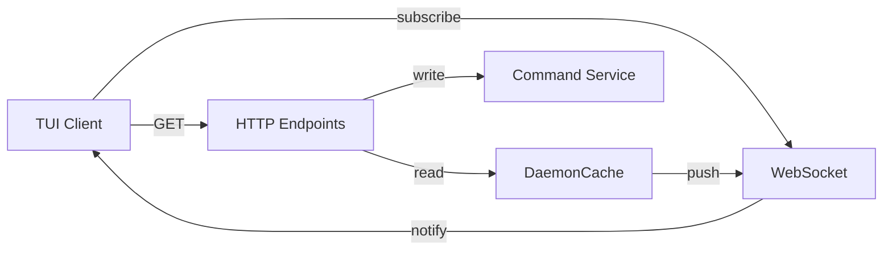
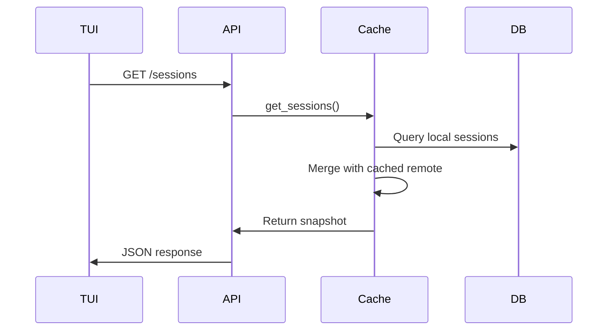
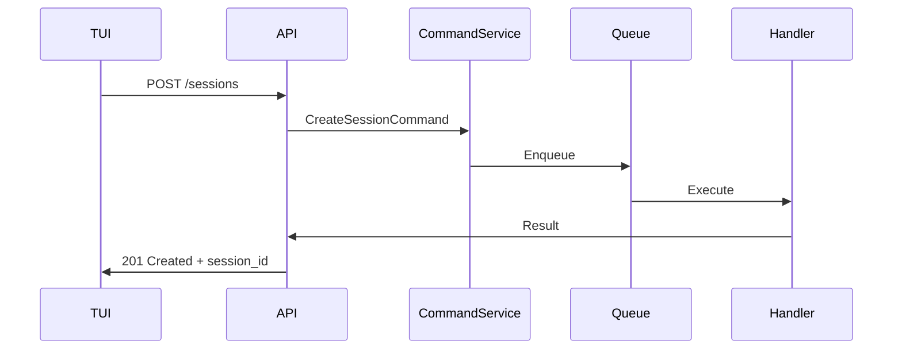
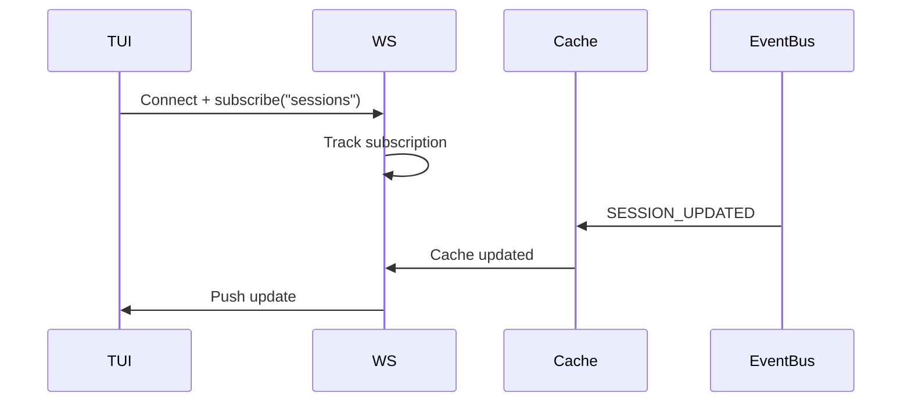
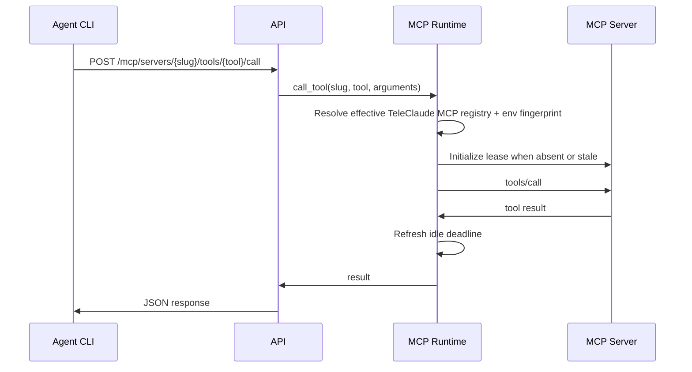

# Api Server — Design

## Required reads

- @docs/project/design/architecture/command-classification.md

## Purpose

Provide a resource-first API for TUI and CLI clients.

- Read endpoints return cached data immediately (local-only if cache is absent).
- Write endpoints map to typed command objects via CommandService. Each command declares
  its `response_mode` (`IMMEDIATE`, `FIRE_AND_FORGET`, or `RECEIPT`); routes derive their
  HTTP status code and response shape from that declaration — never from hardcoded logic.
- WebSocket subscriptions drive cache interest tracking and refresh pushes.
- API handlers do not fetch remote data directly; cache owns refresh.
- Session updates are merged from local DB and cached remote summaries.
- Memory endpoints (`/api/memory/*`) are mounted in the same FastAPI process for observation save/search/injection flows.

- MCP endpoints (`/mcp/*`) are mounted in the same FastAPI process and route through a daemon-owned lazy MCP runtime.

## Inputs/Outputs

**Inputs:**

- HTTP GET requests for resources (sessions, computers, projects, todos)
- HTTP POST requests for commands (create session, send message)
- HTTP lifecycle requests (for example session close)
- WebSocket subscription requests
- Cache update notifications
- HTTP requests and WebSocket subscriptions

- HTTP MCP discovery, tool-catalog, and tool-call requests

**Outputs:**

- JSON responses with resource snapshots
- WebSocket push messages on cache updates
- HTTP 2xx/4xx/5xx status codes
- Command execution results
- Cached resource snapshots and event-driven updates

- Secret-safe MCP server catalogs, tool catalogs, and tool-call results

## Invariants

- **Read-Only Cache Access**: API never writes to cache; only reads snapshots.
- **Explicit Write Boundaries**: Agent/session mutations either go through CommandService or through a documented lifecycle intent handoff owned by the API.
- **Immediate Response**: API returns cached data instantly; never blocks on refresh.
- **Non-Blocking Mutations**: FIRE_AND_FORGET and RECEIPT commands return immediately; the route never awaits async work. Response shape is derived from `command.response_mode`.
- **Subscription Cleanup**: WebSocket disconnect removes all subscriptions for that client.
- **No Remote Fetching**: API does not perform remote computer queries; cache owns that responsibility.
- **Integrated Memory Router**: Memory routes are served by the same API server process and share daemon lifecycle.

- **Integrated MCP Router**: MCP routes are served by the same API server process and share daemon lifecycle.
- **Daemon-Owned MCP Connections**: API handlers delegate MCP server startup, session leasing, request routing, and idle reaping to the daemon-owned MCP runtime. Agent clients never own stdio pipes or raw remote MCP sessions.
- **TeleClaude Registry Source**: MCP routes read from the effective TeleClaude MCP registry, assembled from `teleclaude-mcp.jsonc` and `teleclaude-mcp.local.jsonc`; native agent MCP config files are not the API source of truth.
- **Secret-Safe MCP Output**: MCP routes resolve placeholder environment variables inside the daemon process and never return resolved secret values to callers.

## Primary flows

### 1. Resource Read (Sessions Example)

### 2. Command Write (Create Session)

### 3. WebSocket Subscription & Push

### Lazy MCP Tool Call

### 4. Resource Endpoints

Response mode is declared on the command, not the route. Routes derive HTTP status from it:
`IMMEDIATE` → 200/201, `FIRE_AND_FORGET` → 202 + `completion_event`, `RECEIPT` → 202 + `OperationReceipt`.

| Method | Endpoint                        | Mode            | Action                             |
| ------ | ------------------------------- | --------------- | ---------------------------------- |
| GET    | /health                         | READ            | Health check                       |
| GET    | /sessions                       | READ            | List sessions (cache)              |
| POST   | /sessions                       | IMMEDIATE       | Create session → session_id        |
| POST   | /sessions/{id}/message          | IMMEDIATE       | Send message to session            |
| POST   | /sessions/{id}/keys             | IMMEDIATE       | Inject key input                   |
| POST   | /sessions/{id}/voice            | IMMEDIATE       | Handle voice input                 |
| POST   | /sessions/self/file             | IMMEDIATE       | Deliver file attachment to user    |
| POST   | /sessions/self/result           | IMMEDIATE       | Send formatted result to user      |
| POST   | /sessions/self/widget           | IMMEDIATE       | Render widget and send summary     |
| POST   | /sessions/{id}/agent-restart    | FIRE_AND_FORGET | Restart agent                      |
| POST   | /sessions/self/escalate         | FIRE_AND_FORGET | Escalate customer session          |
| POST   | /sessions/run                   | IMMEDIATE       | Create session + run slash command |
| DELETE | /sessions/{id}                  | FIRE_AND_FORGET | Request async session close        |
| POST   | /jobs/{name}/run                | FIRE_AND_FORGET | Run background job                 |
| GET    | /tui/bootstrap                  | READ            | TUI partial initial state          |
| GET    | /computers                      | READ            | List computers (cache + remote)    |
| GET    | /projects                       | READ            | List projects (cache)              |
| GET    | /todos                          | READ            | List todos (cache)                 |
| POST   | /todos/work                     | RECEIPT         | Run next-work state machine        |
| POST   | /todos/integrate                | RECEIPT         | Run integration state machine      |
| POST   | /todos/create                   | RECEIPT         | Run creative state machine         |
| POST   | /todos/prepare                  | RECEIPT         | Run prepare state machine          |
| GET    | /operations/{id}                | READ            | Poll operation receipt             |
| POST   | /api/notifications/{id}/claim   | IMMEDIATE       | Claim notification                 |
| POST   | /api/notifications/{id}/resolve | IMMEDIATE       | Resolve notification               |
| POST   | /api/memory/save                | IMMEDIATE       | Save observation                   |
| GET    | /api/memory/search              | READ            | Search observations                |
| GET    | /api/memory/timeline            | READ            | Timeline around anchor             |
| POST   | /api/memory/batch               | READ            | Bulk fetch observations            |
| GET    | /api/memory/inject              | READ            | Generate memory context markdown   |

MCP endpoints are resource-shaped but may initialize or reuse a daemon-owned MCP lease as part of satisfying the read or call.

| Method | Endpoint                              | Mode      | Action                          |
| ------ | ------------------------------------- | --------- | ------------------------------- |
| GET    | /mcp/servers                          | READ      | List configured MCP servers     |
| GET    | /mcp/servers/{slug}/tools             | READ      | Lazy-load server and list tools |
| POST   | /mcp/servers/{slug}/tools/{tool}/call | IMMEDIATE | Lazy-load server and call tool  |

## Failure modes

- **Cache Miss**: Returns empty array until cache refresh completes. Client sees "no data" briefly.
- **Command Execution Failure**: Returns 5xx with error message. Client must retry or investigate.
- **Close Intent Failure**: Returns 5xx if the API cannot load the session or record `closing` before emitting the lifecycle event.
- **WebSocket Connection Drop**: Client reconnects, resubscribes. Misses push updates during downtime.
- **Stale Cache**: Client receives outdated data until TTL refresh. Acceptable for TUI; critical updates use events.
- **API Server Crash**: All HTTP/WS clients disconnected. Daemon restart restores service. In-flight commands may be lost.
- **Socket Bind/Startup Failure**: API interface is required; daemon startup fails (fail-fast) instead of continuing in partial mode.
- **Request Timeout**: No timeout enforced by API; relies on client timeout. Long commands may appear hung.

- **MCP Startup Failure**: Tool catalog and tool-call requests return a secret-safe error when the server cannot initialize, a placeholder environment variable is missing, or MCP handshake fails.
- **MCP Tool Timeout**: Tool-call requests fail for the caller whose timeout expires; queued calls remain isolated unless the server lease itself fails.
- **MCP Lease Reap Failure**: Reaper failure leaves an idle lease warm longer than intended. The runtime retries cleanup and logs the server slug without resolved secrets.
