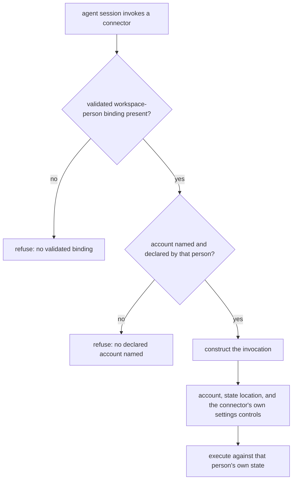

# Assistant Connector Boundary — Design

## Required reads

- @docs/project/spec/feature/integration/assistant-connector-invocation.md
- @docs/project/spec/feature/config/person-mail-accounts.md

## Purpose

An agent acting as someone's assistant reaches mail and calendar through an
external command-line connector. This design places, at the one boundary where
that connector is reached, the binding of an invocation to one declared account
of one person, the direction of that person's connector state, and the conduct
policy's settings prohibition.

Three contexts participate, and the split follows meaning rather than hosting:

- **Configuration** owns what a person may declare — their mail accounts, each
  naming a connector from the platform's vocabulary and an address — and it sits
  with the person's other operational data rather than in the global identity
  entry, which already refuses credentials-adjacent keys.
- **Integration** owns the boundary: translating that vocabulary into a
  particular tool, binding an invocation to one declared account, directing that
  person's state, and constructing the invocation so the connector's own
  controls hold the settings prohibition.
- **Agent runtime** owns that a session reaches the boundary rather than the raw
  tool, and carries the facts the boundary consumes.

Sending is not this design's subject; `assistant-instructed-send` owns it.

### The person is consumed, never derived

The boundary performs no person resolution and accepts no parameter naming a
person. It consumes the validated workspace-person binding — the fact that this
workspace belongs to exactly one registered person, checked against the person
registry and failing closed on an unknown, ambiguous, or disagreeing claim — and
refuses when that fact is absent.

That fact establishes whose workspace this is. It does not authenticate whoever
started the session, and this boundary does not treat it as though it did:
whether a caller was entitled to reach this workspace is settled by the contract
that launches sessions into person workspaces, before the boundary runs.

### Prior art and adopt-vs-build

The settings prohibition is held by controls the connector already provides,
verified against the installed command surface: an authorization grant that
excludes the settings scopes, so the provider refuses those operations whatever
is invoked, and a command allowlist that restricts an invocation to named
command prefixes. Neither is compiled into the tool; each holds only when the
invocation is constructed with it, which is what makes a boundary that
constructs invocations the right place for it.

Nothing bespoke is introduced. The boundary builds no classifier of its own that
inspects arguments or endpoints to judge what an invocation would reach: such a
classifier fails open on any encoding or alias it does not recognize, which is
the wrong direction for a security control and would require prior-art evidence
this design does not have. An allowlist of permitted commands refuses the
unrecognized by construction, so the unknown case is closed rather than judged.

## Inputs/Outputs

**In:** the validated workspace-person binding; that person's declared accounts
and the account this invocation names; and that person's connector state
location.

**Out:** a constructed invocation of the connector, executed against that
person's own state with the settings prohibition held by the connector's own
controls; or a refusal naming which condition failed — no validated binding, no
named account, or an account the person has not declared.

### Layer placement

| Responsibility                                                                          | Layer                                            | Owner         |
| --------------------------------------------------------------------------------------- | ------------------------------------------------ | ------------- |
| Entry point published on the agent tool surface                                         | Artifact / tool surface                          | agent runtime |
| Carrying the validated workspace-person binding and the named account into typed inputs | Injection                                        | agent runtime |
| Validating that a workspace belongs to exactly one registered person                    | Core service, published as an identity fact      | identity      |
| Account lookup against the person's declared list                                       | Core service, via configuration's published read | configuration |
| Invocation construction, vocabulary translation, state direction, control selection     | Core service                                     | integration   |
| Connector process execution                                                             | Infrastructure, behind its owning service        | integration   |

These responsibilities do not fit an existing root. The platform's adapter root
holds inbound and outbound UI adapters, and its integration core holds the
code-delivery state machine; neither is a home for connector invocation. The
connector boundary is therefore a new module under the integration context.

The integration core receives fully resolved typed inputs and reads neither the
environment nor the filesystem to fill them; that resolution is the injection
layer's. Every crossing goes through the owning context's published read.

The entry point carries no logic. This follows the no-inline-logic contract
rather than an existing example: the platform's git entry point is a
several-hundred-line behavioral wrapper, and is a precedent for where such an
entry point is published, not for what it may contain.

## Invariants

- An invocation not bound to both a validated workspace-person binding and one
  of that person's declared accounts does not reach a connector. Neither is
  inferred, neither has a default, including where the person declared exactly
  one account.
- The boundary never resolves, accepts, or overrides which person a session acts
  as, and never reaches into a workspace other than its own.
- Settings operations are refused by controls the connector itself applies, not
  by this boundary's judgment of what an invocation would reach.
- Nothing above this boundary names a vendor tool.
- A connector's state location and its secret store are separate concerns. This
  boundary directs the first and makes no claim about the second, so directing
  state is never presented as isolation between people.

## Primary flows

### What confines credentials, and what does not

Directing a connector's state at a person's own location is not confinement: the
connector resolves stored secrets from a namespace shared across the machine
regardless of where its state is directed.

What keeps one person's invocation away from another's credentials is the
account binding rather than the state location. Stored secrets are keyed by
address, and an invocation may name only an address the acting person has
declared, so it resolves that person's own credential and no other. Reaching
another person's credential would require naming their address, which no
person's declaration contains.

Confinement in the stronger sense — a store one person's process cannot read at
all — belongs to whoever owns the per-person secret store, and this design
defines none.

## Failure modes

- **The platform's routes are not the only physical routes.** The agent shell
  front-pins the platform's tool directory, so the published entry point wins
  name resolution, while a package manager publishes its own executable on the
  same path. A process holding the person's own operating-system authority can
  execute a connector regardless of what the platform publishes. Genuine
  unreachability requires the session to hold less authority than the person,
  which is process isolation the platform does not impose.
- **Directed state reads as isolation.** Every invocation going to its own
  person's location looks like separation between people and is not; the shared
  secret namespace is untouched by it. What the account binding prevents is
  reaching another person's credential, not the store being shared.
- **A declared account that was never authorized** fails at the connector rather
  than at the boundary. The boundary binds an invocation to a declaration; it
  does not verify the declaration was ever consented to.
- **Two concurrent invocations for one person can rotate a credential under each
  other.** The connector's native behavior governs it, and nothing here
  serializes refreshes.

## See Also

- ~/.teleclaude/docs/personal/policy/assistant-conduct.md — the settings prohibition this boundary holds, and the workspace scope it inherits.
- docs/project/spec/feature/identity/person-context-binding.md — the validated binding this boundary consumes.
- docs/project/design/architecture/layer-ownership.md — the layer contract the placement table follows.
- docs/third-party/gogcli/authorization.md — the vendor evidence for the connector's account selection, state root, and caller-supplied controls.
