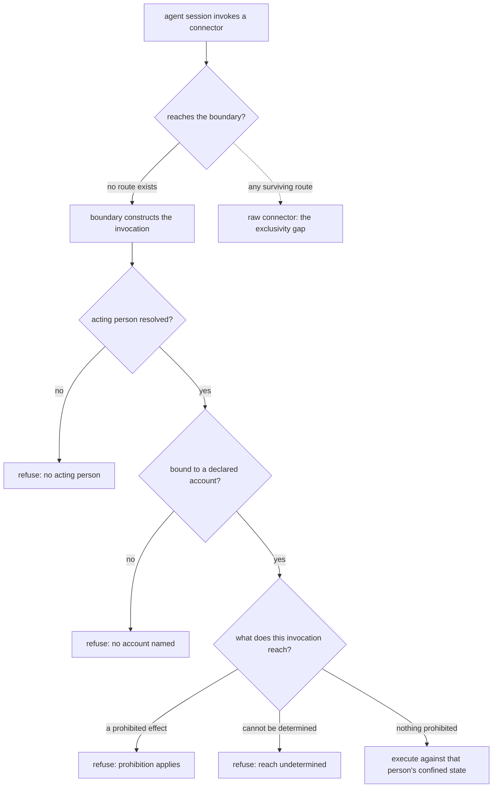

# Assistant Connector Boundary — Design

## Required reads

- @docs/project/spec/feature/integration/assistant-connector-invocation.md
- @docs/project/spec/feature/config/person-mail-accounts.md

## Purpose

An assistant reaches a person's mail and calendar through external command-line
connectors. Those connectors carry the operations that the personal-assistant
conduct policy prohibits, and they do not hold the prohibitions themselves. This
design places the prohibitions, the person and account binding, and the
credential confinement at the one boundary where a connector is actually
reached, and states which context owns each part.

Three contexts participate, and the split follows meaning rather than hosting:

- **Configuration** owns what a person may declare — their mail accounts, each
  naming a connector from the platform's vocabulary and an address. It sits
  beside the person's other operational data rather than in the global identity
  entry, which the global level already refuses credentials-adjacent keys for.
- **Integration** owns the boundary itself: translating the platform's connector
  vocabulary into a particular tool, binding an invocation to one declared
  account, directing that person's state, determining what an invocation
  reaches, and applying the two prohibitions. This is transport and translation
  across an external boundary, which is that context's published territory.
- **Agent runtime** owns one thing: that a session reaches the boundary and
  nothing else. It hosts the entry point, and hosting confers no authority over
  the rules above.

The prohibitions remain the conduct policy's. This design changes where they are
applied, never what they say.

## Inputs/Outputs

**In:** an agent session's connector invocation; the resolved acting person from
the identity context; that person's declared accounts from configuration; the
person's own state location and store secret.

**Out:** either a constructed invocation of the real connector, executed against
that person's state, or a refusal naming which condition failed — no person, no
named account, a reached prohibition, or reach that could not be determined.

The entry point published on the agent tool surface carries no logic of its own.
It delegates to a typed module entrypoint, which is where every decision below
happens; the platform's existing policy-bearing entry point for git established
that shape, and the no-inline-logic contract requires it here.

## Invariants

- An invocation that is not bound to both a resolved person and one of that
  person's declared accounts does not reach a connector. Neither is inferred and
  neither has a default, including where the person declared exactly one account.
- Every invocation is directed at the acting person's own connector state.
- The prohibitions are applied to what an invocation is determined to reach, not
  to the name it was called by, and reach that cannot be determined is refused.
- Nothing above this boundary names a vendor tool; the platform's connector
  vocabulary is translated here and nowhere else.
- A connector's state location and its secret store are separate concerns.
  Directing the first without confining the second yields no isolation at all,
  so neither is sufficient alone.

## Primary flows

### Constructing an invocation

The boundary resolves the person from identity, the account from that person's
declared list, and the person's state location and store secret from their own
workspace. It then constructs the real connector invocation: the account it acts
as, the state location, the confined secret store, and whichever of the
connector's own restriction levers exist. The tool's exact flag spellings belong
to that tool's consolidated documentation, not here.

### Confinement, and the migration it implies

Directing a connector's state at a person's own location is not confinement. At
least one connector resolves an account from a store shared across the machine
regardless of where its state is directed, so a state location alone presents as
isolation and provides none. Confinement additionally requires selecting that
connector's confined secret store together with a per-person secret; the
mechanism and its exact requirements live in that connector's consolidated
third-party documentation.

Selecting a confined store governs authorizations made after it is in force. An
account authorized earlier keeps its credential in the shared store and stays
reachable from anywhere, so confinement is not reached for that account until its
credential is moved into the person's own store and removed from the shared one.
The connectors expose export and import operations for exactly this, so the
transition costs no re-consent. It runs once per already-authorized account.

The per-person secret is read from the person's own workspace, which already
holds their environment-scoped secrets and is already excluded from version
control. The boundary passes it to the connector as that connector requires, and
does not place it in the arguments it constructs or in anything it writes out. A
connector that requires the secret inside the process it runs cannot also be
hidden from that process; that limit is stated in the invocation contract rather
than designed around.

## Failure modes

- **Exclusivity is not achieved by precedence.** The agent shell front-pins the
  platform's tool directory, so an entry point published there wins name
  resolution. It does not make the real connector unreachable: package managers
  publish their own executable on the same path, and an absolute invocation
  reaches it. Closing this requires the connector's provisioning to leave no
  executable of its own on the session's path — the boundary cannot close it from
  where it sits. Provisioning is owned outside this work, so this is a dependency
  and an open question below, not a solved problem.
- **A defeasible gate reads as a structural one.** Where a connector offers no
  restriction lever, the prohibitions rest on determining reach from the
  invocation, and an endpoint alias or encoding that is not recognized is read as
  reaching nothing prohibited. The contract states this rather than implying a
  wall that is not there.
- **Partial confinement is the dangerous state.** A person given a confined store
  whose earlier credential still sits in the shared one has the appearance of
  isolation and none of it, and nothing fails to reveal that. The migration is
  therefore part of reaching the outcome, not a follow-up.
- **A declared account that was never authorized** fails at the connector rather
  than at the boundary. The boundary binds an invocation to a declaration; it does
  not verify that the declaration was ever consented to.

## See Also

- ~/.teleclaude/docs/personal/policy/assistant-conduct.md — the prohibitions this boundary applies.
- docs/project/spec/agent-shell-path.md — the tool-path contract this boundary's entry point is published into.
- docs/project/spec/feature/agent_runtime/sealed-commit.md — the established shape for a policy-bearing entry point on the same surface.
