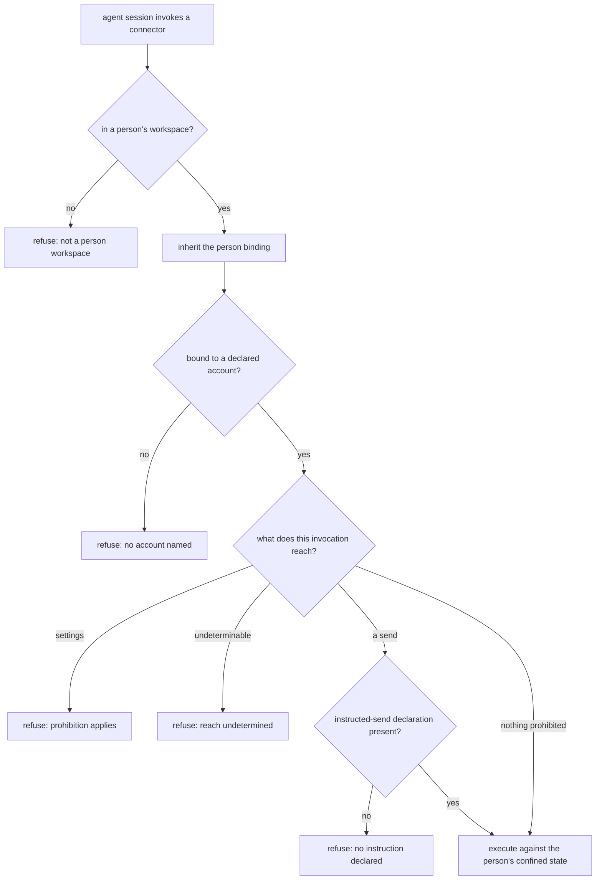

# Assistant Connector Boundary — Design

## Required reads

- @docs/project/spec/feature/integration/assistant-connector-invocation.md
- @docs/project/spec/feature/config/person-mail-accounts.md

## Purpose

An assistant reaches a person's mail and calendar through external command-line
connectors. Those connectors carry the operations the personal-assistant conduct
policy prohibits and do not hold the prohibitions themselves. This design places
the prohibitions, the account binding, and credential confinement at the one
boundary where a connector is reached, and states which context and which layer
owns each part.

Three contexts participate, and the split follows meaning rather than hosting:

- **Configuration** owns what a person may declare — their mail accounts, each
  naming a connector from the platform's vocabulary and an address. It sits with
  the person's other operational data rather than in the global identity entry,
  which already refuses credentials-adjacent keys.
- **Integration** owns the boundary: translating the platform's vocabulary into a
  particular tool, binding an invocation to one declared account, directing that
  person's state, determining what an invocation reaches, and applying the two
  prohibitions.
- **Agent runtime** owns that a session reaches the boundary rather than the tool,
  and owns the person binding the boundary consumes.

The prohibitions remain the conduct policy's. This design changes where they are
applied, never what they say.

### The person is inherited, never resolved here

A session reaches a person's workspace only through the launch call that derives
the person from the authenticated caller, and the general session verbs refuse a
destination inside a person workspace. That contract is the authority for who a
session acts as.

This boundary therefore performs no person resolution and accepts no parameter
naming a person. It reads the person the workspace declares of itself — the
workspace-kind declaration that names the workspace a person's and carries that
person's slug — and refuses when the session is not in a person's workspace at
all. That declaration is the binding's only source: a path is not identity, and
inferring a person from a directory name is the impersonation surface the
declaration exists to close. A non-person workspace never
becomes a mail execution origin, and the boundary never opens a workspace other
than the one it is running in. Consuming that binding rather than re-deriving it is
what keeps the conduct policy's scope — an agent acting in that person's workspace —
structurally true instead of conventionally assumed.

### Prior art and adopt-vs-build

The design introduces a credential-isolation boundary, so its mechanism is
surveyed rather than invented.

- **Vendor documentation** — the consolidated connector authorization facts,
  confirmed against the installed command surface. The connector confines
  secrets to the person's own state root only when its file-backed keyring is
  selected together with a per-person store secret; its default backend resolves
  accounts from a store shared across the machine irrespective of state root. It
  exposes token export, import, and delete operations over stored refresh
  credentials, and accepts a short-lived access token directly, bypassing stored
  refresh credentials entirely.
- **Reference implementation** — a password-store import extension that moves
  credentials between stores: it establishes the shape this migration follows,
  in which the destination store must exist and be usable before import, and
  entries are transferred through the tools' own export and import paths rather
  than by reaching into either store's format. This design adopts that shape and
  differs in one respect: it also evicts from the source, because the source here
  is a shared store whose continued possession of the credential is the defect
  being repaired.
- **The surveyed alternative** — the broker credential-source pattern: a service
  owns refresh state and returns a short-lived access token per request, so the
  runtime holds no refresh credential, with single-flight refresh per identity to
  avoid rotation races. The evidence for it is an open proposal against an agent
  runtime and integration platforms' accounts of managing OAuth refresh at scale,
  not a reference implementation this design could copy. The adopted mechanism is
  vendor-native and needs none.
- **Comparable production architecture** — multi-tenant OAuth deployments wrap a
  per-record data key with a per-tenant key; and an agent runtime sharing one
  credential store across processes has been reported revoking valid credentials
  through concurrent refresh rotation. That is the same class of failure a
  machine-wide shared store produces here, in a deployment of the same shape.

**Adopt, do not build.** The connector's own confined store plus a per-person
secret reaches the approved outcome for the connector in scope. Per-person
confinement removes the rotation race _between people_, since no two people
share a store to race over; it does nothing for two concurrent invocations on
behalf of the same person, which still share that person's store and can still
rotate a refresh credential under each other. No coordination for that case is
specified here — same-person concurrency is outside the approved scope, which
leaves it as the connector's native behavior — so it stands as an accepted
unresolved risk rather than a solved one. A broker is the stronger isolation,
supplies the single-flight coordination that would close it, and is
infrastructure this horizon excludes; it becomes the escalation path if a
connector without a confined store is fronted, if credentials must be reached
from more than one machine, or if same-person concurrency stops being
acceptable. The tool's short-lived-token entry is what makes that
escalation cheap later, and is not used now.

## Inputs/Outputs

**In:** the person binding the session already carries; that person's declared
accounts; the account this invocation names; the person's state location and
store secret; and an explicit declaration when a send was instructed.

**Out:** a constructed invocation of the real connector executed against that
person's confined state, or a refusal naming which condition failed — not in a
person's workspace, no named account, a reached prohibition, an uninstructed
send, or reach that could not be determined.

### Layer placement

| Responsibility                                                                                           | Layer                                            | Owner         |
| -------------------------------------------------------------------------------------------------------- | ------------------------------------------------ | ------------- |
| Entry point published on the agent tool surface                                                          | Artifact / tool surface                          | agent runtime |
| Reading the workspace's person declaration, the named account, and the attendance fact into typed inputs | Injection                                        | agent runtime |
| Account lookup against the person's declared list                                                        | Core service, via configuration's published read | configuration |
| Store-secret resolution for a person                                                                     | Core service, via configuration's published read | configuration |
| Reach determination, prohibition application, invocation construction                                    | Core service                                     | integration   |
| Credential migration for one person and account                                                          | Core service, behind a published operation       | integration   |
| Connector process execution and store-secret delivery to it                                              | Infrastructure, behind its owning service        | integration   |

These responsibilities do not fit an existing root. The platform's adapter root
holds inbound and outbound UI adapters, and its integration core holds the
code-delivery state machine; neither is a home for connector invocation, and
placing this there would make a cohesive concern a tenant of an unrelated one.
The connector boundary is therefore a new module under the integration context,
and the plan names it as new rather than adapting a root whose subject is
something else.

The integration core receives fully resolved typed inputs and reads neither the
environment nor the filesystem to fill them; that resolution is the injection
layer's, as the layer contract requires. Every crossing goes through the owning
context's published read rather than direct access to its state.

The entry point carries no logic of its own. This follows the no-inline-logic
contract rather than an existing example: the platform's git entry point is a
several-hundred-line behavioral shell wrapper, not a delegation, and is a
precedent for _where_ such an entry point is published, not for _what_ it may
contain.

## Invariants

- An invocation not bound to both an inherited person and one of that person's
  declared accounts does not reach a connector. Neither is inferred, neither has
  a default, including where the person declared exactly one account.
- The boundary never resolves, accepts, or overrides which person a session acts
  as, and never reaches into a workspace other than its own.
- The prohibitions are applied to what an invocation is determined to reach, not
  to the name it was called by; reach that cannot be determined is refused.
- A send leaves only when the invocation carries an explicit instructed-send
  declaration. The declaration is the acting agent's own statement, recorded with
  the invocation; it is never derived from attendance, role, or lineage.
- Nothing above this boundary names a vendor tool.
- A connector's state location and its secret store are separate concerns, and
  directing the first without confining the second yields no isolation at all.

### The send gate, in two regimes

No context publishes a fact carrying what a person asked for, so instruction
itself is not readable at the boundary. Attendance is: whether a human is present
to the session is an authority-backed fact the identity context already owns, and
the boundary consumes it rather than inferring it. The gate therefore has two
regimes, and only one of them is structural.

**Where attendance cannot be established, sending is made impossible at the
tool.** The invocation is constructed with the connector's own send-blocking
lever engaged, so the process that runs cannot send whatever it is asked to do,
and no declaration by the acting agent lifts it. Where a connector offers no such
lever, no send-capable invocation is constructed for it at all. This is what
carries the conduct policy's requirement that the tool an unattended run uses
cannot send.

**Where attendance is established, sending is available and the claim is
recorded.** Every send carries the acting agent's declaration that the person
asked for it — the same shape as the platform's involvement declaration on
commits: the agent's own statement, never derived, absent by default, and
answered by the durable record when false. The conduct policy's mandate rule
governs the judgment; this boundary makes the claim attributable rather than
preventing a false one.

The asymmetry is the conduct policy's own: it holds that an assistant which
cannot send when told is a worse tool for no gain in safety, since the person
could send it themselves in the same breath. Prevention is therefore spent where
no instruction can exist, and attribution where one can.

## Primary flows

### Confinement, and the migration it implies

Selecting a confined store governs authorizations made after it is in force. An
account authorized earlier keeps its credential in the shared store and stays
reachable from anywhere, so confinement is not reached for that account until its
credential is moved into the person's own store and removed from the shared one.

**Owner.** The migration belongs to integration, not to configuration: what
moves is external-provider credential state whose lifecycle and operations change
with the connector, and configuration owns the declared account input and nothing
about the credential behind it. It is published as an operator-invoked operation
over one person and account, exposed on the platform's own command surface rather
than as a connector flag, and it consumes validated person and account inputs
like any other crossing.

It is not part of an invocation: the boundary refuses to run an unconfined
account rather than migrating it inline, so a mail command never becomes a
credential mutation.

**Ordering, and why it is import-before-evict.** Import into the person's store
precedes eviction from the shared one. The reverse order has a window in which
neither store holds a usable credential and the account requires re-consent; this
order's window instead has both, which is recoverable. Rotation makes that window
the hazard rather than a convenience: a refresh credential used from two stores
can rotate under one and be revoked for the other, so the account is not used
between import and eviction.

**Idempotency and crash recovery.** Each step is checked before it is applied:
import is skipped when the person's store already resolves the account, eviction
is skipped when the shared store no longer holds it, and any intermediate left
behind is removed before a re-run re-exports. A crash therefore leaves one of
four states — nothing done, an intermediate written, imported, or evicted — and
re-running from the start reaches the terminal state from any of them without
re-consent. The terminal state is observable directly: the account resolves from
the person's store and no longer resolves from a state root carrying only the
connector's client identification.

### Where the store secret comes from

Confinement needs a per-person secret, and none exists in the platform today: the
person configuration model declares none, and agent-session environment assembly
draws on global and project allowlists rather than person configuration. The
design states the contract rather than assuming one.

**Owner and persistence.** Configuration owns it, as it owns the person's other
credential-adjacent data, and it is held with that person's data rather than in
the global entry, which already refuses credentials-adjacent keys. It is
generated when a person's connector state is first confined rather than chosen by
a human, since nothing about it is a preference.

**Retrieval.** Configuration publishes a typed read returning the secret for one
person to a caller already holding that person's validated binding. Both the
invocation boundary and the migration consume that read; neither reaches the
person's files directly, and no caller can ask for a person other than the one it
is bound to.

**Rotation.** Rotation re-keys the person's store through the connector's own
export and import path — the same transfer the migration performs — so it carries
no mechanism of its own and inherits the same crash states. It is not scheduled;
it exists so a disclosed secret has a remedy.

**Not in the session environment.** The secret reaches the connector process the
boundary spawns and nothing else. It is not added to the agent session's own
environment, where every later command in that session would inherit it.

**Secret surfaces, including the intermediate the connector requires.** The
credential moves between stores through the connector's own export and import
operations, and export writes it to a file; the connector offers no
store-to-store path, so the intermediate exists by the tool's shape. That file is
treated as the credential it contains: it is
created inside the person's own workspace, which already holds their
environment-scoped secrets and is already excluded from version control; it is
readable only by its owner; and it is removed once import is confirmed.

Crash recovery removes it too: any intermediate left by an interrupted run is
deleted before the run proceeds rather than reused, per
`software-development/policy/security-awareness` §Secrets management, and because
a re-run re-exports there is nothing to salvage from one.

Nothing else carries the credential: it is not placed in the arguments the
migration constructs, and not written out in any report it produces. A failure
names the account and the step, never the credential.

## Failure modes

- **The platform's routes are not the only physical routes.** The agent shell
  front-pins the platform's tool directory, so the published entry point wins name
  resolution — and a package manager publishes its own executable on the same
  path, which an absolute invocation reaches. Relocating that executable does not
  fix it either: a process holding the person's own authority can obtain and run a
  connector regardless. Genuine unreachability requires the session to hold less
  authority than the person, which is process isolation the platform does not
  impose. The product contract states what the platform provides and records the
  isolation as a dependency.
- **A defeasible gate reads as a structural one.** Where a connector offers no
  restriction lever, the prohibitions rest on determining reach from the
  invocation, and an unrecognized endpoint alias or encoding is read as reaching
  nothing prohibited.
- **A false instructed-send declaration sends mail.** The declaration is
  detection, not prevention. What it buys is attribution: the send is recorded
  against the session that declared it.
- **Partial confinement is the dangerous state.** A person given a confined store
  whose earlier credential still sits in the shared one has the appearance of
  isolation and none of it, and nothing fails to reveal it. The boundary refuses
  an account it cannot confirm is confined, so the appearance never arises
  silently.
- **Two concurrent invocations for one person can rotate a credential under each
  other.** Confinement separates people, not a person's own parallel work. The
  connector's native behavior governs it, and nothing here serializes refreshes.
- **A declared account that was never authorized** fails at the connector rather
  than at the boundary. The boundary binds an invocation to a declaration; it does
  not verify the declaration was ever consented to.

## Sources

- [pass-import](https://github.com/roddhjav/pass-import) — the implemented credential-store import extension whose transfer shape this migration adopts.
- [Proposal: generic OAuth broker credential source](https://github.com/NousResearch/hermes-agent/issues/23944) — the broker pattern surveyed as the alternative; an open proposal, not an implementation.
- [Multi-agent OAuth refresh race on a shared auth store](https://github.com/openclaw/openclaw/issues/3611) — the comparable deployment whose shared credential store revoked valid credentials.
- [Token isolation is the easy half of multi-tenant OAuth](https://workos.com/blog/multi-tenant-oauth-beyond-token-isolation) — the per-tenant key-wrapping architecture and the refresh-lifecycle half it names as harder.

## See Also

- ~/.teleclaude/docs/personal/policy/assistant-conduct.md — the prohibitions this boundary applies, and the workspace scope it inherits.
- docs/project/spec/feature/agent_runtime/person-workspace-dispatch.md — the launch contract that establishes the person binding this boundary consumes.
- docs/project/design/architecture/layer-ownership.md — the layer contract the placement table follows.
- docs/third-party/gogcli/authorization.md — the vendor evidence for confinement, its per-person secret, and the token operations the migration uses.
