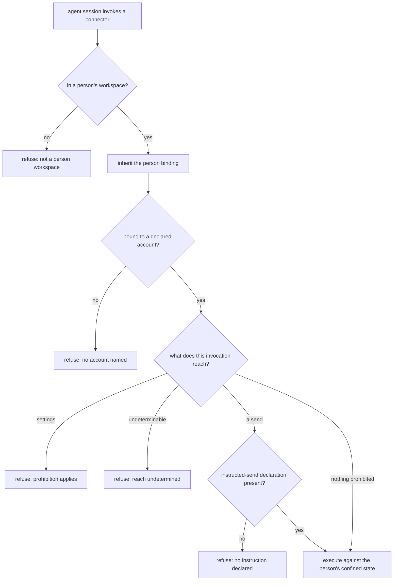

# Assistant Connector Boundary — Design

## Required reads

- @docs/project/spec/feature/integration/assistant-connector-invocation.md
- @docs/project/spec/feature/config/person-mail-accounts.md

## Purpose

An assistant reaches a person's mail and calendar through external command-line
connectors. Those connectors carry the operations the personal-assistant conduct
policy prohibits and do not hold the prohibitions themselves. This design places
the prohibitions, the account binding, and credential confinement at the one
boundary where a connector is reached, and states which context and which layer
owns each part.

Three contexts participate, and the split follows meaning rather than hosting:

- **Configuration** owns what a person may declare — their mail accounts, each
  naming a connector from the platform's vocabulary and an address. It sits with
  the person's other operational data rather than in the global identity entry,
  which already refuses credentials-adjacent keys.
- **Integration** owns the boundary: translating the platform's vocabulary into a
  particular tool, binding an invocation to one declared account, directing that
  person's state, determining what an invocation reaches, and applying the two
  prohibitions.
- **Agent runtime** owns that a session reaches the boundary rather than the tool,
  and owns the person binding the boundary consumes.

The prohibitions remain the conduct policy's. This design changes where they are
applied, never what they say.

### The person is inherited, never resolved here

A session reaches a person's workspace only through the launch call that derives
the person from the authenticated caller, and the general session verbs refuse a
destination inside a person workspace. That contract is the authority for who a
session acts as.

This boundary therefore performs no person resolution and accepts no parameter
naming a person. It reads the binding the session already carries and refuses when
the session is not in a person's workspace at all. A non-person workspace never
becomes a mail execution origin, and the boundary never opens a workspace other
than the one it is running in. Consuming that binding rather than re-deriving it is
what keeps the conduct policy's scope — an agent acting in that person's workspace —
structurally true instead of conventionally assumed.

### Prior art and adopt-vs-build

The design introduces a credential-isolation boundary, so its mechanism is
surveyed rather than invented.

- **Vendor documentation.** The connector confines secrets to the person's own
  state root only when its file-backed keyring is selected together with a
  per-person store secret; its default backend resolves accounts from a store
  shared across the machine irrespective of state root. The same tool accepts a
  short-lived access token directly, bypassing stored refresh credentials.
- **Reference implementation.** The broker credential-source pattern: a service
  owns refresh state and returns a short-lived access token per request, so the
  runtime holds no refresh credential at all, with single-flight refresh per
  identity to avoid rotation races.
- **Comparable production architecture.** Multi-tenant OAuth deployments wrap a
  per-record data key with a per-tenant key, and agent runtimes sharing one
  credential store across processes have hit refresh-token rotation revoking
  valid credentials — the same class of failure a machine-wide shared store
  produces here.

**Adopt, do not build.** The connector's own confined store plus a per-person
secret reaches the approved outcome for the connector in scope, and per-person
confinement additionally removes the rotation race by construction, since no two
people share a store to race over. A broker is the stronger isolation and is
infrastructure this horizon excludes; it becomes the escalation path if a
connector without a confined store is fronted, or if credentials must be reached
from more than one machine. The tool's short-lived-token entry is what makes that
escalation cheap later, and is not used now.

## Inputs/Outputs

**In:** the person binding the session already carries; that person's declared
accounts; the account this invocation names; the person's state location and
store secret; and an explicit declaration when a send was instructed.

**Out:** a constructed invocation of the real connector executed against that
person's confined state, or a refusal naming which condition failed — not in a
person's workspace, no named account, a reached prohibition, an uninstructed
send, or reach that could not be determined.

### Layer placement

| Responsibility                                                               | Layer                                            | Owner         |
| ---------------------------------------------------------------------------- | ------------------------------------------------ | ------------- |
| Entry point published on the agent tool surface                              | Artifact / tool surface                          | agent runtime |
| Reading the session's person binding and the named account into typed inputs | Injection                                        | agent runtime |
| Account lookup against the person's declared list                            | Core service, via configuration's published read | configuration |
| Reach determination, prohibition application, invocation construction        | Core service                                     | integration   |
| Store-secret retrieval and connector process execution                       | Infrastructure, behind its owning service        | integration   |

The integration core receives fully resolved typed inputs and reads neither the
environment nor the filesystem to fill them; that resolution is the injection
layer's, as the layer contract requires. Every crossing goes through the owning
context's published read rather than direct access to its state.

The entry point carries no logic of its own. This follows the no-inline-logic
contract rather than an existing example: the platform's git entry point is a
several-hundred-line behavioral shell wrapper, not a delegation, and is a
precedent for _where_ such an entry point is published, not for _what_ it may
contain.

## Invariants

- An invocation not bound to both an inherited person and one of that person's
  declared accounts does not reach a connector. Neither is inferred, neither has
  a default, including where the person declared exactly one account.
- The boundary never resolves, accepts, or overrides which person a session acts
  as, and never reaches into a workspace other than its own.
- The prohibitions are applied to what an invocation is determined to reach, not
  to the name it was called by; reach that cannot be determined is refused.
- A send leaves only when the invocation carries an explicit instructed-send
  declaration. The declaration is the acting agent's own statement, recorded with
  the invocation; it is never derived from attendance, role, or lineage.
- Nothing above this boundary names a vendor tool.
- A connector's state location and its secret store are separate concerns, and
  directing the first without confining the second yields no isolation at all.

### Attributing an instructed send

Distinguishing an instructed send from initiative cannot be read from session
state: identity carries the session, its token, and its roles, and none of them
records what the person asked for. Nor can attendance stand in for it — a human
being present is not a human having asked.

The attribution is therefore an explicit declaration the agent makes per
invocation, following the platform's established shape for exactly this problem:
the involvement declaration on commits is likewise the acting agent's own
statement, never derived, defaulting to the safe value when absent, and answered
by the durable record when false. Absence of the declaration refuses the send. An
unattended run cannot carry one, because no instruction can exist there, so the
unattended case needs no separate rule.

This is detection rather than prevention, and it is the same guarantee the
platform already accepts elsewhere: an agent can declare falsely, and the
declaration makes that falsehood attributable to the session that made it.

## Primary flows

### Confinement, and the migration it implies

Selecting a confined store governs authorizations made after it is in force. An
account authorized earlier keeps its credential in the shared store and stays
reachable from anywhere, so confinement is not reached for that account until its
credential is moved into the person's own store and removed from the shared one.

**Owner.** The migration is a configuration-context operation over person data,
executed once per already-authorized account. It is not part of an invocation:
the boundary refuses to run an unconfined account rather than migrating it
inline, so a mail command never becomes a credential mutation.

**Ordering, and why it is import-before-evict.** Import into the person's store
precedes eviction from the shared one. The reverse order has a window in which
neither store holds a usable credential and the account requires re-consent; this
order's window instead has both, which is recoverable. Rotation makes that window
the hazard rather than a convenience: a refresh credential used from two stores
can rotate under one and be revoked for the other, so the account is not used
between import and eviction.

**Idempotency and crash recovery.** Each step is checked before it is applied:
import is skipped when the person's store already resolves the account, eviction
is skipped when the shared store no longer holds it. A crash therefore leaves one
of three states — neither done, imported only, both done — and re-running from the
start reaches the terminal state from any of them without re-consent. The
terminal state is observable directly: the account resolves from the person's
store and no longer resolves from a state root carrying only the connector's
client identification.

**Secret surfaces.** The credential passes between stores through the connector's
own export and import operations. It is not written to a location outside the two
stores, not placed in the arguments the migration constructs, and not written out
in any report the migration produces; a failure names the account and the step,
never the credential. The store secret itself is read from the person's own
workspace, which already holds their environment-scoped secrets and is already
excluded from version control.

## Failure modes

- **The platform's routes are not the only physical routes.** The agent shell
  front-pins the platform's tool directory, so the published entry point wins name
  resolution — and a package manager publishes its own executable on the same
  path, which an absolute invocation reaches. Relocating that executable does not
  fix it either: a process holding the person's own authority can obtain and run a
  connector regardless. Genuine unreachability requires the session to hold less
  authority than the person, which is process isolation the platform does not
  impose. The product contract states what the platform provides and records the
  isolation as a dependency.
- **A defeasible gate reads as a structural one.** Where a connector offers no
  restriction lever, the prohibitions rest on determining reach from the
  invocation, and an unrecognized endpoint alias or encoding is read as reaching
  nothing prohibited.
- **A false instructed-send declaration sends mail.** The declaration is
  detection, not prevention. What it buys is attribution: the send is recorded
  against the session that declared it.
- **Partial confinement is the dangerous state.** A person given a confined store
  whose earlier credential still sits in the shared one has the appearance of
  isolation and none of it, and nothing fails to reveal it. The boundary refuses
  an account it cannot confirm is confined, so the appearance never arises
  silently.
- **A declared account that was never authorized** fails at the connector rather
  than at the boundary. The boundary binds an invocation to a declaration; it does
  not verify the declaration was ever consented to.

## See Also

- ~/.teleclaude/docs/personal/policy/assistant-conduct.md — the prohibitions this boundary applies, and the workspace scope it inherits.
- docs/project/spec/feature/agent_runtime/person-workspace-dispatch.md — the launch contract that establishes the person binding this boundary consumes.
- docs/project/design/architecture/layer-ownership.md — the layer contract the placement table follows.
