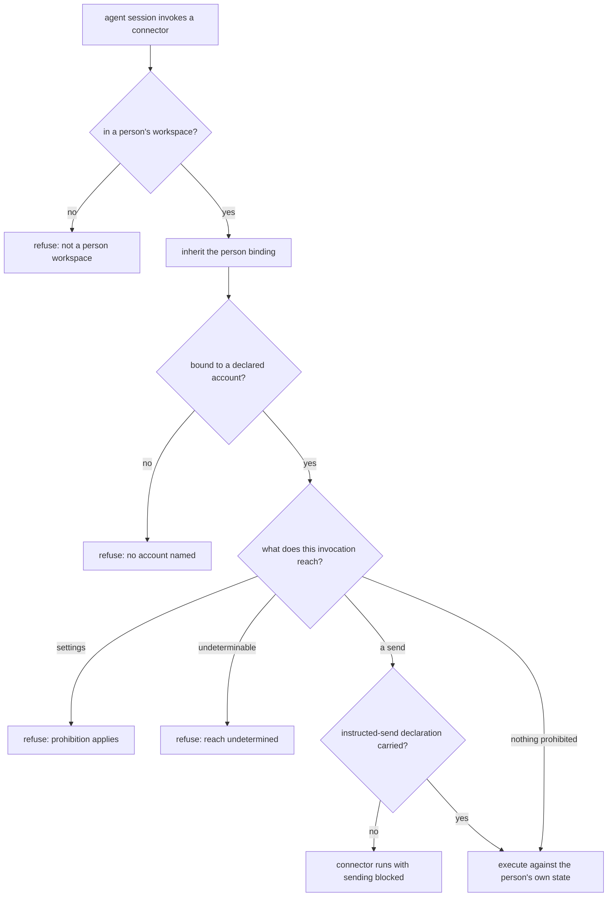

# Assistant Connector Boundary — Design

## Required reads

- @docs/project/spec/feature/integration/assistant-connector-invocation.md
- @docs/project/spec/feature/config/person-mail-accounts.md
- @docs/project/spec/teleclaude-config.md

## Purpose

An assistant reaches a person's mail and calendar through external command-line
connectors. Those connectors carry the operations the personal-assistant conduct
policy prohibits and do not hold the prohibitions themselves. This design places
the prohibitions, the account binding, and per-person state direction at the one
boundary where a connector is reached, and states which context and which layer
owns each part.

Three contexts participate, and the split follows meaning rather than hosting:

- **Configuration** owns what a person may declare — their mail accounts, each
  naming a connector from the platform's vocabulary and an address. It sits with
  the person's other operational data rather than in the global identity entry,
  which already refuses credentials-adjacent keys.
- **Integration** owns the boundary: translating the platform's vocabulary into a
  particular tool, binding an invocation to one declared account, directing that
  person's state, determining what an invocation reaches, and applying the two
  prohibitions.
- **Agent runtime** owns that a session reaches the boundary rather than the tool,
  and owns the person binding the boundary consumes.

The prohibitions remain the conduct policy's. This design changes where they are
applied, never what they say.

### The person is validated elsewhere and consumed here

A session reaches a person's workspace only through the launch call that derives
the person from the authenticated caller, and the general session verbs refuse a
destination inside a person workspace. That contract is the authority for who a
session acts as.

This boundary therefore performs no person resolution and accepts no parameter
naming a person. Nor is a workspace's own declaration the binding: a file
declaring itself a person configuration states what the file is, not that the
person exists and not who is acting. Identity owns turning those separate facts
into one validated binding against the person registry, and publishes it; an
unknown, ambiguous, or disagreeing claim fails closed there and confers no
person-scoped authority at all.

What this boundary consumes is that published binding, carried to it by the
injection layer. It refuses when no validated binding is present. The binding is
an input to whether this boundary acts, never the decision itself — that decision
is this boundary's, and it is the two prohibitions and the account rule below. A non-person workspace never
becomes a mail execution origin, and the boundary never opens a workspace other
than the one it is running in. Consuming that binding rather than re-deriving it is
what keeps the conduct policy's scope — an agent acting in that person's workspace —
structurally true instead of conventionally assumed.

### Prior art and adopt-vs-build

The mechanisms this boundary uses are the connector's own, verified against the
installed command surface rather than assumed: which account an invocation acts
as, where its state is directed, and the levers that block sending, restrict the
command set, or refuse mutations. None is compiled into the tool; each holds only
if the invocation is constructed with it, which is what makes a boundary that
constructs invocations the right place for the prohibitions.

Nothing here is bespoke infrastructure, so there is no adopt-versus-build
decision to record. The one place this design deliberately does not build is
credential confinement: a per-person secret store is an owned concern elsewhere,
and the alternative shape for it — a broker owning refresh state and issuing
short-lived tokens — is surveyed by that owner's work rather than by this.

## Inputs/Outputs

**In:** identity's validated person binding for this session; that person's
declared accounts and the account this invocation names; that person's state
location; and an explicit declaration when a send was instructed.

**Out:** a constructed invocation of the real connector executed against that
person's own state, or a refusal naming which condition failed — not in a
person's workspace, no named account, a reached prohibition, an uninstructed
send, or reach that could not be determined.

### Layer placement

| Responsibility                                                                                       | Layer                                            | Owner         |
| ---------------------------------------------------------------------------------------------------- | ------------------------------------------------ | ------------- |
| Entry point published on the agent tool surface                                                      | Artifact / tool surface                          | agent runtime |
| Validating that a person context belongs to exactly one registered person                            | Core service, published as an identity fact      | identity      |
| Carrying identity's validated binding, the named account, and the send declaration into typed inputs | Injection                                        | agent runtime |
| Account lookup against the person's declared list                                                    | Core service, via configuration's published read | configuration |
| Reach determination, prohibition application, invocation construction                                | Core service                                     | integration   |
| Connector process execution                                                                          | Infrastructure, behind its owning service        | integration   |

These responsibilities do not fit an existing root. The platform's adapter root
holds inbound and outbound UI adapters, and its integration core holds the
code-delivery state machine; neither is a home for connector invocation, and
placing this there would make a cohesive concern a tenant of an unrelated one.
The connector boundary is therefore a new module under the integration context,
and the plan names it as new rather than adapting a root whose subject is
something else.

The integration core receives fully resolved typed inputs and reads neither the
environment nor the filesystem to fill them; that resolution is the injection
layer's, as the layer contract requires. Every crossing goes through the owning
context's published read rather than direct access to its state.

The entry point carries no logic of its own. This follows the no-inline-logic
contract rather than an existing example: the platform's git entry point is a
several-hundred-line behavioral shell wrapper, not a delegation, and is a
precedent for _where_ such an entry point is published, not for _what_ it may
contain.

## Invariants

- An invocation not bound to both an inherited person and one of that person's
  declared accounts does not reach a connector. Neither is inferred, neither has
  a default, including where the person declared exactly one account.
- The boundary never resolves, accepts, or overrides which person a session acts
  as, and never reaches into a workspace other than its own.
- The prohibitions are applied to what an invocation is determined to reach, not
  to the name it was called by; reach that cannot be determined is refused.
- A send leaves only when the invocation carries an explicit instructed-send
  declaration. The declaration is the acting agent's own statement, recorded with
  the invocation; it is never derived from a role, a launch path, or lineage, and
  its absence is the default. No branch of this design distinguishes an attended
  run from an unattended one, because no contract publishes that fact.
- Nothing above this boundary names a vendor tool.
- A connector's state location and its secret store are separate concerns.
  This boundary directs the first and makes no claim about the second, so
  directing state is never presented as isolation between people.

### The send gate rests on a declaration, and nothing structural

Two facts would be needed to make sending structurally impossible in the runs
where no instruction can exist: what a person asked for, and whether a person was
present to ask. Neither is published. Instruction is not carried by any contract.
Attendance is not either — no identity contract, no dispatch contract, and no
session model states whether a human is present to a session, and inferring it
from a session's roles or from how it was launched would be exactly the
directory-shaped inference the identity contract refuses for person binding.

So the gate is one regime, not two. An invocation sends only when it carries the
acting agent's explicit declaration that the person asked for it — absent by
default, so an invocation that says nothing does not send. The declaration is the
agent's own statement in the shape the platform already uses for involvement on
commits: never derived, and answered by the durable record when false. Every send
is constructed with the connector's send-blocking lever engaged unless that
declaration is present, so the block is the default state of the invocation
rather than a decision taken against it.

What this does not do is prevent a false declaration, in any run. The conduct
policy's requirement that the tool an unattended run uses cannot send is not met
structurally by this design. Meeting it requires a published attendance fact for
this boundary to branch on, which no context provides.

## Primary flows

### Confinement is not delivered here

Directing a connector's state at a person's own location is not confinement: a
connector may resolve an account from a store shared across the machine
regardless of where its state is directed. Closing that needs a per-person secret
store, which is an owned concern elsewhere — its contract covers secrets held per
person, resolution bound to a verified identity, refusal rather than fallback to
a global secret or another person's, and non-exposure through catalogs, logs,
errors, or serialized person configuration.

This boundary therefore makes no confinement claim and defines no secret storage.
Building a second mechanism beside that owner would make this work a second owner
of person-secret policy. When confinement is delivered it brings its own
migration for accounts authorized beforehand, since selecting a confined store
governs only authorizations made after it is in force.

## Failure modes

- **The platform's routes are not the only physical routes.** The agent shell
  front-pins the platform's tool directory, so the published entry point wins name
  resolution — and a package manager publishes its own executable on the same
  path, which an absolute invocation reaches. Relocating that executable does not
  fix it either: a process holding the person's own authority can obtain and run a
  connector regardless. Genuine unreachability requires the session to hold less
  authority than the person, which is process isolation the platform does not
  impose. The product contract states what the platform provides and records the
  isolation as a dependency.
- **A defeasible gate reads as a structural one.** Where a connector offers no
  restriction lever, the prohibitions rest on determining reach from the
  invocation, and an unrecognized endpoint alias or encoding is read as reaching
  nothing prohibited.
- **A false instructed-send declaration sends mail, in any run.** The declaration
  is detection, not prevention, and no attendance fact makes an unattended run
  structurally different. What it buys is attribution: the send is recorded
  against the session that declared it.
- **Directed state reads as isolation.** Every invocation going to its own
  person's location looks like separation between people and is not: the
  connector can still resolve an account from a store shared across the machine.
  Nothing fails to reveal that, which is why this design states direction and
  makes no isolation claim rather than leaving a reader to infer one.
- **Two concurrent invocations for one person can rotate a credential under each
  other.** The connector's native behavior governs it, and nothing here
  serializes refreshes.
- **A declared account that was never authorized** fails at the connector rather
  than at the boundary. The boundary binds an invocation to a declaration; it does
  not verify the declaration was ever consented to.

## See Also

- ~/.teleclaude/docs/personal/policy/assistant-conduct.md — the prohibitions this boundary applies, and the workspace scope it inherits.
- docs/project/spec/feature/agent_runtime/person-workspace-dispatch.md — the launch contract that establishes the person binding this boundary consumes.
- docs/project/design/architecture/layer-ownership.md — the layer contract the placement table follows.
- docs/third-party/gogcli/authorization.md — the vendor evidence for the connector's account selection, state root, and caller-supplied levers.
