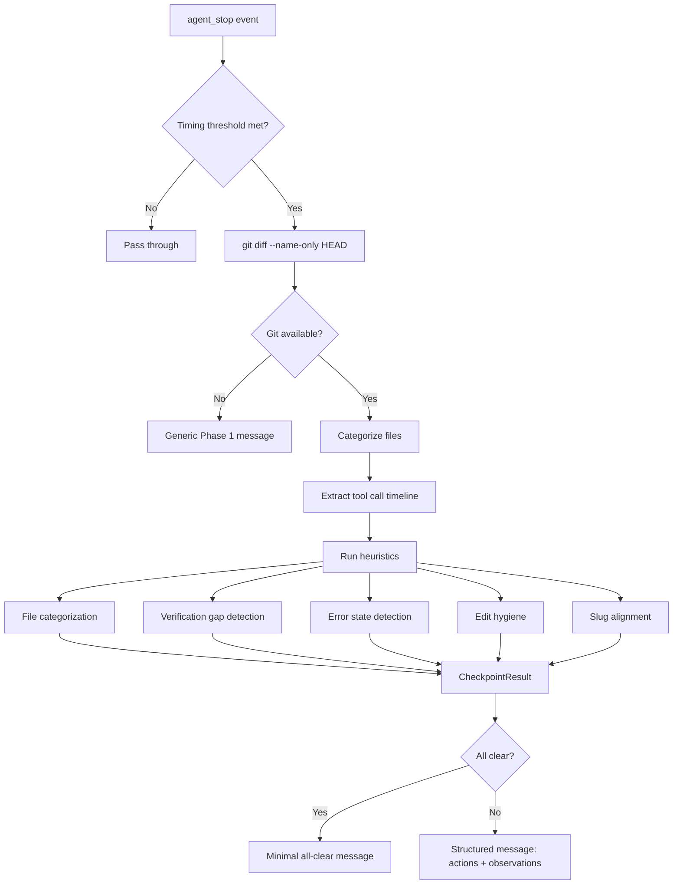
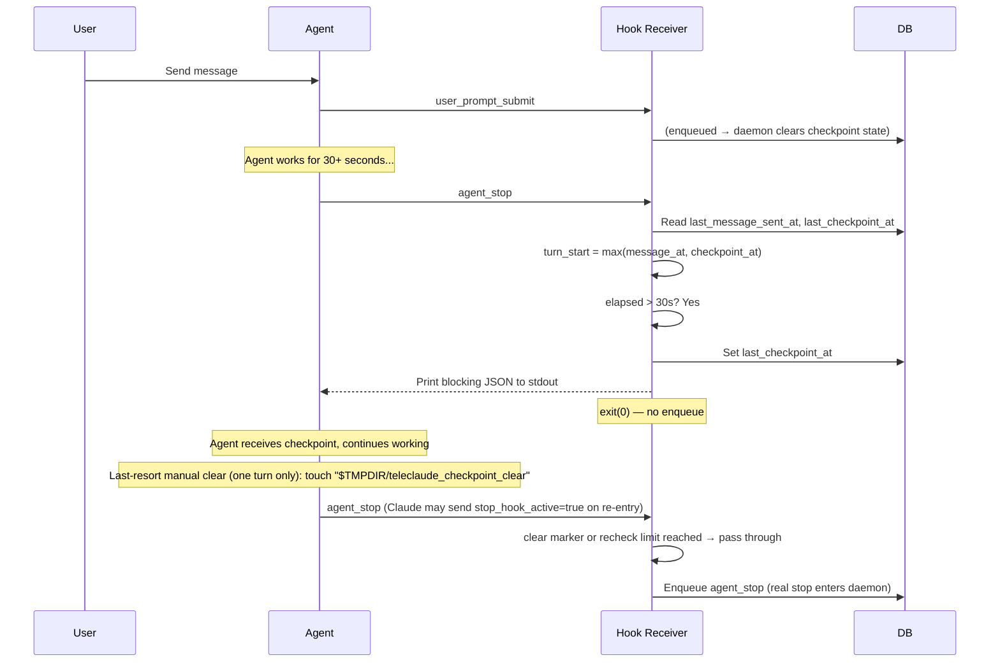
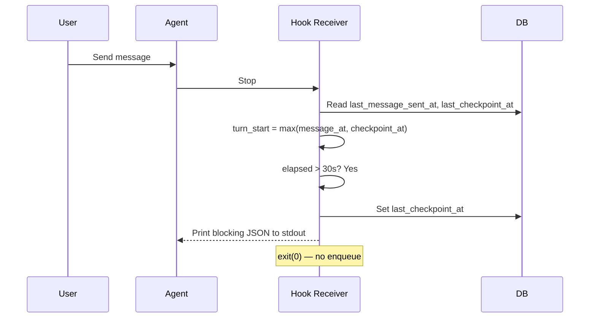
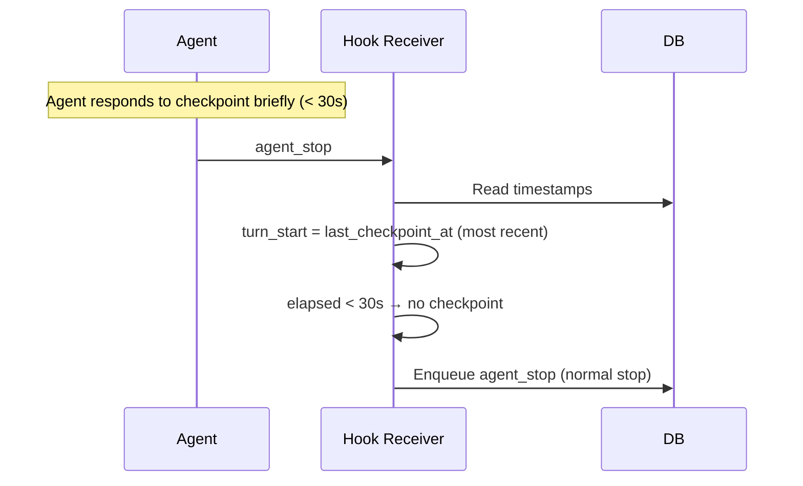
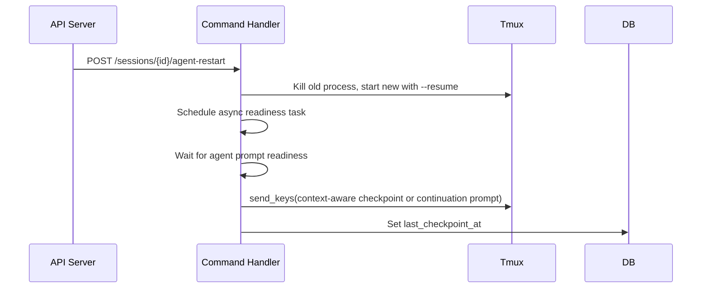

# Checkpoint System — Design

## Purpose

Deliver context-aware checkpoint messages to AI agents at natural work boundaries, prompting them to validate work and capture artifacts. The system uses a unified timer based on the most recent input event and keeps checkpoint messages invisible to session state.

All checkpoint payload variants use the canonical prefix `"[TeleClaude Checkpoint] - "` so runtime filtering can reliably distinguish system checkpoints from normal user prompts.

Two signal axes feed a shared checkpoint builder (`checkpoint.py`):

1. **File-based** — `git diff --name-only HEAD` maps changed files to file categories and action instructions (e.g., daemon code changed → "Run `make restart`"). Two additional sources keep maintenance visible after HEAD moves: the commit-obligation ledger supplies outstanding maintenance actions derived from sealed `telec code commit` pathspecs for any session, and, for the integrator session, the delivered merge delta sourced from the integrator-maintenance marker supplies the changed files when no turn-local edits exist. Git is the category oracle (which file maps to which category) only — never the arbiter of what is in-scope or done.
1. **Transcript-based** — Tool call timeline from the current checkpoint cycle provides file attribution, suppression evidence (action already taken), error state detection, and edit hygiene observations.

One delivery path exists:

- **Claude/Gemini/Codex**: Hook-based invisible checkpoint. The hook receiver (`receiver.py`) evaluates the checkpoint condition at the `agent_stop` boundary and returns blocking hook output to stdout. The agent keeps running without the checkpoint text appearing in the tmux pane.

All agents call the same `get_checkpoint_content()` entry point, ensuring parity.

## Inputs/Outputs

**Inputs:**

- `agent_stop` hook event — Agent's turn ended. Triggers checkpoint evaluation.
- `user_prompt_submit` hook event — New user input. Hard-clears the turn-scoped checkpoint state (recheck flag, clear flag, commit-obligation ledger) for the new turn.
- `tool_use` hook event — Agent finished reasoning. Tracked for other uses but not used in checkpoint decisions.
- Agent restart via API — Triggers unconditional checkpoint injection after a delay.
- `git diff --name-only HEAD` — Uncommitted files relative to HEAD, used as the category oracle for action instructions.
- Commit-obligation ledger — session-scoped marker carrying outstanding `main_only` maintenance actions derived from every sealed `telec code commit` in the turn; unioned into the turn's effective actions so committing does not empty the action ledger. Individual obligations discharge when evidence is observed; the ledger is hard-cleared at the next `user_prompt_submit`.
- Integrator-maintenance marker — session-scoped marker carrying the delivered merge range; for the integrator session it sources the changed files when there are no turn-local edits.
- `TurnTimeline` — Ordered tool calls from the current checkpoint cycle, extracted from the agent transcript via `extract_effective_tool_calls(..., scope="checkpoint")`.
- `CheckpointContext` — Session context: project path, working slug, agent name, and `system_role` (e.g. `"integrator"`) threaded from the session row by the receiver.

**Outputs:**

- `CheckpointResult` — Structured heuristic output: matched file categories, required actions, observations, all-clear flag.
- **Claude/Gemini**: Blocking JSON printed to stdout by `receiver.py`. Claude: `{"decision": "block", "reason": <context-aware message>}`. Gemini: `{"decision": "deny", "reason": <context-aware message>}`. The `agent_stop` event is NOT enqueued (agent stays running). For Claude, the reason is injected as a `<system-reminder>`. For Gemini, the reason becomes a new prompt triggering a retry turn.
- **Codex**: Blocking JSON printed to stdout by `receiver.py`: `{"decision": "block", "reason": <context-aware message>}`. The `agent_stop` event is NOT enqueued (agent keeps running). The `reason` becomes Codex's continuation prompt.
- DB field updated: `last_checkpoint_at`.

## Invariants

1. **Unified turn timer**: `turn_start = max(last_message_sent_at, last_checkpoint_at)`. The most recent input event (real user message or previous checkpoint) marks when the agent's current work period began. If `now - turn_start < 30s`, the checkpoint is skipped. This works identically for all agent types and both delivery paths.

2. **Checkpoint messages are invisible to session state**: They never persist as user input. `handle_user_prompt_submit` returns early (before notification clearing or DB writes). The native session transcript retains them as ground truth.

3. **Notification flag preservation**: Checkpoint injections do not clear the notification flag. Only real user input clears it. This prevents users from missing notifications about completed agent work.

4. **Per-turn clearing**: `handle_user_prompt_submit` clears `last_checkpoint_at` and `last_tool_use_at` on real user input so each turn starts fresh.

5. **Atomic, time-anchored checkpoint-cycle scope**: The action and evidence ledger — what needs doing and what was done — is scoped from the latest TeleClaude checkpoint emitted by the `Stop` hook. Before any checkpoint exists in the work, the scope falls back to the latest real user input. Dirty files from the broader user turn are filtered through this checkpoint-cycle transcript slice, so old dirty files cannot trigger new checkpoint actions after a reset. The commit-obligation ledger (Invariant 20) unions outstanding obligations into this ledger so committing does not empty it; each obligation discharges when its evidence is observed, and the wholesale clear at `user_prompt_submit` is the turn-boundary backstop. Git is consulted only as the category oracle, never as the arbiter of in-scope or done.

6. **TTS dedup**: Agent output extracted at `agent_stop` is compared against `last_output_raw` in the session. If identical, summarization and TTS are skipped. This prevents double-speaking when a checkpoint-induced `agent_stop` re-extracts the same output.

7. **DB-persisted state**: Checkpoint state lives in the sessions table (`last_checkpoint_at`, `last_message_sent_at`). No in-memory state. Survives daemon restarts.

8. **Post-restart unconditional injection**: After an agent restart via the API, checkpoint injection bypasses the 30-second threshold but still waits for agent prompt readiness before sending the continuation prompt or checkpoint.

9. **Turn-scoped hook escape hatch**: The receiver honors a per-session clear marker file (`teleclaude_checkpoint_clear`) in the session temp directory. If present, `agent_stop` passes through immediately for the current turn; the marker is hard-cleared at the next `user_prompt_submit`, so a manual clear lasts one turn only. The involuntary recheck loop-guard (re-entry limiter) is retained as the hard backstop against an evidence-miss spinning forever. Otherwise, every `agent_stop` evaluates the current checkpoint-cycle scope; repeated stop events are acceptable because the latest checkpoint prompt resets files, evidence, and errors together.

10. **Hook stop suppression**: When `_maybe_checkpoint_output` fires for Claude/Gemini/Codex, the receiver prints blocking JSON and exits without enqueuing the `agent_stop` event. The daemon never sees the blocked stop, so no output extraction, TTS, or listener notifications fire for checkpoint turns.

11. **Suppressibility**: Every heuristic checks for positive evidence in the checkpoint-cycle tool call timeline. If the expected action was already performed in that same cycle (e.g., `make restart` found in Bash commands, or `telec sync` for sync-validation), the instruction is suppressed. This applies equally to commit-derived obligations (Invariant 20) — a `make restart` after committing daemon code discharges the restart obligation, removing it from the ledger so it cannot re-surface in a later cycle; suppression and discharge coincide for these obligations rather than the action being merely silenced while still listed. `telec code commit` output that reaches the main-branch classification gate is evidence that the commit-options step was performed, even though no approved commit occurred. When all instructions are suppressed and no observations remain, the checkpoint is "all-clear".

12. **Two-layer error detection**: Layer 1 (structural gate) only fires for tool results with `is_error: true`. Layer 2 (content enrichment) pattern-matches the result snippet to produce targeted feedback. Successful commands with error-like output (e.g., log viewers showing tracebacks) never trigger observations.

13. **Fail-open design**: Git unavailable → generic Phase 1 message. Transcript unavailable → file-based instructions only (no suppression). Any exception in the builder → generic Phase 1 message. The checkpoint never blocks due to infrastructure failure.

14. **Delivery parity**: Claude, Gemini, and Codex all call the same `get_checkpoint_content()` entry point through the hook receiver, ensuring identical heuristic output regardless of agent runtime.

15. **Dynamic log-check window**: The required `instrukt-ai-logs teleclaude --since <window>` action is derived from elapsed time since the turn start (`max(last_message_sent_at, last_checkpoint_at)`), rounded up to minutes with a minimum of `2m`.

16. **Commit-options checkpoint policy**: Checkpoints may require running `telec code commit` to surface the commit classification/options flow, but they must not force an approved commit at `agent_stop`. Commit decisions belong to task-completion flow and human/review gates.

17. **Silent housekeeping + short debrief policy**: Checkpoint payloads instruct agents to execute checkpoint-required housekeeping silently, then provide a short user-relevant debrief focused on task outcome, blocker, or decision request. Checkpoint chore details are omitted from user-facing messages.

18. **Code-scoped post-commit review gate**: The session-scoped authored-main-commit latch is armed by `telec code commit` only when the committed pathspec includes code. The latch triggers only the post-commit review gate — never the action or evidence ledger; commit-action suppression derives from commit evidence in the timeline, not from the latch. Doc-only main commits commit but do not arm the review gate — under doc-first, documentation is reviewed in the lifecycle, not at the post-commit review gate.

19. **Integrator post-merge maintenance**: When the integration state machine advances repo-root `main`, it records a session-scoped integrator-maintenance marker carrying the delivered merge range. For the integrator session only, the engine force-fires on that marker, sources the changed files from the merge delta, and surfaces only the main-only maintenance actions implied by that delta (make install / uv sync / make restart / telec sync) — no review, commit, test, or log actions. Role-gated because repo-root `main` is a shared working copy whose raw HEAD movement is not self-attributable; only the lease-guarded integrator singleton, the marker's owner, receives it.

20. **Committed code sourced as discharging obligations**: A sealed `telec code commit` categorizes its committed pathspec once and records the owed `main_only` maintenance actions (make install / uv sync / make restart / telec sync) into the session-scoped commit-obligation ledger — not the raw file list. The engine unions the outstanding obligations into the turn's effective actions before the no-change early-exit, so commit-implied maintenance survives the HEAD move for any session. Each obligation is discharged the moment its evidence is observed in any checkpoint cycle — in the cycle that surfaced it or a later one — and a discharge is durable: a satisfied obligation does not reappear. The ledger is hard-cleared at `user_prompt_submit` only as a turn-boundary backstop. Tests and log-check are not recorded as commit obligations; they remain cycle-local advisories on the dirty tree, since their soft detectors cannot reliably discharge and would otherwise loop. The commit is the attributing action, so files the agent committed but did not itself Edit/Write are categorized all the same.

21. **Companion-drift detection**: when a turn's changed files include a live parent doc snippet (`<stem>.md`) whose pending companion sibling (`<stem>.<slug>.md`) exists on disk but is absent from the changed set, the engine surfaces an action to mirror the parent edit into the companion — catching, at agent_stop, the edit that the companion would otherwise clobber when it replaces the parent at delivery. The check is a filename-derived presence test (reusing the companion-detection helpers the doc index uses); companion in the changed set suppresses it for free. It mechanizes only the question code may answer (presence); whether the companion is a correct mirror stays with the reviewer (intelligence-boundaries).

<!-- planned-change:project-capability-manifest -->

22. **Base ⊕ overlay action set**: The effective action set is a TeleClaude-owned **platform-universal base** merged with a **project-declared overlay** in `teleclaude.yml` (`ProjectConfig`). The base fires on every checkpoint in every onboarded project regardless of language — telec-contract paths plus the slug-parameterized log-check: `docs/**` → `telec sync`; `agents/**`, `.agents/**`, `**/AGENTS.master.md` → `telec sync` + `telec sessions restart self`; `Makefile`, `.pre-commit-config.yaml`, `.gitattributes`, `.husky/pre-commit` → `make install`; changed code → `instrukt-ai-logs <project_slug>` with the slug read from `ProjectConfig` (superseding the hardcoded command in Invariant 15). The overlay adds the project's own runtime actions. Unreadable project config fails open to base-only — the fail-open posture of Invariant 13 extended to configuration.

<!-- change:project-capability-manifest -->

22. **Base ⊕ overlay action set**: The effective action set is a TeleClaude-owned **platform-universal base** merged with a **project-declared overlay** in `teleclaude.yml` (`ProjectConfig`). Base bindings attach per subscribed capability (`project/spec/feature/config/project-capability-manifest`): `docs: enabled` activates `docs/**` → `telec sync`; `agents: enabled` activates `agents/**`, `.agents/**`, `**/AGENTS.master.md` → `telec sync` + `telec sessions restart self`; `code: enabled` activates the toolchain binding (`Makefile`, `.pre-commit-config.yaml`, `.gitattributes`, `.husky/pre-commit` → `make install`) and the slug-parameterized log-check on changed code (`instrukt-ai-logs <project_slug>` with the slug read from `ProjectConfig`, superseding the hardcoded command in Invariant 15). The overlay adds the project's own runtime actions. Unreadable project config fails open to base-only — the fail-open posture of Invariant 13 extended to configuration.

<!-- /planned-change:project-capability-manifest -->

23. **Action registry and bindings (verb/noun split)**: Detection is two tables joined by an action id. The **action registry** maps an id to its definition: `run` (the command/instruction), `evidence` (tool-call substrings proving it was performed; defaults to `[run]`), `main_only`, `precedence`, and optional `evidence_must_follow_last_mutation`. A **binding** maps a `scope` (`include` / `exclude` / `override` globs, where `override` re-includes despite `exclude`) to a list of action ids. Evidence, `main_only`, `precedence`, and the command belong to the action, never to the binding — so many bindings may trigger one action while its suppression, ordering, and branch-gating are defined exactly once. TeleClaude owns a base registry (`sync`, `reload-self`, `install`, `test`, `log-check`); a project references those ids in its bindings and declares its own actions for project-specific commands. The conventional kinds `docs`, `agents`, and `code` are sugar over bindings: `docs` and `agents` carry fixed base scope and default actions; `code` carries a project-declared scope onto which the base `test` / `log-check` actions attach automatically.

24. **Code is an allowlist; there is no code/non-code classifier**: "Owes `test` + `log-check`" is an ordinary action set bound to a project-declared `code` scope — broad source-root globs authored at analyze-time by intelligence, never sniffed at runtime. A changed file owes test+log iff it matches such a binding; an unmatched file is silent. There is no `is_code` flag, no enumerated non-code set, and no collective cross-category code detection. A code-shaped path that must skip validation (vendored, generated) is carved out with the binding's own `exclude`. Action selection is structural glob + evidence matching over the merged declaration only — no runtime code path inspects file language or content (`general/principle/intelligence-boundaries`).

25. **One matcher, three consumers**: A single scope-matcher (`include` → `override` → `exclude`) and one action-resolution pass serve all three consumers — the `agent_stop` hook engine, the commit-obligation ledger (Invariant 20), and the integrator post-merge maintenance path (Invariant 19) — resolving from the same merged `(registry, bindings)`. A path that owes an action in one consumer owes the equivalent in the others; they cannot drift.

<!-- planned:project-capability-manifest -->

26. **Capability-gated engine activation**: The engine evaluates a turn only when the project subscribes at least one maintenance-owing capability — `code`, `docs`, or `agents` enabled in `teleclaude.yml`, or any project-declared binding present (`project/spec/feature/config/project-capability-manifest`). A project with no subscribed capability receives no checkpoint at `agent_stop`: no timeline extraction, no evidence scanning, no commit obligation — silence is derived from having nothing to enforce, never declared through an independent kill-switch. There is no standalone engine on/off flag; the `checkpoint:` section remains the overlay declaration only (Invariant 22). The commit obligation homes under `code ∨ docs` — the capabilities whose contract includes committing. Capability toggles are authored at analyze-time (`project/procedure/checkpoint-overlay-projection`); the runtime reads the declaration only. This extends Invariant 24 one level up: no enabled/disabled classifier at engine level, only subscribed capabilities.

<!-- /planned:project-capability-manifest -->

## Primary flows

### 0. Context-aware checkpoint builder

### 1. Hook-based checkpoint (Claude/Gemini)

### 2. Hook checkpoint (Codex)

### 3. Checkpoint response cycle (no re-injection for quick responses)

### 4. Post-restart checkpoint (unconditional)

## Failure modes

| Scenario                                                      | Behavior                                                                                          | Recovery                                                              |
| ------------------------------------------------------------- | ------------------------------------------------------------------------------------------------- | --------------------------------------------------------------------- |
| Daemon restart during active turn                             | Timestamps persist in DB; next `agent_stop` evaluates correctly                                   | No action needed                                                      |
| DB field missing (migration not run)                          | `AttributeError` on session access                                                                | Run migration 004; daemon auto-runs on startup                        |
| Agent silent after checkpoint                                 | Same output re-extracted at next `agent_stop`                                                     | TTS dedup skips speaking; DB still updates                            |
| Slug alignment off                                            | Slug mismatch observation surfaced                                                                | Agent re-aligns working slug                                          |
| Rapid successive stops (< 30s)                                | Checkpoint skipped due to threshold                                                               | Correct behavior                                                      |
| Codex checkpoint loop                                         | Hook re-entry limiter detects repeated blocked stop                                               | Correct behavior                                                      |
| Both `last_message_sent_at` and `last_checkpoint_at` are None | No turn start → checkpoint skipped                                                                | First real user message sets `last_message_sent_at`                   |
| DB unavailable in receiver                                    | `_maybe_checkpoint_output` returns None (fail-open)                                               | Stop passes through normally                                          |
| Hook output malformed                                         | CLI ignores non-JSON stdout; agent stops normally                                                 | Next stop re-evaluates                                                |
| Git not available in hook subprocess                          | `_get_uncommitted_files` returns None → generic Phase 1 message                                   | Correct fail-open behavior                                            |
| Transcript missing or corrupt                                 | `TurnTimeline(has_data=False)` → file-based instructions only                                     | No suppression; all actions listed                                    |
| Large transcript (>512KB JSONL)                               | Extraction reads full file via `_get_entries_for_agent()`                                         | Performance acceptable for checkpoint frequency                       |
| False suppression (evidence substring in unrelated command)   | Action incorrectly suppressed                                                                     | Acceptable: false suppression > false negative (R8)                   |
| Committed-turn-files marker write fails (OSError)             | Commit handler logs a warning; the action ledger falls back to dirty-file scoping for that commit | Re-running the implied action manually; next sealed commit re-records |

## See Also

- docs/project/adr/0037-checkpoint-ledger-separates-commit-detection.md
- docs/project/adr/0038-companion-drift-caught-at-checkpoint.md
- docs/project/adr/0043-checkpoint-obligations-discharge-on-evidence.md
