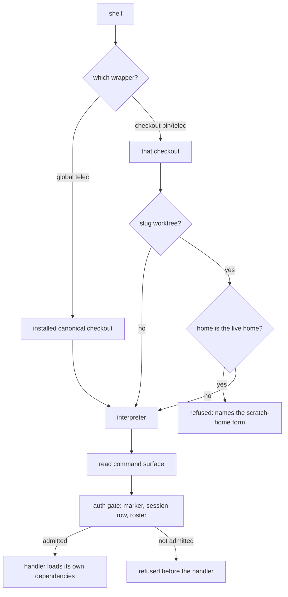

# CLI Invocation Boundary — Design

## Purpose

Give every change that touches the `telec` entry path one account of what happens
between a shell and a command's handler: which checkout's code runs, what may run
before dispatch, and where the caller is authorized. Per-command access lives in
`project/design/cli-authorization-matrix`; caller identity and its carriage live in
`project/spec/identity-and-auth`; the command catalog lives in `CLI_SURFACE`. This
design owns only the path that connects them.

## Inputs/Outputs

**Inputs**

- The wrapper that was invoked: the global `telec`, or a checkout's own `bin/telec`.
- The home the process runs against (`TELECLAUDE_HOME`, fixed before the interpreter
  starts; the default is the live home).
- The command line.
- The caller's identity evidence: the session identity marker and the session row it
  names, or the terminal login outside a session; and the people roster that maps a
  person to a role.

**Outputs**

- The command's handler runs with a resolved, authorized caller, or
- a refusal before the handler runs: a worktree wrapper aimed at the live home, an
  unidentified caller, or a role the command does not admit.

## Invariants

1. **The wrapper's location selects the code.** The global `telec` runs the installed
   canonical checkout from any working directory. A checkout's own `bin/telec` runs
   that checkout. The caller's working directory never selects code; handlers still
   receive it as the directory the command acts on.
2. **Worktree code never runs against the live home.** A slug worktree's `bin/telec`
   runs only when its home resolves to a location other than the live home. Aimed at
   the live home, it is refused before any worktree code runs, and the refusal names
   the scratch-home form of the call. An unset or empty home is the live home. Any
   other home is compared with the live home by filesystem identity, so no spelling,
   symlink, `..` or letter case reaches it, and the interpreter receives exactly the
   location that was checked. A scratch home that holds no machine configuration
   receives a copy of the live one before the worktree's code starts; nothing else is
   copied. The integration worktree is not a slug worktree.
3. **`telec code` grades a change with the change's own code.** Lint lanes, guardrail
   allowlists, schemas and the rendered command surface that judge a worktree's change
   come from that worktree, while `telec code` itself runs installed code. The
   worktree's grading code runs against a fresh scratch home seeded the same way and
   discarded when grading ends, never against the live home. It runs exactly the checks
   the acting invocation context selects (`project/design/code-commit`), no more and no
   fewer. A worktree that cannot run the selected checks in its own code is refused,
   never graded by installed rules instead. Bookkeeping commands run installed code and
   read and write the live home as usual.
4. **Only the auth gate precedes dispatch.** Before a handler runs, the CLI reads the
   command surface to identify the command and passes the caller through one gate.
   Nothing else runs, loads, or validates first.
5. **The gate is cheap and narrow.** It reads the auth the command surface declares for
   the command, and resolves the caller from the session identity marker, one session
   row, and the people roster. A session row is admitted by the marker that names it.
   The gate loads neither the machine configuration nor the ORM, and never validates a
   configuration document beyond the roster it reads, so an invalid document unrelated
   to identity does not lock callers out. Every command the CLI authorizes in process is
   authorized here.
6. **A command pays only for its own dependencies.** Configuration, the ORM, the daemon
   API client, history, mirrors, summarizers and the LLM SDKs load inside the handler
   of a command that needs them. A module shared by several commands imports nothing
   at module scope that one of those commands does not need. The daemon API client is
   loaded only by commands that act through the daemon, and carries no history,
   summarizer or LLM dependency.
7. **The pre-dispatch path is closed.** The set of modules the path before dispatch may
   import is declared, and a guardrail rejects a change that widens it. A command whose
   own work is trivial completes in roughly 200 ms from the shell; the figure is the
   target that shows invariants 4–6 hold, not a limit a change is graded against.

## Primary flows

### Invocation

### Exercising one's own change from a worktree

An agent in a slug worktree runs its bookkeeping with the global `telec` exactly as
anywhere else. To drive its own change by hand — a help path, a probe of a command it
changed — it calls the worktree's `bin/telec` with `TELECLAUDE_HOME` set to a scratch
home. That process runs the worktree's code against the scratch home: configuration,
database and state rooted in the home follow it. The scratch home starts with a copy
of the live machine configuration and nothing else; anything more a probe needs, the
prober provides. State rooted in the project — a checkout's todo store — and the
daemon do not move with the home. A command that writes project state or acts through
the daemon reaches the live one, whose code is delivered code; that behavior is
verified after delivery (`project/policy/test-moratorium`).

### Grading a change

`telec code lint` or `telec code commit` from a worktree runs installed code for its
own orchestration and hands the checks its acting context selects to the worktree's
own code, run against a fresh scratch home, so a change that edits a guardrail
allowlist or a schema is judged by the edited version. A selection carrying the native
leg and the guardrail lane goes to the worktree's own `telec code lint`, which every
TeleClaude checkout carries. A selection carrying the guardrail lane alone — a context
that participates in documentation without subscribing `code` — runs the worktree's own
guardrail lane through a process entry the installation supplies: the entry only starts
the lane, and every rule the lane applies is the worktree's. The entry confirms it
loaded the worktree's code and refuses otherwise. A checkout that is the installation,
or that is not a TeleClaude checkout, is graded by installed code as before.

## Failure modes

| Condition                                              | Effect                                                                                                                               |
| ------------------------------------------------------ | ------------------------------------------------------------------------------------------------------------------------------------ |
| Machine configuration is invalid                       | Only commands whose handler needs it fail, each naming the document; caller resolution, validation and repair commands keep working. |
| People roster cannot be read                           | The caller resolves to no identity and receives the unauthorized view; commands needing no caller still run.                         |
| Session marker names no admissible row                 | The caller resolves to no identity inside the session; it is never widened to another identity.                                      |
| Worktree `bin/telec` aimed at the live home            | Refused before worktree code runs; live home untouched.                                                                              |
| Scratch home holds no machine configuration            | A copy of the live one is placed there before worktree code runs; the live home is only read.                                        |
| Daemon unreachable                                     | Only commands that act through the daemon fail; everything else runs.                                                                |
| A change imports a new module on the pre-dispatch path | The guardrail rejects it before it lands.                                                                                            |

## See Also

- docs/project/adr/0102-a-telec-wrapper-runs-the-checkout-it-belongs-to.md — why the wrapper's location, not the caller's directory, selects the code.
- docs/project/spec/feature/agent_runtime/checkout-code-selection.md — the agent-facing use cases for code selection, the scratch-home refusal, and self-grading.
- docs/project/adr/0101-clients-authorize-and-the-daemon-trusts-carried-identity.md — why the caller is authorized in the CLI process.
- ~/.teleclaude/docs/general/principle/trust-and-guardrails.md — why a write to shared state that others have read cannot be repaired by restoring it, and why a refusal names its door.
- docs/project/policy/test-moratorium.md — how changes are verified without tests, and why daemon behavior is verified after delivery.
