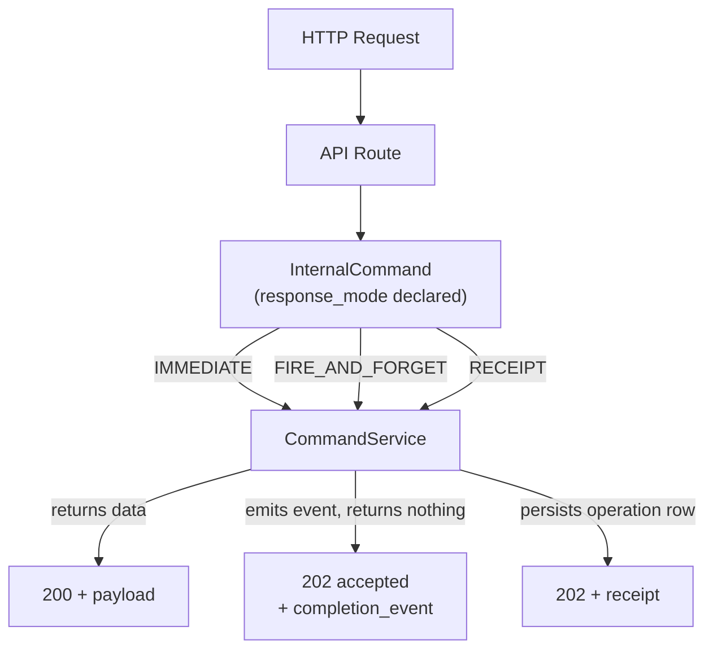
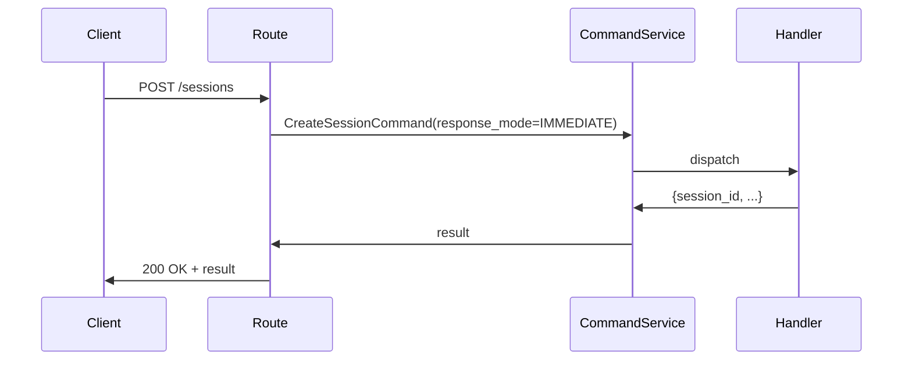
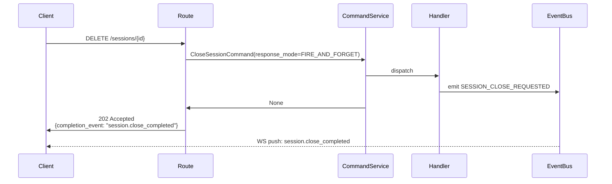
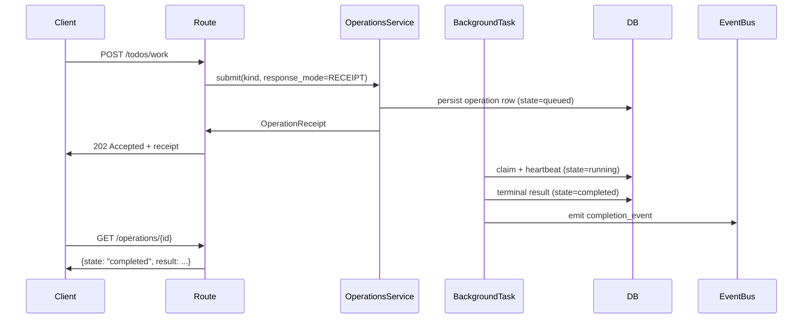
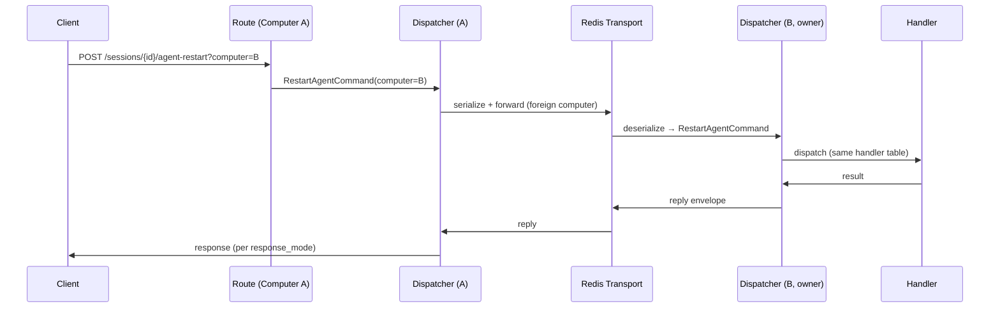

# Command Classification — Design

## Purpose

Every mutating API endpoint maps to one of three response modes. The mode is a property
of the command, not of the route — it lives on the `InternalCommand` base class and is
declared by each command subclass. API routes, the transport layer, and the command
dispatcher all read this property; they do not re-derive it from `isinstance` checks or
hardcoded status codes.



## Inputs/Outputs

**Inputs:** Any HTTP mutation request (POST, PUT, PATCH, DELETE) routed through CommandService.

**Outputs per mode:**

- `IMMEDIATE` — `200 OK` with the command result in the body.
- `FIRE_AND_FORGET` — `202 Accepted` with `{status: "accepted", completion_event: "<domain.event>"}`.
- `RECEIPT` — `202 Accepted` with a full `OperationReceipt` (see below).

Command-to-mode mapping:

<!-- planned-change:commands-carry-target-computer -->

| Command               | Mode                                        | completion_event           |
| --------------------- | ------------------------------------------- | -------------------------- |
| CreateSessionCommand  | IMMEDIATE                                   | None                       |
| GetSessionDataCommand | IMMEDIATE                                   | None                       |
| SystemCommand         | IMMEDIATE (default; instances may override) | None                       |
| ProcessMessageCommand | IMMEDIATE                                   | None                       |
| KeysCommand           | IMMEDIATE                                   | None                       |
| HandleVoiceCommand    | IMMEDIATE                                   | None                       |
| HandleFileCommand     | IMMEDIATE                                   | None                       |
| StartAgentCommand     | IMMEDIATE                                   | None                       |
| ResumeAgentCommand    | IMMEDIATE                                   | None                       |
| RunAgentCommand       | IMMEDIATE                                   | None                       |
| RestartAgentCommand   | FIRE_AND_FORGET                             | "agent.restart_dispatched" |
| CloseSessionCommand   | FIRE_AND_FORGET                             | "session.close_completed"  |
| TodoWorkCommand       | RECEIPT                                     | (per operation kind)       |
| TodoIntegrateCommand  | RECEIPT                                     | (per operation kind)       |
| TodoCreateCommand     | RECEIPT                                     | (per operation kind)       |
| TodoPrepareCommand    | RECEIPT                                     | (per operation kind)       |

<!-- change:commands-carry-target-computer -->

| Command                   | Mode                                        | completion_event           |
| ------------------------- | ------------------------------------------- | -------------------------- |
| CreateSessionCommand      | IMMEDIATE                                   | None                       |
| GetSessionDataCommand     | IMMEDIATE                                   | None                       |
| SystemCommand             | IMMEDIATE (default; instances may override) | None                       |
| ProcessMessageCommand     | IMMEDIATE                                   | None                       |
| KeysCommand               | IMMEDIATE                                   | None                       |
| HandleVoiceCommand        | IMMEDIATE                                   | None                       |
| HandleFileCommand         | IMMEDIATE                                   | None                       |
| StartAgentCommand         | IMMEDIATE                                   | None                       |
| ResumeAgentCommand        | IMMEDIATE                                   | None                       |
| RunAgentCommand           | IMMEDIATE                                   | None                       |
| UnsubscribeSessionCommand | IMMEDIATE                                   | None                       |
| RestartAgentCommand       | FIRE_AND_FORGET                             | "agent.restart_dispatched" |
| CloseSessionCommand       | FIRE_AND_FORGET                             | "session.close_completed"  |
| TodoWorkCommand           | RECEIPT                                     | (per operation kind)       |
| TodoIntegrateCommand      | RECEIPT                                     | (per operation kind)       |
| TodoCreateCommand         | RECEIPT                                     | (per operation kind)       |
| TodoPrepareCommand        | RECEIPT                                     | (per operation kind)       |

<!-- /planned-change:commands-carry-target-computer -->

### `ResponseMode` enum

```python
class ResponseMode(str, Enum):
    IMMEDIATE       = "immediate"        # sync result returned in response body
    FIRE_AND_FORGET = "fire_and_forget"  # async work, event signals completion
    RECEIPT         = "receipt"          # durable operation row, polling + event
```

### `InternalCommand` base fields

<!-- planned-change:commands-carry-target-computer -->

```python
@dataclass(kw_only=True)
class InternalCommand:
    command_type:     CommandType
    request_id:       str | None      = None
    response_mode:    ResponseMode    = ResponseMode.IMMEDIATE
    completion_event: str | None      = None  # required when response_mode != IMMEDIATE

    def __post_init__(self) -> None:
        # Construction-time validation: FIRE_AND_FORGET requires a completion_event
        if self.response_mode == ResponseMode.FIRE_AND_FORGET and self.completion_event is None:
            raise ValueError(
                f"{type(self).__name__}: FIRE_AND_FORGET requires non-null completion_event"
            )
```

<!-- change:commands-carry-target-computer -->

```python
@dataclass(kw_only=True)
class InternalCommand:
    command_type:     CommandType
    request_id:       str | None      = None
    response_mode:    ResponseMode    = ResponseMode.IMMEDIATE
    completion_event: str | None      = None  # required when response_mode != IMMEDIATE
    computer:         str | None      = None  # owning computer; unset/local ⇒ run here, else forward

    def __post_init__(self) -> None:
        # Construction-time validation: FIRE_AND_FORGET requires a completion_event
        if self.response_mode == ResponseMode.FIRE_AND_FORGET and self.completion_event is None:
            raise ValueError(
                f"{type(self).__name__}: FIRE_AND_FORGET requires non-null completion_event"
            )
```

<!-- /planned-change:commands-carry-target-computer -->

<!-- planned:commands-carry-target-computer -->

The `computer` field is the routing key for cross-computer dispatch: it names the computer
that owns the session the command operates on. The API boundary stamps it from the request;
the dispatcher reads it to decide local execution versus forwarding.
<!-- /planned:commands-carry-target-computer -->

Construction-time validation enforces the invariant that every FIRE_AND_FORGET command
declares a `completion_event` at instantiation. A missing `completion_event` raises
`ValueError` immediately — the invalid command never reaches the dispatcher.

### `OperationReceipt` fields (RECEIPT mode response)

```python
{
  "operation_id":       str,       # durable identity
  "kind":               str,       # operation kind (e.g. "todo_work")
  "state":              str,       # queued | running | completed | failed | stale
  "status_path":        str,       # /operations/{operation_id}
  "poll_after_ms":      int,       # suggested polling interval (0 if terminal)
  "completion_event":   str,       # domain event emitted on terminal transition
  "recovery_command":   str,       # telec operations get {operation_id}
}
```

### FIRE_AND_FORGET 202 response fields

```python
{
  "status":             "accepted",
  "completion_event":   str,       # domain event name to listen for
}
```

## Invariants

- **Mode lives on the command.** No route may hardcode a status code that contradicts the
  command's declared `response_mode`. The route reads the mode and derives the status code
  from it.
- **Dispatcher reads mode, not type.** `_dispatch_command()` must not use `isinstance`
  chains to decide whether to capture a return value. It reads `command.response_mode`.
- **Atomic terminal transition.** When a RECEIPT operation reaches a terminal state
  (`completed` | `failed` | `stale`), the `OperationsService` emits the `completion_event`
  as the final step of marking the row terminal. The event and the DB row transition are
  never split across separate code paths.
- **completion_event is required for FIRE_AND_FORGET.** Every command with mode
  `FIRE_AND_FORGET` must declare a `completion_event` string. Leaving it `None` is a
  contract violation and a startup assertion failure.
- **completion_event is informational, not a dispatch key.** Call sites that receive
  a receipt or a 202 response may use `completion_event` for tracing, monitoring, and
  test harnesses. They must not use it to dynamically deserialize payloads — payload
  semantics are expressed in static types.

<!-- planned:commands-carry-target-computer -->

- **Dispatch is computer-aware.** A session-scoped command carries `computer`, the computer
  that owns the target session. When it is unset or names the local computer, the dispatcher
  runs the command in-process. When it names a peer, the dispatcher forwards the command to
  the owning computer, which runs it through the same dispatcher and `response_mode` layer;
  the caller receives the same response it would for a local command. Forwarding composes
  with `response_mode`: `IMMEDIATE` forwards and awaits the reply, `FIRE_AND_FORGET` forwards
  without waiting.
- **The command is the cross-computer wire format.** The serialized command itself crosses
  the transport. There is no parallel command-string vocabulary and no per-command remote
  wrapper: the owning computer reconstructs the same `InternalCommand` and dispatches it
  identically to a locally-originated one, keyed on `command_type` and `response_mode`.

<!-- /planned:commands-carry-target-computer -->

## Primary flows

### 1. IMMEDIATE command



<!-- planned-change:commands-carry-target-computer -->

Commands in this mode: `CreateSessionCommand`, `GetSessionDataCommand`, `SystemCommand` (default),
`ProcessMessageCommand`, `KeysCommand`, `HandleVoiceCommand`, `HandleFileCommand`,
`StartAgentCommand`, `ResumeAgentCommand`, `RunAgentCommand`.

<!-- change:commands-carry-target-computer -->

Commands in this mode: `CreateSessionCommand`, `GetSessionDataCommand`, `SystemCommand` (default),
`ProcessMessageCommand`, `KeysCommand`, `HandleVoiceCommand`, `HandleFileCommand`,
`StartAgentCommand`, `ResumeAgentCommand`, `RunAgentCommand`, `UnsubscribeSessionCommand`.

<!-- /planned-change:commands-carry-target-computer -->

### 2. FIRE_AND_FORGET command



Commands in this mode: `RestartAgentCommand` (`completion_event="agent.restart_dispatched"`),
`CloseSessionCommand` (`completion_event="session.close_completed"`).

### 3. RECEIPT command



Commands in this mode: `TodoWorkCommand`, `TodoIntegrateCommand`, `TodoCreateCommand`,
`TodoPrepareCommand`.

<!-- planned:commands-carry-target-computer -->

### 4. Cross-computer command (forwarded)

A command whose `computer` names a peer is forwarded to the owning computer and executed
there through the identical dispatcher; the reply returns to the caller unchanged.



<!-- /planned:commands-carry-target-computer -->

## Failure modes

- **Mode mismatch between route and command.** If a route assumes 200 but the command
  declares FIRE_AND_FORGET, the client receives the wrong status code. The dispatcher
  asserts `response_mode` consistency at dispatch time.
- **RECEIPT operation lost on daemon restart.** Background tasks are not replayed.
  Queued or running operations are marked `stale` at startup. Clients polling the
  receipt see `state: "stale"` and may resubmit.
- **completion_event never fires.** If the background task panics before the terminal
  DB write, the event is not emitted and polling clients eventually see the stale
  heartbeat window expire. The receipt remains the source of truth; the event is
  a convenience, not the authority.
- **FIRE_AND_FORGET with no completion_event declared.** Assertion failure at startup.
  No command may ship with `response_mode=FIRE_AND_FORGET` and `completion_event=None`.
