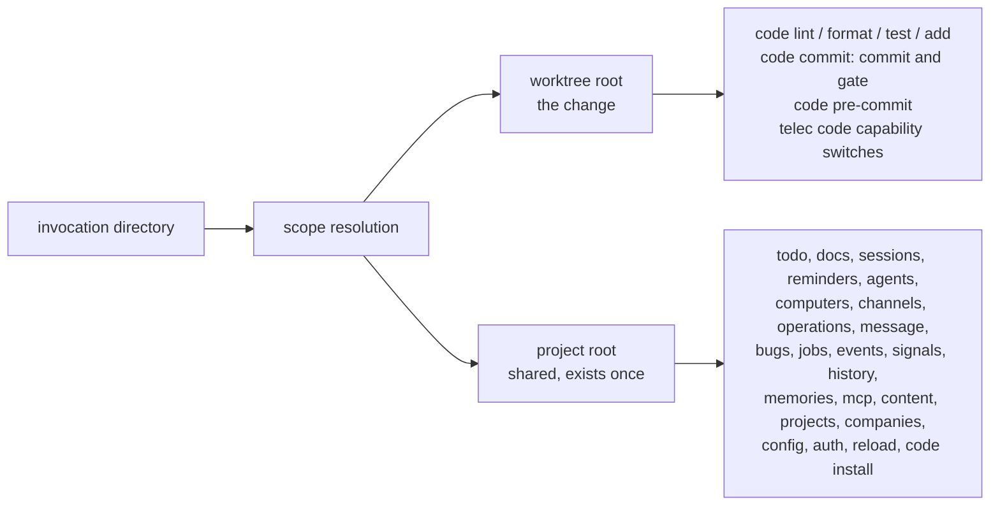

# Command Scope — Design

## Required reads

@docs/project/design/architecture/config-tier-resolution.md
@docs/project/spec/feature/agent_runtime/checkout-code-selection.md

## Purpose

A `telec` command invoked from inside a slug worktree acts on one of two roots:

- **The worktree root** — the checkout that holds the change: its files, its git
  history, its own `teleclaude.yml` and the rules it carries.
- **The project root** — the owning checkout, which holds everything that exists once
  for every checkout of the project: the todo store with its artifacts and stamps, the
  doc layer, and the project's registration and plumbing. Sessions, reminders, the
  daemon, the live home and the host belong to the same side.

This design states, per command group, which root a command acts on. Which checkout's
code runs is a separate question, owned by
`project/spec/feature/agent_runtime/checkout-code-selection`. How the tier declaration
and the shared-state root are resolved is owned by
`project/design/architecture/config-tier-resolution`; this design names which of those
answers each command uses.

## Inputs/Outputs

**Input:** the invocation directory.

**Output:** one resolution carrying both roots. On the canonical checkout both roots
are the same checkout. Every command takes the root it acts on from this resolution. No
command derives a root from the raw invocation directory, from the repository root of
the code that happens to run, or from the daemon's own working directory.

## Invariants

1. **The change acts on the worktree.** A command whose subject is the change — its
   files, its git index and history, its quality rules, its own declaration — acts on
   the worktree root.
2. **Anything that exists once acts on the project.** A command that reads or writes
   state other agents or the daemon read and write concurrently acts on the project
   root. A worktree copy of that state is a second truth another agent acts on, which
   restoring a file cannot undo (`general/principle/trust-and-guardrails`,
   interference).
3. **The `telec code` capability switches are the worktree's own.** The `code`, `docs`
   and `agents` switches that decide which checks a worktree's commit runs are read
   from the worktree's own declaration: they describe the change.
4. **A split is stated.** A command that acts on both roots names which part acts on
   which.
5. **One resolution.** Every command obtains its root from the one scope resolution;
   no command carries its own root logic.

## Primary flows

### Commands that act on the worktree root

| Command                                               | Acts on                                               |
| ----------------------------------------------------- | ----------------------------------------------------- |
| `telec code lint`, `format`, `test`, `add`            | The change's files, under the worktree's own rules    |
| `telec code commit` — the commit and its quality gate | The worktree's branch, graded by the worktree's rules |
| `telec code pre-commit`                               | The worktree's own index                              |
| The `telec code` capability switches                  | The worktree's own declaration                        |
| Help rendering and `telec version`                    | The code that runs, reported as one checkout          |

### Commands that act on the project root

| Command group                                                                                                         | Shared state it acts on                                                            |
| --------------------------------------------------------------------------------------------------------------------- | ---------------------------------------------------------------------------------- |
| `telec todo …`, including artifacts and stamps                                                                        | The one todo store; a worktree is a todo's sandbox and holds no copy               |
| `telec docs …`                                                                                                        | The doc layer, authored only on the project root                                   |
| `telec sessions …`, `reminders …`, `agents …`, `computers`, `channels …`, `operations`, `message`, `reload`, `auth …` | Daemon and live-home state shared by every session                                 |
| `telec bugs …`, including the suppression ledger                                                                      | The project's bug lane and the ledger the log bug hunter reads                     |
| `telec jobs report`, `events`, `signals`, `history …`, `memories …`, `mcp …`, `content dump`                          | Shared runtime records and stores                                                  |
| `telec projects …`, `telec companies onboard`                                                                         | Project registration and plumbing, done once at the owning checkout                |
| `telec config …`, including `env set`                                                                                 | Machine, people and project configuration in the live home and the owning checkout |
| `telec code install`                                                                                                  | The host: the native install target deploys service definitions                    |

### Commands that act on both

| Command                         | Worktree part                       | Project part                                    |
| ------------------------------- | ----------------------------------- | ----------------------------------------------- |
| `telec code commit`             | The commit and its quality gate     | Checkpoint markers and maintenance records      |
| `telec code blueprint affected` | The changed files it is asked about | The dependency graph, built on the project root |

## Failure modes

| Condition                                                            | Effect                                                                                                            |
| -------------------------------------------------------------------- | ----------------------------------------------------------------------------------------------------------------- |
| The invocation directory lies in no checkout of a registered project | A project-root command refuses, naming the directory; it never falls back to the invocation directory             |
| The scope resolution cannot be completed                             | The command exits non-zero naming the directory and the unresolved root; no command substitutes a root of its own |
| A worktree-root command runs on the canonical checkout               | It acts on the canonical checkout, which is its own worktree root                                                 |

## See Also

- ~/.teleclaude/docs/general/principle/trust-and-guardrails.md — why state that exists once has a single home.
- docs/project/design/architecture/config-tier-resolution.md — the tier and shared-state resolvers the scope resolution draws on.
- docs/project/spec/feature/agent_runtime/checkout-code-selection.md — which checkout's code runs, the other half of running from a worktree.
