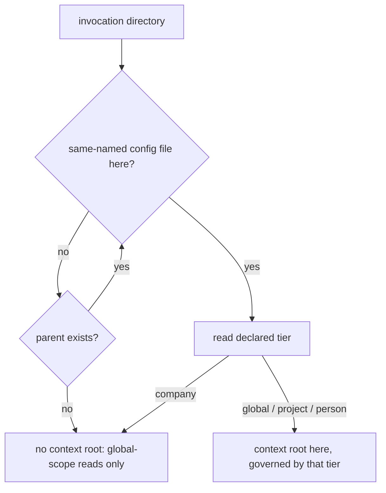

# Config Tier Resolution — Design

## Required reads

- @docs/project/spec/feature/config/tier-declaration.md
- @docs/project/spec/domain/config.md

## Purpose

Give every caller one answer to _which configuration and documentation context
governs this invocation_, and a separate answer to _where does this project's
shared state live_, so that no caller infers a tier from a path shape or from
the presence of a repository. The behavioral contract lives in
`project/spec/feature/config/tier-declaration`; the file locations, keys, and
published schemas live in `project/spec/teleclaude-config`. This design states
the resolver decomposition, who owns it, which consumers ask which question,
and how existing installations reach the declared state.

## Inputs/Outputs

- **Inputs:** the invocation directory; the same-named configuration files on
  its ancestor chain and the tier each one declares; the git metadata at a
  project context root; the registered project roots in the projects manifest.
- **Outputs:** a context root and its declared tier, or none; a project
  shared-state root for project contexts; the composed app config for the
  resolved context; the published editor schemas under `schemas/` and their
  deployed copies under the TeleClaude home.

## Invariants

- **Two questions, two resolvers, two owners.** The config context publishes
  the context-root resolver, because its rule is the parsing of a configuration
  declaration. The workflow context publishes the project shared-state
  resolver, because its rule is the checkout-and-worktree relation: a linked
  worktree shares its owning checkout's state precisely because workflow
  creates linked worktrees and defines what they share. That the subject also
  carries a configuration file is not an ownership basis
  (`software-development/policy/domain-ownership`). Consumers cross each
  boundary through the owning contract, and no consumer walks the ancestor
  chain, reads a tier declaration, or interprets git metadata itself.
- **The context walk consults declarations only.** The nearest ancestor
  directory carrying a same-named configuration file wins, and that file's
  declared tier is the answer. An anchoring tier — global, project, or person —
  establishes the context root there. A company declaration terminates the walk
  with no context root. Exhausting the ancestors yields no context root. Git is
  never consulted, and no directory is excluded from the walk because of its
  name: the TeleClaude home's own global declaration anchors like any other.
  Deciding what a folder is from repository topology is the failure this
  removes (`general/design/configuration-tiers`, _Letting git decide what a
  folder is_).
- **Nearest-wins is what makes termination meaningful.** A company folder sits
  beneath the home's global declaration, so the walk reaches the company file
  first and stops; without nearest-wins, an outer declaration would anchor a
  context the company tier does not confer.
- **The project-state resolver presupposes a project context.** Its input is a
  project context root and its answer comes from that root's git metadata: a
  primary checkout owns its own state, a linked worktree resolves through its
  `.git` file to the owning checkout, and a project root with no git metadata
  fails loud naming the root. It answers nothing about which tier governs.
- **One invocation may ask both questions.** A surface that composes
  configuration for the caller _and_ reads a checkout-owned artifact asks the
  context question for the first and the project-state question for the second.
  Collapsing them is what makes a worktree read a worktree-local artifact that
  only the owning checkout carries.
- **One closed vocabulary, one owner, per-model membership.** The four values
  are a single closed vocabulary owned by one enumeration type rather than
  repeated as free literals, and each tier model accepts only its own member, so
  a file declaring another tier fails that model's validation instead of loading
  as something else. Being a declared field also keeps it valid under strict
  unknown-key rejection.
- **Every schema reference is portable, because configuration files are
  tracked.** A file references a schema reachable from its own tree by relative
  path, and a project configuration outside this repository references the
  published schema by its canonical URL. No reference embeds a machine-local
  path: a project configuration is a regular tracked file, so an absolute home
  path in it would commit local topology and resolve on no other checkout
  (`software-development/policy/security-awareness`).
- **The schema reference is advisory and never load-bearing.** Loading reads
  the declaration alone, so a missing, stale, or unresolvable modeline is never
  an error.
- **Company composition runs through membership, not through the walk.** A
  company configuration is reached through a project's declared company
  membership, never through a context root, so no context walk composes a
  company layer.
- **Working-checkout resolution is outside this design.** Locating the checkout
  in which file and quality operations run is a working-copy question, not a
  question about what a root is, and it keeps its own resolver and its own
  worktree-local answer.

## Primary flows

**Context resolution.**

**Configuration composition.** The loader receives the context root and its
declared tier and dispatches on the declaration: a person context loads the
per-person overlay, a project context loads the project overlay, and the global
overlay always loads. The company layer composes from the project overlay's
declared company membership. The loader applies no path-shape test.

**Project shared-state resolution.** A consumer holding a project context root
asks for that project's shared-state root and receives the owning checkout.
Everything checkout-owned — the todo store, lifecycle state, worktree paths,
blueprint state, and integration checkpoints — resolves beneath that answer.

**Consumer classification.** Each existing caller of root resolution asks
exactly one of the two questions, and the rule is what the caller does with the
answer:

- _Context question_ — callers that compose configuration or select the
  documentation and registry scope for the invocation: the docs retrieval
  surface's configuration composition, MCP invocation-scope naming, and the
  surfaces that associate an invocation with a project for dispatch, bug
  filing, and content capture.
- _Project-state question_ — callers that read or write checkout-owned state:
  the todo store, lifecycle state IO and worktree paths, blueprint state,
  integration checkpoints, the sync deploy root, checkpoint flags, and the todo
  API routes.

The docs retrieval surface is the case that asks both: its configuration
composition follows the context root, while the generated index it reads is a
checkout-owned artifact and follows the project-state root.

**Editor-schema publication.** Generation is a config-owned pure export from
the four tier models — new behavior beside the existing markdown config-surface
export, which serves release inspection and covers only three of the four
models. Generating from the model is what keeps a published schema from
drifting from the shape it describes; the committed MCP registry schema is
hand-maintained and is a publication precedent, not a generation one.

Reconciliation owns the writing: the same boundary that already regenerates the
machine-config sample from the field-exposure map and composes the home docs and
skills roots writes the four schema files at this repository's root and deploys
copies into the home tree. Deploying into the home tree is what makes the home's
own configuration files — global, person, and company — able to reference their
schema relatively, since they and the deployed copies share one tree.

A file carries its association as a YAML schema modeline. This repository's
project configuration references the repo-root schema relatively; the home
tree's files reference the deployed copies relatively; a project configuration
in any other repository references the published schema by URL, because no
relative path from a foreign repository reaches a TeleClaude schema and a
tracked file may not carry a local one.

**Advancing a stored file.** Advancing a same-named configuration file to the
declared state is a property of the config load boundary, not of a startup
hook. Placing it there is what makes it precede every strict read by
construction — including a standalone read command that loads overlays without
passing through daemon startup, and project bootstrap, which parses a
newly-written project configuration before that project is registered.

The advance carries two independent idempotent properties, checked and repaired
separately: the tier declaration, and the editor schema association. A file that
already declares its tier but carries no association gains one; a correct
declaration never suppresses repair of the association. Applying the advance to
an already-current file changes nothing.

Writers close the window from the other end: a newly created global, person,
company, or project configuration is written declared and associated, so it is
never born needing an advance.

Where the advance cannot write — a read-only tree, or a file the invoking user
may not modify — the load still succeeds against the advanced in-memory value.
Writing where it can is deliberate: the declaration surfaces in the owning
project's working tree as an ordinary change for its owner to commit, which is
how a project's committed configuration reaches the declared state.

Inferring an absent tier from a file's location is the one legacy rule this
design retains, and it lives only inside the advance — no loader and no
consumer carries it. Its removal trigger is that every registered project
configuration carries a committed declaration; until then it is what keeps
established installations resolving. An invalid declaration is outside it
entirely: an unknown or model-inconsistent value is never inferred over and
never advanced, and fails immediately.

## Failure modes

- **A same-named configuration file carries no declaration.** The advance
  supplies one at the load boundary and the load proceeds. Once the legacy
  inference is retired this becomes a load failure naming the file and the
  missing declaration — which is why the inference's removal trigger is stated
  rather than left to judgement.
- **The advance cannot write the file.** The load succeeds against the advanced
  in-memory value and the stored file is left as it was, so a read-only or
  unwritable tree degrades to a repeated advance rather than to a failed read.
- **A schema association is absent, stale, or unresolvable.** Not an error at
  any point: the association serves the editor, and loading reads the
  declaration alone.
- **A declaration names an unknown tier, or a tier the model does not accept.**
  Validation fails naming the file and the declaration. The file is never
  loaded as another tier — silently loading it as a neighbouring tier is the
  mis-classification the declaration exists to prevent.
- **A project context root carries no git metadata.** Shared-state resolution
  fails loud naming the project root rather than materializing state somewhere
  incidental.
- **No declaration anywhere on the ancestor chain.** Not an error: read
  surfaces proceed with global-scope information only.
- **Invocation from inside a company folder.** Not an error: the walk
  terminates and the invocation behaves as one with no context root.
- **A path-shape test reappears in a consumer.** A caller that re-derives a
  tier from a directory name reintroduces exactly the coupling this
  decomposition removes, and does so where no resolver change can correct it.
