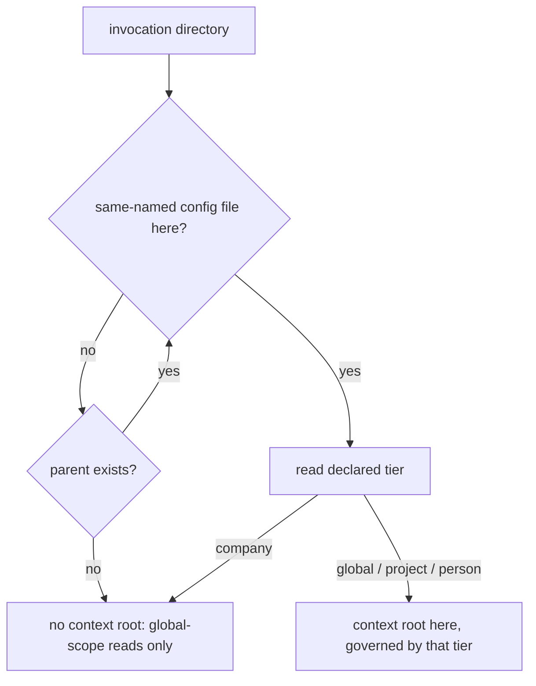

# Config Tier Resolution — Design

## Required reads

- @docs/project/spec/feature/config/tier-declaration.md
- @docs/project/spec/domain/config.md

## Purpose

Give every caller one answer to _which configuration and documentation context
governs this invocation_, and a separate answer to _where does this project's
shared state live_, so that no caller infers a tier from a path shape or from
the presence of a repository. The behavioral contract lives in
`project/spec/feature/config/tier-declaration`; the file locations, keys, and
published schemas live in `project/spec/teleclaude-config`. This design states
the resolver decomposition, who owns it, which consumers ask which question,
and how existing installations reach the declared state.

## Inputs/Outputs

- **Inputs:** the invocation directory; the same-named configuration files on
  its ancestor chain and the tier each one declares; the git metadata at a
  project context root; the registered project roots in the projects manifest.
- **Outputs:** a context root and its declared tier, or none; a project
  shared-state root for project contexts; the composed app config for the
  resolved context; the published editor schemas under `schemas/` and their
  deployed copies under the TeleClaude home.

## Invariants

- **Two questions, two resolvers, two owners.** The config context publishes
  the context-root resolver, because its rule is the parsing of a configuration
  declaration. The workflow context publishes the project shared-state
  resolver, because its rule is the checkout-and-worktree relation: a linked
  worktree shares its owning checkout's state precisely because workflow
  creates linked worktrees and defines what they share. That the subject also
  carries a configuration file is not an ownership basis
  (`software-development/policy/domain-ownership`). Consumers cross each
  boundary through the owning contract, and no consumer walks the ancestor
  chain, reads a tier declaration, or interprets git metadata itself.
- **Resolution carries no location logic.** No resolver, loader, or consumer
  derives a tier from where a file sits. Consulting a location belongs to
  advancement alone, and there it is a lookup in the tier registries rather than
  a match against a path pattern: a path the registries do not name is not
  advanced.
- **The context walk consults declarations only.** The nearest ancestor
  directory carrying a same-named configuration file wins, and that file's
  declared tier is the answer. An anchoring tier — global, project, or person —
  establishes the context root there. A company declaration terminates the walk
  with no context root. Exhausting the ancestors yields no context root. Git is
  never consulted, and no directory is excluded from the walk because of its
  name: the TeleClaude home's own global declaration anchors like any other.
  Deciding what a folder is from repository topology is the failure this
  removes (`general/design/configuration-tiers`, _Letting git decide what a
  folder is_).
- **Nearest-wins is what makes termination meaningful.** A company folder sits
  beneath the home's global declaration, so the walk reaches the company file
  first and stops; without nearest-wins, an outer declaration would anchor a
  context the company tier does not confer.
- **The project-state resolver presupposes a project context.** Its input is a
  project context root and its answer comes from that root's git metadata: a
  primary checkout owns its own state, a linked worktree resolves through its
  `.git` file to the owning checkout, and a project root with no git metadata
  fails loud naming the root. It answers nothing about which tier governs.
- **One invocation may ask both questions.** A surface that composes
  configuration for the caller _and_ reads a checkout-owned artifact asks the
  context question for the first and the project-state question for the second.
  Collapsing them is what makes a worktree read a worktree-local artifact that
  only the owning checkout carries.
- **One closed vocabulary, one owner, per-model membership.** The four values
  are a single closed vocabulary owned by one enumeration type rather than
  repeated as free literals, and each tier model accepts only its own member, so
  a file declaring another tier fails that model's validation instead of loading
  as something else. Being a declared field also keeps it valid under strict
  unknown-key rejection.
- **Every schema reference is relative to a schema in the file's own tree.** A
  project configuration references a sibling schema deployed at its own project
  root; a home-tree file references the home's deployed copies. No reference is
  absolute and none is fetched over a network, so a schema resolves from every
  checkout of the file that carries it and needs no distribution surface beyond
  the repositories that already hold these files. A configuration file is a
  regular tracked file, so a machine-local path in one would commit local
  topology and resolve nowhere else
  (`software-development/policy/security-awareness`).
- **The schema reference is advisory and never load-bearing.** Loading reads
  the declaration alone, so a missing, stale, or unresolvable modeline is never
  an error.
- **Company composition runs through membership, not through the walk.** A
  company configuration is reached through a project's declared company
  membership, never through a context root, so no context walk composes a
  company layer.
- **Working-checkout resolution is outside this design.** Locating the checkout
  in which file and quality operations run is a working-copy question, not a
  question about what a root is, and it keeps its own resolver and its own
  worktree-local answer.

## Primary flows

**Context resolution.**

**Configuration composition.** The loader receives the context root and its
declared tier and dispatches on the declaration: a person context loads the
per-person overlay, a project context loads the project overlay, and the global
overlay always loads. The company layer composes from the project overlay's
declared company membership. The loader applies no path-shape test.

**Project shared-state resolution.** A consumer holding a project context root
asks for that project's shared-state root and receives the owning checkout.
Everything checkout-owned — the todo store, lifecycle state, worktree paths,
blueprint state, and integration checkpoints — resolves beneath that answer.

**Consumer classification.** Each existing caller of root resolution asks
exactly one of the two questions, and the rule is what the caller does with the
answer:

- _Context question_ — callers that compose configuration or select the
  documentation and registry scope for the invocation: the docs retrieval
  surface's configuration composition, MCP invocation-scope naming, and the
  surfaces that associate an invocation with a project for dispatch, bug
  filing, and content capture.
- _Project-state question_ — callers that read or write checkout-owned state:
  the todo store, lifecycle state IO and worktree paths, blueprint state,
  integration checkpoints, the sync deploy root, checkpoint flags, and the todo
  API routes.

The docs retrieval surface is the case that asks both: its configuration
composition follows the context root, while the generated index it reads is a
checkout-owned artifact and follows the project-state root.

**Editor-schema publication.** Generation is a config-owned pure export from
the four tier models. Generating from the model is what keeps a published
schema from drifting from the shape it describes.

Reconciliation owns the writing. The same boundary that regenerates the
machine-config sample from the field-exposure map and composes the home docs and
skills roots writes the four canonical schemas at this repository's root, deploys
all four into the home tree beside the home's own configuration files, and
deploys the project-tier schema to a project root beside that project's
configuration file — the boundary that already writes that project's generated
entrypoints. A deployed schema is a generated artifact its project commits, as
the generated entrypoints are.

A file carries its association as a YAML schema modeline naming a schema in its
own tree: a project configuration names its sibling, and a home-tree file names
the home's deployed copy. Every configuration file therefore validates from any
checkout, with no network fetch and no path that means something different on
another machine.

**Advancing stored files.** A same-named configuration file is advanced before
it is loaded. Advancement supplies what the file lacks — its tier declaration,
its schema association, or both — and each is an independent idempotent repair,
so a file carrying a valid declaration and no association gains the association
alone and a file carrying both is untouched. The file is its own record of
having been advanced; no separate durable state exists to go stale, be
invalidated, or disagree with the files it describes.

Advancement obtains an absent tier by asking the tier registries the model
already defines — the designated locations for the home's own configuration,
person, and company files, and the project manifest for project roots. A path
the registries do not name is not advanced, so it reaches loading undeclared and
fails there.

A best-effort sweep advances every root the registries reach, at the
boundaries where a full pass is already natural: daemon start, reconciliation,
and project registration. The sweep is an optimization over the per-file
guarantee, never a precondition of it. A registered root that is temporarily
unavailable is absent from the manifest the sweep loads, which is neither an
error nor a completion claim about that root: when it returns, the per-file
advance reaches it before its first load. Nothing about one root's advancement
affects another's.

A file advancement cannot write fails that file's load, naming the file and the
declaration it needs. The failure is scoped to that file; every other root
continues to resolve.

Writing a project's schema association depends on that project's sibling schema
being in place, so advancement writes the association only once the
reconciliation-owned deployment reports the schema deployed at that root. Where
deployment cannot complete, the declaration is still written — the two repairs
are independent, and only the declaration is load-bearing — and the association
is retried by the next advance. A file never carries a modeline naming a schema
that is not there.

A newly created global, person, company, or project configuration is written
declared, and associated once its schema is deployed.

Advancement never overwrites a declaration that is present: an unknown or
model-inconsistent value fails rather than being replaced.

## Failure modes

- **A same-named configuration file carries no declaration.** Loading fails
  naming the file and the missing declaration, wherever the file sits. A file
  the tier registries do not name reaches this by construction, and its remedy
  is to declare itself.
- **Advancement cannot write a file the registries name.** That file's load
  fails, naming it and the declaration it needs, rather than substituting a
  value that leaves the stored file undeclared. Other roots are unaffected.
- **A registered project root is unavailable.** It is absent from the manifest
  the sweep loads. Nothing is recorded about it and nothing else is blocked; it
  is advanced when it returns and is next read.
- **A schema association is absent, stale, or unresolvable.** Not an error: the
  association serves the editor, and loading reads the declaration alone.
- **A declaration names an unknown tier, or a tier the model does not accept.**
  Validation fails naming the file and the declaration. The file is never
  loaded as another tier — silently loading it as a neighbouring tier is the
  mis-classification the declaration exists to prevent.
- **A project context root carries no git metadata.** Shared-state resolution
  fails loud naming the project root rather than materializing state somewhere
  incidental.
- **No declaration anywhere on the ancestor chain.** Not an error: read
  surfaces proceed with global-scope information only.
- **Invocation from inside a company folder.** Not an error: the walk
  terminates and the invocation behaves as one with no context root.
- **A path-shape test reappears in a consumer.** A caller that re-derives a
  tier from a directory name reintroduces exactly the coupling this
  decomposition removes, and does so where no resolver change can correct it.
