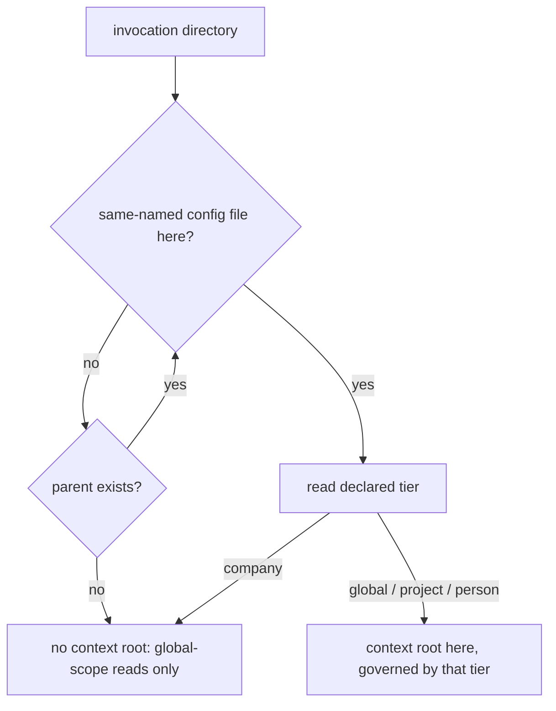

# Config Tier Resolution — Design

## Required reads

- @docs/project/spec/feature/config/tier-declaration.md
- @docs/project/spec/domain/config.md

## Purpose

Give every caller one answer to _which configuration and documentation context
governs this invocation_, and a separate answer to _where does this project's
shared state live_, so that no caller infers a tier from a path shape or from
the presence of a repository. The behavioral contract lives in
`project/spec/feature/config/tier-declaration`; the file locations, keys, and
published schemas live in `project/spec/teleclaude-config`. This design states
the resolver decomposition, who owns it, which consumers ask which question,
and how existing installations reach the declared state.

## Inputs/Outputs

- **Inputs:** the invocation directory; the same-named configuration files on
  its ancestor chain and the tier each one declares; the git metadata at a
  project context root; the registered project roots in the projects manifest.
- **Outputs:** a context root and its declared tier, or none; a project
  shared-state root for project contexts; the composed app config for the
  resolved context; the editor schemas published into the TeleClaude home's
  schema directory.

## Invariants

- **Two questions, two resolvers, two owners.** The config context publishes
  the context-root resolver, because its rule is the parsing of a configuration
  declaration. The workflow context publishes the project shared-state
  resolver, because its rule is the checkout-and-worktree relation: a linked
  worktree shares its owning checkout's state precisely because workflow
  creates linked worktrees and defines what they share. That the subject also
  carries a configuration file is not an ownership basis
  (`sdlc/policy/domain-ownership`). Consumers cross each
  boundary through the owning contract, and no consumer walks the ancestor
  chain, reads a tier declaration, or interprets git metadata itself.
<!-- planned-change:config-migration-chain -->
- **Resolution carries no location logic.** No resolver, loader, or consumer
  derives a tier from where a file sits. Consulting a location belongs to
  advancement alone, and there it is a lookup in the tier registries rather than
  a match against a path pattern: a path the registries do not name is not
  advanced.
<!-- change:config-migration-chain -->
- **Resolution carries no location logic.** No resolver, loader, or consumer
  derives a tier from where a file sits. Consulting a location belongs to the
  declaring configuration migration alone, and there it is a lookup in the tier
  registries rather than a match against a path pattern: a path the registries
  do not name is given no tier.
<!-- /planned-change:config-migration-chain -->
- **The context walk consults declarations only.** The nearest ancestor
  directory carrying a same-named configuration file wins, and that file's
  declared tier is the answer. An anchoring tier — global, project, or person —
  establishes the context root there. A company declaration terminates the walk
  with no context root. Exhausting the ancestors yields no context root. Git is
  never consulted, and no directory is excluded from the walk because of its
  name: the TeleClaude home's own global declaration anchors like any other.
  Deciding what a folder is from repository topology is the failure this
  removes (`general/design/configuration-tiers`, _Letting git decide what a
  folder is_).
- **Nearest-wins is what makes termination meaningful.** A company folder sits
  beneath the home's global declaration, so the walk reaches the company file
  first and stops; without nearest-wins, an outer declaration would anchor a
  context the company tier does not confer.
- **The project-state resolver presupposes a project context.** Its input is a
  project context root and its answer comes from that root's git metadata: a
  primary checkout owns its own state, a linked worktree resolves through its
  `.git` file to the owning checkout, and a project root with no git metadata
  fails loud naming the root. It answers nothing about which tier governs.
- **One invocation may ask both questions.** A surface that composes
  configuration for the caller _and_ reads a checkout-owned artifact asks the
  context question for the first and the project-state question for the second.
  Collapsing them is what makes a worktree read a worktree-local artifact that
  only the owning checkout carries.
- **One closed vocabulary, one owner, per-model membership.** The four values
  are a single closed vocabulary owned by one enumeration type rather than
  repeated as free literals, and each tier model accepts only its own member, so
  a file declaring another tier fails that model's validation instead of loading
  as something else. Being a declared field also keeps it valid under strict
  unknown-key rejection.
- **Every schema reference is relative and fixed by the tier.** A project
  configuration references its schema through the project root's machine-local
  schema link; a home-tree file references the home's published schema
  directory from its designated location. No reference is absolute and none is
  fetched over a network, and no reference depends on what the writing machine
  holds, so every machine writes the same bytes for the same document. A
  configuration file is a regular tracked file, so a machine-local path in one
  would commit local topology and resolve nowhere else
  (`sdlc/policy/security-awareness`); the machine-local part
  lives in the untracked link instead.
- **The schema reference is advisory and never load-bearing.** Loading reads
  the declaration alone, so a missing, stale, or unresolvable modeline is never
  an error.
- **Company composition runs through membership, not through the walk.** A
  company configuration is reached through a project's declared company
  membership, never through a context root, so no context walk composes a
  company layer.
- **Working-checkout resolution is outside this design.** Locating the checkout
  in which file and quality operations run is a working-copy question, not a
  question about what a root is, and it keeps its own resolver and its own
  worktree-local answer.

## Primary flows

**Context resolution.**

**Configuration composition.** The loader receives the context root and its
declared tier and dispatches on the declaration: a person context loads the
per-person overlay, a project context loads the project overlay, and the global
overlay always loads. The company layer composes from the project overlay's
declared company membership. The loader applies no path-shape test.

**Project shared-state resolution.** A consumer holding a project context root
asks for that project's shared-state root and receives the owning checkout.
Everything checkout-owned — the todo store, lifecycle state, worktree paths,
blueprint state, and integration checkpoints — resolves beneath that answer.

**Consumer classification.** Each existing caller of root resolution asks
exactly one of the two questions, and the rule is what the caller does with the
answer:

- _Context question_ — callers that compose configuration or select the
  documentation and registry scope for the invocation: the docs retrieval
  surface's configuration composition, MCP invocation-scope naming, and the
  surfaces that associate an invocation with a project for dispatch, bug
  filing, and content capture.
- _Project-state question_ — callers that read or write checkout-owned state:
  the todo store, lifecycle state IO and worktree paths, blueprint state,
  integration checkpoints, the sync deploy root, checkpoint flags, and the todo
  API routes.

<!-- planned-change:worktree-or-project-scope -->
A linked worktree is never authoritative for daemon-facing configuration. The
tier and subscription gates — the `telec code` capability gate and the
checkpoint's project-support gate — read the declaration of the checkout that
owns the worktree, never the branch copy the worktree carries. The context walk
still answers where the invocation acts, so path scoping stays worktree-local;
only the declaration those gates read resolves to the owning checkout. A branch
that edits its own declaration therefore cannot change the gate applied to it,
and a declaration whose shape the installed daemon cannot yet parse cannot break
the gate for the checkout that carries it.

The docs retrieval surface is the case that asks both: its configuration
composition follows the context root, while the generated index it reads is a
checkout-owned artifact and follows the project-state root.
<!-- change:worktree-or-project-scope -->
The `telec code` capability gate reads the declaration of the context the
invocation acts in. From a slug worktree that is the worktree's own declaration:
its tier and its subscriptions describe the change the worktree carries, so the
code grading the change and the declaration it reads come from the same checkout
(`project/design/architecture/command-scope`). The checkpoint's project-support
gate is evaluated by the daemon, on the installed code, for the live project; it
reads the declaration of the checkout that owns the worktree, so the installed
code and the declaration it reads again come from the same checkout.

The docs retrieval surface asks both questions for a project context: the
context question identifies the invocation as a project invocation, and the
project-state root then carries both its configuration composition and the
generated index it reads, because both belong to the owning checkout. A
non-project context composes from its own context root.
<!-- /planned-change:worktree-or-project-scope -->

**Editor-schema publication.** Generation is a config-owned pure export from
the four tier models. Generating from the model is what keeps a published
schema from drifting from the shape it describes.

Reconciliation owns the writing
(`project/spec/feature/reconciliation/config-schema-publication`). It
publishes the four tier schemas, together with the MCP registry schema the MCP
context authors, into the TeleClaude home's schema directory: a real directory
it alone writes, content-gated, at machine installation and at the canonical
checkout's main-only commit boundary. No repository carries a schema file.
Project plumbing convergence gives each adopted project root, and workflow's
worktree preparation gives each of its worktrees, a machine-local link to that
directory in the root's untracked state directory.

A file carries its association as a YAML schema modeline whose target is fixed
by its tier and owned by the configuration writer in one place: a project
configuration names its schema through the root's link, and a home-tree file
names the home's schema directory relative to its designated location. Every configuration file therefore validates on any machine that has
published its schemas, with no network fetch and no path that means something
different on another machine.

<!-- planned-change:config-migration-chain -->
**Advancing stored files.** A same-named configuration file is advanced before
it is loaded. Advancement supplies what the file lacks — its tier declaration,
its schema association, or both — and each is an independent idempotent repair,
so a file carrying a valid declaration and no association gains the association
alone and a file carrying both is untouched.

Advancement runs against an epoch, held in config-owned durable state in the
home and keyed by the identity of the advancement itself, so a later advancement
neither collides with this one nor inherits its state. An epoch is opened only
by the versioned installation upgrade that introduces that advancement, running
over an established installation. Nothing at runtime opens one: a load that
finds no epoch is strict, which is also the correct answer for an installation
new enough that its files were born declared.

Opening an epoch captures the eligible set from the registries as they stand at
that moment: the home's own configuration, every person and company folder at
its designated location, and every entry in the project manifest — including
entries whose directory is unavailable, which are carried as pending rather than
omitted. Completion is recorded per root, so no record claims anything about a
root it has not seen.

Eligibility is decided by that captured set and never by first encounter. A root
in the set is advanced when it is reached, whenever that is. A root outside it —
one registered after the epoch opened, moved, cloned onto another machine, or
living on an installation whose epoch found nothing to do — is strict from the
start: an undeclared file there fails rather than being repaired. Deleting a
declaration and moving the repository therefore restores nothing anywhere.

Advancement obtains an absent tier by asking the tier registries the model
already defines — the designated locations for the home's own configuration,
person, and company files, and the project manifest for project roots. A path
the registries do not name is not advanced, so it reaches loading undeclared and
fails there.

Whether a root may still be advanced is settled from the epoch before any
repair is attempted: with no open epoch, or for a root outside the eligible set
or already recorded complete, the root is strict, and a file there missing or
misdeclaring its tier fails whatever else it does or does not carry. Strictness therefore arrives for a root
the moment its advancement completes, and for every other root immediately.
Editing a file cannot return its root to the eligible state, because neither the
epoch nor its completion records live in the file.

The schema association carries no evidential weight. It serves the editor, it is
repaired independently at any point, and its absence never makes an advanced
root eligible for advancement again.

A best-effort sweep advances the eligible roots it can reach, at the boundaries
where a full pass is already natural: daemon start, reconciliation, and project
registration. The sweep is an optimization over the per-root guarantee, never a
precondition of it. A root that is unavailable when the sweep runs stays pending
in the epoch and is advanced when it returns; the sweep records completion only
for roots it actually reached. Nothing about one root's advancement affects
another's.

A file advancement cannot write fails that file's load, naming the file and the
declaration it needs. The failure is scoped to that file; every other root
continues to resolve.

Writing a schema association does not depend on the schema being present on
the writing machine. The association is a fixed function of the tier, so
advancement writes it together with the declaration, and every later write of a
declared file writes it again. Gating it on local presence would make a
committed file's content depend on the machine that wrote it.

A newly created global, person, company, or project configuration is written
declared and associated.

Advancement never overwrites a declaration that is present: an unknown or
model-inconsistent value fails rather than being replaced.
<!-- change:config-migration-chain -->
**Migrating stored files.** A same-named configuration file reaches its
declared state through the configuration migration list, the one mechanism that
moves every configuration document's stored shape forward
(`project/spec/feature/config/document-migration`). The declaring migration
supplies what an older file lacks — its tier declaration — and every stored
write supplies the schema association, so a file carrying a valid declaration
and no association gains the association the next time it is stored and a file
carrying both is untouched.

The declaring migration obtains an absent tier by asking the tier registries the
model already defines — the designated locations for the home's own
configuration, person, and company files, and the project registry for project
roots. A path the registries do not name is given no tier, so it reaches loading
undeclared and fails there.

Whether a file may still be declared is settled by the file's own version and
nothing else. A file that has not passed the declaring migration is declared
from the registries: in memory whenever it is read, on disk when a migration
run or a writer stores it. A file past the declaring migration is strict: a
missing or misdeclared tier fails whatever else the file does or does not
carry, on whichever machine reads it. Deleting a declaration and moving the
repository therefore restores nothing anywhere, because the version that makes
the file strict travels with the file.

The schema association carries no evidential weight. It serves the editor, it
is written with every stored write, and its absence never makes a file eligible
for a declaration again.

Reading never writes. A migration run persists the declaration together with
every other pending migration: commit-boundary maintenance runs one over every
registered root when the migration list changes, and registration and
installation run one for the roots they bring in. Nothing about one file's
migration affects another's.

Writing a schema association does not depend on the schema being present on
the writing machine. The association is a fixed function of the tier, so every
write of a declared file writes it. Gating it on local presence would make a
committed file's content depend on the machine that wrote it.

A newly created global, person, company, or project configuration is written
declared and associated, at the current version.

No migration overwrites a declaration that is present: an unknown or
model-inconsistent value fails rather than being replaced.
<!-- /planned-change:config-migration-chain -->

## Failure modes

<!-- planned-change:config-migration-chain -->
- **A same-named configuration file carries no declaration.** Loading fails
  naming the file and the missing declaration, wherever the file sits. Three
  files reach this by construction: one at a root the tier registries do not
  name, one at a root outside the epoch's eligible set, and one at a root
  already recorded complete. The remedy for all three is to declare the file.
- **The epoch's state is lost.** Nothing reopens it at runtime: every root is
  strict, so an undeclared file fails loud rather than being repaired against
  registries captured after the fact. A completed transition survives this
  untouched, because the declarations it wrote live in the files themselves.
  What is lost is the pending remainder, and the remedy for each such file is
  the one its failure names — declare it.
- **Advancement cannot write a file the registries name.** That file's load
  fails, naming it and the declaration it needs, rather than substituting a
  value that leaves the stored file undeclared. Other roots are unaffected.
- **A registered project root is unavailable.** It stays pending in the epoch,
  which captured it as eligible whether or not it could be reached. No
  completion is recorded for it and nothing else is blocked; it is advanced when
  it returns and is next read.
<!-- change:config-migration-chain -->
- **A same-named configuration file carries no declaration.** Loading fails
  naming the file and the missing declaration, wherever the file sits, unless
  the tier registries name it and it has not passed the declaring migration.
  Two files reach this by construction: one at a root the tier registries do not
  name, and one already stored past the declaring migration. The remedy for both
  is to declare the file.
- **A migration run cannot write a file the registries name.** Reading it is
  unaffected: the file loads in its current shape without being written. The run
  reports that file as failed and migrates every other document.
- **A registered project root is unavailable.** Reads of every other root are
  unaffected, and the migration run migrates every document it can reach. The
  root's file is stored at the current version by the next run that reaches it,
  by registration, or by the next writer; until then any read upcasts it.
<!-- /planned-change:config-migration-chain -->
- **A schema association is absent, stale, or unresolvable.** Not an error: the
  association serves the editor, and loading reads the declaration alone.
- **A declaration names an unknown tier, or a tier the model does not accept.**
  Validation fails naming the file and the declaration. The file is never
  loaded as another tier — silently loading it as a neighbouring tier is the
  mis-classification the declaration exists to prevent.
- **A project context root carries no git metadata.** Shared-state resolution
  fails loud naming the project root rather than materializing state somewhere
  incidental.
- **No declaration anywhere on the ancestor chain.** Not an error: read
  surfaces proceed with global-scope information only.
- **Invocation from inside a company folder.** Not an error: the walk
  terminates and the invocation behaves as one with no context root.
- **A path-shape test reappears in a consumer.** A caller that re-derives a
  tier from a directory name reintroduces exactly the coupling this
  decomposition removes, and does so where no resolver change can correct it.
