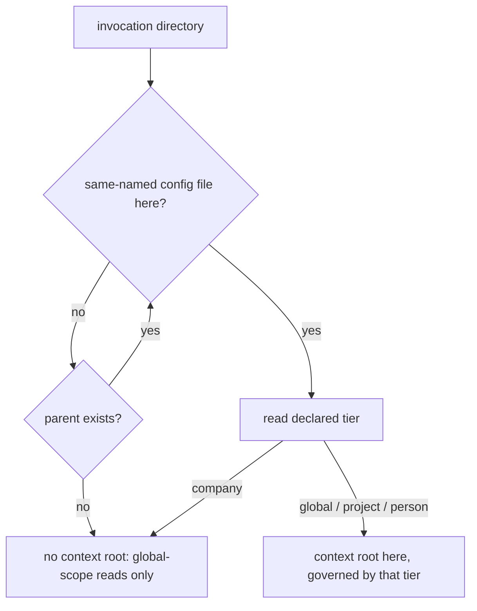

# Config Tier Resolution — Design

## Required reads

- @docs/project/spec/feature/config/tier-declaration.md
- @docs/project/spec/domain/config.md

## Purpose

Give every caller one answer to _which configuration and documentation context
governs this invocation_, and a separate answer to _where does this project's
shared state live_, so that no caller infers a tier from a path shape or from
the presence of a repository. The behavioral contract lives in
`project/spec/feature/config/tier-declaration`; the file locations, keys, and
published schemas live in `project/spec/teleclaude-config`. This design states
the resolver decomposition, who owns it, which consumers ask which question,
and how existing installations reach the declared state.

## Inputs/Outputs

- **Inputs:** the invocation directory; the same-named configuration files on
  its ancestor chain and the tier each one declares; the git metadata at a
  project context root; the registered project roots in the projects manifest.
- **Outputs:** a context root and its declared tier, or none; a project
  shared-state root for project contexts; the composed app config for the
  resolved context; the published editor schemas under `schemas/` and their
  deployed copies under the TeleClaude home.

## Invariants

- **Two questions, two resolvers, one owner.** The config context publishes
  both: a context-root resolver answering which tier governs an invocation, and
  a project-state resolver answering where a project's shared state lives. Both
  answer facts about a project or person as a _configured_ entity, which is why
  they share an owner. No consumer walks the ancestor chain, reads a tier
  declaration, or interprets git metadata itself.
- **The context walk consults declarations only.** The nearest ancestor
  directory carrying a same-named configuration file wins, and that file's
  declared tier is the answer. An anchoring tier — global, project, or person —
  establishes the context root there. A company declaration terminates the walk
  with no context root. Exhausting the ancestors yields no context root. Git is
  never consulted, and no directory is excluded from the walk because of its
  name: the TeleClaude home's own global declaration anchors like any other.
  Deciding what a folder is from repository topology is the failure this
  removes (`general/design/configuration-tiers`, _Letting git decide what a
  folder is_).
- **Nearest-wins is what makes termination meaningful.** A company folder sits
  beneath the home's global declaration, so the walk reaches the company file
  first and stops; without nearest-wins, an outer declaration would anchor a
  context the company tier does not confer.
- **The project-state resolver presupposes a project context.** Its input is a
  project context root and its answer comes from that root's git metadata: a
  primary checkout owns its own state, a linked worktree resolves through its
  `.git` file to the owning checkout, and a project root with no git metadata
  fails loud naming the root. It answers nothing about which tier governs.
- **One invocation may ask both questions.** A surface that composes
  configuration for the caller _and_ reads a checkout-owned artifact asks the
  context question for the first and the project-state question for the second.
  Collapsing them is what makes a worktree read a worktree-local artifact that
  only the owning checkout carries.
- **The declaration is a typed field, not a passenger key.** Each tier model
  declares its own literal, so a file declaring another tier fails that model's
  validation instead of loading as something else. Being declared also keeps the
  field valid under strict unknown-key rejection.
- **The editor schema reference is advisory and never load-bearing.** Loading
  reads the declaration alone. A missing, stale, or unresolvable schema modeline
  is never an error, so a shared project file committed without one resolves
  identically on every machine.
- **Company composition runs through membership, not through the walk.** A
  company configuration is reached through a project's declared company
  membership, never through a context root, so no context walk composes a
  company layer.
- **Working-checkout resolution is outside this design.** Locating the checkout
  in which file and quality operations run is a working-copy question, not a
  question about what a root is, and it keeps its own resolver and its own
  worktree-local answer.

## Primary flows

**Context resolution.**

**Configuration composition.** The loader receives the context root and its
declared tier and dispatches on the declaration: a person context loads the
per-person overlay, a project context loads the project overlay, and the global
overlay always loads. The company layer composes from the project overlay's
declared company membership. The loader applies no path-shape test.

**Project shared-state resolution.** A consumer holding a project context root
asks for that project's shared-state root and receives the owning checkout.
Everything checkout-owned — the todo store, lifecycle state, worktree paths,
blueprint state, and integration checkpoints — resolves beneath that answer.

**Consumer classification.** Each existing caller of root resolution asks
exactly one of the two questions, and the rule is what the caller does with the
answer:

- _Context question_ — callers that compose configuration or select the
  documentation and registry scope for the invocation: the docs retrieval
  surface's configuration composition, MCP invocation-scope naming, and the
  surfaces that associate an invocation with a project for dispatch, bug
  filing, and content capture.
- _Project-state question_ — callers that read or write checkout-owned state:
  the todo store, lifecycle state IO and worktree paths, blueprint state,
  integration checkpoints, the sync deploy root, checkpoint flags, and the todo
  API routes.

The docs retrieval surface is the case that asks both: its configuration
composition follows the context root, while the generated index it reads is a
checkout-owned artifact and follows the project-state root.

**Editor-schema publication.** One JSON Schema per tier is generated from the
tier's model, committed at repo root beside the existing MCP registry schema,
and deployed into the TeleClaude home alongside it. Generation from the model
is what keeps a published schema from drifting from the shape it describes. A
configuration file references its schema through a YAML schema modeline —
relatively where the schema is reachable relatively, and by absolute reference
to the deployed copy otherwise.

**Transition.** Stamping existing files is a one-shot, idempotent pass in the
config domain's existing migration seam, which already runs before folder-keyed
configuration access from both daemon startup and the configuration CLI. The
pass covers every reachable same-named file: the global file, every person
folder, every company folder, and every root in the projects manifest. An
already-declared file is left untouched. Project registration stamps the
joining root, so a project that registers after a pass is covered when it
joins.

## Failure modes

- **A same-named configuration file carries no declaration.** Loading fails
  naming the file and the missing declaration, and the message names the
  remedy. A checkout that never met the transition is the ordinary way this is
  reached.
- **A declaration names an unknown tier, or a tier the model does not accept.**
  Validation fails naming the file and the declaration. The file is never
  loaded as another tier — silently loading it as a neighbouring tier is the
  mis-classification the declaration exists to prevent.
- **A project context root carries no git metadata.** Shared-state resolution
  fails loud naming the project root rather than materializing state somewhere
  incidental.
- **No declaration anywhere on the ancestor chain.** Not an error: read
  surfaces proceed with global-scope information only.
- **Invocation from inside a company folder.** Not an error: the walk
  terminates and the invocation behaves as one with no context root.
- **A path-shape test reappears in a consumer.** A caller that re-derives a
  tier from a directory name reintroduces exactly the coupling this
  decomposition removes, and does so where no resolver change can correct it.
