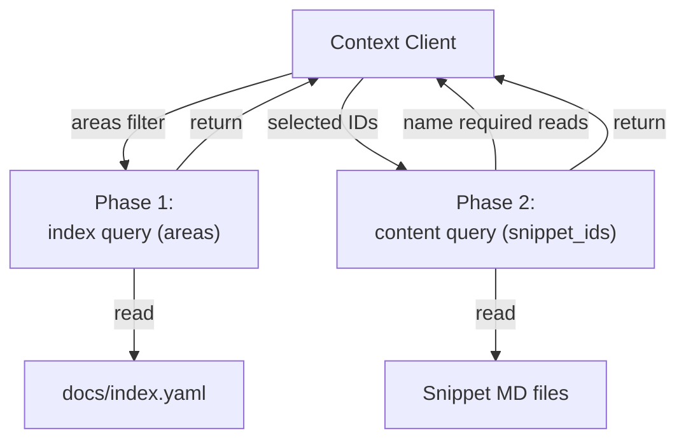
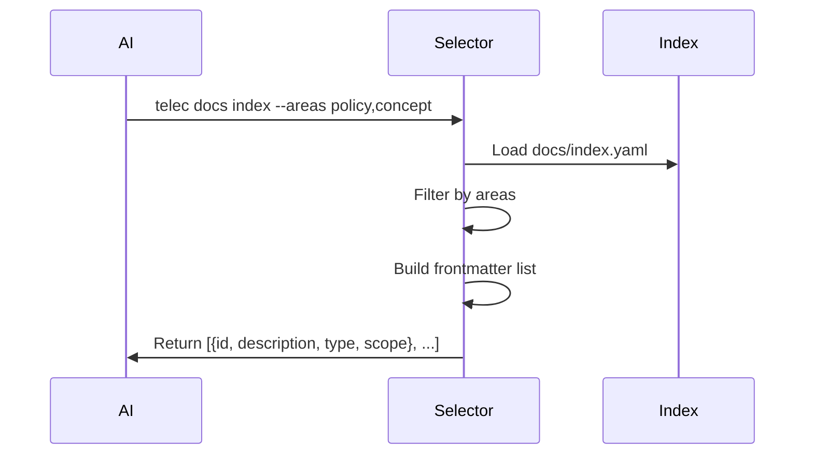
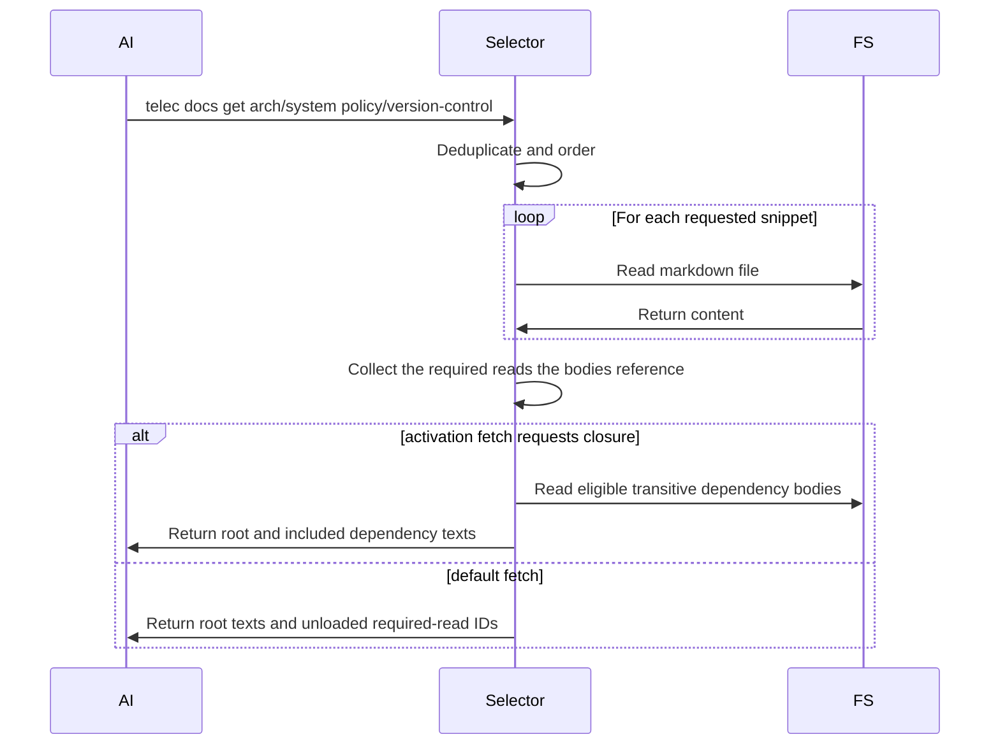
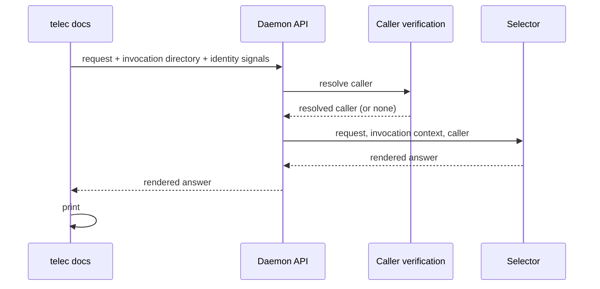

# Context Selection — Design

## Purpose

- Select relevant documentation docs for a given request.

- Selected IDs must exist in the snippet index.
- Required reads are named in the default response for an explicit follow-up.
  An activatable-procedure fetch may request the eligible transitive closure in
  one pass; that explicit activation form includes the dependency bodies.

- Build snippet metadata from docs and global docs.
- Return a filtered index (frontmatter only) when no IDs are provided.
- Accept selected snippet IDs from the caller and report the required reads their
  bodies reference.
<!-- planned-change:docs-tier-layering -->
- Order by scope priority (global -> domain -> project).
<!-- change:docs-tier-layering -->
- Order by scope priority across the four tiers.
<!-- /planned-change:docs-tier-layering -->
- Persist selected IDs per session to avoid repeated context churn.

## Inputs/Outputs

**Inputs:**

- **Phase 1**: Optional `areas` array (taxonomy type filter: principle, concept, policy, procedure, design, spec)
- **Phase 2**: `snippet_ids` array of selected snippets to retrieve
- Caller session ID for context persistence
- Project working directory

**Outputs:**

- **Phase 1**: Index listing (ID, description, type, scope) - frontmatter only
- **Phase 2**: Full snippet content. The default form also reports required-read
  IDs not loaded; the explicit activation form includes the eligible transitive
  dependency bodies and names them as included.
<!-- planned-change:docs-tier-layering -->
- Ordered by scope priority: global → domain → project
<!-- change:docs-tier-layering -->
- Ordered by scope priority across the four tiers
<!-- /planned-change:docs-tier-layering -->

## Invariants

- **Discovery precedes content**: the index listing is queried first, then content
  is fetched for the IDs chosen from it.
- **Required-read expansion is explicit**: the default response names dependency
  IDs for a follow-up; only the activation form explicitly requesting closure
  includes eligible transitive dependency bodies in the same response.
<!-- planned-change:docs-tier-layering -->
- **Scope Ordering**: Global snippets before domain before project; stable deterministic order.
<!-- change:docs-tier-layering -->
- **Scope Ordering**: one deterministic order across the four tiers, given by the scope priority table.
<!-- /planned-change:docs-tier-layering -->
- **Duplicate Prevention**: Each snippet ID appears exactly once in output even if required multiple times.

## Primary flows

### 1. Phase 1: Index Retrieval (Discovery)

### 2. Phase 2: Content Retrieval

#### Baseline Filtering (Optional)

By default, all snippets including baseline are shown in the phase-1 index.
`telec docs index --baseline-only` filters to baseline snippets only
(those referenced in `baseline.md` manifests). This focused view is useful for
authoring/editing baseline content.

### 3. Required Reads

By default, required reads referenced by a returned body are reported as IDs
alongside the content; following them is another content request. An explicit
activatable-procedure closure fetch instead resolves the eligible transitive
dependency set and returns those bodies in the same response under the included
header. In both forms, the caller chooses whether closure expansion occurs.

### 4. Scope Priority Ordering

<!-- planned-change:docs-tier-layering -->
| Scope   | Priority | Rationale                                   |
| ------- | -------- | ------------------------------------------- |
| global  | 1        | Foundational policies apply universally     |
| domain  | 2        | Domain-specific rules constrain projects    |
| project | 3        | Project details reference global foundation |
<!-- change:docs-tier-layering -->
| Scope   | Priority |
| ------- | -------- |
| global  | 1        |
| company | 2        |
| project | 3        |
| person  | 4        |

Within the global tier, `domain` is the secondary key. It is metadata on a global
snippet, not a scope of its own, and the ordering never treats it as one.
<!-- /planned-change:docs-tier-layering -->

<!-- planned:docs-tier-layering -->
### 5. Caller-Scope Resolution

Source assembly is preceded by resolving the caller. The stage takes the
resolved person and the resolved organizational membership from identity, and a
project's declared owning company from configuration, and answers two things:
the depth the caller reads any tier at, and the default read set — the tiers
assembled when the caller names none, each paired with its depth. The membership facts are read where they are resolved, not where they are
declared: configuration owns the declarations and publishes them to identity,
which owns what they mean. Nothing downstream re-derives reach: assembly loads the
tiers the stage named, and the include predicate applies the depth it assigned.

The stage is the only place the two inputs meet. The relationship facts stay
owned by their declaring contexts; the reach rule stays here.

The projects a caller reaches are the projects the roster's resolution reports
for them — explicit assignments and, for a company's administrative role, every
project that company owns — taken as one answer. This stage never recomputes
coverage from a role: the roster resolves it once, and documentation reads the
result.

Reach and depth are separate answers and are never traded for one another. Reach
decides which tiers are assembled; depth decides how much of an assembled tier is
read. The default read set is the caller's own person tier, every company they
belong to, global, and what the invocation offers — the project being worked in
and the company that project declares as its owner — the last two met at
whatever depth the caller's relationship grants, public-only where there is
none. The other projects a caller reaches through the roster are not in the
default set; they are read in full when worked in or named. When the invocation
resolves to no context at all, it offers what it offers today — the published
documentation of every registered project — at the caller's depth; the bound on
the default set rejects relationship-derived expansion inside a context and
removes nothing from that absent-workspace case. Naming a tier, by selector
or by snippet identity, changes reach: the named tier is assembled instead of
the default set, at the depth this stage grants the caller for it. Naming never
changes depth. A caller with no resolvable identity gains no tier from a
relationship it does not have.

**Layer placement.** The caller arrives already resolved. Identity resolution
belongs to the boundary that owns injection, and the resolved caller reaches the
command surface as a typed parameter alongside the arguments a caller supplied.
The command surface translates those arguments into a request; it resolves
nothing and decides no reach. The resolution stage decides. Catalog loading
executes what it decided.

A surface that reaches outward to fill its own inputs — reading a login file, an
environment, or an identity service to discover who is calling — has taken both
a decision and an ownership that are not its own. A surface that inspects a
relationship to choose what to load has taken the reach decision.

**Naming a tier.** One rule covers every selector that names a tier — a person,
a company, or a project — and every snippet identity that names one: the named
tier is assembled at the depth the caller's relationship to it grants — in full
where a relationship exists, at what its snippets declare public where none does
— and a platform administrator reads any named tier in full. Naming adds the
tier to what is assembled; it grants nothing about how deeply it is read. A
selector naming a tier that yields nothing at the caller's depth returns the
same empty answer as one naming a tier that does not exist, so a selector
discloses nothing. A direct snippet identity keeps the retrieval contract's
per-identity answer: content where the caller's depth admits it, a withheld
notice where it does not, and an unknown-identity error where nothing exists.

Authorization therefore lives in one place — the depth the resolution stage
assigns — and no selector carries a gate of its own. Command clearance authorizes
the verb; what one argument to that verb returns is decided by the same
resolution every unselected read goes through.

### 6. Tier-Qualified Identity

A snippet's identity carries its tier as the first segment. Person and company
identities carry the owning slug as the second segment:
`person/<slug>/<taxonomy>/<rest>` and
`company/<slug>/<taxonomy>/<rest>`. Project identities retain their existing
project-qualified form.

### 7. Tier Catalog Construction

Every tier whose material participates in the documentation surface has its
catalog built by the same publication pass that builds the project and global
catalogs. Whether a non-project tier participates is read from that tier's own
declaration, never inferred from its location on disk. Participation is answered per tier by the tier-permissions contract, on an axis
independent of whether the tier is an invocation context or carries project
subscriptions.

A participating tier that holds no snippets keeps an empty catalog. The
catalog's existence answers participation; its entries answer content.

Tier catalogs and sources are published like every other publisher's: they
enter the staged documentation generation and the merged index, and each tier's
own catalog is deployed beside its material whether or not it has entries.
Discovery reads the deployed corpus for every tier; a snippet body resolves
through the same source-tree resolver every other tier uses.

Discovery names every tier in the caller's read set with the entries it
contributes, so a participating tier that holds nothing is visible as a tier
with zero entries to a caller who may see it, and invisible to one who may not.
<!-- /planned:docs-tier-layering -->

<!-- planned:cli-authorization-docs-via-daemon -->
### 8. Serving Boundary

Selection runs in the daemon. The command line parses and validates its
arguments, then sends the request, the directory it was invoked from, and its
identity signals, and prints the rendered answer it receives. The daemon's
caller verification is the boundary that owns injection: it resolves the
caller, and the retrieval request receives that caller as a typed parameter.
The invocation directory resolves what the invocation offers, never who is
calling.

A caller the daemon cannot resolve, including one whose credential it rejects,
reaches the Selector as no caller rather than as a refusal, and is read as the
Unresolvable Caller below.
<!-- /planned:cli-authorization-docs-via-daemon -->

## Failure modes

- **Snippet Not Found**: Requested ID not in index. Returns error with missing ID list. Client must re-select.
- **File Read Error**: Snippet in index but file missing/unreadable. Skipped with warning. Partial results returned.
- **Invalid ID Format**: Malformed snippet ID. Rejected immediately with error.
- **Index Not Found**: `docs/index.yaml` missing. Returns empty result with error message. Agent cannot proceed.
- **Context Too Large**: Expanded content exceeds AI context window. No automatic truncation. Client must reduce selection.
- **Session Context Loss**: Persisted IDs not found in index after regeneration. Falls back to phase 1 discovery.

<!-- planned:docs-tier-layering -->
- **Unresolvable Caller**: The call carries no identity that resolves to a
  person. No relationship-derived source enters scope at all — no person tier, no
  company, no assigned project — and what remains is what the invocation already
  offers, read at public-only depth. Absent identity never widens a read, and
  public-only is a depth rather than authority to assemble every tier at it.
- **Declared-but-absent tier**: A relationship names a person or company with no
  configuration present. The misconfiguration is surfaced rather than silently
  producing an empty tier, which is indistinguishable from a correctly empty one.
- **Scope read from location**: Deriving reach from the working directory
  produces an authorization answer that changes when someone changes directory,
  which is not an authorization answer at all.
<!-- /planned:docs-tier-layering -->
<!-- planned:cli-authorization-docs-via-daemon -->
- **Daemon Unavailable**: The command line cannot reach the daemon. Retrieval
  fails with the daemon-unavailable error and no local read is attempted.
<!-- /planned:cli-authorization-docs-via-daemon -->

