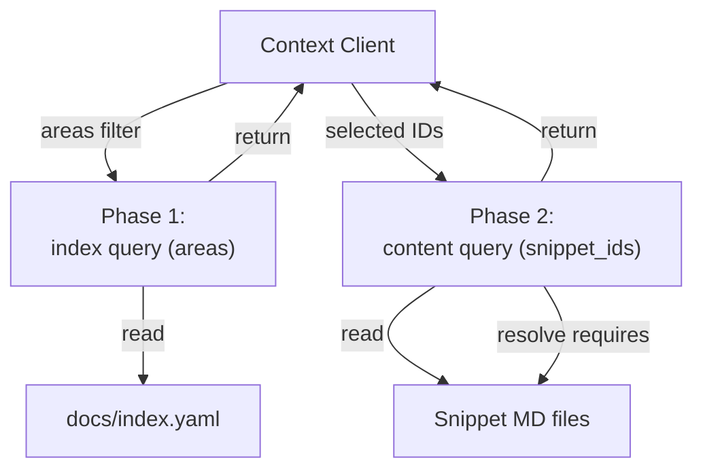
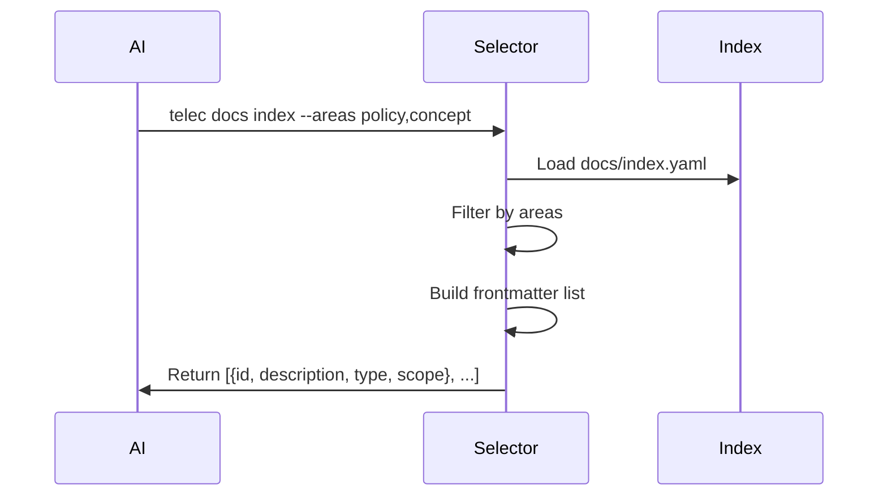
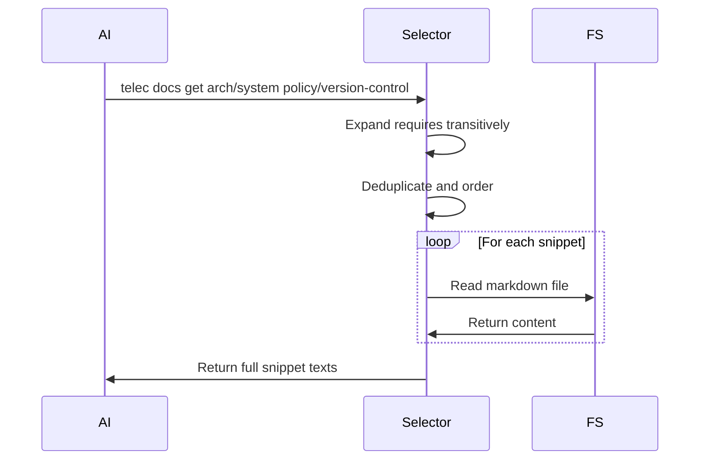

# Context Selection — Design

## Purpose

- Select relevant documentation docs for a given request.

- Selected IDs must exist in the snippet index.
- Requires dependencies are always expanded before output.

- Build snippet metadata from docs and global docs.
- Return a filtered index (frontmatter only) when no IDs are provided.
- Accept selected snippet IDs from the caller and resolve requires dependencies.
<!-- planned-change:docs-tier-layering -->
- Order by scope priority (global -> domain -> project).
<!-- change:docs-tier-layering -->
- Order by scope priority across the four tiers.
<!-- /planned-change:docs-tier-layering -->
- Persist selected IDs per session to avoid repeated context churn.



## Inputs/Outputs

**Inputs:**

- **Phase 1**: Optional `areas` array (taxonomy type filter: principle, concept, policy, procedure, design, spec)
- **Phase 2**: `snippet_ids` array of selected snippets to retrieve
- Caller session ID for context persistence
- Project working directory

**Outputs:**

- **Phase 1**: Index listing (ID, description, type, scope) - frontmatter only
- **Phase 2**: Full snippet content with resolved requires dependencies
<!-- planned-change:docs-tier-layering -->
- Ordered by scope priority: global → domain → project
<!-- change:docs-tier-layering -->
- Ordered by scope priority across the four tiers
<!-- /planned-change:docs-tier-layering -->

## Invariants

- **Two-Phase Protocol**: Always phase 1 (index) first, then phase 2 (content).
- **Requires Expansion**: All transitive dependencies included automatically; caller never manually resolves requires.
<!-- planned-change:docs-tier-layering -->
- **Scope Ordering**: Global snippets before domain before project; stable deterministic order.
<!-- change:docs-tier-layering -->
- **Scope Ordering**: one deterministic order across the four tiers, given by the scope priority table.
<!-- /planned-change:docs-tier-layering -->
- **Duplicate Prevention**: Each snippet ID appears exactly once in output even if required multiple times.

## Primary flows

### 1. Phase 1: Index Retrieval (Discovery)



### 2. Phase 2: Content Retrieval with Requires Resolution



#### Baseline Filtering (Optional)

By default, all snippets including baseline are shown in the phase-1 index.
`telec docs index --baseline-only` filters to baseline snippets only
(those referenced in `baseline.md` manifests). This focused view is useful for
authoring/editing baseline content.

### 3. Requires Expansion Algorithm

```python
def expand_requires(snippet_id, visited=set()):
    if snippet_id in visited:
        return  # Prevent cycles
    visited.add(snippet_id)

    snippet = load_snippet(snippet_id)
    for required_id in snippet.requires:
        expand_requires(required_id, visited)

    yield snippet
```

### 4. Scope Priority Ordering

<!-- planned-change:docs-tier-layering -->
| Scope   | Priority | Rationale                                   |
| ------- | -------- | ------------------------------------------- |
| global  | 1        | Foundational policies apply universally     |
| domain  | 2        | Domain-specific rules constrain projects    |
| project | 3        | Project details reference global foundation |
<!-- change:docs-tier-layering -->
| Scope   | Priority |
| ------- | -------- |
| global  | 1        |
| company | 2        |
| project | 3        |
| person  | 4        |

Within the global tier, `domain` is the secondary key. It is metadata on a global
snippet, not a scope of its own, and the ordering never treats it as one.
<!-- /planned-change:docs-tier-layering -->

<!-- planned:docs-tier-layering -->
### 5. Caller-Scope Resolution

Source assembly is preceded by resolving the caller into a set of reachable
tiers. The stage takes the resolved person from identity and the declared
relationships from configuration, and returns the tiers in reach paired with the
depth each is read at. Nothing downstream re-derives reach: assembly loads the
tiers the stage named, and the include predicate applies the depth it assigned.

The stage is the only place the two inputs meet. The relationship facts stay
owned by their declaring contexts; the reach rule stays here.

Reach and depth are separate answers and are never traded for one another. Reach
decides which tiers are assembled; depth decides how much of an assembled tier is
read. A caller with no declared relationship to a tier may still meet that tier
because the invocation offers it — the project being worked in, and the company
that project declares as its owner — and meets it at public-only depth. A caller
with no resolvable identity gains no tier from a relationship it does not have.

**Layer placement.** The caller arrives already resolved. Identity resolution
belongs to the boundary that owns injection, and the resolved caller reaches the
command surface as a typed parameter alongside the arguments a caller supplied.
The command surface translates those arguments into a request; it resolves
nothing and decides no reach. The resolution stage decides. Catalog loading
executes what it decided.

A surface that reaches outward to fill its own inputs — reading a login file, an
environment, or an identity service to discover who is calling — has taken both
a decision and an ownership that are not its own. A surface that inspects a
relationship to choose what to load has taken the reach decision.

**Selector authorization.** One rule covers every selector that names a tier —
a person, a company, or a project: naming a tier explicitly is reserved to
platform administrators. A caller who is not one reads their derived scope,
narrowed by the filters that name no tier.

Retrieving a snippet by an identity already present in the caller's assembled
catalogs is not naming a tier: it is the second phase of the discovery the caller
was already permitted, and it stays open to everyone. Using an identity to pull
in a tier the caller's derived scope does not contain is the reach the rule
governs, and it meets the rule.

Authorization precedes lookup. A caller who may not name a tier is refused
without the request being resolved, so refusal never reports whether the named
tier exists. Only for a caller who may name tiers does an unknown name return
nothing.

The refusal is a refusal rather than a silent narrowing — a caller who may not
name a tier is told so instead of receiving a smaller answer that looks like the
tier is empty. Naming a tier that does not exist returns nothing, which is not a
refusal and discloses nothing about a tier's existence.

This gate lives here rather than with command clearance. Clearance authorizes a
verb; this authorizes what one argument to that verb may reach.

### 6. Tier-Qualified Identity

A snippet's identity carries its tier as the first segment. For the person and
company tiers the identity also carries which person or which company it belongs
to. More than one tier of the same kind can be present in one assembled
index at the same time — a caller belonging to several companies always
assembles several, and an administrator naming another person's tier assembles
theirs alongside their own. The qualification is what keeps two such tiers from naming the same thing.

A foreign project's identity is formed differently: its tier marker is exchanged
for the project's slug. That form depends on exactly one project tier being the
caller's own and on project slugs being registered in a single manifest. Neither
holds for the company tier: no company is the caller's own, and a bare slug
segment places company identities in the same namespace as project identities,
where a company and a project sharing a name collide. The tier marker stays in
front and the identity behind it.

### 7. Tier Catalog Construction

Every tier whose material participates in the documentation surface has its
catalog built by the same publication pass that builds the project and global
catalogs. Whether a non-project tier participates is read from that tier's own
declaration, never inferred from its location on disk. Participation is answered per tier by the tier-permissions contract, on an axis
independent of whether the tier is an invocation context or carries project
subscriptions.

A tier whose catalog is never built is indistinguishable from a tier holding no
content. Construction is part of what makes a tier a tier, not a step taken
after it exists.
<!-- /planned:docs-tier-layering -->

## Failure modes

- **Snippet Not Found**: Requested ID not in index. Returns error with missing ID list. Client must re-select.
- **File Read Error**: Snippet in index but file missing/unreadable. Skipped with warning. Partial results returned.
- **Invalid ID Format**: Malformed snippet ID. Rejected immediately with error.
- **Index Not Found**: `docs/index.yaml` missing. Returns empty result with error message. Agent cannot proceed.
- **Context Too Large**: Expanded content exceeds AI context window. No automatic truncation. Client must reduce selection.
- **Session Context Loss**: Persisted IDs not found in index after regeneration. Falls back to phase 1 discovery.

<!-- planned:docs-tier-layering -->
- **Unresolvable Caller**: The call carries no identity that resolves to a
  person. No relationship-derived source enters scope at all — no person tier, no
  company, no assigned project — and what remains is what the invocation already
  offers, read at public-only depth. Absent identity never widens a read, and
  public-only is a depth rather than authority to assemble every tier at it.
- **Declared-but-absent tier**: A relationship names a person or company with no
  configuration present. The misconfiguration is surfaced rather than silently
  producing an empty tier, which is indistinguishable from a correctly empty one.
- **Scope read from location**: Deriving reach from the working directory
  produces an authorization answer that changes when someone changes directory,
  which is not an authorization answer at all.
<!-- /planned:docs-tier-layering -->
