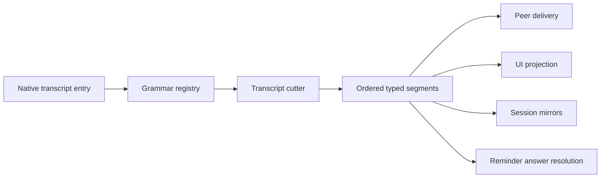

# Conversation Delivery — Design

## Required reads

@docs/project/design/architecture/human-message-envelope.md
@~/.teleclaude/docs/software-development/policy/python/logging.md

## Purpose

Deliver local and peer conversation turns exactly under their real authorship,
preserve UI continuity across interleaving and restart, and keep presentation
text outside the authority path.

The transcript is conversational truth, and the platform's own envelopes make it
self-describing. Every consumer reads authorship from the envelope grammar and
advances on its own cursor; no durable side record mediates that reading.

## Inputs/Outputs

**Inputs:**

- Native transcript entries whose platform-authored content is delimited by
  paired or auto-closed envelopes.
- One grammar registry declaring each opening shape, the kind it denotes, and
  its closure discipline.
- Durable inbound rows carrying full content, source event keys, actor metadata,
  and acceptance time, for delivery, dedupe, and idle-wake decisions.
- Active direct links and directional delivery cursors.
- Structured peer bundles accepted from local or remote transport.
- Per-adapter delivery generations and platform message receipts.

**Outputs:**

- One ordered list of typed segments per native entry, each carrying its span,
  its kind, and its resolved author.
- Ordered assistant output routed to the adapter generation belonging to its
  turn.
- A structured peer bundle with stable bundle and segment identities, immutable
  event authorship, original source session, occurrence time, and body.
- Readable delimiters around every platform-authored block in the agent-facing
  transcript, which are the parser's input and the reader's framing alike.
- Discord messages authored through `<Identity>[ - <raw JobRole>][ (peer)]`
  with the resolved avatar and one stable platform message across streaming
  edits. Thinking mode never appears in the Discord alias.
- Body-free structured delivery events that let agents verify production
  decisions from logs, cursors, segments, and platform receipts.

## Invariants

### Authorship from structure

- **Ingress receipt first.** A queued input and its complete receipt are
  committed before injection. Retried source events reuse the source event key
  and never create a second accepted occurrence.
- **The envelope delimits authorship.** A native entry is an ordered composition
  of platform-authored envelopes and prompt input. Content inside an envelope is
  platform-authored and typed by its opening; content outside every envelope,
  within a user entry, is prompt input. Assistant entries are the agent's own
  output.
- **Only headers are read.** Boundaries and kind come from the opening and its
  declared closing. Envelope bodies are never inspected — not for nested
  openings, not for shape, not for content — and pass through unaltered.
- **Bodies carry no live delimiter.** Envelope bodies are composed by the
  platform and are not edited afterwards, so a body never contains a delimiter
  that could terminate its own envelope. This is a stated premise of the design,
  not a condition the parser defends against.
- **One registry declares the grammar.** Each opening shape, the kind it
  denotes, and whether it is auto-closed or paired with a derived closing are
  declared once. Recognition, construction, and rendering read that declaration;
  no consumer carries its own vocabulary, prefix test, or closing literal.
- **The model outlives its grammar.** Segment kind, span, author, and provenance
  are independent of how an envelope is rendered, so a surface may carry a
  different grammar without forking the classification.
- **Classification always terminates.** Reading an entry yields a complete
  segmentation. There is no state in which authorship is undetermined and a
  consumer waits for it to resolve.
- **Native references survive runtime boundaries.** A reference includes the
  runtime and native-session identity plus the runtime's stable entry, item, or
  step identity. A positional file or entry index is never durable identity.
- **Source kind and UI surface are independent.** A peer or machine turn has no
  human UI origin and never overwrites the viewing session's human-origin
  routing state. Reflection decisions read the entry's segments, not
  `last_input_origin`, preview text, or another session-level summary.

### Output generations

- **Acceptance does not cut output.** Accepting another input never clears an
  output message ID, character offset, cursor, or pending adapter payload.
- **A new real user entry cuts the turn.** The next genuine user entry creates
  the next logical generation. Output carries its turn identity and can update
  only that generation.
- **Adapters acknowledge independently.** Every enabled UI adapter, Discord
  admin/reflection lane, and peer-delivery consumer has its own durable cursor
  and generation receipt. No session-wide consumed bit stands in for them.
- **Late output cannot cross generations.** An older-turn snapshot never edits
  the next turn's message, even when it arrives after a later input was
  accepted.
- **Repeated wakes are idempotent.** Poller passes, agent-stop hooks, startup
  reconciliation, and duplicate transport signals can repeat without
  duplicating or reclassifying a source span.

### Peer transport and authorship

- **The envelope is the structure.** Peer detection, segment boundaries,
  loop-prevention, source identity, and Discord presentation read the envelope's
  opening and the fields it carries. No consumer re-derives them from a body, a
  prefix test over whole-entry text, or a session-level summary.
- **Event identity is immutable.** Each segment snapshots author class, agent
  runtime and historical mode, human reference and display identity, or raw
  `JobRole`, independently of later session configuration.
- **Forwarding preserves origin.** Multi-hop relay keeps the stable segment ID,
  original source session, author, occurrence time, and body. Target-specific
  echo suppression compares structured original source session IDs.
- **Cursor advance follows durable acceptance.** A source cursor advances only
  after the target atomically accepts the bundle and its structured provenance
  under the stable bundle key.
- **A cursor always advances or delivers.** Every directional outcome is
  terminal: an entry is delivered, or it is recorded as skipped with its reason
  and the cursor moves past it. A direction is never held pending a condition
  that may never arrive.

### Discord presentation and observability

- **Alias grammar is contextual.** The owning session renders its author
  without `(peer)`; any author from another session receives `(peer)`. A raw
  `JobRole` is appended as ` - <role>` before the relationship suffix.
- **Every remote author is marked.** Agents, humans, and role-bearing machine
  authors all receive `(peer)` when authored elsewhere.
- **Identity survives edits.** A Discord streaming generation is created and
  edited through the same webhook alias, avatar, thread, and message ID.
- **Webhook intent is durable.** Create intent is persisted before dispatch and
  the returned message ID before any edit. Restart reconciles a unique observed
  message when provable and never blindly resends an unresolved create.
- **Uncertainty cannot wedge the lane.** An irreducibly unresolved webhook
  create becomes a visible omitted generation after bounded reconciliation;
  later generations continue and explicit recovery may replay it.
- **Logs prove our side without leaking content.** Decision and completion
  events use policy-defined levels and structured fields for full session,
  turn, bundle, segment, generation, thread, role, relationship, alias, avatar
  selection, operation, result, and platform message IDs. Bodies, tokens, and
  PII payloads are never logged. Repeating recoverable anomalies are throttled
  or aggregated.

## Primary flows

### Accepted input and projection

1. Normalize the inbound event and atomically persist the complete queue row
   under its source event key.
2. Inject the exact stored payload without clearing any adapter generation.
3. Cut each native entry into ordered typed segments by reading its envelope
   openings and their declared closings, preserving any local prefix and suffix
   as prompt-input segments.
4. Create one new logical turn generation from the entry.
5. Route user reflection and subsequent assistant spans by that segmentation.
   The origin adapter skips its already-visible local human input; eligible
   admin lanes reflect other-source input under its real author, one rendered
   block per segment.
6. Each consumer advances only its own cursor after durable handoff.

### Direct peer delivery

1. Project eligible source entries after the directional cursor.
2. Preserve inherited structured segments and create structured segments for
   local turns, assigning stable identities and immutable event authorship.
3. Suppress only segments whose structured original source equals the target.
4. Persist the pending upper bound and hand off one bundle under its stable
   bundle key.
5. Atomically accept bundle content and provenance at the target, then advance
   the source cursor.
6. Render readable delimiters for the agent. Discord independently renders each
   eligible segment body through its resolved alias and avatar.

### Startup and pane recovery

1. Resume each consumer from its own cursor and generation receipts.
2. Re-read transcript truth for any entry after a cursor; segmentation is
   recomputed, never restored from a side record.
3. When a pane was replaced, read the resumed native transcript chain; runtime
   and native-session qualification keep step identities unambiguous.
4. Reconcile pending peer bounds and Discord webhook intents without guessing
   that an external side effect did or did not occur.

## Failure modes

- A mutable session origin classifies an earlier turn according to whichever
  input arrived last, causing reflection omission or same-surface echo.
- Clearing adapter state at acceptance loses the edit target for output still
  in flight and reposts cumulative content as a new message.
- Timestamp comparison misclassifies a late snapshot from an older turn.
- A second classifier beside the registry — a prefix test, a private regex, a
  per-consumer vocabulary — diverges from it and reclassifies content the
  registry already typed.
- Treating an envelope as a verdict on its whole entry collapses a composed
  entry to one kind and one author, losing the ordering a reader depends on.
- Inspecting an envelope body reintroduces content authority: a quoted
  delimiter or header then changes how the surrounding entry is read.
- A classification outcome that is neither delivered nor skipped freezes its
  direction permanently, and the silence is indistinguishable from an idle link.
- Looking up mutable session identity at render time rewrites historical author
  mode or fails when the source row is remote or gone.
- Blind webhook resend after a lost response duplicates a message that Discord
  already accepted; waiting forever wedges all later generations.
- Interpolated or body-bearing logs hide decision fields, leak conversation
  content, and make production behavior unverifiable.

## See Also

- docs/project/spec/session-projection.md
- docs/project/spec/session-output-routing.md
- docs/project/spec/feature/agent_runtime/direct-conversation-links.md
- docs/project/spec/feature/agent_runtime/session-input-delivery.md
- docs/project/spec/feature/agent_runtime/output-polling-and-delivery.md
- docs/project/spec/feature/agent_runtime/session-revival.md
