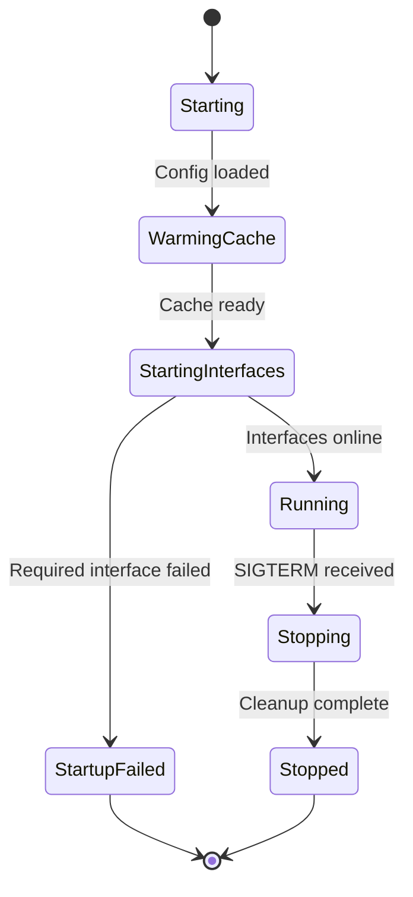
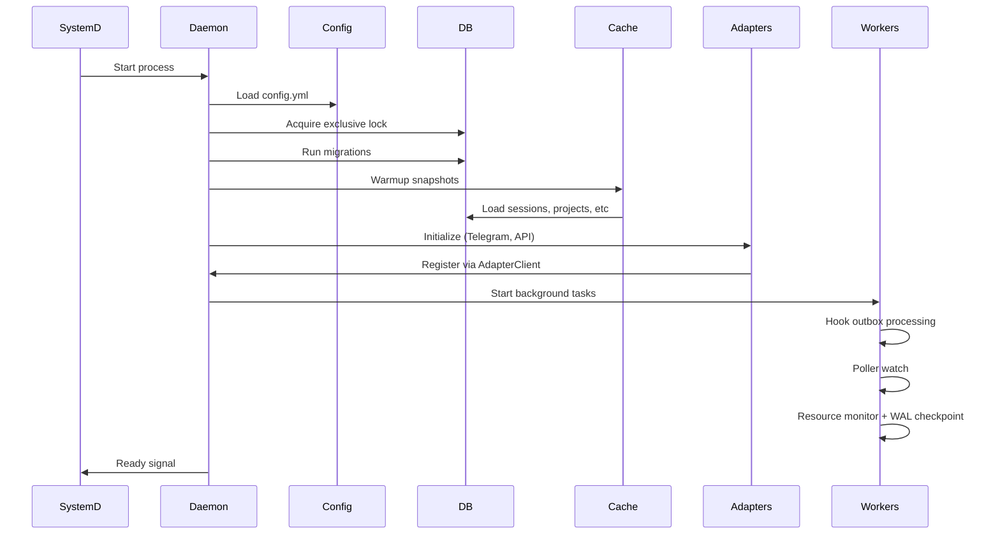
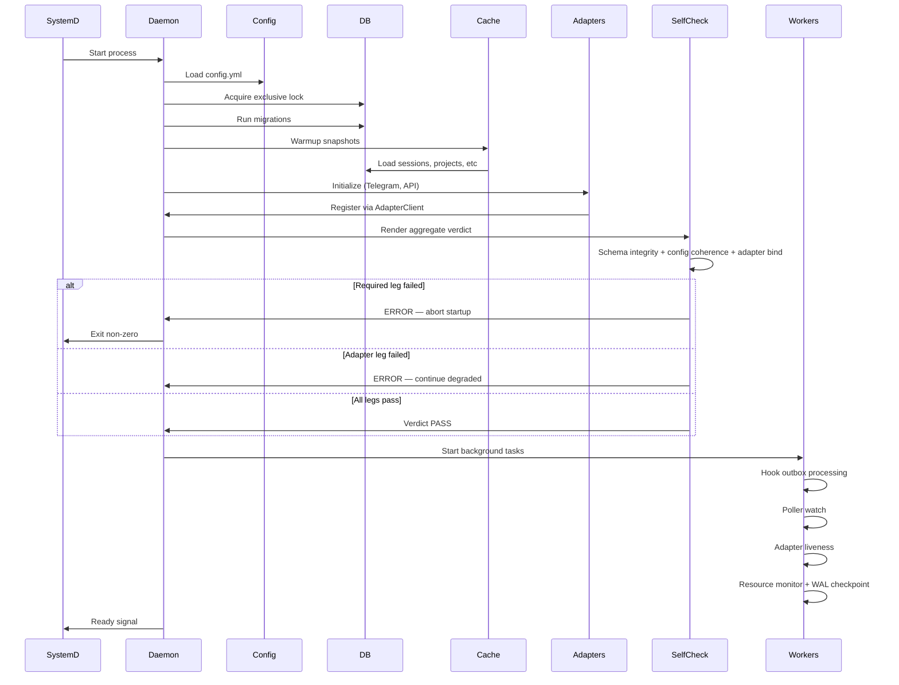
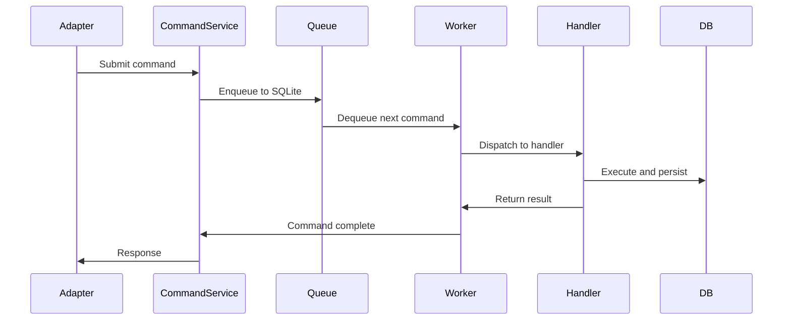
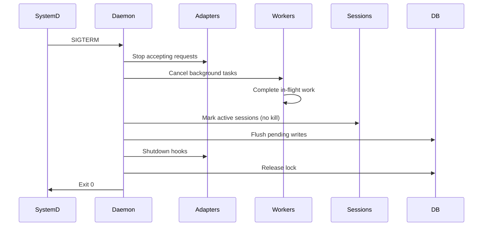

# Daemon — Design

## Required reads

- @docs/project/design/architecture/system-overview.md

## Purpose

- Coordinate adapters, command handling, tmux execution, and background tasks.
- Adapter interactions flow through `AdapterClient`.
- State is persisted in SQLite and surfaced via the cache.



## Inputs/Outputs

**Inputs:**

- Configuration file (`config.yml`, `teleclaude.yml`)
- Adapter events and inbound command objects
- SIGTERM/SIGINT for graceful shutdown
- Redis transport messages (if enabled)
- Adapter-specific inputs (Telegram bot API, API HTTP requests)
- Filesystem artifacts (session transcripts, project registries)

**Outputs:**

- Adapter initialization and registration
- Command execution via CommandService
- Tmux session orchestration
- Cache population and updates
- Background task execution (hook processing, poller-watch, monitoring, WAL maintenance)
- Graceful shutdown signals to all subsystems

## Invariants

- **Single Instance**: Only one daemon process runs per repository root (enforced by SQLite exclusive lock).
- **Cache Before Adapters**: Cache must be fully warmed before adapters start serving requests.

<!-- planned-change:daemon-selfcheck-and-adapter-liveness -->

- **Fail-Fast Startup**: Required interface startup failures abort daemon startup instead of degrading silently.

<!-- change:daemon-selfcheck-and-adapter-liveness -->

- **Fail-Fast Startup**: A _required_ interface is one no client can be served without — storage, the single-instance lock, the Redis transport, and the request surface. A required-interface startup failure aborts daemon startup instead of degrading silently. UI adapters are explicitly **not** required: headless operation is a supported mode, so an enabled adapter that fails to bind leaves the daemon running and is reported through the boot self-check verdict rather than aborting.

<!-- /planned-change:daemon-selfcheck-and-adapter-liveness -->

- **Outbox Recovery**: On restart, daemon processes undelivered hooks and pending commands from outbox tables.
- **Clean Shutdown**: SIGTERM triggers graceful adapter shutdown, command completion, and resource cleanup.

<!-- planned:daemon-selfcheck-and-adapter-liveness -->

- **Boot Self-Check Verdict**: Every boot renders exactly one aggregate self-check verdict covering schema integrity, config coherence, and per-adapter bind outcome — on a healthy boot as well as a failing one — under a stable marker a reader locates without scanning the whole startup log. A failing leg is reported at ERROR. The absence of a verdict line is itself a detectable fault.
- **Headless Is A Pass**: A daemon with no UI adapter enabled renders a passing adapter leg. "No adapters started" is normal operation; only "enabled and fully configured but not registered" is a failure.
- **The Self-Check Never Breaks The Daemon**: A fault raised _inside_ the self-check or the liveness worker is caught, logged, and leaves a daemon running that would otherwise run. This is distinct from a check that _reports_ a failing required leg, which aborts under the Fail-Fast rule above — a checker fault is not a check failure.

<!-- /planned:daemon-selfcheck-and-adapter-liveness -->

## Primary flows

### 1. Daemon Startup

<!-- planned-change:daemon-selfcheck-and-adapter-liveness -->



<!-- change:daemon-selfcheck-and-adapter-liveness -->



<!-- /planned-change:daemon-selfcheck-and-adapter-liveness -->

### 2. Command Execution Cycle



### 3. Background Workers

<!-- planned-change:daemon-selfcheck-and-adapter-liveness -->

| Worker                | Interval (default) | Purpose                                                                                                            |
| --------------------- | ------------------ | ------------------------------------------------------------------------------------------------------------------ |
| Hook Outbox           | 1s                 | Process agent lifecycle hooks                                                                                      |
| Poller Watch          | 5s                 | Keep per-session output pollers aligned with tmux                                                                  |
| Resource Monitor      | 60s                | Emit runtime resource snapshots                                                                                    |
| WAL Checkpoint        | 300s               | Prevent unbounded SQLite WAL growth                                                                                |
| Launchd Watch         | 300s (optional)    | Log launchd state transitions on macOS                                                                             |
| Runtime Maintenance   | 1h                 | Prune stale sessions, scratch dirs, caches, operational rows, event runtime rows, and compact runtime SQLite files |
| Closed Session Replay | 1h                 | Re-emit `session_closed` for recently closed sessions (12h window)                                                 |

<!-- change:daemon-selfcheck-and-adapter-liveness -->

| Worker                                | Interval (default)  | Purpose                                                                                                                |
| ------------------------------------- | ------------------- | ---------------------------------------------------------------------------------------------------------------------- |
| Hook Outbox                           | 1s                  | Process agent lifecycle hooks                                                                                          |
| Poller Watch                          | 5s                  | Keep per-session output pollers aligned with tmux                                                                      |
| Adapter Liveness                      | 60s                 | Re-evaluate the boot self-check's adapter leg against live routing outcomes and report an adapter that stopped routing |
| Resource Monitor                      | 60s                 | Emit runtime resource snapshots                                                                                        |
| WAL Checkpoint                        | 300s                | Prevent unbounded SQLite WAL growth                                                                                    |
| Launchd Watch                         | 300s (optional)     | Log launchd state transitions on macOS                                                                                 |
| Process Janitor                       | configured          | Reap leaked processes against the signature + TTL policy                                                               |
| Config Watch                          | filesystem-driven   | Watch `config.yml`, `experiments.yml`, and `.env`; hot-reload live sections and restart on connection-bound changes    |
| Mirror Worker                         | event-driven        | Mirror session transcripts for historical search                                                                       |
| Workflow / Identity / Cluster Bridges | subscription-driven | Translate v2 envelopes into v1 cache invalidation                                                                      |
| Runtime Maintenance                   | 1h                  | Prune stale sessions, scratch dirs, caches, operational rows, event runtime rows, and compact runtime SQLite files     |
| Closed Session Replay                 | 1h                  | Re-emit `session_closed` for recently closed sessions (12h window)                                                     |

<!-- /planned-change:daemon-selfcheck-and-adapter-liveness -->

An operator can force the same behavior on demand with:

```bash
uv run scripts/cleanup_closed_session_channels.py [--hours 12] [--dry-run]
```

The helper queries local closed sessions within the window and replays their
`session_closed` handling through the running daemon API.

### 4. Graceful Shutdown



## Failure modes

- **Config Parse Error**: Daemon exits immediately with error. Systemd restarts with exponential backoff.
- **SQLite Lock Failure**: Another daemon instance is running. Refuses to start. Indicates configuration or deployment issue.

<!-- planned-change:daemon-selfcheck-and-adapter-liveness -->

- **Migration Failure**: Database schema incompatible. Manual intervention required. No automatic rollback.
- **Interface Startup Failure (API/Adapter)**: Daemon fails startup (fail-fast) rather than running in partial mode.

<!-- change:daemon-selfcheck-and-adapter-liveness -->

- **Migration Failure**: Database schema incompatible. Manual intervention required. No automatic rollback.
- **Partial Migration**: A migration the runner cannot load, or one lacking its expected entry point, is skipped rather than applied. The schema-integrity leg of the boot self-check fails, and the daemon aborts startup — booting on a partially-migrated schema risks every subsequent write, so this is a required leg under the Fail-Fast rule.
- **Required Interface Startup Failure (storage / lock / Redis / request surface)**: Daemon fails startup (fail-fast) rather than running in partial mode.
- **UI Adapter Bind Failure**: An enabled, fully configured adapter that raises during start is left unregistered and the daemon keeps running. The adapter leg of the boot self-check fails at ERROR, naming the adapter and the reason, and an actionable event carries the condition to the owner. The daemon is not aborted: aborting would convert a third-party outage into a total daemon outage and thrash the supervisor's restart loop, while headless operation demonstrates the daemon serves every other surface without that adapter.
- **Adapter Stopped Routing**: A registered adapter whose deliveries fail repeatedly at the delivery lane is reported to the owner through the notification pipeline. Detection only — the daemon does not restart, re-bind, or fail over the adapter.

<!-- /planned-change:daemon-selfcheck-and-adapter-liveness -->

- **Redis Unavailable at Startup**: Daemon fails startup (fail-fast). Redis is required by the event platform; downstream code (operations, integration, signals) emits events unconditionally and cannot tolerate a missing producer. systemd/launchd restarts with backoff until Redis returns. Adapter startup and event-producer registration complete before the API socket opens, so no `/todos/*` operation can land before the producer is registered. The event consumer — the Redis-stream event processor and the scheduler minute clock — starts only after the API socket is bound, so in-daemon pipeline stages that reach the daemon's own API over that socket never run before the socket exists.

- **Cache Warmup Timeout**: Daemon fails to start. Indicates database corruption or resource exhaustion.
- **Unclean Shutdown (SIGKILL)**: Hooks and commands may be partially processed. Next startup recovers from outbox.
- **Worker Task Crash**: Background worker stops. Dependent features stall (for example, no output polling means frozen sessions). Daemon logs error but continues.
- **Shutdown Timeout**: Cleanup takes too long; systemd may SIGKILL and leak resources.
