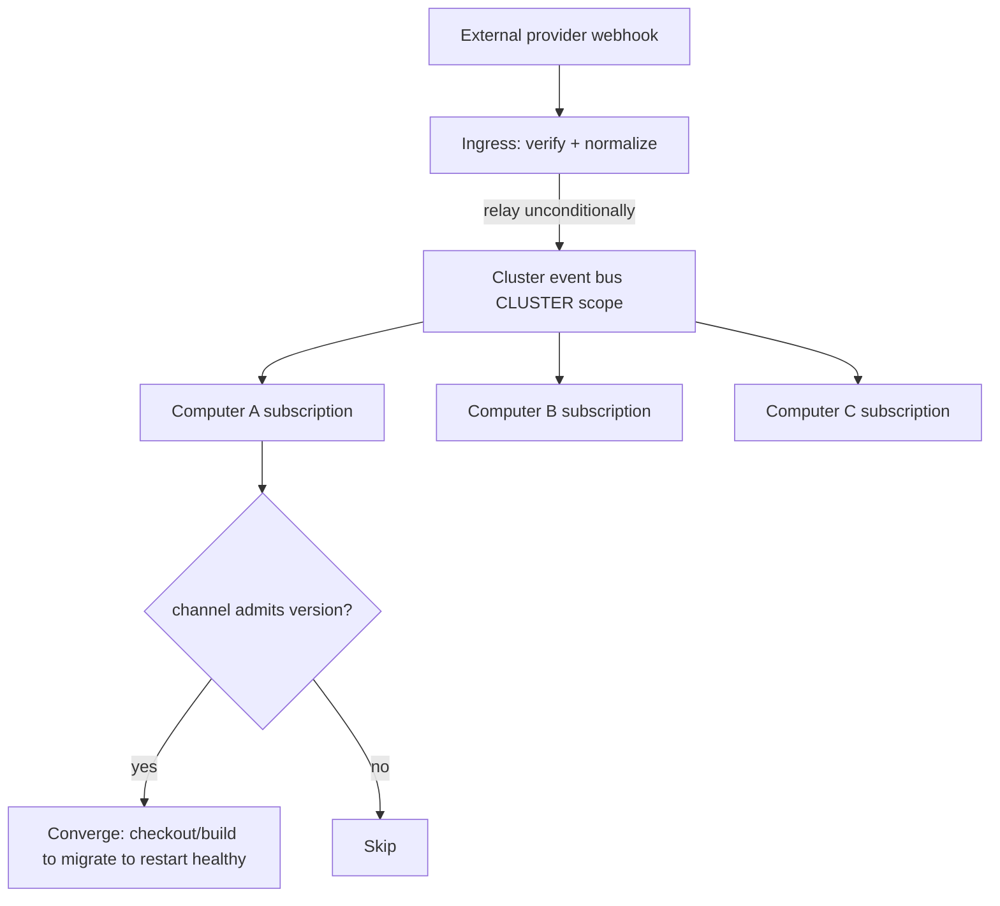

# Deployment Pipeline — Design

## Purpose

TeleClaude keeps a multi-machine fleet current automatically. The pipeline has
two responsibilities, owned by two bounded contexts on different change axes:

- **Ingress (`integration`)** — terminate external webhooks for the whole
  cluster at one public node, verify and normalize each payload, and relay it
  onto the cluster event bus unconditionally.
- **Convergence (`reconciliation`)** — each computer subscribes to the relayed
  release/version signal and drives its own actual state toward its desired
  state: the newest version its channel admits, applied exactly once, ending
  healthy.

The ingress decides nothing about the reaction; the reaction is
subscriber-driven. This separation is the recorded decision in ADR-0028
(single-ingress termination) and ADR-0024 (reconciliation as its own bounded
context); ADR-0055 supersedes ADR-0028's bind topology with proxy-fronted reuse
of the localhost API server.

### Ingress — `teleclaude/hooks/inbound.py`

`InboundEndpointRegistry` mounts dynamic inbound webhook routes on the existing
localhost API server's FastAPI app. For each registered provider path it
verifies the payload signature (HMAC-SHA256, constant-time), normalizes the body
into the unified `HookEvent` shape via a registered normalizer, and relays the
event onto the cluster event bus (CLUSTER visibility). The ingress endpoint is
localhost-only and never bound to a LAN or promiscuous address; a mandatory
same-host reverse proxy is the public surface — it terminates TLS, restricts
source, and forwards only the webhook path prefix to the localhost endpoint.
Webhook routes authenticate by HMAC signature alone and inherit no loopback
identity-trust. It is provider-agnostic: one ingress terminates webhooks for
every provider and project. See
`docs/project/spec/feature/integration/single-ingress-webhook-termination.md`.

### Cluster relay

The verified, normalized event is published onto the event bus at CLUSTER
scope. Every computer consumes it through its own subscription; only the
ingress is publicly exposed. The relay is stateless, so a second ingress can be
added without redesign.

The relay is a new cross-node capability gated behind an ignorable feature-ID
(ADR-0027): a node that does not carry it drops `cluster.webhook.*` cleanly and
keeps converging through the legacy `version_available` fan-out. That fan-out is
the expand-phase bridge and is retired only once the reconciliation capability
map shows the slowest channel carries the feature. The ingress publishes the
normalized event onto `cluster.webhook.<provider>` and also dispatches it
locally; the bus drops the ingress's own echo at dispatch (ADR-0013 self-origin),
so each node — including the ingress — reacts exactly once.

### Convergence — `reconciliation`

Each computer evaluates a relayed release/version signal against its own channel
policy and, on a match, starts a convergence run: checkout/build the target,
run installation migrations, restart healthy. A target version is applied at
most once (exactly-once); a convergence is not complete until the daemon is
running and healthy on the target, and a failed step halts the run with a
recorded reason rather than coming up partially. Channel policy and the
exactly-once / healthy-or-failed contract are owned by
`docs/project/spec/feature/reconciliation/channel-gated-self-update.md`; the
context model (Installation, Convergence Run, Fleet Capability Map) is in
`docs/project/spec/domain/reconciliation.md`.

A deliberately multi-version fleet (alpha ahead of beta ahead of stable) stays
interoperable through the fleet capability map and feature-ID gating in
`teleclaude/core/reconciliation/` — unaware nodes drop ignorable capabilities
cleanly, and removal of a shared capability waits until every live node carries
it. See
`docs/project/spec/feature/reconciliation/fleet-cross-version-interop.md`.

### Current implementation surface

The ingress (`teleclaude/hooks/inbound.py`) and the fleet capability map /
feature-ID registry (`teleclaude/core/reconciliation/`) are in place. The
convergence reaction currently runs through the deployment executor in
`teleclaude/deployment/` (channel evaluation in `handler.py`, the
checkout/migrate/install/restart steps in `executor.py`); the standalone
`reconciliation` control loop is the target owner of that reaction. Channel
configuration lives in `project.deployment.channel` in `config.yml`:

```yaml
project:
  deployment:
    channel: alpha # alpha | beta | stable
    pinned_minor: '1.2' # required when channel=stable
```

## Inputs/Outputs

**Inputs:**

- External provider webhooks (GitHub push to `main`, GitHub release published,
  other provider events) arriving at the single ingress.
- `config.yml` with `project.deployment.channel` and optional `pinned_minor`.
- The relayed cluster-scoped release/version event consumed by each computer.

**Outputs:**

- A verified, normalized event relayed onto the cluster event bus.
- On each subscribing computer whose channel admits the version: a convergence
  run (checkout/build → migrate → restart) ending healthy on the target, or a
  halted run with a recorded failure reason.

## Invariants

- **Single public surface.** Exactly one computer (the ingress) accepts
  external webhooks; every other computer reacts by subscription.
- **Unconditional relay.** The ingress relays every verified event regardless
  of its own channel, role, or whether it would itself act.
- **Channel-gated convergence.** A computer converges only when the signal
  matches its channel policy; `stable` ignores releases outside its
  `pinned_minor`.
- **Exactly-once per target version.** Re-receiving the same version signal is
  a no-op; the convergence loop is idempotent.
- **Healthy-or-failed.** A convergence is complete only when the daemon is
  running and healthy on the target; a failed step halts with a recorded
  reason, never a silent partial state.

## Primary flows



## Failure modes

- **Ingress down.** No external events are processed while it is down; the
  cluster is not otherwise broken. Recovery is the next release signal, a
  periodic desired-state self-check, or a second stateless ingress.
- **Unverified payload.** Signature verification fails at the ingress; nothing
  is relayed and the sender receives a rejection response.
- **Cluster pub/sub is fire-and-forget.** A computer offline when a signal
  publishes misses it; recovery is the next signal or a periodic self-check,
  not event replay.
- **Convergence step failure.** The run halts and records the failure reason;
  the computer does not come up in a partial or unhealthy state. Config-load
  failure is logged and the update skipped (non-fatal).
- **Idempotent migrations.** Installation migrations are tracked; re-running
  skips already-applied steps.

## See Also

- docs/project/procedure/deploy.md — operator procedure
- docs/project/spec/feature/integration/single-ingress-webhook-termination.md
- docs/project/spec/feature/reconciliation/channel-gated-self-update.md
- docs/project/spec/feature/reconciliation/fleet-cross-version-interop.md
- docs/project/spec/domain/reconciliation.md
- docs/project/adr/0028-single-lan-bound-ingress.md
- docs/project/adr/0055-proxy-fronted-ingress-reuse.md
- docs/project/adr/0024-reconciliation-bounded-context.md
- docs/project/spec/teleclaude-config.md — config schema for deployment
