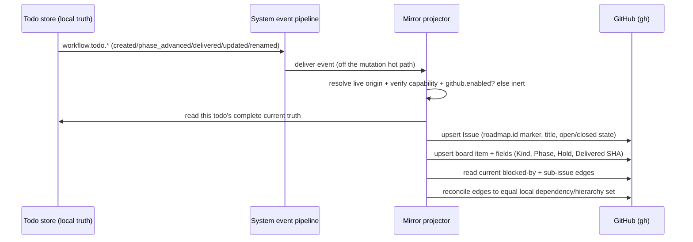

# GitHub Todo Mirror — Design

## Purpose

The mirror reflects a project's todo/roadmap state into that project's own GitHub
repository — as Issues plus a Projects v2 board — so roadmap state is replicated,
externally inspectable, and diffable outside the local SQLite store. It is a
read-only projection: the local todo store remains the single source of truth, and
nothing flows back from GitHub into local state. The projection is derived entirely
from local truth and is convergent — it keeps GitHub matching local as todos change,
and the same projection re-asserted on demand repairs any divergence.

## Inputs/Outputs

Inputs:

- `workflow.todo.*` domain events (`created`, `phase_advanced`, `delivered`,
  `updated`, `renamed`) delivered through the daemon's system event pipeline. The
  `renamed` event carries the slug change; the projector resolves the affected todo
  by its new slug and updates the existing Issue, identified by `roadmap.id`.
- Local todo truth read at projection time from the todo store (status, kind,
  lifecycle phase, hold, delivered commit, dependency edges, group/children).
- The project's GitHub origin, resolved live from `git remote get-url origin`.
- The `github` configuration section: the verified enablement flag and a rebuildable
  cache of GitHub-generated identifiers (board node id, field option ids, an
  id→issue map).
- The machine's existing `gh` authentication (scopes `repo` + `project`).

Outputs (on GitHub, for an enabled project):

- An Issue per todo, carrying the todo's immutable `roadmap.id` as a hidden marker,
  with open/closed state mapped from todo status (active/icebox → open; delivered →
  closed-completed; removed → closed-not-planned).
- A Projects v2 board item per issue with custom fields: Kind, Phase, Hold,
  Delivered SHA.
- Native blocked-by dependency edges reconciled to equal the todo's dependency set.
- Native sub-issue parent relationships from the container/child hierarchy.

No new authoritative local state is introduced; the only local addition is the
rebuildable id cache.

## Invariants

- **Mirror, never authority.** Local is the sole source of truth. The projection is
  outbound-only; there is no inbound GitHub→local sync.
- **Never touch foreign state.** The mirror only ever creates or updates Issues
  bearing its own `roadmap.id` marker, and writes only to its own marker-stamped
  board. It never reads-modifies, relabels, adopts, or merges any Issue or board it
  did not create — so no GitHub state belonging to anything else can be mutated.
- **Convergent and idempotent.** Each projection asserts a todo's complete desired
  GitHub state from current local truth; applying it twice is a no-op. Graph
  relations (dependencies, sub-issues) are read-then-reconciled to the local set;
  an "already exists" rejection on an edge is treated as already-converged.
- **Off the hot path, failures isolated.** The projection runs in the event pipeline,
  never inside a todo mutation. A GitHub outage, rate-limit, or revoked token never
  fails, blocks, or slows a `telec todo` mutation. The mirror processor catches every
  projection error internally and returns normally to the pipeline — it never raises —
  so the pipeline's retry and dead-letter machinery never fires on a GitHub failure and
  GitHub health is never coupled back into event processing. Reconciliation is the only
  re-attempt path. The mirror is eventually consistent by design.
- **Live eligibility, resolved per event.** Before any GitHub mutation the projector
  re-resolves the repository from `git remote get-url origin` at event time — git
  config is authoritative and the repo identity is never copied into config — and
  confirms the origin is a GitHub repo whose token currently holds read/write
  capability. The stored `github.enabled` flag records intent; it never authorizes a
  write on its own. A repo that is re-pointed, made non-GitHub, or whose token lost
  capability becomes inert with no mutation.
- **Clean-slate enablement, with conscious override.** Automatic enablement happens
  only when the repository had no pre-existing Issues and no pre-existing Projects v2
  board; on any pre-existing GitHub state automatic enablement is refused and the
  mirror stays inert. An operator may still enable a non-clean repository they own
  through an explicit conscious-acceptance action that records the decision to coexist
  with the existing state. This override never fires automatically and never applies to
  a repo the operator has not explicitly opted into; even when enabled this way the
  never-touch-foreign invariant still holds.
- **Self-describing identity.** The `roadmap.id` (a UUID) is stamped into each issue
  body as a hidden HTML-comment marker, invisible when rendered. The entire
  local→GitHub mapping is reconstructible by scanning issue markers; the local id
  cache is a lookup accelerator only, never authoritative, and is rebuildable from
  the markers.
- **Slug rename preserves linkage.** The projector keys on the immutable
  `roadmap.id`, never on the slug. A todo's active slug may change; the projection
  resolves the todo by its new slug and updates the existing Issue in place, never
  creating a duplicate.

## Primary flows

### 1. Per-todo projection (event-driven)

The mirror projector is a processor in the daemon's system event pipeline — a
sibling of the lifecycle router — that reacts to `workflow.todo.*` events. It reads
the affected todo's complete current truth from the local store and asserts the
corresponding GitHub state; it never derives state from the event payload alone, so
out-of-order or duplicate delivery converges to the same result.

### 2. Reconciliation (on-demand, optionally scheduled)

A `telec` command runs the same projection over every todo in a project —
simultaneously the integrity audit and the self-heal. The command contract:

- **Verb:** `telec projects mirror-reconcile [--project <path>]` — conforms to the
  existing `telec projects` namespace and the CLI scaffold; resolves the project from
  the working directory when `--project` is omitted.
- **Behavior:** idempotent — runs the projection over every todo in the project;
  re-asserting an already-converged project changes nothing on GitHub.
- **Output:** reports how many todos were already converged versus repaired, turning
  silent divergence into a visible result.
- **Gating:** inert unless `github.enabled`; the same clean-slate and
  never-touch-foreign invariants as event-driven projection apply.

It is the backstop for any per-event projection that was dropped (see Failure modes)
and is optionally schedulable.

### 3. Enablement preflight (folded into `projects init` / `onboard`)

Idempotent. Resolves the GitHub origin, probes read+write capability and the required
`gh` scopes, and inventories existing GitHub state. On a clean slate it provisions the
board and its single-select field option sets and records the verified enablement
flag; on any pre-existing Issues or board it records the discovery and leaves the
mirror inert. Non-interactive — clean repos enable, others stay off.

The preflight is the same idempotent check for a brand-new project and an
already-set-up one: it runs for any eligible project that has no `github` section yet,
not only at first `init`/`onboard`, so existing projects pick up the mirror once the
capability is present without being re-onboarded. A non-clean repository the operator
owns is enabled through the explicit conscious-acceptance action (per the
clean-slate-with-override invariant), which provisions the board and sets
`github.enabled` while accepting that the repository's existing Issues coexist.

### 4. Tooling prerequisite check (`make install`)

`make install` verifies the machine's `gh` authentication carries the scopes the
mirror needs — `repo` and `project` — and, for any missing scope, prints the exact
remediation (`gh auth refresh -s <missing>`) instead of failing silently. This is a
machine-level capability gate (once per machine), distinct from the per-project
enablement preflight above; the mirror reuses the existing `gh` login and adds no new
credential surface.

## Failure modes

- **GitHub outage or rate-limit.** The per-event projection fails; the mirror catches
  it internally and returns normally (it never raises), so the pipeline's retry/DLQ
  machinery never fires and no local mutation is affected. Reconciliation re-converges
  the project on its next run.
- **Token scope lost after enablement.** Projection fails and surfaces through the
  mirror's health/status; it never becomes a hot-path failure and never silently
  corrupts GitHub state.
- **Partial projection** (some fields written, then a failure mid-todo). The next
  projection re-asserts the complete desired state; idempotency and edge
  set-reconciliation make the re-run safe.
- **Foreign state appears after enablement.** The never-touch-foreign invariant
  holds: only marker-bearing issues and the marker-stamped board are ever written,
  so unrelated Issues are never mutated.
- **Origin re-pointed or capability lost.** The event-time live-eligibility check
  fails, the projector is inert for that event, and nothing is written — a repo the
  project no longer owns (or can no longer write) is never mutated, regardless of the
  stored `github.enabled` flag.
- **Stale or lost id cache.** Rebuilt by scanning issue markers; the cache is never
  the source of truth.

## See Also

- docs/project/adr/0054-v1-is-the-system.md
