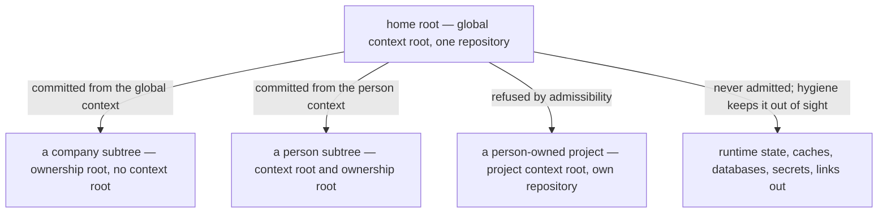

# Home Repository — Design

## Required reads

- @docs/project/spec/feature/reconciliation/home-repository.md
- @docs/project/spec/feature/config/tier-permissions.md
- @docs/project/spec/feature/config/tier-declaration.md
- @docs/project/spec/domain/reconciliation.md

## Purpose

The TeleClaude home is one local-only repository holding the durable state of
every person and company an installation serves. This design states the shape
that takes: what reaches its history, how a commit taken in one part of it
avoids carrying another part's work, how commits happen at all where no project
exists, and what a person's own project is when it sits inside the tree.

It owns the relationship among the participating contexts and nothing else.
Retained-content eligibility resolves to `reconciliation`, which owns the
decision and its source of truth; permission answers and the schemas carrying
every declaration resolve to `config`; the person-to-registry binding to
`identity`; the commit surface to `agent_runtime`. The context-root walk and the
project shared-state resolver are consumed from `config` and `workflow`.

## Inputs/Outputs

- **Inputs:** the home directory and its contents; the tier registries that
  define where the home's own configuration, persons, and companies live, and
  the project manifest for registered project roots; the declared tier at a
  context root; the repository's tracked set, dirty paths, and live-session
  dirty-path ownership.
- **Outputs:** a repository whose tracked set contains only admitted material; a
  commit scoped to one ownership root; a permission answer per declared tier; a
  validated person-to-registry binding or a refusal; a breach report over
  already-tracked content.

## Invariants

### Two roots, and neither is the other

Two different questions each yield a root, and conflating them is the failure
this section exists to prevent.

- **The context root** answers _whose authority governs this invocation_ — the
  nearest ancestor carrying an anchoring tier declaration. Global, project, and
  person declarations anchor one; a company declaration does not, and resolution
  terminates at it with no context root.
- **The ownership root** answers _whose material is this path_ — the home's own
  files, one person's subtree, one company's subtree, or a nested project. It is
  registry-backed: the tier registries already name where persons and companies
  live, and membership follows from that naming rather than from anything a
  caller declares.

Every company has an ownership root and no context root, which is exactly the
approved tier contract and is why the two coordinates cannot be collapsed.
Company material is therefore committed from the home's own global context,
which is the only anchoring context above the companies directory, and no
invocation authority is granted at a company folder to make that work.

### Isolation is containment over the ownership coordinate

A commit carries only paths inside the ownership root the invocation is
operating on. Containment is decided from the filesystem and the registries, so
it holds regardless of how the acting session's own path set was derived.

The existing scope resolution intersects a transcript-derived path set with the
dirty set, and that path set is not a statement of what a session modified: for
one agent runtime it is the key set of a vendor-owned file-history structure
whose membership rule this platform neither owns nor narrows, and its
shell-derived component classifies command text by pattern. A session that only
reads a file another session is editing is therefore recorded as having touched
it. Isolation resting on that set rests on a structure this platform does not
control; containment does not.

Containment separates different ownership roots. It cannot separate two sessions
editing one path inside one root, which requires knowing which live session
claims a dirty path. That is dirty-path ownership attribution, owned by the
commit surface.

**The consumed ownership contract is taken whole.** The query answers per path
with the earliest still-uncommitted live claimant or none, and it separately
reports how many live sessions could not be attributed at all. A null claimant
means _no live claimant_ only when that undetermined count is zero. With
attribution incomplete, the commit boundary fails closed or re-queries; it never
reads an unresolved batch as a clean one, because a session whose attribution
could not be resolved is precisely the session whose work would be combined
silently.

### Non-project commits compose their own gates

The person and global tiers carry commit permission on the invocation axis and
acquire no project subscriptions and no project lifecycle behavior. That
distinction is load-bearing at the commit boundary, because the sanctioned
commit path today is gated on project capability and delegates every
non-deletion commit to project-native build targets at the repository root. A
home repository has no such targets, so a commit there would fail on machinery
that does not apply to it.

So the commit surface resolves its gate composition from the invocation's
declared tier rather than assuming a project:

| Tier           | Commit permitted by                      | Commit-time gates                                                                      |
| -------------- | ---------------------------------------- | -------------------------------------------------------------------------------------- |
| Project        | Its project subscriptions, unchanged     | The project's own native build targets, unchanged                                      |
| Person, global | Commit permission on the invocation axis | The platform's own configuration and documentation validation over the committed paths |

The home holds configuration and documentation rather than code, so the second
row is not a weaker gate — it is the applicable one, and it is machinery the
platform already owns. Nothing here grants a project subscription to a
non-project tier, and no project changes behavior.

### Admission decides membership; a per-version decision decides each write

Nothing enters the home's history except by an act that names a path, and
nothing reaches history in a given version without a decision about that
version's content. Path membership alone is not a secret-safety control: an
admitted file that is safe today can hold a credential tomorrow and would
otherwise ride the ordinary commit path unexamined.

**Membership** is answered by two questions that must not be collapsed, because
collapsing them makes admission circular — a new path could never be admitted,
being by definition absent from the record:

- **Admissible?** A structural and security test on a path, independent of the
  record: it resolves inside the home, no component escapes it, no symlink in it
  points outward, and it lies under no root carrying its own repository. A
  brand-new path is answerable here.
- **Admitted?** Membership in the admitted-path record.

Admission is the atomic transition between them: an explicitly named path is
tested, recorded on success, and only then does the commit boundary consume the
updated membership answer. A failed test records nothing.

**Per-version safety** is a separate published decision over the content being
committed, consumed at the commit boundary alongside membership. A path may be
admitted and its current version still refused. The mechanism is an adopted
secret-detection control rather than a bespoke one — the established practice for
keeping credentials out of a repository is content scanning at the commit
boundary, and the surveyed home-directory managers pair explicit admission with
encryption or external secret storage precisely because admission alone does not
answer per-version questions. The same decision feeds the breach flow, which
tests already-tracked content rather than only path membership.

Two acts admit, and there are no others:

- **First activation admits what is already there, path by path, by explicit
  selection.** Convergence enumerates every candidate under the tier roots the
  registries name and reports each one's admissibility, admitting nothing on its
  own: the operator names the exact paths, and only those are tested and
  recorded. No classifier decides which existing files are safe, because none
  could be trusted with the consequence. A credential file under a tier root
  stays out because nobody named it, not because a rule anticipated it.
- **Afterwards, the ordinary commit act admits.** The commit surface already
  requires an explicit declaration for a new untracked file, and that
  declaration is the named path the admission transition tests.

Exclusion rules remain, demoted to hygiene generated from the tier registries:
they keep untracked runtime state, caches, databases, and links out of status
output and out of a careless broad add. They are not a boundary. The published
specification for them states that files already tracked are unaffected and that
a file cannot be re-included once its parent directory is excluded — so they
reach nothing already recorded, and re-including a directory to retain its
authored content readmits everything beneath it.

### Location grants nothing, and ownership is a declaration

A tier's permissions follow from its declaration, and the three axes —
invocation context, surface participation, project subscriptions — are answered
independently. A project inside a person's space is an ordinary project on every
axis.

Whom a project belongs to is one optional declaration that names exactly one
owner when present. A project under no owner stays valid, as it is today:

| Current shape      | Migrated shape                                          | Resulting invariant                                          |
| ------------------ | ------------------------------------------------------- | ------------------------------------------------------------ |
| A declared company | An owner declaration of kind company carrying that slug | Behavior unchanged for every existing company-owned project  |
| No company         | No owner declaration                                    | Ownerless projects stay representable and compose no company |
| —                  | An owner declaration of kind person                     | The person-owned case                                        |

Absent means ownerless; present means exactly one owner of one kind, so two
owners are unrepresentable rather than forbidden. The superseded field is removed
rather than kept beside the new one, and its consumers — the context selector's
company resolution, the app-config company composition with its unresolved-company
warning, and the hook receiver's company lookup — read the migrated shape.

A person-owned project's declared owner is validated against the person registry
at registration, never inferred from the directory containing it. It lives at
`people/<slug>/projects/<name>/`, registers in the project manifest like any
other project, and its own repository holds its history.

### Person-scoped authority requires a validated binding

A person root's declaration carries its tier. Which person the root belongs to
is a separate declared claim in the person configuration, validated by `identity`
against the canonical person registry before any person-scoped visibility or
write authority follows. An unknown, ambiguous, or disagreeing claim fails
closed. The claim is a statement in a file and never authenticates a caller.

## Primary flows

**Activating and converging the home.** `telec home converge` reports the
proposal and exits, admitting nothing: candidates with their admissibility,
refusals with reasons, and the breach set. `telec home converge --admit
<path>...` admits exactly the named paths. It initializes the history when
absent, regenerates the hygiene rules from the tier registries, and configures no
remote under any invocation. It is idempotent, comparing against a derived target
rather than accumulating edits. The installer invokes the same verb.

**Committing from a person context.** The commit surface resolves the context
root and the ownership root, expresses the repository's dirty paths in
context-root coordinates, restricts the pathspec to the ownership root's subtree,
consults the dirty-path ownership contract for every path, and applies membership
and per-version safety before writing. Material belonging to another ownership
root is absent by construction; a live claimant that is not the committing
session, or an incomplete attribution batch, fails the commit rather than
combining work.

**Answering the permission question.** The caller asks about a root; dispatch
reads that root's declared tier and answers the three axes for it. No tier falls
through to project defaults, and the question does not fail for a tier that is
not a project.

**Creating a project inside a personal space.** The project is created at its
sublocation, registers in the project manifest, declares its person owner, and
that declaration is validated against the person registry. The home's hygiene
rules exclude its path and admissibility refuses it, so the home neither versions
its contents nor records a reference to it.

## Failure modes

- **Treating exclusion rules as a boundary.** They reach nothing already tracked
  and cannot classify below a re-included directory.
- **Treating path admission as secret safety.** Membership is permanent and
  content is not; without a per-version decision, an admitted file that later
  holds a credential enters history unexamined.
- **Reading an unresolved attribution batch as clean.** A null claimant beside a
  positive undetermined count means attribution failed, not that the path is
  free.
- **Assuming a company folder anchors a context.** It does not; a design that
  expects one finds no invocation authority there and no containment boundary.
- **Assuming the commit path is project machinery.** It is, today; a
  non-project tier committing through it without its own gate composition fails
  on build targets that do not exist.
- **The dangling reference trap.** A repository nested inside another is offered
  as an untracked directory: a broad add either refuses it or records a reference
  the outer repository cannot resolve.
- **A hazard reaching history once.** History retains what it recorded, so
  excluding material afterwards does not unrecord it; the breach is reported.
- **Hand-editing the generated hygiene rules.** An edit survives until the next
  convergence and then vanishes.
- **Assuming the home root is a project.** It carries the global declaration;
  treating it as a project root yields a validation failure or fabricated
  subscriptions.

## See Also

- ~/.teleclaude/docs/general/design/configuration-tiers.md — the tier model this shape realizes.
- docs/project/design/architecture/config-tier-resolution.md — the context-root and project shared-state resolvers consumed here.
