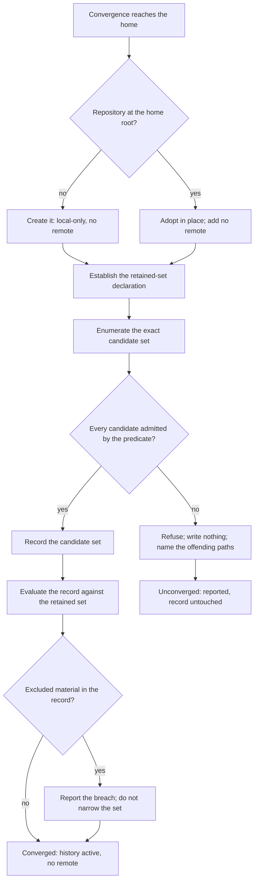

# Home Repository — Design

## Required reads

- @docs/project/spec/feature/reconciliation/home-repository.md

## Purpose

The home-repository contract states what the home keeps and what must never
enter its record. This design states how that contract is realized: where the
retained set is declared, how membership is evaluated authoritatively, what
stands between that evaluation and the irreversible record, and in what shape
membership is published for the commit boundary that asks it.

Its scope is the home's own history and membership. What a commit boundary does
with a membership answer belongs to the surface that asks.

The retained-set rule and the membership predicate are owned by the
reconciliation context, per `software-development/policy/domain-ownership`.
Consumers invoke the published predicate; none restates it.

## Inputs/Outputs

**Inputs**

- The home root, found by the convention in `general/design/configuration-tiers`
  — never by a filesystem scan, never by walking up for a repository.
- The home's observed version-control state: no repository, a repository whose
  record is empty, or a repository with a record.
- The **retained-set declaration**: one file at the home root naming the classes
  of material the feature contract admits.

**Outputs**

- An activated local-only history at the home root, with no remote.
- A **membership predicate**: given any path, one of exactly three results —
  `retained` (the declaration admits it), `not-retained` (it lies within the home
  and the declaration does not admit it, which includes every path beneath a
  foreign root), or `outside` (it resolves beyond the home root, which is not
  this repository's question). It answers for an arbitrary path at any time, not
  only for the tree being converged, and for a path that does not yet exist.
- A **breach report** naming material present in the record that the retained
  set excludes.
- A **refusal** when the activation this context performs would itself record a
  path the predicate does not return `retained` for.

The predicate is the published contract. `project/spec/feature/agent_runtime/sealed-commit`
consumes it as the retained set a repository's owner publishes; a repository that
publishes none is valid there, so the predicate is asked, never assumed. The
predicate reports membership and nothing more: what a consumer does with a
result — filter, refuse, or report — is that consumer's decision.

## Invariants

### The retained-set declaration is the sole authority

One file at the home root declares the retained set. No other ignore source
contributes to membership: not a per-directory ignore file deeper in the tree,
not the repository's own exclude file, not the user-global excludes file, not
patterns supplied on a command line.

### Membership evaluation is isolated from ambient sources and from index state

The predicate evaluates a path against the retained-set declaration alone. Two
isolations hold: the ambient ignore sources above contribute nothing, and a
path's tracked status confers no membership. A path already recorded is a member
only if the declaration admits it; membership and trackedness are independent
answers, and where they disagree the record is in breach.

### Activation writes only through a fail-closed validation

The activation this context performs does not record on the strength of the
declaration alone. The exact set of paths it would record is enumerated and
compared against the predicate's result for each; any path not returning
`retained` refuses that activation and writes nothing. The gate binds the write
this context owns. Every later path into the record belongs to the commit
boundary that performs it, which consults the predicate under its own contract.

### Path identity is canonical before any answer is given

The predicate resolves a path to one canonical identity before deciding:
symbolic links are resolved, relative and traversing segments are eliminated,
and equivalent spellings reach the same answer. A path that resolves beyond the home
root returns `outside` rather than `not-retained`, because the home has no
standing to answer for it. A path that does not exist is answered from its
canonical form, so a prospective write can be tested before it happens. An
identity that cannot be resolved returns `not-retained`, per
`software-development/policy/security-awareness`.

### No remote is configured, and none is implied

The history is rollback, never resilience. No surface presents it otherwise.

### A foreign nested root is outside the retained set

A root inside the home belonging to another owner is not part of the home's
retained set: the predicate returns `not-retained` for every path beneath it, and
activation records no such root.

### Membership answers paths, never bytes

The predicate decides whether a path belongs to the retained set. It does not
examine what any version of that path contains.

### Breach detection reads the record

A breach is established against the history rather than the working tree, and it
is reported. It is never resolved by narrowing the retained set.

### Activation converges from any of the three observed states

Re-running activation neither widens the retained set nor introduces a remote,
from an unversioned home, from a repository whose record is empty, or from one
with a record. Detection tests the home root itself and never walks upward.

## Primary flows

**Activation**

Two orderings are contractual: the declaration precedes enumeration, and the
validation gate `G` precedes the write this flow performs.

**Membership query**

A consumer supplies a path. The predicate canonicalizes it, returns `outside`
where it resolves beyond the home root, `not-retained` where it resolves beneath
a foreign root, and otherwise the result the retained-set declaration alone
gives. The answer never depends on a convergence run, on tracked status, or on
content, and it carries no instruction: the consumer decides what its own
contract does with the result.

**Placement**

The declaration, the predicate, and activation's validation gate are core
decisions inside the reconciliation context. Git mechanics execute through the sanctioned
seam in `teleclaude.git`, which resolves the real binary rather than the agent
wrapper. Enumeration and membership use git plumbing, whose documented contract
is to read exclusion patterns only from what it is given, rather than porcelain,
which composes the ambient sources. The installation-convergence entrypoint
translates a run into a call on that core and decides nothing itself, per the
layer direction in `software-development/principle/architectural-defaults`.

## Failure modes

- **Treating the ignore expression as the boundary.** It describes the retained
  set and does not enforce it: a deeper per-directory ignore file outranks the
  root declaration and can re-admit an excluded path, and ignore rules do not
  reach a path that is already tracked. Without the validation gate, the
  candidate set can differ from the retained set at the one moment that cannot
  be undone.
- **Evaluating membership through porcelain.** Porcelain composes the ambient
  ignore sources, so its answer moves with per-directory files, the repository
  exclude file, and the user-global excludes file. Membership evaluated that way
  is a different question from the one the declaration asks.
- **Answering on a caller's spelling.** Two spellings of one path, or an alias
  through a symbolic link, otherwise receive different ownership answers, which
  makes a boundary decision depend on how it was asked.
- **Reusing project provisioning.** Project setup unions patterns into an
  existing exclusion file and defaults to tracking. That default is correct for
  a project and inverted for the home.
- **Recording before validating.** The record permanently holds what the
  retained set excludes; a later change to the declaration changes what is
  tracked, never what is recorded.
- **Detecting the repository by searching parent directories.** A home beneath
  any repository is then read as already versioned, and activation adopts a
  repository that is not the home's.
- **Treating a breach as a declaration defect.** Excluding the offending path
  makes the working tree look correct while the record still holds the material,
  and removes the only signal that it does.
- **Deciding the consumer's action.** Publishing membership and also dictating
  whether a later commit filters or refuses places one rule in two contexts; the
  commit boundary owns what it does with the answer.
- **Presenting local history as backup.** The home has no remote by decision.

## See Also

- docs/project/spec/domain/reconciliation.md — the context that owns the retained-set rule.
- ~/.teleclaude/docs/general/design/configuration-tiers.md — how the home root is found, and why git plays no part in finding configuration.
- docs/project/spec/feature/agent_runtime/sealed-commit.md — the commit boundary that consumes the published membership answer.
