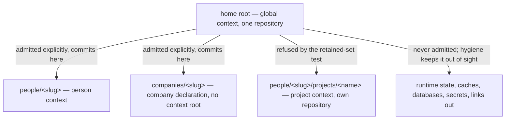

# Home Repository — Design

## Required reads

- @docs/project/spec/feature/reconciliation/home-repository.md
- @docs/project/spec/feature/config/tier-permissions.md
- @docs/project/spec/domain/reconciliation.md

## Purpose

The TeleClaude home holds the durable state of every person and company an
installation serves and versions none of it. Making it one repository is the
approved outcome (`@prd#authorized-horizon`); this design states the shape that
outcome takes once several context roots share one history, and answers the
three questions that shape raises: what reaches history and what keeps it out
(`@prd#success-criteria` SC-1 through SC-4), how a commit taken in one context
root avoids carrying another's work (SC-5 through SC-7), and what a person's own
project is when it sits inside that tree (SC-10, SC-11).

It owns the relationship among the participating contexts and nothing else.
Retained-content eligibility resolves to `reconciliation`, which owns both the
decision and its source of truth; the tier permission answer and the schemas
carrying every declaration resolve to `config`; the person-to-registry binding to
`identity`; the commit surface to `agent_runtime`.
The context-root walk and the project shared-state resolver are consumed from
`config` and `workflow` as published contracts.

## Inputs/Outputs

- **Inputs:** the home directory and its contents; the tier registries that
  define where the home's own configuration, persons, and companies live, and
  the project manifest (`teleclaude/project_manifest.py`) for registered project
  roots; the declared tier at a context root; the repository's tracked set and
  dirty paths.
- **Outputs:** a repository at the home whose tracked set contains only
  explicitly admitted material; a commit scoped to one context root's subtree; a
  permission answer per declared tier; a validated person-to-registry binding or
  a refusal; a breach report over already-tracked content.

## Invariants

### Retained-content eligibility has one owner

Whether a path may enter the home's history is one decision with one owner:
`reconciliation`. It is an installation-state question — what belongs in this
machine's durable home — which is the comparison reconciliation already owns.
The other contexts consume its answer and restate nothing:

| Context          | Role                                                                                                                                           |
| ---------------- | ---------------------------------------------------------------------------------------------------------------------------------------------- |
| `reconciliation` | **Owns** the decision and its source of truth: the admitted-path record, the eligibility query over it, and the convergence that maintains it. |
| `config`         | Owns only the schemas it already owns. It gains no retained-content declaration.                                                               |
| `agent_runtime`  | Consumes the eligibility answer at commit construction and refuses a path the owner rejects. It never defaults or reinterprets the rule.       |

The published contract answers two questions that must not be collapsed, because
collapsing them makes admission circular — a new path could never be admitted,
since it is by definition absent from the record:

- **Admissible?** A structural and security test on a path, independent of the
  record: it resolves inside the home, no component escapes it, no symlink in it
  points outward, and it lies under no root carrying its own repository. A
  brand-new path is answerable here.
- **Admitted?** Membership in the admitted-path record.

Admission is the transition between them, and it is atomic: an explicitly named
path is tested for admissibility, recorded on success, and only then does the
commit boundary consume the updated membership answer. A failed test records
nothing. One owner holds both questions and the transition; consumers ask, and
supply a default for neither.

### What reaches history is decided by admission, not by exclusion

Nothing enters the home's history except by an act that names it and is
recorded. Two acts admit, and there are no others:

- **First activation admits what is already there, path by path, by explicit
  selection.** Convergence enumerates every candidate under the tier roots the
  registries name and reports each one's admissibility, but admits nothing on its
  own: the operator names the exact paths to admit, and only those are tested and
  recorded. No classifier decides which existing files are "authored" or "safe",
  because none could be trusted with the consequence — the operator is the
  judgment at adoption, which is the model the surveyed prior art uses.

  This is what makes activation over a populated home fail closed
  (`@prd#success-criteria` SC-2, SC-3), and the reason is selection rather than
  refusal: a credential file under a tier root stays out because nobody named it,
  not because a rule anticipated it. Unselected is unadmitted, with no appeal to
  the hygiene rules, which are never the selector.

- **Afterwards, the ordinary commit act admits.** The sealed commit surface
  already requires an explicit declaration for a new untracked file
  (`project/spec/feature/agent_runtime/sealed-commit`), and that declaration
  extends the admitted-path record once the eligibility query accepts it.

Refusal is definite regardless of confirmation: a path that resolves outside the
home, a symlink whose target leaves the home, and any path under a root carrying
its own repository are refused and cannot be confirmed into the record.

Exclusion rules remain, demoted to what they are: hygiene generated from the
tier registries that keeps untracked runtime state, caches, databases, and links
out of status output and out of a careless broad add. They are not the boundary
and nothing in this design leans on them as one.

Already-tracked content is a separate problem with a separate answer. Ignore
rules provably cannot reach it, so the breach report (`@prd#success-criteria`
SC-4) is produced by testing the _tracked_ set against the eligibility query and
reporting what fails — never by adding an exclusion and calling it resolved.

#### Prior art and adopt-vs-build

The mechanism above is adopted, not invented. The alternative considered and
rejected was a generated exclusion artifact standing as the containment boundary
for secrets and foreign repositories.

- **Vendor documentation (Git).** The gitignore specification states that a
  gitignore file "specifies intentionally untracked files that Git should
  ignore" and that "Files already tracked by Git are not affected," and that
  "It is not possible to re-include a file if a parent directory of that file is
  excluded." Both sentences disqualify exclusion rules as a containment
  boundary: they do not reach what is already tracked, and re-including a
  directory to retain its authored content necessarily readmits everything
  beneath it, so classification below a retained root degrades to an
  enumeration of known hazards.
- **Reference implementation (chezmoi).** A home-directory manager whose source
  state is populated only by an explicit add, so a file in the home is outside
  version control until someone names it. Secrets are handled by encryption
  (age, GnuPG) or by retrieval from an external secret manager at render time —
  not by ignore rules.
- **Comparable production architecture (yadm).** The same problem, the same
  answer: a git-based home-directory manager whose private-data story is
  encryption and git-crypt integration rather than exclusion.

Both surveyed tools solve exactly this problem — versioning a home directory
that also contains secrets — and neither treats exclusion as the boundary. The
decision is therefore **adopt**: the admission model is the boundary, the
existing sealed-commit pathspec is where it is enforced, and exclusion rules are
kept only for hygiene. Encryption of secrets that must themselves be versioned
is deliberately not adopted here: no approved outcome requires versioning a
secret, and the backup design that might is a triggered deferral
(`@prd#risks-deferrals-and-open-decisions`).

### Isolation between context roots is containment over a preserved two-root coordinate

A commit taken in one context root carries only paths inside that root's
subtree. Containment is decided from the filesystem and holds regardless of how
the acting session's path set was derived.

The missing seam is not upward repository discovery. `resolve_git_root`
(`teleclaude/project_root.py`) already walks ancestors for a checkout root. The
defect is that callers collapse the two roots into one: the code surface passes
the resolved _git_ root as the project root to permission and scope resolution
(`teleclaude/cli/telec/handlers/code.py`), and workspace scoping then joins
repository-relative status paths onto that same root
(`teleclaude/quality/scope.py`). Where context root and repository root coincide
the collapse is invisible; where they differ, the context root is the coordinate
that is lost.

So the resolution result carries **both** roots, and each consumer receives the
one its question needs: the declared context root answers which tier governs,
what the permission question is asked about, which subtree bounds the commit,
and what paths are displayed; the repository root answers where git runs and how
git's own output is expressed. Conversion between the two coordinates happens
once, at that boundary, rather than being re-derived by each caller.

This is deliberate and it is a correction. The existing scope resolution
intersects a transcript-derived path set with the dirty set, and that path set is
not a statement of what the session modified: for one agent runtime it is
dominated by a vendor-owned file-history structure whose membership rule
TeleClaude neither owns nor can narrow, and its shell-derived component
classifies free-text command text by pattern. Isolation resting on that set
rests on someone else's data structure.

**Containment carries most of `@prd#success-criteria` SC-6, and a consumed
contract carries the rest.** Containment separates _different_ context roots —
every case SC-6 enumerates, since global, a company, another person, and a
foreign nested root are each a different root. It cannot separate two sessions
editing the same path inside one root: that needs to know which live session
claims a dirty path, which is dirty-path ownership attribution, owned by the
commit surface and delivered by `telec-code-dirty-path-owners`.

That work is a **blocking dependency** of this one rather than a hope. SC-6 is an
approved outcome, and neither narrowing it here nor absorbing another context's
mechanism is available: architecture may not shrink what the product intent
already accepted, and ownership does not transfer to whoever noticed the gap.

**The contract consumed** is a per-path query over live sessions in the
repository, returning the earliest still-uncommitted live claimant of a dirty
path, or none. The commit boundary asks it for every path in the pathspec; a
claimant that is not the committing session is an overlap, and the commit fails
naming the path and the claimant rather than combining two sessions' work. A
committed claim is cleared, so a path nobody currently claims commits normally.

**A known imprecision travels with it**, and the plan must see it rather than
discover it: that query is computed from the same transcript-derived attribution
whose read-is-a-touch weakness this design documents, so a session that merely
read a dirty path can be reported as its claimant and refuse an otherwise valid
commit. That failure direction is safe — it refuses rather than silently
combining, which is what SC-6 asks for — but it is a usability cost owned by the
attribution contract and not corrected here.

### Location grants nothing, and ownership is a closed declaration

A tier's permissions follow from its declaration, and the three axes —
invocation context, surface participation, project subscriptions — are answered
independently (`project/spec/feature/config/tier-permissions`). A project inside
a person's space is an ordinary project on every axis.

**Whom a project belongs to is one optional declaration that names exactly one
owner when present.** Today the project model carries an optional company slug,
and a project under no company is valid — a contract this delivery preserves,
because no approved outcome changes it. Adding a second optional person field
beside it would make two simultaneous owners representable, which is the illegal
state to design out. So the two collapse into one optional declared relationship
that names its kind:

| Current shape      | Migrated shape                                          | Resulting invariant                                                          |
| ------------------ | ------------------------------------------------------- | ---------------------------------------------------------------------------- |
| A declared company | An owner declaration of kind company carrying that slug | Behavior unchanged for every existing company-owned project                  |
| No company         | No owner declaration                                    | Ownerless projects stay representable and compose no company, exactly as now |
| —                  | An owner declaration of kind person                     | The person-owned case this delivery adds                                     |

Absent means ownerless; present means exactly one owner of one kind, so two
owners are unrepresentable rather than merely forbidden. The old field is removed
rather than kept beside the new one
(`software-development/policy/backward-compatibility-hygiene`: owned
configuration migrates forward, never branches), and its four current consumers —
the context selector's company resolution, the app-config company composition and
its unresolved-company warning, and the hook receiver's company lookup — read the
migrated shape.

Registration validates the declaration: a person-owned project's declared owner
is checked against the person registry through `identity`, never inferred from
the directory containing it. Caller identity is resolved by `identity`
independently of the enclosing context.

The sublocation is `people/<slug>/projects/<name>/` — the sibling convention to
the tier directories the registries already name — and the project is created
and registered through the existing project-initialization surface operating at
that path, which writes the owner declaration and registers the root in the
project manifest like any other project. No new discovery mechanism appears.

### Person-scoped authority requires a validated binding

A person root's declaration says what the file is; the tier declaration
supplied upstream carries the tier and nothing else. **Which person the root
belongs to is a separate typed claim**, and it does not exist today: the person
configuration model carries credentials, settings, and memberships but no
identity of its own. So the person configuration gains one declared, validated
claim naming the person the root belongs to — owned by `config` as the schema
owner, alongside the tier declaration and acquired by existing overlays through
the same advancement the tier declaration already uses, so no second migration
mechanism appears. A newly created person overlay is written carrying it.

`identity` (`teleclaude/core/identity.py`) then compares that claim against the
canonical person registry before any person-scoped visibility or write authority
follows. An unknown, ambiguous, or disagreeing claim fails closed
(`project/spec/feature/identity/person-context-binding`). The claim is a
statement in a file and never authenticates a caller.

## Primary flows

**Activating and converging the home.** Convergence compares the home's declared
state against what is observed and brings the repository to it: initializing the
history when absent, regenerating the hygiene rules from the tier registries,
and testing the tracked set against the retained-set test to report breaches. It
configures no remote. It is idempotent because it compares against a derived
target rather than accumulating edits.

Its activation surface is a CLI verb in a new `telec home` namespace, authored
per `software-development/procedure/cli-command-authoring`. One action converges
the home, and its contract is:

- **Invocation** — `telec home converge`, idempotent and safe to repeat. Bare, it
  admits nothing: it reports the proposal and exits, so a populated home can be
  read before anything is recorded. `telec home converge --admit <path>...`
  admits exactly the named paths and no others, mirroring the explicit per-path
  declaration the commit surface already requires for a new file.
- **Result** — three sets: the paths admitted or already admitted; the paths
  refused, each with the reason it failed the eligibility query; and the breach
  set, being tracked paths the query rejects. An empty breach set is the healthy
  outcome; a non-empty one is reported, never silently narrowed away.
- **Effects** — initializes the history when absent, writes confirmed
  admissions into the admitted-path record, regenerates the hygiene rules from
  the tier registries, and configures no remote under any invocation.

The installer invokes the same verb, so a machine converges through one code
path. A CLI surface is required rather than installer-only execution because the
outcome must be inspectable and repeatable on demand
(`software-development/principle/architectural-defaults`, CLI-first agency).

**Committing from a person context.** The commit surface resolves both roots,
expresses the repository's dirty paths in context-root coordinates, restricts
the pathspec to that root's subtree, and applies the retained-set test to every
admitted path. Paths belonging to another person, a company, the home's own
files, or a nested project are absent by construction. The eligible delta shown
before committing is rendered from the same scoped set, so what an agent
inspects is what a commit would carry.

**Answering the permission question.** The caller asks about a root; dispatch
reads that root's declared tier and answers the three axes for it. No tier falls
through to project defaults, and the question does not fail for a tier that is
not a project.

**Creating a project inside a personal space.** The project is created at the
sublocation above, registers in the project manifest, declares its person owner
in its own configuration, and that declaration is validated against the person
registry. Its own repository holds its history; the home's hygiene rules exclude
its path and the retained-set test refuses it, so the home neither versions its
contents nor records a reference to it.

### Affected surfaces, per unit

Verified against source; the blast-radius query over these anchors reports a
broad transitive radius, so the bounded consumer selection below is what a plan
works from rather than the raw dependent set.

| Unit                       | Adapted                                                                                                                                                                                          | Reused unchanged                                                               | Explicit non-consumers                                                        |
| -------------------------- | ------------------------------------------------------------------------------------------------------------------------------------------------------------------------------------------------ | ------------------------------------------------------------------------------ | ----------------------------------------------------------------------------- |
| Tier-dispatched permission | `teleclaude/capabilities.py` and its five call sites: the sync entry points, the code-surface capability gate, the checkpoint hook's capability state, and the project-init flow                 | The project subscription semantics and their derivation rules                  | Every project-only path stays on today's answer; no project changes behavior  |
| Person claim and binding   | `teleclaude/config/schema.py` person model and its schema export; `teleclaude/core/identity.py` for the registry comparison                                                                      | The person registry and slug validation, which already exist and are canonical | Credential, notification, and subscription fields on the person model         |
| Two-root resolution        | `teleclaude/project_root.py` result shape; `teleclaude/cli/telec/handlers/code.py` capability and scope call sites; `teleclaude/quality/scope.py` dirty-path anchoring and pathspec construction | `resolve_git_root`'s ancestor walk, which already does the discovery           | Worktree shared-state resolution, owned by the workflow context and untouched |
| Admission and hygiene      | The commit pathspec construction in the code surface; the reconciliation-owned admitted-path record and eligibility query                                                                        | The sealed commit surface's existing explicit-declaration act for new files    | The project capability manifest and its toggles                               |
| Home convergence           | A new `telec home` surface registered in the CLI surface table; the installer entry point                                                                                                        | The tier registries and project manifest as read-only inputs                   | Project-scoped initialization, which keeps its own flow                       |
| Person-owned project       | `teleclaude/config/schema.py` project owner declaration and its four company consumers; the project-initialization flow                                                                          | The project manifest's root registration                                       | Company composition semantics, which the migration preserves                  |

**Blind spot recorded:** the blast-radius graph does not model configuration-key
consumers reached through dynamic attribute access, so the owner-declaration
migration's consumer set above was established by direct source search rather
than by the graph alone.

### Decomposition

1. **Tier-dispatched permission** — answer the three axes from the declared tier
   for every tier; stop interpreting non-project overlays as project overlays.
2. **Person claim and registry binding** — the typed claim in the person schema
   and its validation at the identity boundary, failing closed.
3. **Two-root resolution** — carry the context root beside the repository root
   and route each consumer to the coordinate its question needs. This is the
   containment property the isolation invariant rests on.
4. **Admission** — the reconciliation-owned record and eligibility query, and
   its enforcement in the commit pathspec.
5. **Home convergence** — the CLI action and its result contract, hygiene
   generation, and the breach report.
6. **Person-owned project** — the closed owner declaration, its forward
   migration, and creation at the sublocation through the existing project
   initialization surface.

Unit 3 is what makes units 4, 5, and 6 safe to exercise; unit 1 gates whether
the commit surface may run in a person context at all.

## Failure modes

- **Treating exclusion rules as the boundary.** They do not reach tracked
  content and cannot classify below a re-included directory. A design that
  relies on them reports safety it does not have; admission is the boundary and
  the rules are hygiene.
- **The dangling reference trap.** A repository nested inside another is not
  descended into, but it is still offered as an untracked directory: a broad add
  either refuses it or records a reference the outer repository cannot resolve.
  Excluding and refusing its path is required, not tidy.
- **Attribution inside one context root.** Containment separates different
  roots; it does not separate two sessions editing the same path in the same
  root. That remains governed by the commit surface's attribution contract,
  whose precision is a known weakness. Treating containment as its fix would be
  a false guarantee.
- **A hazard reaching history once.** History retains what it recorded.
  Excluding material afterwards does not unrecord it, so convergence reports the
  breach rather than narrowing future retention and calling it fixed.
- **Hand-editing the generated hygiene rules.** An edit survives until the next
  convergence and then vanishes. Hazards are expressed where the generator reads
  them.
- **Assuming the home root is a project.** It carries the global declaration;
  treating it as a project root yields either a validation failure or fabricated
  subscriptions. Tier-dispatched permission is what prevents it.

## See Also

- ~/.teleclaude/docs/general/design/configuration-tiers.md — the tier model this shape realizes.
- docs/project/design/architecture/config-tier-resolution.md — the context-root and project shared-state resolvers consumed here.
