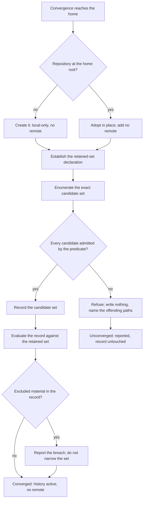

# Home Repository — Design

## Required reads

- @docs/project/spec/feature/reconciliation/home-repository.md

## Purpose

The home-repository contract states what the home keeps and what must never
enter its record. This design states how that contract is realized: where the
retained set is declared, how membership is evaluated authoritatively, what
stands between that evaluation and the irreversible record, and in what shape
membership is published for the commit boundary that asks it.

Its scope is the home's own history and membership. What a commit boundary does
with a membership answer belongs to the surface that asks.

The retained-set rule and the membership predicate are owned by the
reconciliation context, per `sdlc/policy/domain-ownership`.
Consumers invoke the published predicate; none restates it.

## Inputs/Outputs

**Inputs**

- The home root, found by the convention in `general/design/configuration-tiers`
  — never by a filesystem scan, never by walking up for a repository.
- The home's observed version-control state: no repository, a repository whose
  record is empty, or a repository with a record.
- The **retained-set declaration**: one file at the home root naming the classes
  of material the feature contract admits.

**Outputs**

- An activated local-only history at the home root, with no remote.
- A **membership predicate**: given any path, one of exactly three results.
  `retained` requires both that the declaration admits the path and that, where
  the path exists, its kind is one the home retains — declaration admission is
  necessary, never sufficient. `not-retained` covers a path within the home that
  the declaration excludes, every path beneath a foreign root, and any existing
  path whose kind the home does not retain even where the declaration admits it.
  `outside` covers a path resolving beyond the home root, which is not this
  repository's question. It answers for an arbitrary path at any time, not only
  for the tree being converged, and for a path that does not yet exist.
- A **breach report** naming material present in the record that the retained
  set excludes.
- A **refusal** when the activation this context performs would itself record a
  path the predicate does not return `retained` for.

The predicate is the published contract. `project/spec/feature/agent_runtime/sealed-commit`
consumes it as the retained set a repository's owner publishes; a repository that
publishes none is valid there, so the predicate is asked, never assumed. The
predicate reports membership and nothing more: what a consumer does with a
result — filter, refuse, or report — is that consumer's decision.

## Invariants

### The retained-set declaration is the sole authority

One file at the home root declares the retained set. No other ignore source
contributes to membership: not a per-directory ignore file deeper in the tree,
not the repository's own exclude file, not the user-global excludes file, not
patterns supplied on a command line.

### Membership evaluation is isolated from ambient sources and from index state

The predicate evaluates a path against the retained-set declaration and, where
the path exists, its kind — and against nothing else. Two isolations hold: the ambient ignore sources above contribute nothing, and a
path's tracked status confers no membership. A path already recorded is a member
only if the predicate returns `retained` for it; membership and trackedness are
independent answers, and where they disagree the record is in breach.

The declaration decides by path, and a path is not the only thing the record
holds. Where the path exists, its **kind** is read as a second, equally isolated
input: a symbolic link is never `retained`, whatever the declaration says about
the path it occupies. Kind is a property of the path itself rather than an
ignore source, so consulting it preserves both isolations.

### Activation writes only through a fail-closed validation

The activation this context performs does not record on the strength of the
declaration alone. The exact set of paths it would record is enumerated and
compared against the predicate's result for each; any path not returning
`retained` refuses that activation and writes nothing. The gate binds the write
this context owns. Every later path into the record belongs to the commit
boundary that performs it, which consults the predicate under its own contract.

### Path identity is canonical before any answer is given

The predicate reduces a path to one canonical identity before deciding.
Traversing and relative segments are eliminated, and symbolic links among a
path's **ancestor directories** are resolved, so no alias presents a path as
inside the home that is not — or as outside one that is. Equivalent spellings
reach the same answer.

The **final component is never dereferenced**. A symbolic link is a membership
question about the link, not about what it points at, because that is what the
record holds: a link enters history as its target path, never as the target's
content. A link inside the home is therefore governed by the home even when it
points beyond it.

Reading the final component's kind is not dereferencing it: the link's target is
never opened, resolved, or consulted, and the answer never depends on what lies
at the far end.

`outside` is returned when the resolved ancestor chain leaves the home root, and
only then. A path that does not exist is answered from the declaration alone, and
that answer is the one for a regular file or directory created there; the same
path later created as a symbolic link is `not-retained`. So a prospective write
can be tested before it happens, and the test states the condition it assumes. An
identity that cannot be reduced returns `not-retained`, per
`sdlc/policy/security-awareness`.

### No remote is configured, and none is implied

The history is rollback, never resilience. No surface presents it otherwise.

### A foreign nested root is outside the retained set

A root inside the home belonging to another owner is not part of the home's
retained set: the predicate returns `not-retained` for every path beneath it, and
activation records no such root.

### Membership answers paths, never bytes

The predicate decides whether a path belongs to the retained set. It does not
examine what any version of that path contains.

### Breach detection reads the record

A breach is established against the history rather than the working tree, and it
is reported. It is never resolved by narrowing the retained set.

### Activation converges from any of the three observed states

Re-running activation neither widens the retained set nor introduces a remote,
from an unversioned home, from a repository whose record is empty, or from one
with a record. Detection tests the home root itself and never walks upward.

## Primary flows

**Activation**

Two orderings are contractual: the declaration precedes enumeration, and the
validation gate `G` precedes the write this flow performs.

**Membership query**

A consumer supplies a path. The predicate canonicalizes it, returns `outside`
where it resolves beyond the home root, and `not-retained` where it resolves
beneath a foreign root. Otherwise it composes the two inputs: the declaration
must admit the path, and where the path exists its kind must be one the home
retains — a disallowed kind returns `not-retained` over an admitting
declaration. A path that does not exist is answered on the declaration alone,
under the regular-file-or-directory condition stated above. The answer never depends on a convergence run, on tracked status, or on
content, and it carries no instruction: the consumer decides what its own
contract does with the result.

**Placement**

The declaration, the predicate, and activation's validation gate are core
decisions inside the reconciliation context. Git mechanics execute through the sanctioned
seam in `teleclaude.git`, which resolves the real binary rather than the agent
wrapper. Isolation is obtained structurally, never by trusting a command to
consult only what it is handed: membership is decided where no ignore source but
the declaration can exist. Enumerating what is present in the home and deciding
whether a given path belongs are separate operations, and only the second answers
for a path that does not yet exist. The installation-convergence entrypoint
translates a run into a call on that core and decides nothing itself, per the
layer direction in `sdlc/principle/architectural-defaults`.

## Failure modes

- **Treating the ignore expression as the boundary.** It describes the retained
  set and does not enforce it: a deeper per-directory ignore file outranks the
  root declaration and can re-admit an excluded path, and ignore rules do not
  reach a path that is already tracked. Without the validation gate, the
  candidate set can differ from the retained set at the one moment that cannot
  be undone.
- **Deciding membership in the home tree itself.** Any evaluation performed
  where the home's own directories are visible reads whatever ignore files sit
  along the path, so its answer moves with a per-directory file, the repository
  exclude file, or the user-global excludes file. A command flag that neutralises
  one such source does not neutralise the others, and a nested file placed later
  reopens the hole.
- **Answering membership by enumerating what exists.** Enumeration reports the
  tree's present contents, so it returns nothing for a path that does not yet
  exist and cannot answer a prospective write — the case a commit boundary asks
  about most.
- **Answering on a caller's spelling.** Two spellings of one path, or an alias
  through a symbolic link, otherwise receive different ownership answers, which
  makes a boundary decision depend on how it was asked.
- **Dereferencing the final component.** A link inside the home that points
  beyond it then reports as `outside`, and the home appears to have no standing
  over a path it both governs and records. Credential material reached through a
  link is the case that makes this concrete.
- **Deciding membership from the path string alone.** A declaration matches
  paths, and no pattern can say "unless this one is a link", so a link sitting at
  an admitted path is admitted — and a link into external material enters the
  record as a machine-local target string that restores nothing. The kind of an
  existing path is the missing input, and it is available without following the
  link.
- **Reusing project provisioning.** Project setup unions patterns into an
  existing exclusion file and defaults to tracking. That default is correct for
  a project and inverted for the home.
- **Recording before validating.** The record permanently holds what the
  retained set excludes; a later change to the declaration changes what is
  tracked, never what is recorded.
- **Detecting the repository by searching parent directories.** A home beneath
  any repository is then read as already versioned, and activation adopts a
  repository that is not the home's.
- **Treating a breach as a declaration defect.** Excluding the offending path
  makes the working tree look correct while the record still holds the material,
  and removes the only signal that it does.
- **Deciding the consumer's action.** Publishing membership and also dictating
  whether a later commit filters or refuses places one rule in two contexts; the
  commit boundary owns what it does with the answer.
- **Presenting local history as backup.** The home has no remote by decision.

## See Also

- docs/project/spec/domain/reconciliation.md — the context that owns the retained-set rule.
- ~/.teleclaude/docs/general/design/configuration-tiers.md — how the home root is found, and why git plays no part in finding configuration.
- docs/project/spec/feature/agent_runtime/sealed-commit.md — the commit boundary that consumes the published membership answer.
